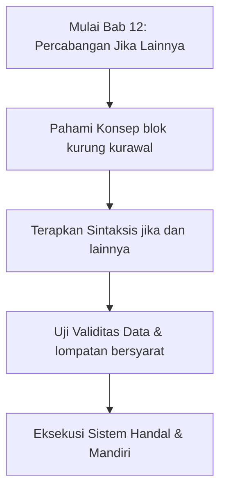
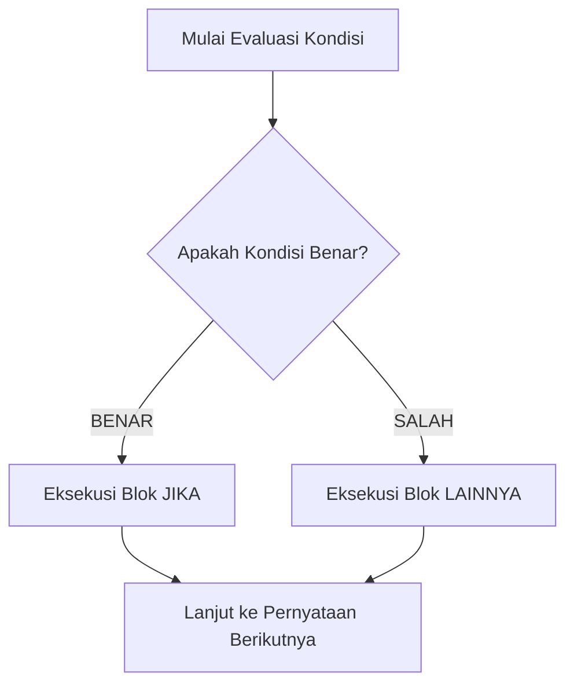

## Bab 12: Percabangan Logika Dasar: `jika` dan `lainnya`

### 12.1 Konsep Percabangan Instruksi Komputer



Dalam instruksi bahasa mesin biner, CPU secara alamiah bergerak maju dari satu alamat memori instruksi (*Instruction Pointer* / IP) ke baris instruksi berikutnya secara berurutan. Namun, pemecahan masalah dunia nyata membutuhkan fleksibilitas untuk memilih jalur alternatif.

Kemampuan memilih jalur alternatif diwujudkan melalui instruksi lompatan bersyarat (*Conditional Jump* seperti `JZ` / *Jump if Zero* atau `JNZ` / *Jump if Not Zero*). Widya-Lang mengabstraksikan instruksi lompatan tingkat rendah ini melalui struktur kendali **`jika`** dan **`lainnya`**.



### 12.2 Sintaksis Resmi `jika` dan `lainnya`
Kata kunci `jika` diikuti oleh ekspresi boolean di dalam tanda kurung `(...)`, dan blok kode instruksi diapit kurung kurawal `{}`:

```widya
jika (kondisi_boolean) {
    // Instruksi yang dieksekusi jika kondisi bernilai benar
} lainnya {
    // Instruksi alternatif jika kondisi bernilai salah
}
```

### 12.3 Contoh Kode Praktik 1: Sistem Validasi Kehadiran Karyawan
Program ini menentukan status tunjangan kehadiran berdasarkan jam kedatangan pegawai:

```widya
// Berkas: bab12_absensi_pegawai.widya

fungsi utama() {
    tetap JAM_MASUK_MAKSIMAL = 8.0; // Jam 08:00 Pagi
    tetap jam_kedatangan_staf = 8.25; // Jam 08:15 Pagi
    
    cetak("SISTEM PENCATATAN PRESENSI DIGITAL:");
    cetak("Waktu Kedatangan: Jam " + teks(jam_kedatangan_staf));
    
    jika (jam_kedatangan_staf <= JAM_MASUK_MAKSIMAL) {
        cetak("STATUS: Tepat Waktu. Berhak menerima tunjangan kehadiran 100%.");
    } lainnya {
        tetap keterlambatan_menit = (jam_kedatangan_staf - JAM_MASUK_MAKSIMAL) * 60.0;
        cetak("STATUS: Terlambat " + teks(keterlambatan_menit) + " Menit.");
        cetak("Diberikan sanksi pemotongan tunjangan presisi sesuai regulasi.");
    }
}
```

### 12.4 Contoh Kode Praktik 2: Pengendali Pintu Palang Otomatis Bendungan
Program ini mengatur pintu air bendungan irigasi berdasarkan sensor ketinggian air sungai:

```widya
// Berkas: bab12_pintu_bendungan.widya

fungsi utama() {
    tetap KETINGGIAN_SIAGA_METER = 3.5;
    tetap sensor_air_meter = 3.85;
    
    cetak("SISTEM MONITORING BENDUNGAN GADJAH MADA:");
    cetak("Level Air Terbaca : " + teks(sensor_air_meter) + " meter");
    cetak("Batas Siaga Banjir: " + teks(KETINGGIAN_SIAGA_METER) + " meter");
    
    jika (sensor_air_meter >= KETINGGIAN_SIAGA_METER) {
        cetak("STATUS: SIAGA MERAH!");
        cetak("Instruksi Motor: Buka Pintu Pelimpas Air ke Kanal Evakuasi.");
    } lainnya {
        cetak("STATUS: AMAN TERKENDALI.");
        cetak("Instruksi Motor: Pertahankan Pintu Air pada Posisi Standar.");
    }
}
```

### 12.5 Kesalahan Pemula dan Panduan Solusi
- **Menuliskan Titik Koma Setelah Kondisi `jika (...)`**:
  ```widya
  // KESALAHAN FATAL:
  jika (x > 10); {
      cetak("Ini selalu dieksekusi!");
  }
  ```
  Titik koma setelah kurung menutup ekspresi bersyarat sebelum blok dieksekusi, sehingga blok kurung kurawal akan selalu berjalan tanpa syarat.
- **Kondisi Tidak Menghasilkan Nilai Boolean**:
  Menulis `jika (100)` akan ditolak oleh kompilator Widya-Lang. Seluruh kondisi wajib menghasilkan tipe data boolean murni (`benar` atau `salah`).

### 12.6 Rangkuman Konsep Kunci Bab 12
- `jika` mengendalikan alur percabangan kode berbasis ekspresi boolean.
- `lainnya` menangani skenario alternatif penolakan.
- Kurung kurawal `{}` membatasi ruang lingkup variabel lokal percabangan.

### 12.7 Latihan Mandiri & Evaluasi Pemahaman
1. Bagaimana prosesor mengeksekusi instruksi percabangan bersyarat melalui register bendera?
2. Mengapa blok `lainnya` tidak memerlukan tanda kurung kondisi `(...)`?
3. **Tantangan Praktik**: Buatlah program `pemeriksa_diskon.widya` yang memberikan diskon belanja 10% jika nilai belanja pelanggan melampaui Rp 200.000, lalu cetak total bayar akhirnya!

---

### 12.9 Latihan Soal Pilihan Ganda (10 Soal)

Pilihlah satu jawaban yang paling tepat (A, B, C, atau D) untuk menguji penguasaan materi bab ini:

**1. Apa fokus utama pembahasan dalam Bab 12 (Percabangan Jika Lainnya)?**
- A. Membahas secara mendalam Alur seleksi kondisi
- B. Mengonfigurasi kabel jaringan lokal
- C. Memperbaiki motherboard komputer
- D. Menghapus database peladen

**2. Manakah kata kunci atau sintaksis yang menjadi inti materi bab ini?**
- A. Kata kunci `jika dan lainnya`
- B. perintah format disk
- C. bahasa assembly x86
- D. tag HTML

**3. Mengapa konsep blok kurung kurawal sangat penting dalam rekayasa perangkat lunak modern?**
- A. Menjamin efisiensi komputasi dan keterbacaan kode secara modular
- B. Hanya formalitas akademis
- C. Agar program berjalan lambat
- D. Mengurangi resolusi layar

**4. Dalam pengolahan data, bagaimana lompatan bersyarat memengaruhi performa memori?**
- A. Mengoptimalkan struktur alokasi data di RAM secara efisien
- B. Membuat memori penuh seketika
- C. Menghapus seluruh file disk
- D. Menghentikan kipas prosesor

**5. Manakah best practice yang dianjurkan dalam menerapkan materi Bab 12?**
- A. Menerapkan validasi data dan isolasi ruang lingkup yang bersih
- B. Menulis seluruh kode dalam satu baris panjang
- C. Mengabaikan penanganan kesalahan
- D. Menggunakan variabel global sembarangan

**6. Apa risiko yang timbul jika pemrogram mengabaikan kaidah blok kurung kurawal?**
- A. Munculnya kutu logika atau kerentanan runtime saat data ekstrem masuk
- B. Komputer langsung terbakar
- C. Kecepatan internet naik dua kali lipat
- D. Keyboard tidak berfungsi

**7. Bagaimana kompilator Widya-Lang memproses instruksi yang berkaitan dengan jika dan lainnya?**
- A. Divalidasi pada tahap analisis semantik dan diterjemahkan ke instruksi biner native
- B. Dikirimkan ke cloud pihak ketiga
- C. Diterjemahkan baris per baris secara lambat
- D. Diabaikan seluruhnya

**8. Di lingkungan industri, penerapan modul Bab 12 lazim ditemukan pada...**
- A. Sistem perbankan, backend peladen, aplikasi sains data, dan otomatisasi bisnis
- B. Hanya pada kalkulator saku sederhana
- C. Hanya pada game lawas 8-bit
- D. Tidak pernah digunakan di industri

**9. Fungsi pendukung apa yang paling sering dikombinasikan dengan materi bab ini?**
- A. Fungsi bawaan `cetak()`, `teks()`, atau asersi pengujian `pastikan()`
- B. Perintah mematikan komputer
- C. Fungsi memutar musik
- D. Fungsi mencetak kertas printer

**10. Setelah menuntaskan Bab 12, kompetensi apa yang diharapkan dikuasai oleh pembaca?**
- A. Mampu merancang, mengimplementasikan, dan menguji solusi berbasis Alur seleksi kondisi secara mandiri
- B. Mampu merakit kabel listrik tegangan tinggi
- C. Mampu mendesain grafis vektor 3D
- D. Mampu memasang antena radio
