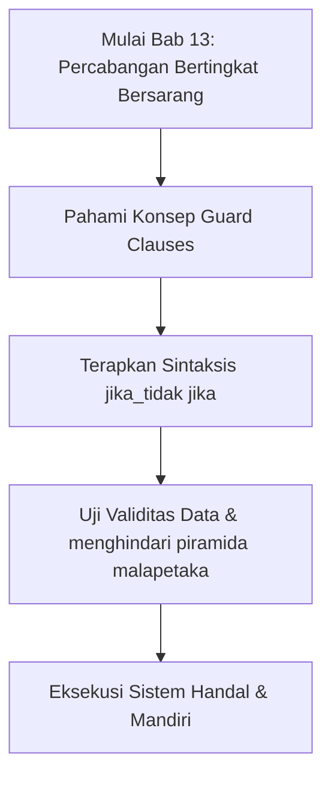

## Bab 13: Percabangan Bertingkat dan Bersarang

### 13.1 Struktur Rantai Multi-Kondisi `jika_tidak jika`



Dalam skenario komputasi yang memiliki banyak klasifikasi (seperti kategori usia, tingkatan tarif pajak, atau golongan jabatan), satu pasang `jika-lainnya` tidak mencukupi. Widya-Lang menyediakan kata kunci **`jika_tidak jika`** untuk membentuk rantai evaluasi berjenjang yang diperiksa berurutan dari atas ke bawah.

Begitu satu kondisi dalam rantai bernilai `benar`, blok kodenya akan dieksekusi dan seluruh sisa rantai percabangan di bawahnya akan **diabaikan secara instan**.

```widya
fungsi utama() {
    tetap nilai_siswa = 84;
    variabel predikat = "";
    
    jika (nilai_siswa >= 90) {
        predikat = "A (Istimewa)";
    } jika_tidak jika (nilai_siswa >= 80) {
        predikat = "B (Baik)";
    } jika_tidak jika (nilai_siswa >= 70) {
        predikat = "C (Cukup)";
    } jika_tidak jika (nilai_siswa >= 60) {
        predikat = "D (Kurang)";
    } lainnya {
        predikat = "E (Gagal)";
    }
    
    cetak("Predikat Kelulusan: " + predikat);
}
```

### 13.2 Menghindari Piramida Malapetaka (*Pyramid of Doom*)
Percabangan bersarang (*nested if*) yang memiliki kedalaman lebih dari 3 tingkat kurung kurawal membuat kode sulit dipahami dan rawan kutu logika. Para rekayasawan perangkat lunak profesional mengatasinya menggunakan teknik **Pola Penjaga (*Guard Clauses*)** dengan keluar lebih awal (*early return*):

```widya
// PENDEKATAN BERSIH DENGAN GUARD CLAUSES
fungsi proses_tarik_tunai(saldo, nominal_tarik, kartu_aktif) {
    // Penjaga 1: Validasi Keaktifan Kartu
    jika (bukan kartu_aktif) {
        cetak("DITOLAK: Kartu rekening tidak aktif!");
        kembalikan;
    }
    
    // Penjaga 2: Validasi Nominal Sah
    jika (nominal_tarik <= 0) {
        cetak("DITOLAK: Nominal penarikan harus lebih dari 0!");
        kembalikan;
    }
    
    // Penjaga 3: Validasi Kecukupan Saldo
    jika (nominal_tarik > saldo) {
        cetak("DITOLAK: Saldo rekening tidak mencukupi!");
        kembalikan;
    }
    
    // Jalur Bahagia (Happy Path) dieksekusi dengan bersih tanpa lekukan kurung kurawal
    tetap sisa_saldo = saldo - nominal_tarik;
    cetak("SUKSES: Penarikan Rp " + teks(nominal_tarik) + " berhasil disetujui.");
    cetak("Sisa Saldo Rekening: Rp " + teks(sisa_saldo));
}
```

### 13.3 Contoh Kode Praktik: Penetapan Tarif Progresif Pajak Penghasilan (PPh 21)
Program ini menghitung besaran pajak penghasilan tahunan wajib pajak berdasarkan lapisan penghasilan kena pajak (PKP) resmi:

```widya
// Berkas: bab13_pajak_progresif.widya

fungsi utama() {
    tetap pkp_tahunan = 120000000.0; // Rp 120 Juta
    variabel total_pajak = 0.0;
    
    cetak("PENGHITUNGAN PPH 21 TAHUNAN:");
    cetak("Penghasilan Kena Pajak: Rp " + teks(pkp_tahunan));
    
    jika (pkp_tahunan <= 60000000.0) {
        // Lapisan 1: 5% untuk 0 s.d. 60 Juta
        total_pajak = pkp_tahunan * 0.05;
    } jika_tidak jika (pkp_tahunan <= 250000000.0) {
        // Lapisan 1 penuh (3 Juta) + 15% dari sisa di atas 60 Juta
        tetap pajak_lapisan_1 = 60000000.0 * 0.05;
        tetap sisa_lapisan_2 = pkp_tahunan - 60000000.0;
        tetap pajak_lapisan_2 = sisa_lapisan_2 * 0.15;
        total_pajak = pajak_lapisan_1 + pajak_lapisan_2;
    } lainnya {
        // Lapisan 3 untuk di atas 250 Juta
        total_pajak = 31500000.0 + ((pkp_tahunan - 250000000.0) * 0.25);
    }
    
    cetak("-----------------------------------");
    cetak("Pajak Terutang Tahunan: Rp " + teks(total_pajak));
}
```

### 13.4 Kesalahan Pemula dan Panduan Solusi
- **Urutan Kondisi yang Terbalik**:
  Jika Anda menguji `jika (nilai >= 60)` sebelum `jika (nilai >= 90)`, maka siswa bernilai 95 akan masuk ke kategori pertama (>= 60) dan tidak pernah mencapai kategori 90. Selalu urutkan dari kondisi paling ketat ke paling longgar!

### 13.5 Rangkuman Konsep Kunci Bab 13
- `jika_tidak jika` mengevaluasi kondisi diskrit berjenjang secara berurutan.
- Pola *Guard Clauses* meratakan lekukan kode yang terlalu dalam menjadi alur linier yang mudah dirawat.

### 13.6 Latihan Mandiri & Evaluasi Pemahaman
1. Mengapa urutan evaluasi kondisi dalam rantai `jika_tidak jika` sangat menentukan keabsahan keluaran?
2. Bagaimana cara merefaktor kode percabangan bertingkat 4 tingkat menjadi kode bersih berbasis *Guard Clauses*?
3. **Tantangan Praktik**: Rancanglah simulator sistem parkir kendaraan yang menghitung biaya: motor (Rp 2.000/jam pertama, Rp 1.000/jam berikutnya), mobil (Rp 5.000/jam pertama, Rp 3.000/jam berikutnya), dan bus (Rp 10.000/jam pertama, Rp 7.000/jam berikutnya)!

---

### 13.9 Latihan Soal Pilihan Ganda (10 Soal)

Pilihlah satu jawaban yang paling tepat (A, B, C, atau D) untuk menguji penguasaan materi bab ini:

**1. Apa fokus utama pembahasan dalam Bab 13 (Percabangan Bertingkat Bersarang)?**
- A. Membahas secara mendalam Rantai multi kondisi
- B. Mengonfigurasi kabel jaringan lokal
- C. Memperbaiki motherboard komputer
- D. Menghapus database peladen

**2. Manakah kata kunci atau sintaksis yang menjadi inti materi bab ini?**
- A. Kata kunci `jika_tidak jika`
- B. perintah format disk
- C. bahasa assembly x86
- D. tag HTML

**3. Mengapa konsep Guard Clauses sangat penting dalam rekayasa perangkat lunak modern?**
- A. Menjamin efisiensi komputasi dan keterbacaan kode secara modular
- B. Hanya formalitas akademis
- C. Agar program berjalan lambat
- D. Mengurangi resolusi layar

**4. Dalam pengolahan data, bagaimana menghindari piramida malapetaka memengaruhi performa memori?**
- A. Mengoptimalkan struktur alokasi data di RAM secara efisien
- B. Membuat memori penuh seketika
- C. Menghapus seluruh file disk
- D. Menghentikan kipas prosesor

**5. Manakah best practice yang dianjurkan dalam menerapkan materi Bab 13?**
- A. Menerapkan validasi data dan isolasi ruang lingkup yang bersih
- B. Menulis seluruh kode dalam satu baris panjang
- C. Mengabaikan penanganan kesalahan
- D. Menggunakan variabel global sembarangan

**6. Apa risiko yang timbul jika pemrogram mengabaikan kaidah Guard Clauses?**
- A. Munculnya kutu logika atau kerentanan runtime saat data ekstrem masuk
- B. Komputer langsung terbakar
- C. Kecepatan internet naik dua kali lipat
- D. Keyboard tidak berfungsi

**7. Bagaimana kompilator Widya-Lang memproses instruksi yang berkaitan dengan jika_tidak jika?**
- A. Divalidasi pada tahap analisis semantik dan diterjemahkan ke instruksi biner native
- B. Dikirimkan ke cloud pihak ketiga
- C. Diterjemahkan baris per baris secara lambat
- D. Diabaikan seluruhnya

**8. Di lingkungan industri, penerapan modul Bab 13 lazim ditemukan pada...**
- A. Sistem perbankan, backend peladen, aplikasi sains data, dan otomatisasi bisnis
- B. Hanya pada kalkulator saku sederhana
- C. Hanya pada game lawas 8-bit
- D. Tidak pernah digunakan di industri

**9. Fungsi pendukung apa yang paling sering dikombinasikan dengan materi bab ini?**
- A. Fungsi bawaan `cetak()`, `teks()`, atau asersi pengujian `pastikan()`
- B. Perintah mematikan komputer
- C. Fungsi memutar musik
- D. Fungsi mencetak kertas printer

**10. Setelah menuntaskan Bab 13, kompetensi apa yang diharapkan dikuasai oleh pembaca?**
- A. Mampu merancang, mengimplementasikan, dan menguji solusi berbasis Rantai multi kondisi secara mandiri
- B. Mampu merakit kabel listrik tegangan tinggi
- C. Mampu mendesain grafis vektor 3D
- D. Mampu memasang antena radio
