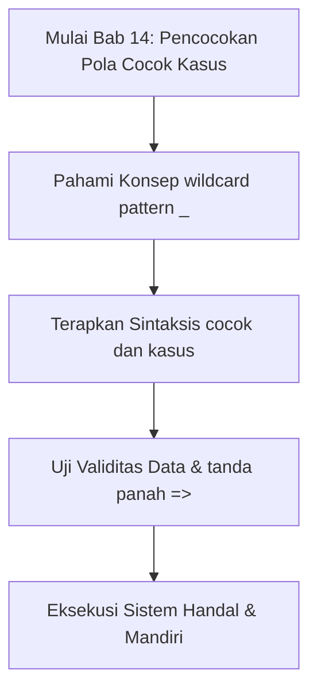

## Bab 14: Pencocokan Pola Struktural dengan `cocok` dan `kasus`

### 14.1 Evolusi dari Percabangan Tradisional Menuju Pattern Matching



Dalam bahasa pemrograman lawas seperti C atau Java, struktur `switch-case` hanya mendukung tipe integer primitif dan rentan terhadap kutu akibat lupa menyisipkan perintah `break` (*fall-through bug*). 

Widya-Lang menghadirkan paradigma **Pencocokan Pola (*Pattern Matching*)** modern melalui kata kunci **`cocok`** dan **`kasus`**. Setiap lengan kasus dipisahkan secara tegas menggunakan tanda panah gemuk `=>`, tidak memiliki risiko *fall-through*, mendukung pencocokan teks string dan tipe komposit, serta memastikan kelengkapan penanganan (*exhaustiveness checking*).

```widya
fungsi utama() {
    tetap kode_bandara = "YIA";
    variabel nama_bandara = "";
    
    cocok (kode_bandara) {
        kasus "CGK" => {
            nama_bandara = "Bandara Internasional Soekarno-Hatta (Jakarta)";
        },
        kasus "SUB" => {
            nama_bandara = "Bandara Internasional Juanda (Surabaya)";
        },
        kasus "DPS" => {
            nama_bandara = "Bandara Internasional I Gusti Ngurah Rai (Bali)";
        },
        kasus "YIA" => {
            nama_bandara = "Bandara Internasional Yogyakarta Kulon Progo";
        },
        kasus "KNO" => {
            nama_bandara = "Bandara Internasional Kualanamu (Medan)";
        },
        kasus _ => {
            nama_bandara = "Bandara Perintis Lainnya di Nusantara";
        }
    }
    
    cetak("Informasi Navigasi Penerbangan:");
    cetak("Kode IATA : " + kode_bandara);
    cetak("Nama Resmi: " + nama_bandara);
}
```

### 14.2 Karakter Pengganti Liar (*Wildcard Pattern* `_`)
Simbol garis bawah `_` bertindak sebagai penangkap sisa kondisi yang tidak cocok dengan kasus-kasus di atasnya (setara dengan `default`). Keberadaan pola wildcard menjamin bahwa program selalu memiliki jalur penanganan jika sistem menerima data yang tak terduga.

### 14.3 Contoh Kode Praktik: Pengurai Perintah Kendali Drone Otonom
Program berikut mengarahkan aktuator motor baling-baling drone berdasarkan sinyal telemetri:

```widya
// Berkas: bab14_drone_telemetri.widya

fungsi utama() {
    tetap sinyal_remote = "LEPAS_LANDAS";
    variabel status_motor = "";
    variabel elevasi_target = 0;
    
    cocok (sinyal_remote) {
        kasus "LEPAS_LANDAS" => {
            status_motor = "4 Motor Berputar 8000 RPM, Naik Vertikal";
            elevasi_target = 15; // 15 Meter
        },
        kasus "MELAYANG" => {
            status_motor = "Motor Menyeimbangkan Posisi Sesuai Sensor Gyro";
            elevasi_target = 15;
        },
        kasus "KEMBALI_KE_PANGKALAN" => {
            status_motor = "Navigasi GPS Aktif, Kembali ke Titik Koordinat Rumah";
            elevasi_target = 25;
        },
        kasus "MENDARAT_DARURAT" => {
            status_motor = "Putaran Motor Menurun Perlahan, Aktifkan Sensor Bawah";
            elevasi_target = 0;
        },
        kasus _ => {
            status_motor = "Sinyal Tidak Terdefinisi! Pertahankan Posisi Hover";
            elevasi_target = 10;
        }
    }
    
    cetak("SISTEM AVIONIK DRONE NUSANTARA:");
    cetak("- Perintah Masuk: " + sinyal_remote);
    cetak("- Respon Aktuator: " + status_motor);
    cetak("- Ketinggian Auto: " + teks(elevasi_target) + " meter");
}
```

### 14.4 Kesalahan Pemula dan Panduan Solusi
- **Lupa Menyertakan Pola Wildcard `_`**:
  Jika nilai yang diuji tidak cocok dengan kasus apa pun dan tidak ada wildcard `_`, program berpotensi melewatkan inisialisasi variabel target. Selalu sertakan kasus `_` sebagai pertahanan.

### 14.5 Rangkuman Konsep Kunci Bab 14
- `cocok` dan `kasus` memformat pencabangan multi-nilai diskrit menjadi ringkas dan deklaratif.
- Tanda panah gemuk `=>` membatasi setiap lengan kasus secara mandiri tanpa memerlukan instruksi `break`.

### 14.6 Latihan Mandiri & Evaluasi Pemahaman
1. Apa keunggulan keamanan sintaksis `cocok` di Widya-Lang dibandingkan `switch-case` di bahasa C?
2. Apakah pencocokan pola dapat digunakan untuk mencocokkan tipe string dan integer secara bersamaan?
3. **Tantangan Praktik**: Rancanglah konverter status kode respon HTTP menggunakan blok `cocok`: 200 ("Sukses"), 400 ("Permintaan Buruk"), 401 ("Tidak Terotorisasi"), 404 ("Tidak Ditemukan"), dan 500 ("Kesalahan Peladen Internal")!

---

### 14.9 Latihan Soal Pilihan Ganda (10 Soal)

Pilihlah satu jawaban yang paling tepat (A, B, C, atau D) untuk menguji penguasaan materi bab ini:

**1. Apa fokus utama pembahasan dalam Bab 14 (Pencocokan Pola Cocok Kasus)?**
- A. Membahas secara mendalam Pattern matching modern
- B. Mengonfigurasi kabel jaringan lokal
- C. Memperbaiki motherboard komputer
- D. Menghapus database peladen

**2. Manakah kata kunci atau sintaksis yang menjadi inti materi bab ini?**
- A. Kata kunci `cocok dan kasus`
- B. perintah format disk
- C. bahasa assembly x86
- D. tag HTML

**3. Mengapa konsep wildcard pattern _ sangat penting dalam rekayasa perangkat lunak modern?**
- A. Menjamin efisiensi komputasi dan keterbacaan kode secara modular
- B. Hanya formalitas akademis
- C. Agar program berjalan lambat
- D. Mengurangi resolusi layar

**4. Dalam pengolahan data, bagaimana tanda panah => memengaruhi performa memori?**
- A. Mengoptimalkan struktur alokasi data di RAM secara efisien
- B. Membuat memori penuh seketika
- C. Menghapus seluruh file disk
- D. Menghentikan kipas prosesor

**5. Manakah best practice yang dianjurkan dalam menerapkan materi Bab 14?**
- A. Menerapkan validasi data dan isolasi ruang lingkup yang bersih
- B. Menulis seluruh kode dalam satu baris panjang
- C. Mengabaikan penanganan kesalahan
- D. Menggunakan variabel global sembarangan

**6. Apa risiko yang timbul jika pemrogram mengabaikan kaidah wildcard pattern _?**
- A. Munculnya kutu logika atau kerentanan runtime saat data ekstrem masuk
- B. Komputer langsung terbakar
- C. Kecepatan internet naik dua kali lipat
- D. Keyboard tidak berfungsi

**7. Bagaimana kompilator Widya-Lang memproses instruksi yang berkaitan dengan cocok dan kasus?**
- A. Divalidasi pada tahap analisis semantik dan diterjemahkan ke instruksi biner native
- B. Dikirimkan ke cloud pihak ketiga
- C. Diterjemahkan baris per baris secara lambat
- D. Diabaikan seluruhnya

**8. Di lingkungan industri, penerapan modul Bab 14 lazim ditemukan pada...**
- A. Sistem perbankan, backend peladen, aplikasi sains data, dan otomatisasi bisnis
- B. Hanya pada kalkulator saku sederhana
- C. Hanya pada game lawas 8-bit
- D. Tidak pernah digunakan di industri

**9. Fungsi pendukung apa yang paling sering dikombinasikan dengan materi bab ini?**
- A. Fungsi bawaan `cetak()`, `teks()`, atau asersi pengujian `pastikan()`
- B. Perintah mematikan komputer
- C. Fungsi memutar musik
- D. Fungsi mencetak kertas printer

**10. Setelah menuntaskan Bab 14, kompetensi apa yang diharapkan dikuasai oleh pembaca?**
- A. Mampu merancang, mengimplementasikan, dan menguji solusi berbasis Pattern matching modern secara mandiri
- B. Mampu merakit kabel listrik tegangan tinggi
- C. Mampu mendesain grafis vektor 3D
- D. Mampu memasang antena radio
