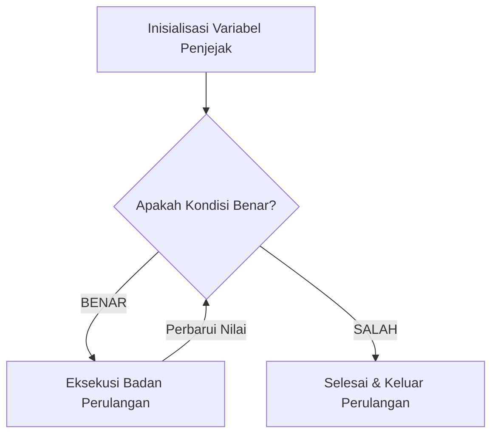

## Bab 15: Perulangan Terkendali dengan `selama` (While Loop)

### 15.1 Landasan Teori Perulangan Komputasi

```mermaid
graph TD
    A[Mulai Bab 15: Perulangan Selama] --> B[Pahami Konsep terminasi loop]
    B --> C[Terapkan Sintaksis selama (kondisi)]
    C --> D[Uji Validitas Data & mencegah infinite loop]
    D --> E[Eksekusi Sistem Handal & Mandiri]
```

Kekuatan terbesar komputer dibandingkan otak manusia terletak pada kecepatannya dalam mengeksekusi instruksi yang repetitif miliaran kali tanpa mengalami kelelahan, kebosanan, atau penurunan presisi. 

Struktur **`selama`** adalah perulangan berbasis kondisi logika (*pre-tested condition loop*). Sebelum badan perulangan dieksekusi, kondisi diuji terlebih dahulu. Jika kondisi bernilai `benar`, blok instruksi dijalankan; setelah selesai, kontrol kembali ke atas untuk menguji kondisi lagi. Siklus ini terus berulang hingga kondisi bernilai `salah`.



### 15.2 Tiga Pilar Perulangan yang Sehat
Agar sebuah perulangan `selama` bekerja dengan andal, ia wajib memiliki tiga komponen:
1. **Inisialisasi (*Initialization*)**: Menetapkan nilai awal variabel pengendali sebelum perulangan dimulai.
2. **Kondisi Uji (*Condition Check*)**: Ekspresi boolean yang menentukan apakah perulangan boleh lanjut.
3. **Pembaruan Langkah (*Step Update*)**: Memodifikasi variabel pengendali di dalam badan perulangan agar kondisi pada akhirnya menjadi `salah`.

### 15.3 Bahaya Perulangan Tanpa Akhir (*Infinite Loop*)
Jika pemrogram lupa menyertakan langkah pembaruan, kondisi uji akan selamanya bernilai `benar`. Akibatnya, program akan terkunci dalam perulangan abadi yang menyedot 100% kapasitas pemrosesan CPU:

```widya
// CONTOH KESALAHAN FATAL:
variabel counter = 1;
selama (counter <= 10) {
    cetak(teks(counter));
    // LUPA MENULIS: counter += 1;
    // Program akan mencetak angka 1 selamanya!
}
```

### 15.4 Contoh Kode Praktik: Simulasi Peluruhan Radioaktif Zat Nuklir
Program berikut menghitung berapa tahun yang dibutuhkan suatu isotop radioaktif untuk meluruh hingga mencapai batas aman radiasi:

```widya
// Berkas: bab15_peluruhan_nuklir.widya

fungsi utama() {
    variabel massa_aktif_gram = 2000.0; // 2 Kilogram sampel
    tetap AMBANG_AMAN_GRAM = 5.0;
    tetap WAKTU_PARUH_TAHUN = 28.8; // Waktu paruh Stronsium-90
    
    variabel tahun_berjalan = 0.0;
    variabel siklus = 0;
    
    cetak("SIMULASI FISIKA RADIASI DAN KESELAMATAN:");
    cetak("Massa Awal Sampel : " + teks(massa_aktif_gram) + " gram");
    cetak("Ambang Batas Aman : " + teks(AMBANG_AMAN_GRAM) + " gram");
    cetak("--------------------------------------------");
    
    selama (massa_aktif_gram > AMBANG_AMAN_GRAM) {
        siklus += 1;
        massa_aktif_gram = massa_aktif_gram / 2.0;
        tahun_berjalan += WAKTU_PARUH_TAHUN;
        cetak("Siklus " + teks(siklus) + " (" + teks(tahun_berjalan) + " Tahun) -> Sisa Massa: " + teks(massa_aktif_gram) + " gr");
    }
    
    cetak("--------------------------------------------");
    cetak("Status: Radiasi telah meluruh hingga tingkat aman.");
    cetak("Total Waktu Penyimpanan: " + teks(tahun_berjalan) + " Tahun.");
}
```

### 15.5 Kesalahan Pemula dan Panduan Solusi
- **Kondisi Off-by-One**:
  Menggunakan operator `<` padahal yang dimaksud adalah `<=` (atau sebaliknya). Akibatnya, perulangan berjalan kurang satu kali atau lebih satu kali dari target.
- **Menghentikan Program yang Macet di Terminal**:
  Jika program Anda terjebak dalam infinite loop, tekan kombinasi tombol `Ctrl + C` pada keyboard untuk mengirimkan sinyal interupsi SIGINT ke sistem operasi.

### 15.6 Rangkuman Konsep Kunci Bab 15
- `selama` mengevaluasi kondisi sebelum memasuki badan perulangan.
- Selalu pastikan variabel pengendali dimutasi di dalam blok menuju titik terminasi.

### 15.7 Latihan Mandiri & Evaluasi Pemahaman
1. Apa yang dimaksud dengan *pre-tested loop* pada struktur perulangan `selama`?
2. Bagaimana cara kerja algoritma Euclidean dalam mencari FPB dua bilangan menggunakan `selama`?
3. **Tantangan Praktik**: Rancanglah permainan tebak angka di mana program memiliki konstanta rahasia `tetap KUNCI = 42;`, dan perulangan `selama` mensimulasikan tebakan berulang hingga angka tebakan tepat sama!

---

### 15.9 Latihan Soal Pilihan Ganda (10 Soal)

Pilihlah satu jawaban yang paling tepat (A, B, C, atau D) untuk menguji penguasaan materi bab ini:

**1. Apa fokus utama pembahasan dalam Bab 15 (Perulangan Selama)?**
- A. Membahas secara mendalam Perulangan pra-syarat
- B. Mengonfigurasi kabel jaringan lokal
- C. Memperbaiki motherboard komputer
- D. Menghapus database peladen

**2. Manakah kata kunci atau sintaksis yang menjadi inti materi bab ini?**
- A. Kata kunci `selama (kondisi)`
- B. perintah format disk
- C. bahasa assembly x86
- D. tag HTML

**3. Mengapa konsep terminasi loop sangat penting dalam rekayasa perangkat lunak modern?**
- A. Menjamin efisiensi komputasi dan keterbacaan kode secara modular
- B. Hanya formalitas akademis
- C. Agar program berjalan lambat
- D. Mengurangi resolusi layar

**4. Dalam pengolahan data, bagaimana mencegah infinite loop memengaruhi performa memori?**
- A. Mengoptimalkan struktur alokasi data di RAM secara efisien
- B. Membuat memori penuh seketika
- C. Menghapus seluruh file disk
- D. Menghentikan kipas prosesor

**5. Manakah best practice yang dianjurkan dalam menerapkan materi Bab 15?**
- A. Menerapkan validasi data dan isolasi ruang lingkup yang bersih
- B. Menulis seluruh kode dalam satu baris panjang
- C. Mengabaikan penanganan kesalahan
- D. Menggunakan variabel global sembarangan

**6. Apa risiko yang timbul jika pemrogram mengabaikan kaidah terminasi loop?**
- A. Munculnya kutu logika atau kerentanan runtime saat data ekstrem masuk
- B. Komputer langsung terbakar
- C. Kecepatan internet naik dua kali lipat
- D. Keyboard tidak berfungsi

**7. Bagaimana kompilator Widya-Lang memproses instruksi yang berkaitan dengan selama (kondisi)?**
- A. Divalidasi pada tahap analisis semantik dan diterjemahkan ke instruksi biner native
- B. Dikirimkan ke cloud pihak ketiga
- C. Diterjemahkan baris per baris secara lambat
- D. Diabaikan seluruhnya

**8. Di lingkungan industri, penerapan modul Bab 15 lazim ditemukan pada...**
- A. Sistem perbankan, backend peladen, aplikasi sains data, dan otomatisasi bisnis
- B. Hanya pada kalkulator saku sederhana
- C. Hanya pada game lawas 8-bit
- D. Tidak pernah digunakan di industri

**9. Fungsi pendukung apa yang paling sering dikombinasikan dengan materi bab ini?**
- A. Fungsi bawaan `cetak()`, `teks()`, atau asersi pengujian `pastikan()`
- B. Perintah mematikan komputer
- C. Fungsi memutar musik
- D. Fungsi mencetak kertas printer

**10. Setelah menuntaskan Bab 15, kompetensi apa yang diharapkan dikuasai oleh pembaca?**
- A. Mampu merancang, mengimplementasikan, dan menguji solusi berbasis Perulangan pra-syarat secara mandiri
- B. Mampu merakit kabel listrik tegangan tinggi
- C. Mampu mendesain grafis vektor 3D
- D. Mampu memasang antena radio
