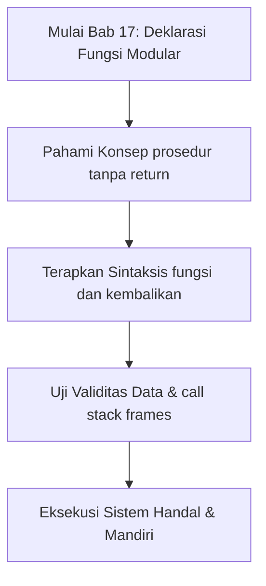
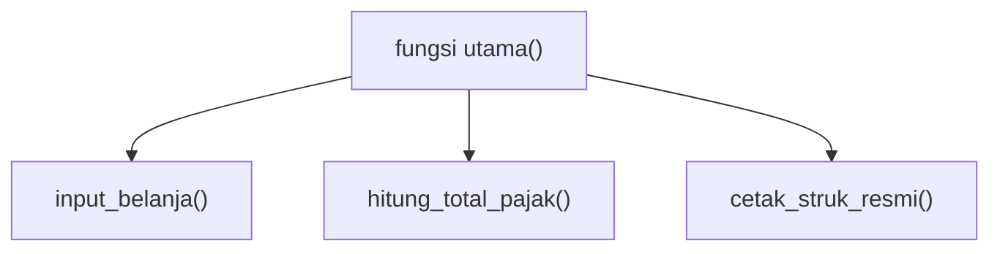

## Bab 17: Deklarasi Fungsi Dasar dan Dekomposisi Masalah

### 17.1 Filosofi Dekomposisi Masalah dan Prinsip DRY



Salah satu keterampilan tertinggi seorang rekayasawan perangkat lunak adalah **Dekomposisi Masalah** (*Problem Decomposition*)—yakni kemampuan untuk memecah persoalan raksasa yang rumit menjadi puluhan sub-persoalan kecil yang sederhana, terisolasi, dan mudah diuji secara independen.

Tanpa fungsi, kode program akan membengkak menjadi ribuan baris naskah linier (*spaghetti code*) yang penuh duplikasi instruksi. Prinsip utama perancangan perangkat lunak adalah **DRY (*Don't Repeat Yourself*)**: setiap logika atau rumus yang digunakan lebih dari sekali wajib dikemas ke dalam sebuah fungsi mandiri.



### 17.2 Bingkai Tumpukan Panggilan (*Call Stack Frames*)
Ketika sebuah fungsi dipanggil oleh komputer, CPU mengalokasikan area memori khusus di dalam tumpukan sistem yang disebut **Bingkai Panggilan (*Call Stack Frame*)**. Bingkai ini menampung:
1. Alamat instruksi pengirim (*Return Address*) untuk kembali ke pemanggil setelah fungsi selesai.
2. Salinan nilai argumen yang dilewatkan ke parameter fungsi.
3. Alokasi seluruh variabel lokal yang dideklarasikan di dalam badan fungsi.

Begitu eksekusi mencapai kata kunci `kembalikan` atau kurung kurawal tutup `}`, seluruh bingkai memori ini dibebaskan (*popped*) seketika dari RAM dengan waktu alokasi nol nanodetik.

### 17.3 Mendefinisikan Fungsi dengan `fungsi` dan `kembalikan`
Fungsi dideklarasikan menggunakan kata kunci `fungsi`, diikuti nama fungsi, daftar parameter dalam kurung `(...)`, dan badan blok dalam kurung kurawal `{}`:

```widya
// Definisi fungsi matematika untuk luas trapesium
fungsi hitung_luas_trapesium(sisi_sejajar_a, sisi_sejajar_b, tinggi) {
    tetap jumlah_sisi = sisi_sejajar_a + sisi_sejajar_b;
    tetap luas = 0.5 * jumlah_sisi * tinggi;
    kembalikan luas; // Mengirimkan nilai balik ke pemanggil
}

fungsi utama() {
    // Memanggil fungsi dengan argumen konkret
    tetap luas_tanah_1 = hitung_luas_trapesium(12.0, 18.0, 8.0);
    tetap luas_tanah_2 = hitung_luas_trapesium(20.0, 30.0, 15.0);
    
    cetak("Luas Petak Sawah A: " + teks(luas_tanah_1) + " m²");
    cetak("Luas Petak Sawah B: " + teks(luas_tanah_2) + " m²");
}
```

### 17.4 Prosedur: Fungsi Tanpa Nilai Kembalian
Jika sebuah fungsi hanya bertugas melakukan aksi sampingan (seperti menampilkan banner di layar atau mencetak pembatas) tanpa menghasilkan nilai kalkulasi, kita tidak perlu menyertakan pernyataan `kembalikan`:

```widya
fungsi cetak_garis_pemisah(panjang_karakter, simbol) {
    variabel s = "";
    variabel i = 0;
    selama (i < panjang_karakter) {
        s = s + simbol;
        i += 1;
    }
    cetak(s);
}

fungsi utama() {
    cetak_garis_pemisah(40, "=");
    cetak("     SISTEM INFORMASI AKADEMIK        ");
    cetak_garis_pemisah(40, "-");
}
```

### 17.5 Contoh Kode Praktik: Kalkulator Konversi Skala Termometrik Lengkap
Program ini mengemas formula termodinamika ke dalam fungsi-fungsi modular mandiri:

```widya
// Berkas: bab17_modul_suhu.widya

fungsi celcius_ke_fahrenheit(c) {
    kembalikan (c * 9.0 / 5.0) + 32.0;
}

fungsi celcius_ke_reamur(c) {
    kembalikan c * 4.0 / 5.0;
}

fungsi celcius_ke_kelvin(c) {
    kembalikan c + 273.15;
}

fungsi utama() {
    tetap suhu_ruang = 28.0; // Derajat Celsius
    
    cetak("MODUL TERMODINAMIKA PRESISI:");
    cetak("Input Suhu Celsius: " + teks(suhu_ruang) + " °C");
    cetak("- Skala Fahrenheit: " + teks(celcius_ke_fahrenheit(suhu_ruang)) + " °F");
    cetak("- Skala Reamur    : " + teks(celcius_ke_reamur(suhu_ruang)) + " °R");
    cetak("- Skala Kelvin    : " + teks(celcius_ke_kelvin(suhu_ruang)) + " K");
}
```

### 17.6 Kesalahan Pemula dan Panduan Solusi
- **Lupa Kata Kunci `kembalikan`**:
  Jika Anda menghitung nilai di dalam fungsi tetapi lupa menuliskan `kembalikan hasil;`, fungsi pemanggil akan menerima nilai kosong (*Unit Type*) dan kalkulasi selanjutnya akan keliru.
- **Instruksi yang Diletakkan Setelah `kembalikan` (*Dead Code*)**:
  Baris instruksi apa pun yang diletakkan persis setelah kata kunci `kembalikan` tidak akan pernah dieksekusi oleh mesin.

### 17.7 Rangkuman Konsep Kunci Bab 17
- Fungsi mengemas blok instruksi berulang menjadi unit modular berdaulat.
- `kembalikan` menyudahi eksekusi fungsi dan mengirimkan nilai balik.
- Variabel lokal dialokasikan di dalam stack frame dan musnah saat fungsi berakhir.

### 17.8 Latihan Mandiri & Evaluasi Pemahaman
1. Mengapa alokasi memori pada call stack frame berlangsung jauh lebih cepat dibanding alokasi heap?
2. Apakah sebuah fungsi dapat memiliki nilai kembalian bertipe boolean? Berikan contohnya!
3. **Tantangan Praktik**: Rancanglah fungsi `hitung_energi_potensial(massa_kg, ketinggian_m)` dengan asumsi gravitasi bumi $g = 9.8$ m/s², lalu tampilkan besaran Joule yang dihasilkan!

---

### 17.9 Latihan Soal Pilihan Ganda (10 Soal)

Pilihlah satu jawaban yang paling tepat (A, B, C, atau D) untuk menguji penguasaan materi bab ini:

**1. Apa fokus utama pembahasan dalam Bab 17 (Deklarasi Fungsi Modular)?**
- A. Membahas secara mendalam Dekomposisi masalah DRY
- B. Mengonfigurasi kabel jaringan lokal
- C. Memperbaiki motherboard komputer
- D. Menghapus database peladen

**2. Manakah kata kunci atau sintaksis yang menjadi inti materi bab ini?**
- A. Kata kunci `fungsi dan kembalikan`
- B. perintah format disk
- C. bahasa assembly x86
- D. tag HTML

**3. Mengapa konsep prosedur tanpa return sangat penting dalam rekayasa perangkat lunak modern?**
- A. Menjamin efisiensi komputasi dan keterbacaan kode secara modular
- B. Hanya formalitas akademis
- C. Agar program berjalan lambat
- D. Mengurangi resolusi layar

**4. Dalam pengolahan data, bagaimana call stack frames memengaruhi performa memori?**
- A. Mengoptimalkan struktur alokasi data di RAM secara efisien
- B. Membuat memori penuh seketika
- C. Menghapus seluruh file disk
- D. Menghentikan kipas prosesor

**5. Manakah best practice yang dianjurkan dalam menerapkan materi Bab 17?**
- A. Menerapkan validasi data dan isolasi ruang lingkup yang bersih
- B. Menulis seluruh kode dalam satu baris panjang
- C. Mengabaikan penanganan kesalahan
- D. Menggunakan variabel global sembarangan

**6. Apa risiko yang timbul jika pemrogram mengabaikan kaidah prosedur tanpa return?**
- A. Munculnya kutu logika atau kerentanan runtime saat data ekstrem masuk
- B. Komputer langsung terbakar
- C. Kecepatan internet naik dua kali lipat
- D. Keyboard tidak berfungsi

**7. Bagaimana kompilator Widya-Lang memproses instruksi yang berkaitan dengan fungsi dan kembalikan?**
- A. Divalidasi pada tahap analisis semantik dan diterjemahkan ke instruksi biner native
- B. Dikirimkan ke cloud pihak ketiga
- C. Diterjemahkan baris per baris secara lambat
- D. Diabaikan seluruhnya

**8. Di lingkungan industri, penerapan modul Bab 17 lazim ditemukan pada...**
- A. Sistem perbankan, backend peladen, aplikasi sains data, dan otomatisasi bisnis
- B. Hanya pada kalkulator saku sederhana
- C. Hanya pada game lawas 8-bit
- D. Tidak pernah digunakan di industri

**9. Fungsi pendukung apa yang paling sering dikombinasikan dengan materi bab ini?**
- A. Fungsi bawaan `cetak()`, `teks()`, atau asersi pengujian `pastikan()`
- B. Perintah mematikan komputer
- C. Fungsi memutar musik
- D. Fungsi mencetak kertas printer

**10. Setelah menuntaskan Bab 17, kompetensi apa yang diharapkan dikuasai oleh pembaca?**
- A. Mampu merancang, mengimplementasikan, dan menguji solusi berbasis Dekomposisi masalah DRY secara mandiri
- B. Mampu merakit kabel listrik tegangan tinggi
- C. Mampu mendesain grafis vektor 3D
- D. Mampu memasang antena radio
