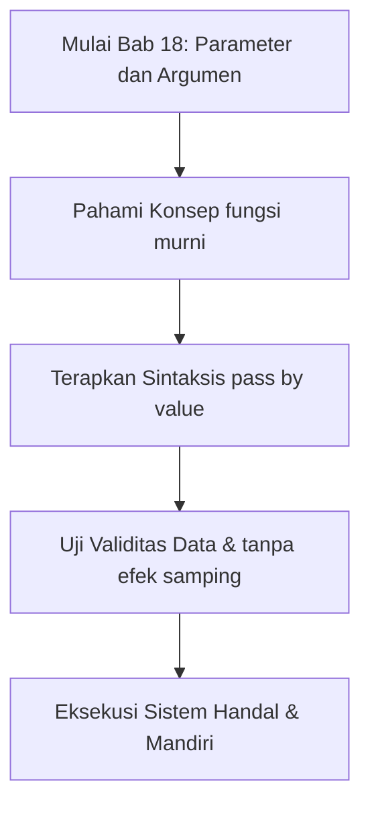

## Bab 18: Parameter Fungsi Lanjutan dan Karakteristik Eksekusi

### 18.1 Parameter Formal vs Argumen Aktual



Dalam terminologi ilmu komputer, penting untuk membedakan dua istilah:
- **Parameter Formal**: Variabel yang dideklarasikan di dalam tanda kurung pada definisi fungsi (misal: `fungsi hitung(a, b)` -> `a` dan `b` adalah parameter formal).
- **Argumen Aktual**: Nilai konkret yang dilewatkan saat fungsi dipanggil (misal: `hitung(10, 25)` -> `10` dan `25` adalah argumen aktual).

### 18.2 Mekanisme Pelewatan Nilai (*Pass by Value*)
Di dalam Widya-Lang, tipe data primitif (angka, teks, boolean) dilewatkan menggunakan semantik **Pelewatan Nilai (*Pass by Value*)**. Artinya, fungsi menerima salinan mandiri dari nilai aslinya. Memodifikasi nilai parameter di dalam badan fungsi **sama sekali tidak mengubah** nilai variabel asli di tempat pemanggil:

```widya
fungsi mutasi_lokal(x) {
    x = x + 100;
    cetak("Nilai di dalam fungsi: " + teks(x)); // 150
}

fungsi utama() {
    variabel nilai_asli = 50;
    mutasi_lokal(nilai_asli);
    cetak("Nilai di luar fungsi: " + teks(nilai_asli)); // Tetap 50!
}
```

### 18.3 Fungsi Murni (*Pure Functions*)
Fungsi yang baik mematuhi sifat matematis murni:
1. Menghasilkan keluaran yang deterministik untuk masukan yang sama.
2. Tidak mengubah keadaan memori di luar badan fungsi (*No Side-Effects*).

```widya
// CONTOH FUNGSI MURNI (Sangat Direkomendasikan)
fungsi hitung_biaya_kirim(berat_kg, jarak_km) {
    tetap tarif_per_kg = 8000;
    tetap tarif_per_km = 1500;
    kembalikan (berat_kg * tarif_per_kg) + (jarak_km * tarif_per_km);
}
```

### 18.4 Contoh Kode Praktik: Pembangkit Faktur Pajak Perusahaan
Program ini menghitung faktur tagihan lengkap dengan potongan diskon dan pajak pertambahan nilai:

```widya
// Berkas: bab18_faktur_pajak.widya

fungsi hitung_pajak_ppn(nilai_transaksi, tarif_persen) {
    kembalikan nilai_transaksi * (tarif_persen / 100.0);
}

fungsi hitung_total_tagihan(subtotal, diskon_persen, ppn_persen) {
    tetap nilai_diskon = subtotal * (diskon_persen / 100.0);
    tetap setelah_diskon = subtotal - nilai_diskon;
    tetap pajak = hitung_pajak_ppn(setelah_diskon, ppn_persen);
    kembalikan setelah_diskon + pajak;
}

fungsi utama() {
    tetap belanja = 5000000.0;
    tetap tagihan_akhir = hitung_total_tagihan(belanja, 10.0, 11.0);
    cetak("Subtotal Transaksi : Rp " + teks(belanja));
    cetak("Total Tagihan Final: Rp " + teks(tagihan_akhir));
}
```

### 18.5 Kesalahan Pemula dan Panduan Solusi
- **Jumlah Argumen Tidak Sesuai (*Arity Mismatch*)**:
  Jika fungsi didefinisikan menerima 3 parameter, memanggilnya dengan 2 argumen akan ditolak kompilator. Pastikan jumlah dan urutan argumen tepat cocok.

### 18.6 Rangkuman Konsep Kunci Bab 18
- Parameter formal menerima salinan nilai dari argumen pemanggil (*Pass by Value*).
- Fungsi murni meminimalkan efek samping dan mempermudah pengujian otomatis.

### 18.7 Latihan Mandiri & Evaluasi Pemahaman
1. Jelaskan perbedaan mendasar antara parameter formal dan argumen aktual!
2. Mengapa pelewatan nilai (*pass by value*) melindungi variabel pemanggil dari perubahan yang tidak disengaja?
3. **Tantangan Praktik**: Buatlah fungsi `hitung_zakat_penghasilan(gaji_bulanan, bonus_tambahan)` yang mengembalikan zakat 2,5% jika total penghasilan melampaui nisab Rp 7.000.000 per bulan!

---

### 18.9 Latihan Soal Pilihan Ganda (10 Soal)

Pilihlah satu jawaban yang paling tepat (A, B, C, atau D) untuk menguji penguasaan materi bab ini:

**1. Apa fokus utama pembahasan dalam Bab 18 (Parameter dan Argumen)?**
- A. Membahas secara mendalam Pelewatan argumen
- B. Mengonfigurasi kabel jaringan lokal
- C. Memperbaiki motherboard komputer
- D. Menghapus database peladen

**2. Manakah kata kunci atau sintaksis yang menjadi inti materi bab ini?**
- A. Kata kunci `pass by value`
- B. perintah format disk
- C. bahasa assembly x86
- D. tag HTML

**3. Mengapa konsep fungsi murni sangat penting dalam rekayasa perangkat lunak modern?**
- A. Menjamin efisiensi komputasi dan keterbacaan kode secara modular
- B. Hanya formalitas akademis
- C. Agar program berjalan lambat
- D. Mengurangi resolusi layar

**4. Dalam pengolahan data, bagaimana tanpa efek samping memengaruhi performa memori?**
- A. Mengoptimalkan struktur alokasi data di RAM secara efisien
- B. Membuat memori penuh seketika
- C. Menghapus seluruh file disk
- D. Menghentikan kipas prosesor

**5. Manakah best practice yang dianjurkan dalam menerapkan materi Bab 18?**
- A. Menerapkan validasi data dan isolasi ruang lingkup yang bersih
- B. Menulis seluruh kode dalam satu baris panjang
- C. Mengabaikan penanganan kesalahan
- D. Menggunakan variabel global sembarangan

**6. Apa risiko yang timbul jika pemrogram mengabaikan kaidah fungsi murni?**
- A. Munculnya kutu logika atau kerentanan runtime saat data ekstrem masuk
- B. Komputer langsung terbakar
- C. Kecepatan internet naik dua kali lipat
- D. Keyboard tidak berfungsi

**7. Bagaimana kompilator Widya-Lang memproses instruksi yang berkaitan dengan pass by value?**
- A. Divalidasi pada tahap analisis semantik dan diterjemahkan ke instruksi biner native
- B. Dikirimkan ke cloud pihak ketiga
- C. Diterjemahkan baris per baris secara lambat
- D. Diabaikan seluruhnya

**8. Di lingkungan industri, penerapan modul Bab 18 lazim ditemukan pada...**
- A. Sistem perbankan, backend peladen, aplikasi sains data, dan otomatisasi bisnis
- B. Hanya pada kalkulator saku sederhana
- C. Hanya pada game lawas 8-bit
- D. Tidak pernah digunakan di industri

**9. Fungsi pendukung apa yang paling sering dikombinasikan dengan materi bab ini?**
- A. Fungsi bawaan `cetak()`, `teks()`, atau asersi pengujian `pastikan()`
- B. Perintah mematikan komputer
- C. Fungsi memutar musik
- D. Fungsi mencetak kertas printer

**10. Setelah menuntaskan Bab 18, kompetensi apa yang diharapkan dikuasai oleh pembaca?**
- A. Mampu merancang, mengimplementasikan, dan menguji solusi berbasis Pelewatan argumen secara mandiri
- B. Mampu merakit kabel listrik tegangan tinggi
- C. Mampu mendesain grafis vektor 3D
- D. Mampu memasang antena radio
