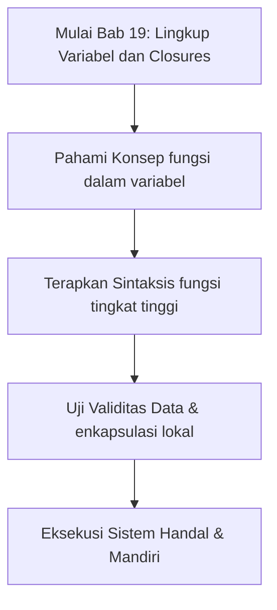

## Bab 19: Ruang Lingkup Fungsi, Penutupan (*Closures*), dan Tingkat Tinggi

### 19.1 Lingkup Leksikal (*Lexical Scope*)



Variabel yang dideklarasikan di dalam suatu fungsi hanya hidup di dalam fungsi tersebut. Nama variabel yang sama di luar fungsi tidak akan saling bertabrakan atau menimpa:

```widya
variabel pajak = 0.10; // Variabel Global

fungsi hitung_lokal() {
    variabel pajak = 0.05; // Variabel Lokal (Membayangi Variabel Global)
    cetak("Pajak Lokal: " + teks(pajak));
}

fungsi utama() {
    hitung_lokal();
    cetak("Pajak Global: " + teks(pajak));
}
```

### 19.2 Fungsi sebagai Warga Negara Kelas Satu (*First-Class Citizens*)
Dalam Widya-Lang, fungsi dapat disimpan ke dalam variabel, dilewatkan sebagai argumen ke fungsi lain, atau dikembalikan dari fungsi:

```widya
fungsi kuadrat(x) {
    kembalikan x * x;
}

fungsi kubik(x) {
    kembalikan x * x * x;
}

fungsi jalankan_operasi(angka, operasi_fn) {
    kembalikan operasi_fn(angka);
}

fungsi utama() {
    tetap hasil_1 = jalankan_operasi(5, kuadrat);
    tetap hasil_2 = jalankan_operasi(3, kubik);
    
    cetak("5 Kuadrat: " + teks(hasil_1));
    cetak("3 Kubik  : " + teks(hasil_2));
}
```

### 19.3 Contoh Kode Praktik: Pipa Pemrosesan Data (*Data Pipeline*)
Program ini mengombinasikan beberapa fungsi transformasi untuk membersihkan data masukan formulir:

```widya
// Berkas: bab19_pipa_data.widya

fungsi pangkas_spasi(s) {
    kembalikan pangkas(s);
}

fungsi ubah_kapital(s) {
    kembalikan ke_huruf_besar(s);
}

fungsi format_gelar(s) {
    kembalikan "Yth. Sdr. " + s;
}

fungsi proses_nama_tamu(nama_mentah) {
    tetap t1 = pangkas_spasi(nama_mentah);
    tetap t2 = ubah_kapital(t1);
    tetap t3 = format_gelar(t2);
    kembalikan t3;
}

fungsi utama() {
    tetap input = "   raden arya wijaya   ";
    tetap hasil = proses_nama_tamu(input);
    cetak("Hasil Transformasi Pipeline: [" + hasil + "]");
}
```

### 19.4 Rangkuman Konsep Kunci Bab 19
- Lingkup leksikal memisahkan variabel lokal dari intervensi luar.
- Fungsi tingkat tinggi (*Higher-Order Functions*) dapat menerima fungsi lain sebagai parameter.

### 19.5 Latihan Mandiri & Evaluasi Pemahaman
1. Mengapa konsep pembayangan variabel (*variable shadowing*) harus digunakan secara bijaksana?
2. Bagaimana fungsi tingkat tinggi mempermudah pembuatan pipeline data analitis?
3. **Tantangan Praktik**: Buatlah fungsi `terapkan_ke_semua(larik, fungsi_transformasi)` yang menerima larik bilangan dan fungsi matematika, lalu mengembalikan larik baru hasil modifikasi!

---

### 19.9 Latihan Soal Pilihan Ganda (10 Soal)

Pilihlah satu jawaban yang paling tepat (A, B, C, atau D) untuk menguji penguasaan materi bab ini:

**1. Apa fokus utama pembahasan dalam Bab 19 (Lingkup Variabel dan Closures)?**
- A. Membahas secara mendalam Lingkup leksikal
- B. Mengonfigurasi kabel jaringan lokal
- C. Memperbaiki motherboard komputer
- D. Menghapus database peladen

**2. Manakah kata kunci atau sintaksis yang menjadi inti materi bab ini?**
- A. Kata kunci `fungsi tingkat tinggi`
- B. perintah format disk
- C. bahasa assembly x86
- D. tag HTML

**3. Mengapa konsep fungsi dalam variabel sangat penting dalam rekayasa perangkat lunak modern?**
- A. Menjamin efisiensi komputasi dan keterbacaan kode secara modular
- B. Hanya formalitas akademis
- C. Agar program berjalan lambat
- D. Mengurangi resolusi layar

**4. Dalam pengolahan data, bagaimana enkapsulasi lokal memengaruhi performa memori?**
- A. Mengoptimalkan struktur alokasi data di RAM secara efisien
- B. Membuat memori penuh seketika
- C. Menghapus seluruh file disk
- D. Menghentikan kipas prosesor

**5. Manakah best practice yang dianjurkan dalam menerapkan materi Bab 19?**
- A. Menerapkan validasi data dan isolasi ruang lingkup yang bersih
- B. Menulis seluruh kode dalam satu baris panjang
- C. Mengabaikan penanganan kesalahan
- D. Menggunakan variabel global sembarangan

**6. Apa risiko yang timbul jika pemrogram mengabaikan kaidah fungsi dalam variabel?**
- A. Munculnya kutu logika atau kerentanan runtime saat data ekstrem masuk
- B. Komputer langsung terbakar
- C. Kecepatan internet naik dua kali lipat
- D. Keyboard tidak berfungsi

**7. Bagaimana kompilator Widya-Lang memproses instruksi yang berkaitan dengan fungsi tingkat tinggi?**
- A. Divalidasi pada tahap analisis semantik dan diterjemahkan ke instruksi biner native
- B. Dikirimkan ke cloud pihak ketiga
- C. Diterjemahkan baris per baris secara lambat
- D. Diabaikan seluruhnya

**8. Di lingkungan industri, penerapan modul Bab 19 lazim ditemukan pada...**
- A. Sistem perbankan, backend peladen, aplikasi sains data, dan otomatisasi bisnis
- B. Hanya pada kalkulator saku sederhana
- C. Hanya pada game lawas 8-bit
- D. Tidak pernah digunakan di industri

**9. Fungsi pendukung apa yang paling sering dikombinasikan dengan materi bab ini?**
- A. Fungsi bawaan `cetak()`, `teks()`, atau asersi pengujian `pastikan()`
- B. Perintah mematikan komputer
- C. Fungsi memutar musik
- D. Fungsi mencetak kertas printer

**10. Setelah menuntaskan Bab 19, kompetensi apa yang diharapkan dikuasai oleh pembaca?**
- A. Mampu merancang, mengimplementasikan, dan menguji solusi berbasis Lingkup leksikal secara mandiri
- B. Mampu merakit kabel listrik tegangan tinggi
- C. Mampu mendesain grafis vektor 3D
- D. Mampu memasang antena radio
