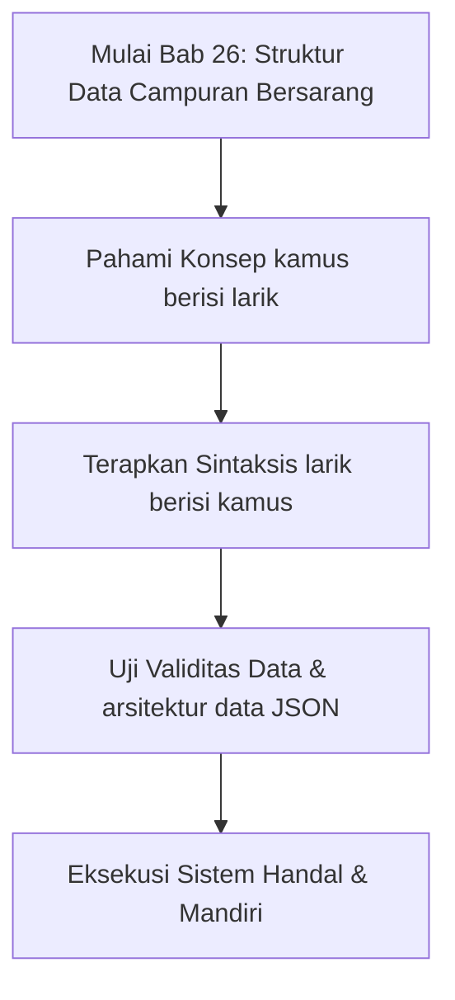

## Bab 26: Kamus Lanjutan dan Struktur Data Campuran

### 26.1 Larik Berisi Kamus (*Array of Maps*)



Di lingkungan industri, satu entitas bisnis (misalnya pelanggan atau produk) memiliki banyak atribut, dan kumpulan entitas tersebut ditampung dalam sebuah larik:

```widya
fungsi utama() {
    variabel daftar_produk = [];
    
    variabel p1 = {};
    p1["sku"] = "PRD-01";
    p1["nama"] = "Kopi Robusta Lampung";
    p1["harga"] = 45000;
    p1["stok"] = 120;
    tambah(daftar_produk, p1);
    
    variabel p2 = {};
    p2["sku"] = "PRD-02";
    p2["nama"] = "Teh Melati Keraton";
    p2["harga"] = 25000;
    p2["stok"] = 85;
    tambah(daftar_produk, p2);
    
    cetak("--- LAPORAN NILAI INVENTARIS GUDANG ---");
    variabel total_valuasi = 0;
    untuk p dalam daftar_produk {
        tetap nilai_aset = p["harga"] * p["stok"];
        total_valuasi += nilai_aset;
        cetak("[" + p["sku"] + "] " + p["nama"] + " | Aset: Rp " + teks(nilai_aset));
    }
    cetak("Total Valuasi Gudang: Rp " + teks(total_valuasi));
}
```

### 26.2 Rangkuman Konsep Kunci Bab 26
- Kombinasi larik dan kamus memungkinkan pemodelan data hierarkis dunia nyata yang sangat kaya.
- Menjadi fondasi representasi data JSON dalam komunikasi web API modern.

### 26.3 Latihan Mandiri & Evaluasi Pemahaman
1. Bagaimana cara memodelkan sistem keranjang belanja di mana satu pengguna memiliki daftar riwayat transaksi?
2. Bagaimana cara mengiterasi larik yang bersarang di dalam bidang kamus?
3. **Tantangan Praktik**: Rancanglah struktur data data siswa yang menampung: nama, nomor induk, dan larik berisi nilai-nilai tugas harian, lalu hitung nilai rata-rata tugas siswa tersebut!

---

### 26.9 Latihan Soal Pilihan Ganda (10 Soal)

Pilihlah satu jawaban yang paling tepat (A, B, C, atau D) untuk menguji penguasaan materi bab ini:

**1. Apa fokus utama pembahasan dalam Bab 26 (Struktur Data Campuran Bersarang)?**
- A. Membahas secara mendalam Pemodelan objek nyata
- B. Mengonfigurasi kabel jaringan lokal
- C. Memperbaiki motherboard komputer
- D. Menghapus database peladen

**2. Manakah kata kunci atau sintaksis yang menjadi inti materi bab ini?**
- A. Kata kunci `larik berisi kamus`
- B. perintah format disk
- C. bahasa assembly x86
- D. tag HTML

**3. Mengapa konsep kamus berisi larik sangat penting dalam rekayasa perangkat lunak modern?**
- A. Menjamin efisiensi komputasi dan keterbacaan kode secara modular
- B. Hanya formalitas akademis
- C. Agar program berjalan lambat
- D. Mengurangi resolusi layar

**4. Dalam pengolahan data, bagaimana arsitektur data JSON memengaruhi performa memori?**
- A. Mengoptimalkan struktur alokasi data di RAM secara efisien
- B. Membuat memori penuh seketika
- C. Menghapus seluruh file disk
- D. Menghentikan kipas prosesor

**5. Manakah best practice yang dianjurkan dalam menerapkan materi Bab 26?**
- A. Menerapkan validasi data dan isolasi ruang lingkup yang bersih
- B. Menulis seluruh kode dalam satu baris panjang
- C. Mengabaikan penanganan kesalahan
- D. Menggunakan variabel global sembarangan

**6. Apa risiko yang timbul jika pemrogram mengabaikan kaidah kamus berisi larik?**
- A. Munculnya kutu logika atau kerentanan runtime saat data ekstrem masuk
- B. Komputer langsung terbakar
- C. Kecepatan internet naik dua kali lipat
- D. Keyboard tidak berfungsi

**7. Bagaimana kompilator Widya-Lang memproses instruksi yang berkaitan dengan larik berisi kamus?**
- A. Divalidasi pada tahap analisis semantik dan diterjemahkan ke instruksi biner native
- B. Dikirimkan ke cloud pihak ketiga
- C. Diterjemahkan baris per baris secara lambat
- D. Diabaikan seluruhnya

**8. Di lingkungan industri, penerapan modul Bab 26 lazim ditemukan pada...**
- A. Sistem perbankan, backend peladen, aplikasi sains data, dan otomatisasi bisnis
- B. Hanya pada kalkulator saku sederhana
- C. Hanya pada game lawas 8-bit
- D. Tidak pernah digunakan di industri

**9. Fungsi pendukung apa yang paling sering dikombinasikan dengan materi bab ini?**
- A. Fungsi bawaan `cetak()`, `teks()`, atau asersi pengujian `pastikan()`
- B. Perintah mematikan komputer
- C. Fungsi memutar musik
- D. Fungsi mencetak kertas printer

**10. Setelah menuntaskan Bab 26, kompetensi apa yang diharapkan dikuasai oleh pembaca?**
- A. Mampu merancang, mengimplementasikan, dan menguji solusi berbasis Pemodelan objek nyata secara mandiri
- B. Mampu merakit kabel listrik tegangan tinggi
- C. Mampu mendesain grafis vektor 3D
- D. Mampu memasang antena radio
