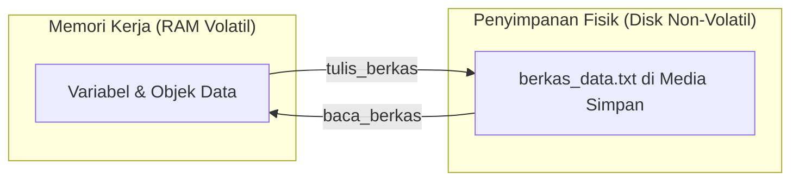

## Bab 28: Operasi Berkas I/O dan Aliran Data (File Stream)

### 28.1 Konsep Sistem Berkas dan Descriptor

```mermaid
graph TD
    A[Mulai Bab 28: Operasi Berkas IO Stream] --> B[Pahami Konsep tulis_berkas()]
    B --> C[Terapkan Sintaksis baca_berkas()]
    C --> D[Uji Validitas Data & tambah_berkas() append]
    D --> E[Eksekusi Sistem Handal & Mandiri]
```

Perangkat lunak yang bermanfaat harus mampu menyimpan keadaan datanya (*state persistence*) ke media penyimpanan permanen (Solid State Drive atau Hard Disk). Tanpa operasi berkas, seluruh data yang disimpan di memori RAM akan musnah saat program berhenti dieksekusi atau komputer dimatikan.

Di tingkat sistem operasi, setiap berkas yang dibuka diberikan nomor pengenal berkas (**File Descriptor**). Widya-Lang mengabstraksikan kompleksitas panggilan sistem POSIX/Windows ini melalui antarmuka fungsi yang bersih dan aman dari kebocoran berkas (*file descriptor leak*).



### 28.2 Membaca Seluruh Isi Berkas Teks
Fungsi `baca_berkas(jalur)` membaca seluruh isi berkas teks dari disk ke dalam variabel string secara instan:

```widya
tetap jalur = "data_konfigurasi.cfg";

jika (berkas_ada(jalur)) {
    tetap isi = baca_berkas(jalur);
    cetak("--- ISI BERKAS KONFIGURASI ---");
    cetak(isi);
    cetak("-------------------------------");
} lainnya {
    cetak("Peringatan: Berkas '" + jalur + "' tidak ditemukan di direktori kerja!");
}
```

### 28.3 Menulis dan Menimpa Berkas
Untuk menyimpan catatan baru ke disk, fungsi `tulis_berkas(jalur, isi)` membuat berkas baru secara otomatis atau menimpa berkas lama jika sudah ada:

```widya
tetap jalur_catatan = "catatan_harian.txt";
tetap catatan = "Laporan Operasional Sistem:\n"
             + "Tanggal: 2026-10-19\n"
             + "Status: Semua layanan berjalan 100% normal tanpa kendala.\n";

tetap status = tulis_berkas(jalur_catatan, catatan);
jika (status) {
    cetak("Penyimpanan berkas berhasil diverifikasi.");
} lainnya {
    cetak("Gagal menulis berkas ke media penyimpanan!");
}
```

### 28.4 Mode Penambahan Data (*Append*)
Dalam skenario pencatatan log (*logging*), kita tidak ingin menimpa entri lama, melainkan menyematkan baris baru di ujung berkas:

```widya
fungsi catat_kejadian(pesan_log) {
    tetap waktu_sekarang = "2026-10-19 20:30:00";
    tetap entri = "[" + waktu_sekarang + "] " + pesan_log + "\n";
    tambah_berkas("audit_trail.log", entri);
}

catat_kejadian("Pengguna 'admin' berhasil masuk log sistem.");
catat_kejadian("Pembaruan basis data modul inventaris selesai.");
```

### 28.5 Rangkuman Konsep Kunci Bab 28
- Operasi berkas menjamin persistensi data melintasi siklus mati-hidup program.
- `baca_berkas` membaca teks utuh, `tulis_berkas` menyimpan/menimpa, `tambah_berkas` menyematkan log baru.

### 28.6 Latihan Mandiri & Evaluasi Pemahaman
1. Apa perbedaan mendasar antara memori volatil (RAM) dan penyimpanan non-volatil (Disk)?
2. Mengapa mode append lebih disukai daripada menimpa seluruh berkas saat menulis log audit?
3. **Tantangan Praktik**: Buatlah program pencatat buku tamu `buku_tamu.widya` yang meminta nama dan instansi pengunjung, lalu menambahkannya ke berkas `daftar_hadir.txt`!

---

### 28.9 Latihan Soal Pilihan Ganda (10 Soal)

Pilihlah satu jawaban yang paling tepat (A, B, C, atau D) untuk menguji penguasaan materi bab ini:

**1. Apa fokus utama pembahasan dalam Bab 28 (Operasi Berkas IO Stream)?**
- A. Membahas secara mendalam Persistensi penyimpanan disk
- B. Mengonfigurasi kabel jaringan lokal
- C. Memperbaiki motherboard komputer
- D. Menghapus database peladen

**2. Manakah kata kunci atau sintaksis yang menjadi inti materi bab ini?**
- A. Kata kunci `baca_berkas()`
- B. perintah format disk
- C. bahasa assembly x86
- D. tag HTML

**3. Mengapa konsep tulis_berkas() sangat penting dalam rekayasa perangkat lunak modern?**
- A. Menjamin efisiensi komputasi dan keterbacaan kode secara modular
- B. Hanya formalitas akademis
- C. Agar program berjalan lambat
- D. Mengurangi resolusi layar

**4. Dalam pengolahan data, bagaimana tambah_berkas() append memengaruhi performa memori?**
- A. Mengoptimalkan struktur alokasi data di RAM secara efisien
- B. Membuat memori penuh seketika
- C. Menghapus seluruh file disk
- D. Menghentikan kipas prosesor

**5. Manakah best practice yang dianjurkan dalam menerapkan materi Bab 28?**
- A. Menerapkan validasi data dan isolasi ruang lingkup yang bersih
- B. Menulis seluruh kode dalam satu baris panjang
- C. Mengabaikan penanganan kesalahan
- D. Menggunakan variabel global sembarangan

**6. Apa risiko yang timbul jika pemrogram mengabaikan kaidah tulis_berkas()?**
- A. Munculnya kutu logika atau kerentanan runtime saat data ekstrem masuk
- B. Komputer langsung terbakar
- C. Kecepatan internet naik dua kali lipat
- D. Keyboard tidak berfungsi

**7. Bagaimana kompilator Widya-Lang memproses instruksi yang berkaitan dengan baca_berkas()?**
- A. Divalidasi pada tahap analisis semantik dan diterjemahkan ke instruksi biner native
- B. Dikirimkan ke cloud pihak ketiga
- C. Diterjemahkan baris per baris secara lambat
- D. Diabaikan seluruhnya

**8. Di lingkungan industri, penerapan modul Bab 28 lazim ditemukan pada...**
- A. Sistem perbankan, backend peladen, aplikasi sains data, dan otomatisasi bisnis
- B. Hanya pada kalkulator saku sederhana
- C. Hanya pada game lawas 8-bit
- D. Tidak pernah digunakan di industri

**9. Fungsi pendukung apa yang paling sering dikombinasikan dengan materi bab ini?**
- A. Fungsi bawaan `cetak()`, `teks()`, atau asersi pengujian `pastikan()`
- B. Perintah mematikan komputer
- C. Fungsi memutar musik
- D. Fungsi mencetak kertas printer

**10. Setelah menuntaskan Bab 28, kompetensi apa yang diharapkan dikuasai oleh pembaca?**
- A. Mampu merancang, mengimplementasikan, dan menguji solusi berbasis Persistensi penyimpanan disk secara mandiri
- B. Mampu merakit kabel listrik tegangan tinggi
- C. Mampu mendesain grafis vektor 3D
- D. Mampu memasang antena radio
