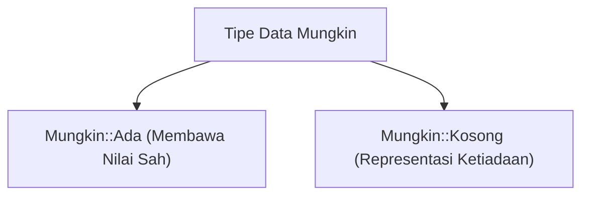

## Bab 30: Penanganan Galat Berbasis Nilai dan Konsep `Mungkin` (Option)

### 30.1 Dilema Nilai Hilang (*The Billion Dollar Mistake*)

```mermaid
graph TD
    A[Mulai Bab 30: Penanganan Galat Nilai Mungkin] --> B[Pahami Konsep Mungkin::Kosong]
    B --> C[Terapkan Sintaksis Mungkin::Ada(v)]
    C --> D[Uji Validitas Data & ekstraksi aman via cocok]
    D --> E[Eksekusi Sistem Handal & Mandiri]
```

Dalam bahasa pemrograman lawas, konsep nilai kosong sering diwakili oleh `null` atau pointer nol. Hal ini kerap memicu galat runtime fatal yang dikenal sebagai *NullPointerException*, yang menyebabkan aplikasi perbankan atau server terhenti mendadak. 

Widya-Lang menghapuskan `null` liar dari sintaksis intinya. Ketika suatu nilai mungkin ada dan mungkin tidak ada (misalnya mencari kata kunci di kamus atau mencari berkas di disk), Widya-Lang memodelkannya secara eksplisit dengan pola nilai opsional `Mungkin`.

### 30.2 Anatomi Tipe `Mungkin`
Tipe `Mungkin` memiliki dua representasi keadaan:
1. `Mungkin::Ada(nilai)`: Nilai yang dicari tersedia dan terbungkus rapi.
2. `Mungkin::Kosong`: Nilai tidak ditemukan atau ketiadaan data yang sah.



### 30.3 Pola Pencarian Aman pada Kamus
Contoh implementasi fungsi pencarian yang mengembalikan tipe `Mungkin`:

```widya
fungsi cari_nomor_telepon(buku_kontak, nama_target) {
    jika (kunci_ada(buku_kontak, nama_target)) {
        kembalikan Mungkin::Ada(buku_kontak[nama_target]);
    }
    kembalikan Mungkin::Kosong;
}

variabel kontak = {};
kontak["Posko_Bencana"] = "021-5551234";
kontak["Ambulans"] = "118";
kontak["Polisi"] = "110";

tetap hasil = cari_nomor_telepon(kontak, "Pemadam");

cocok (hasil) {
    kasus Mungkin::Ada(no) => {
        cetak("Hubungi nomor darurat: " + no);
    },
    kasus Mungkin::Kosong => {
        cetak("Kontak tidak tercatat dalam direktori.");
    }
}
```

### 30.4 Rangkuman Konsep Kunci Bab 30
- `Mungkin` menghapuskan bahaya galat penunjuk kosong (*Null Pointer Exception*).
- Kompilator memaksa pemrogram menangani kedua kasus (`Ada` dan `Kosong`) secara eksplisit.

### 30.5 Latihan Mandiri & Evaluasi Pemahaman
1. Mengapa Tony Hoare menyebut penemuan pointer `null` sebagai *"The Billion Dollar Mistake"*?
2. Bagaimana blok `cocok` menjamin bahwa data di dalam `Mungkin::Ada` tidak diekstraksi tanpa validasi?
3. **Tantangan Praktik**: Rancanglah fungsi pencarian ID pengguna di dalam larik yang mengembalikan `Mungkin::Ada(indeks)` jika ditemukan atau `Mungkin::Kosong` jika tidak terdaftar!

---

### 30.9 Latihan Soal Pilihan Ganda (10 Soal)

Pilihlah satu jawaban yang paling tepat (A, B, C, atau D) untuk menguji penguasaan materi bab ini:

**1. Apa fokus utama pembahasan dalam Bab 30 (Penanganan Galat Nilai Mungkin)?**
- A. Membahas secara mendalam Pola eliminasi null pointer
- B. Mengonfigurasi kabel jaringan lokal
- C. Memperbaiki motherboard komputer
- D. Menghapus database peladen

**2. Manakah kata kunci atau sintaksis yang menjadi inti materi bab ini?**
- A. Kata kunci `Mungkin::Ada(v)`
- B. perintah format disk
- C. bahasa assembly x86
- D. tag HTML

**3. Mengapa konsep Mungkin::Kosong sangat penting dalam rekayasa perangkat lunak modern?**
- A. Menjamin efisiensi komputasi dan keterbacaan kode secara modular
- B. Hanya formalitas akademis
- C. Agar program berjalan lambat
- D. Mengurangi resolusi layar

**4. Dalam pengolahan data, bagaimana ekstraksi aman via cocok memengaruhi performa memori?**
- A. Mengoptimalkan struktur alokasi data di RAM secara efisien
- B. Membuat memori penuh seketika
- C. Menghapus seluruh file disk
- D. Menghentikan kipas prosesor

**5. Manakah best practice yang dianjurkan dalam menerapkan materi Bab 30?**
- A. Menerapkan validasi data dan isolasi ruang lingkup yang bersih
- B. Menulis seluruh kode dalam satu baris panjang
- C. Mengabaikan penanganan kesalahan
- D. Menggunakan variabel global sembarangan

**6. Apa risiko yang timbul jika pemrogram mengabaikan kaidah Mungkin::Kosong?**
- A. Munculnya kutu logika atau kerentanan runtime saat data ekstrem masuk
- B. Komputer langsung terbakar
- C. Kecepatan internet naik dua kali lipat
- D. Keyboard tidak berfungsi

**7. Bagaimana kompilator Widya-Lang memproses instruksi yang berkaitan dengan Mungkin::Ada(v)?**
- A. Divalidasi pada tahap analisis semantik dan diterjemahkan ke instruksi biner native
- B. Dikirimkan ke cloud pihak ketiga
- C. Diterjemahkan baris per baris secara lambat
- D. Diabaikan seluruhnya

**8. Di lingkungan industri, penerapan modul Bab 30 lazim ditemukan pada...**
- A. Sistem perbankan, backend peladen, aplikasi sains data, dan otomatisasi bisnis
- B. Hanya pada kalkulator saku sederhana
- C. Hanya pada game lawas 8-bit
- D. Tidak pernah digunakan di industri

**9. Fungsi pendukung apa yang paling sering dikombinasikan dengan materi bab ini?**
- A. Fungsi bawaan `cetak()`, `teks()`, atau asersi pengujian `pastikan()`
- B. Perintah mematikan komputer
- C. Fungsi memutar musik
- D. Fungsi mencetak kertas printer

**10. Setelah menuntaskan Bab 30, kompetensi apa yang diharapkan dikuasai oleh pembaca?**
- A. Mampu merancang, mengimplementasikan, dan menguji solusi berbasis Pola eliminasi null pointer secara mandiri
- B. Mampu merakit kabel listrik tegangan tinggi
- C. Mampu mendesain grafis vektor 3D
- D. Mampu memasang antena radio
