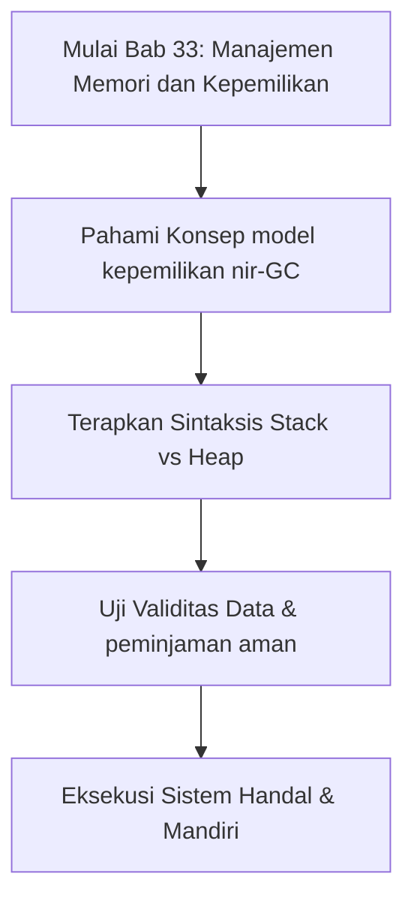

## Bab 33: Arsitektur Memori dan Model Kepemilikan (*Ownership*)

### 33.1 Tumpukan (*Stack*) vs Hamburan (*Heap*)



Untuk memahami bagaimana program mengeksekusi data secara efisien, pemrogram harus memahami pembagian dua area memori utama:
- **Tumpukan (Stack)**: Area memori berkecepatan sangat tinggi berstruktur LIFO (*Last In, First Out*). Digunakan untuk menyimpan variabel lokal dengan ukuran yang sudah pasti pada saat kompilasi (angka primitif, boolean). Alokasi dan dealokasi terjadi otomatis begitu blok kurung kurawal `{}` selesai dieksekusi.
- **Hamburan (Heap)**: Area memori berkapasitas besar yang digunakan untuk data berukuran dinamis yang dapat membesar atau mengecil selama program berjalan (seperti string berukuran panjang, larik dinamis, dan pohon objek).

```
   MEMORI STACK                     MEMORI HEAP
+-----------------------+        +---------------------------+
| variabel angka = 42   |        | ["Data 1", "Data 2", ...] |
| variabel ref_larik ---+------->| (Alokasi dinamis)         |
+-----------------------+        +---------------------------+
(Cepat, Ukuran Pasti)             (Fleksibel, Perlu Dikelola)
```

### 33.2 Konsep Kepemilikan Variabel
Widya-Lang terinspirasi oleh pendekatan modern dalam keselamatan memori (*memory safety*). Setiap nilai di memori heap memiliki tepat **satu variabel pemilik (*owner*)** pada satu waktu. Ketika variabel pemilik keluar dari ruang lingkup (*scope*), memori heap yang dialokasikan akan dibersihkan secara instan tanpa perlu jeda *Garbage Collector* yang lambat.

### 33.3 Peminjaman (*Borrowing*) Akses Baca
Saat sebuah larik besar dilewatkan ke fungsi pencetak, kita tidak ingin menggandakan (*clone*) jutaan elemen di memori. Sebaliknya, fungsi hanya "meminjam" akses baca ke data tersebut:

```widya
fungsi hitung_rata_rata(daftar_angka) {
    variabel total = 0;
    untuk n dalam daftar_angka {
        total = total + n;
    }
    kembalikan total / panjang(daftar_angka);
}

tetap sampel_suhu = [28.5, 29.2, 30.1, 27.8, 28.9];
tetap rataan = hitung_rata_rata(sampel_suhu);

cetak("Suhu Rata-rata: " + teks(rataan) + " °C");
cetak("Jumlah data sampel: " + teks(panjang(sampel_suhu)));
```

### 33.4 Rangkuman Konsep Kunci Bab 33
- Memori Stack berkecepatan tinggi untuk variabel lokal terikat ruang lingkup.
- Memori Heap untuk data dinamis yang dikelola dengan model kepemilikan ketat tanpa jeda GC.

### 33.5 Latihan Mandiri & Evaluasi Pemahaman
1. Jelaskan perbedaan mendasar antara alokasi memori Stack dan Heap!
2. Mengapa model kepemilikan nir-GC menghasilkan waktu latensi yang stabil untuk sistem waktu nyata (*real-time*)?
3. **Tantangan Praktik**: Jelaskan siklus hidup variabel dari saat dialokasikan di dalam blok fungsi hingga dibebaskan kembali ke sistem operasi!

---

### 33.9 Latihan Soal Pilihan Ganda (10 Soal)

Pilihlah satu jawaban yang paling tepat (A, B, C, atau D) untuk menguji penguasaan materi bab ini:

**1. Apa fokus utama pembahasan dalam Bab 33 (Manajemen Memori dan Kepemilikan)?**
- A. Membahas secara mendalam Arsitektur memori modern
- B. Mengonfigurasi kabel jaringan lokal
- C. Memperbaiki motherboard komputer
- D. Menghapus database peladen

**2. Manakah kata kunci atau sintaksis yang menjadi inti materi bab ini?**
- A. Kata kunci `Stack vs Heap`
- B. perintah format disk
- C. bahasa assembly x86
- D. tag HTML

**3. Mengapa konsep model kepemilikan nir-GC sangat penting dalam rekayasa perangkat lunak modern?**
- A. Menjamin efisiensi komputasi dan keterbacaan kode secara modular
- B. Hanya formalitas akademis
- C. Agar program berjalan lambat
- D. Mengurangi resolusi layar

**4. Dalam pengolahan data, bagaimana peminjaman aman memengaruhi performa memori?**
- A. Mengoptimalkan struktur alokasi data di RAM secara efisien
- B. Membuat memori penuh seketika
- C. Menghapus seluruh file disk
- D. Menghentikan kipas prosesor

**5. Manakah best practice yang dianjurkan dalam menerapkan materi Bab 33?**
- A. Menerapkan validasi data dan isolasi ruang lingkup yang bersih
- B. Menulis seluruh kode dalam satu baris panjang
- C. Mengabaikan penanganan kesalahan
- D. Menggunakan variabel global sembarangan

**6. Apa risiko yang timbul jika pemrogram mengabaikan kaidah model kepemilikan nir-GC?**
- A. Munculnya kutu logika atau kerentanan runtime saat data ekstrem masuk
- B. Komputer langsung terbakar
- C. Kecepatan internet naik dua kali lipat
- D. Keyboard tidak berfungsi

**7. Bagaimana kompilator Widya-Lang memproses instruksi yang berkaitan dengan Stack vs Heap?**
- A. Divalidasi pada tahap analisis semantik dan diterjemahkan ke instruksi biner native
- B. Dikirimkan ke cloud pihak ketiga
- C. Diterjemahkan baris per baris secara lambat
- D. Diabaikan seluruhnya

**8. Di lingkungan industri, penerapan modul Bab 33 lazim ditemukan pada...**
- A. Sistem perbankan, backend peladen, aplikasi sains data, dan otomatisasi bisnis
- B. Hanya pada kalkulator saku sederhana
- C. Hanya pada game lawas 8-bit
- D. Tidak pernah digunakan di industri

**9. Fungsi pendukung apa yang paling sering dikombinasikan dengan materi bab ini?**
- A. Fungsi bawaan `cetak()`, `teks()`, atau asersi pengujian `pastikan()`
- B. Perintah mematikan komputer
- C. Fungsi memutar musik
- D. Fungsi mencetak kertas printer

**10. Setelah menuntaskan Bab 33, kompetensi apa yang diharapkan dikuasai oleh pembaca?**
- A. Mampu merancang, mengimplementasikan, dan menguji solusi berbasis Arsitektur memori modern secara mandiri
- B. Mampu merakit kabel listrik tegangan tinggi
- C. Mampu mendesain grafis vektor 3D
- D. Mampu memasang antena radio
