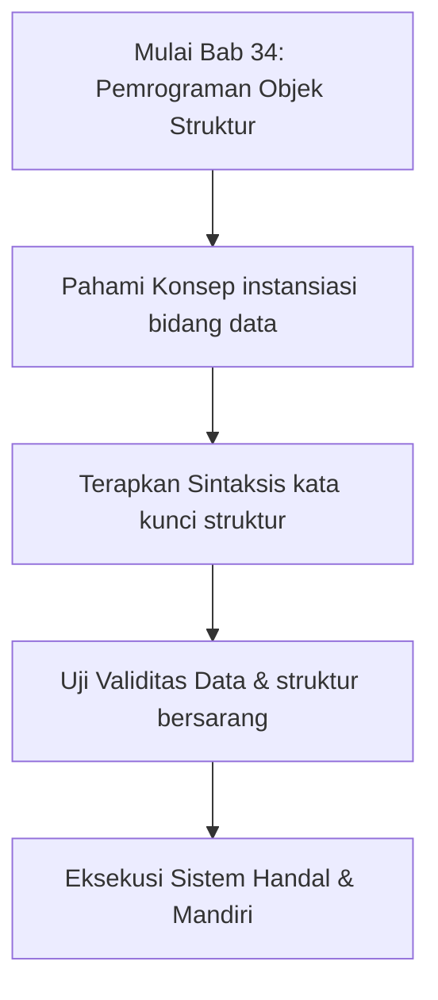

## Bab 34: Pemrograman Berorientasi Objek Bagian 1 - Tipe Struktur

### 34.1 Keterbatasan Tipe Primitif



Hingga tahap ini, kita menggunakan tipe dasar (angka, teks, boolean) dan wadah umum (larik dan kamus). Namun, saat memodelkan sistem kompleks seperti aplikasi perbankan atau logistik pelabuhan, representasi data perlu disatukan ke dalam tipe kustom yang merepresentasikan entitas nyata.

### 34.2 Deklarasi `struktur`
Kata kunci `struktur` digunakan untuk mendefinisikan cetak biru (*blueprint*) tipe data komposit baru:

```widya
struktur Nasabah {
    nik,
    nama_lengkap,
    nomor_rekening,
    saldo,
    status_aktif
}

struktur TitikGeografis {
    garis_lintang,
    garis_bujur,
    ketinggian_mdpl
}
```

### 34.3 Pembuatan Instansiasi Objek
Setelah struktur dideklarasikan, kita dapat mencetak instansi objek baru dari struktur tersebut:

```widya
variabel nasabah_1 = Nasabah {
    nik: "3201123456780001",
    nama_lengkap: "Siti Rahmawati",
    nomor_rekening: "009-887-2134",
    saldo: 15750000,
    status_aktif: benar
};

cetak("--- DATA NASABAH TERDAFTAR ---");
cetak("Nama:    " + nasabah_1.nama_lengkap);
cetak("No Rek:  " + nasabah_1.nomor_rekening);
cetak("Saldo:   Rp " + teks(nasabah_1.saldo));
cetak("Aktif:   " + teks(nasabah_1.status_aktif));
```

### 34.4 Struktur Bersarang (*Nested Structures*)
Sebuah struktur dapat menampung struktur lain sebagai salah satu bidangnya, membentuk relasi hierarkis:

```widya
struktur AlamatRumah {
    jalan,
    kecamatan,
    kota,
    kode_pos
}

struktur Karyawan {
    id_pegawai,
    nama,
    jabatan,
    alamat
}

variabel staf = Karyawan {
    id_pegawai: "STF-2026-089",
    nama: "Hendra Wijaya",
    jabatan: "Analis Perangkat Lunak",
    alamat: AlamatRumah {
        jalan: "Jl. Diponegoro No. 45",
        kecamatan: "Menteng",
        kota: "Jakarta Pusat",
        kode_pos: "10310"
    }
};

cetak("Pegawai " + staf.nama + " berdomisili di Kota " + staf.alamat.kota);
```

### 34.5 Rangkuman Konsep Kunci Bab 34
- `struktur` membentuk tipe data kustom bentukan pengguna.
- Objek diinstansiasi dengan memetakan nama bidang ke nilai awal.
- Struktur bersarang memungkinkan pemodelan domain bisnis yang kaya.

### 34.6 Latihan Mandiri & Evaluasi Pemahaman
1. Mengapa menggunakan `struktur` lebih aman daripada sekadar kamus string bebas?
2. Bagaimana cara mengakses bidang yang berada di dalam struktur bersarang dua tingkat?
3. **Tantangan Praktik**: Rancanglah struktur `BukuPerpustakaan` dengan bidang judul, penulis, isbn, tahun terbit, dan status ketersediaan peminjaman!

---

### 34.9 Latihan Soal Pilihan Ganda (10 Soal)

Pilihlah satu jawaban yang paling tepat (A, B, C, atau D) untuk menguji penguasaan materi bab ini:

**1. Apa fokus utama pembahasan dalam Bab 34 (Pemrograman Objek Struktur)?**
- A. Membahas secara mendalam Tipe data bentukan
- B. Mengonfigurasi kabel jaringan lokal
- C. Memperbaiki motherboard komputer
- D. Menghapus database peladen

**2. Manakah kata kunci atau sintaksis yang menjadi inti materi bab ini?**
- A. Kata kunci `kata kunci struktur`
- B. perintah format disk
- C. bahasa assembly x86
- D. tag HTML

**3. Mengapa konsep instansiasi bidang data sangat penting dalam rekayasa perangkat lunak modern?**
- A. Menjamin efisiensi komputasi dan keterbacaan kode secara modular
- B. Hanya formalitas akademis
- C. Agar program berjalan lambat
- D. Mengurangi resolusi layar

**4. Dalam pengolahan data, bagaimana struktur bersarang memengaruhi performa memori?**
- A. Mengoptimalkan struktur alokasi data di RAM secara efisien
- B. Membuat memori penuh seketika
- C. Menghapus seluruh file disk
- D. Menghentikan kipas prosesor

**5. Manakah best practice yang dianjurkan dalam menerapkan materi Bab 34?**
- A. Menerapkan validasi data dan isolasi ruang lingkup yang bersih
- B. Menulis seluruh kode dalam satu baris panjang
- C. Mengabaikan penanganan kesalahan
- D. Menggunakan variabel global sembarangan

**6. Apa risiko yang timbul jika pemrogram mengabaikan kaidah instansiasi bidang data?**
- A. Munculnya kutu logika atau kerentanan runtime saat data ekstrem masuk
- B. Komputer langsung terbakar
- C. Kecepatan internet naik dua kali lipat
- D. Keyboard tidak berfungsi

**7. Bagaimana kompilator Widya-Lang memproses instruksi yang berkaitan dengan kata kunci struktur?**
- A. Divalidasi pada tahap analisis semantik dan diterjemahkan ke instruksi biner native
- B. Dikirimkan ke cloud pihak ketiga
- C. Diterjemahkan baris per baris secara lambat
- D. Diabaikan seluruhnya

**8. Di lingkungan industri, penerapan modul Bab 34 lazim ditemukan pada...**
- A. Sistem perbankan, backend peladen, aplikasi sains data, dan otomatisasi bisnis
- B. Hanya pada kalkulator saku sederhana
- C. Hanya pada game lawas 8-bit
- D. Tidak pernah digunakan di industri

**9. Fungsi pendukung apa yang paling sering dikombinasikan dengan materi bab ini?**
- A. Fungsi bawaan `cetak()`, `teks()`, atau asersi pengujian `pastikan()`
- B. Perintah mematikan komputer
- C. Fungsi memutar musik
- D. Fungsi mencetak kertas printer

**10. Setelah menuntaskan Bab 34, kompetensi apa yang diharapkan dikuasai oleh pembaca?**
- A. Mampu merancang, mengimplementasikan, dan menguji solusi berbasis Tipe data bentukan secara mandiri
- B. Mampu merakit kabel listrik tegangan tinggi
- C. Mampu mendesain grafis vektor 3D
- D. Mampu memasang antena radio
