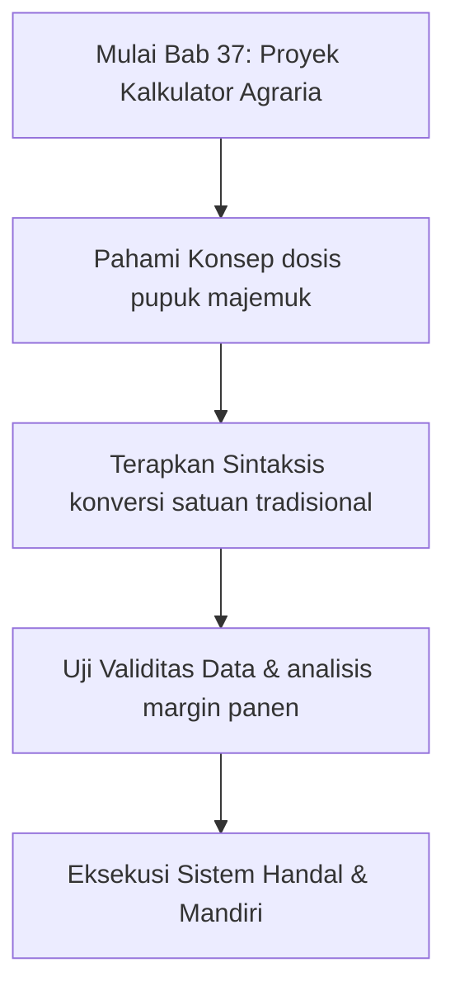
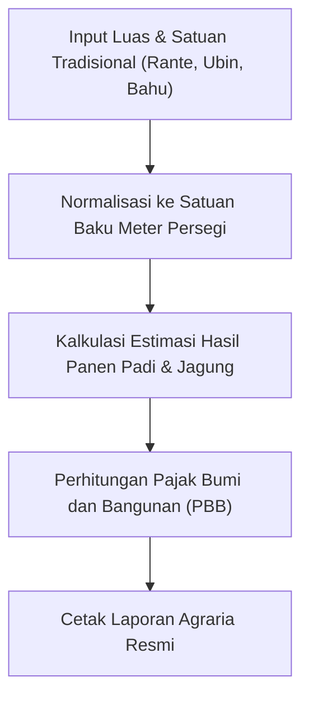

## Bab 37: Proyek Mandiri 1 - Sistem Kalkulator Agraria & Pengukuran Lahan

### 37.1 Latar Belakang dan Spesifikasi Kebutuhan Sistem (SRS)



Indonesia sebagai lumbung pangan agraris memiliki jutaan petani dan kelompok tani (Gapoktan) yang mengelola lahan dengan satuan tradisional yang beraneka ragam di berbagai pelosok nusantara—seperti satuan *Hektar* (Ha), *Are*, *Rante* (Sumatera Utara), *Bahu* / *Bau* (Jawa), *Ubin* / *Tumbak* (Sunda/Jawa Barat), hingga *Ru*. 

Dalam proyek pertama ini, kita akan merancang sistem perangkat lunak terpadu berbasis Widya-Lang untuk:
1. Mengonversi berbagai satuan luas tradisional ke satuan standar internasional meter persegi ($m^2$).
2. Menghitung kebutuhan pupuk majemuk (Urea, SP-36, KCl, dan NPK Phonska) berdasarkan komoditas pangan.
3. Mengestimasikan biaya modal sarana produksi padi dan proyeksi keuntungan panen.



### 37.2 Implementasi Kode Program Utuh

```widya
// ==========================================================
// PROYEK 1: KALKULATOR AGRARIA & PENGUKURAN LAHAN NUSANTARA
// ==========================================================

struktur LahanTani {
    nama_pemilik,
    komoditas,
    satuan_asal,
    nilai_luas,
    luas_meter_persegi
}

implementasi LahanTani {
    fungsi baru(pemilik, tanaman, satuan, nilai) {
        variabel m2 = 0.0;
        
        jika (satuan == "hektar" || satuan == "ha") {
            m2 = nilai * 10000.0;
        } jika_tidak jika (satuan == "are") {
            m2 = nilai * 100.0;
        } jika_tidak jika (satuan == "rante") {
            m2 = nilai * 400.0; // 1 rante di Sumut = 400 m2
        } jika_tidak jika (satuan == "bahu" || satuan == "bau") {
            m2 = nilai * 7096.0; // 1 bahu di Jawa = ~7096 m2
        } jika_tidak jika (satuan == "ubin" || satuan == "tumbak" || satuan == "ru") {
            m2 = nilai * 14.0625; // 1 ubin = 3.75m x 3.75m = 14.0625 m2
        } lainnya {
            m2 = nilai; // Dianggap meter persegi langsung
        }
        
        kembalikan LahanTani {
            nama_pemilik: pemilik,
            komoditas: tanaman,
            satuan_asal: satuan,
            nilai_luas: nilai,
            luas_meter_persegi: m2
        };
    }

    fungsi hitung_dosis_pupuk(diri) {
        tetap rasio = diri.luas_meter_persegi / 10000.0;
        tetap butuh_urea = rasio * 250.0;
        tetap butuh_npk = rasio * 300.0;
        
        cetak("=== RENCANA KEBUTUHAN PUPUK KELOMPOK TANI ===");
        cetak("Pemilik Lahan   : " + diri.nama_pemilik);
        cetak("Komoditas       : " + diri.komoditas);
        cetak("Luas Asal       : " + teks(diri.nilai_luas) + " " + diri.satuan_asal);
        cetak("Luas Baku (m2)  : " + teks(diri.luas_meter_persegi) + " m2 (" + teks(rasio) + " Ha)");
        cetak("Kebutuhan Urea  : " + teks(butuh_urea) + " kg");
        cetak("Kebutuhan NPK   : " + teks(butuh_npk) + " kg");
    }

    fungsi estimasi_panen_dan_laba(diri, harga_gabah_per_kg) {
        tetap rasio = diri.luas_meter_persegi / 10000.0;
        tetap estimasi_hasil_kg = rasio * 6000.0;
        tetap estimasi_pendapatan = estimasi_hasil_kg * harga_gabah_per_kg;
        tetap estimasi_biaya_produksi = rasio * 15000000.0;
        tetap proyeksi_laba_bersih = estimasi_pendapatan - estimasi_biaya_produksi;

        cetak("=== PROYEKSI FINANSIAL PANEN PANGAN ===");
        cetak("Estimasi Panen  : " + teks(estimasi_hasil_kg) + " kg GKP");
        cetak("Estimasi Omzet  : Rp " + teks(estimasi_pendapatan));
        cetak("Estimasi Modal  : Rp " + teks(estimasi_biaya_produksi));
        cetak("Proyeksi Laba   : Rp " + teks(proyeksi_laba_bersih));
    }
}

fungsi utama() {
    tetap lahan1 = LahanTani::baru("Pak Sukardi", "Padi Ciherang", "rante", 10.0);
    lahan1.hitung_dosis_pupuk();
    lahan1.estimasi_panen_dan_laba(6800.0);
}
```

### 37.3 Rangkuman Desain Proyek 1
- Memadukan pemodelan `struktur` dan `implementasi` metode.
- Menerapkan percabangan bersyarat untuk normalisasi konversi satuan lokal nusantara.
- Memberikan solusi komputasi nyata yang berdampak langsung bagi sektor pertanian nasional.

### 37.4 Latihan Mandiri & Evaluasi Pemahaman
1. Mengapa normalisasi seluruh satuan luas tradisional ke satuan meter persegi ($m^2$) penting dilakukan sebelum menghitung dosis kebutuhan pupuk?
2. Bagaimana cara mengantisipasi nilai masukan luas lahan yang bernilai nol atau negatif agar sistem tidak menghasilkan kalkulasi pertanian yang menyesatkan?
3. **Tantangan Praktik**: Rancanglah fungsi pengayaan `hitung_kebutuhan_benih(luas_m2, varietas_padi)` yang mengestimasikan jumlah kilogram bibit padi unggul serta total biaya subsidinya!

---

### 37.5 Latihan Soal Pilihan Ganda (10 Soal)

Pilihlah satu jawaban yang paling tepat (A, B, C, atau D) untuk menguji penguasaan materi bab ini:

**1. Apa fokus utama pembahasan dalam Bab 37 (Proyek Kalkulator Agraria)?**
- A. Membahas secara mendalam Aplikasi rekayasa pertanian
- B. Mengonfigurasi kabel jaringan lokal
- C. Memperbaiki motherboard komputer
- D. Menghapus database peladen

**2. Manakah kata kunci atau sintaksis yang menjadi inti materi bab ini?**
- A. Kata kunci `konversi satuan tradisional`
- B. perintah format disk
- C. bahasa assembly x86
- D. tag HTML

**3. Mengapa konsep dosis pupuk majemuk sangat penting dalam rekayasa perangkat lunak modern?**
- A. Menjamin efisiensi komputasi dan keterbacaan kode secara modular
- B. Hanya formalitas akademis
- C. Agar program berjalan lambat
- D. Mengurangi resolusi layar

**4. Dalam pengolahan data, bagaimana analisis margin panen memengaruhi performa memori?**
- A. Mengoptimalkan struktur alokasi data di RAM secara efisien
- B. Membuat memori penuh seketika
- C. Menghapus seluruh file disk
- D. Menghentikan kipas prosesor

**5. Manakah best practice yang dianjurkan dalam menerapkan materi Bab 37?**
- A. Menerapkan validasi data dan isolasi ruang lingkup yang bersih
- B. Menulis seluruh kode dalam satu baris panjang
- C. Mengabaikan penanganan kesalahan
- D. Menggunakan variabel global sembarangan

**6. Apa risiko yang timbul jika pemrogram mengabaikan kaidah dosis pupuk majemuk?**
- A. Munculnya kutu logika atau kerentanan runtime saat data ekstrem masuk
- B. Komputer langsung terbakar
- C. Kecepatan internet naik dua kali lipat
- D. Keyboard tidak berfungsi

**7. Bagaimana kompilator Widya-Lang memproses instruksi yang berkaitan dengan konversi satuan tradisional?**
- A. Divalidasi pada tahap analisis semantik dan diterjemahkan ke instruksi biner native
- B. Dikirimkan ke cloud pihak ketiga
- C. Diterjemahkan baris per baris secara lambat
- D. Diabaikan seluruhnya

**8. Di lingkungan industri, penerapan modul Bab 37 lazim ditemukan pada...**
- A. Sistem perbankan, backend peladen, aplikasi sains data, dan otomatisasi bisnis
- B. Hanya pada kalkulator saku sederhana
- C. Hanya pada game lawas 8-bit
- D. Tidak pernah digunakan di industri

**9. Fungsi pendukung apa yang paling sering dikombinasikan dengan materi bab ini?**
- A. Fungsi bawaan `cetak()`, `teks()`, atau asersi pengujian `pastikan()`
- B. Perintah mematikan komputer
- C. Fungsi memutar musik
- D. Fungsi mencetak kertas printer

**10. Setelah menuntaskan Bab 37, kompetensi apa yang diharapkan dikuasai oleh pembaca?**
- A. Mampu merancang, mengimplementasikan, dan menguji solusi berbasis Aplikasi rekayasa pertanian secara mandiri
- B. Mampu merakit kabel listrik tegangan tinggi
- C. Mampu mendesain grafis vektor 3D
- D. Mampu memasang antena radio
