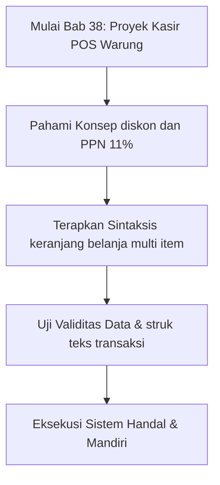

## Bab 38: Proyek Mandiri 2 - Sistem Kasir Point-of-Sale (POS) Warung Digital

### 38.1 Spesifikasi Sistem Kasir Ritel



Warung sembako modern memerlukan sistem pencatatan transaksi yang cepat, akurat, dan mampu menghasilkan struk belanja resmi. Fitur yang dirancang dalam proyek ini:
- Manajemen keranjang belanja multi-item dinamis.
- Perhitungan subtotal otomatis per baris barang.
- Kebijakan diskon bertingkat (apabila total belanja melampaui ambang batas tertentu).
- Pajak Pertambahan Nilai (PPN 11%) sesuai ketentuan regulasi.
- Perhitungan nominal uang kembalian pembeli.
- Penyimpanan bukti audit transaksi ke dalam berkas log `struk_transaksi.txt`.

### 38.2 Implementasi Kode Program Utuh

```widya
// ==========================================================
// PROYEK 2: SISTEM KASIR WARUNG DIGITAL NUSANTARA
// ==========================================================

struktur ItemBelanja {
    kode_barang,
    nama_barang,
    harga_satuan,
    jumlah_beli,
    subtotal
}

struktur TransaksiKasir {
    id_transaksi,
    kasir,
    daftar_item,
    total_kotor,
    potongan_diskon,
    pajak_ppn,
    total_bersih,
    uang_diterima,
    uang_kembalian
}

implementasi TransaksiKasir {
    fungsi baru(id_transaksi, nama_kasir) {
        kembalikan TransaksiKasir {
            id_transaksi: id_transaksi,
            kasir: nama_kasir,
            daftar_item: [],
            total_kotor: 0,
            potongan_diskon: 0,
            pajak_ppn: 0,
            total_bersih: 0,
            uang_diterima: 0,
            uang_kembalian: 0
        };
    }
    
    fungsi tambah_barang(diri, kode, nama, harga, qty) {
        tetap sub = harga * qty;
        tetap item = ItemBelanja {
            kode_barang: kode,
            nama_barang: nama,
            harga_satuan: harga,
            jumlah_beli: qty,
            subtotal: sub
        };
        tambah(diri.daftar_item, item);
        diri.total_kotor = diri.total_kotor + sub;
    }
    
    fungsi selesaikan_pembayaran(diri, tunai_pembeli) {
        // Diskon 5% jika belanja di atas 150.000
        jika (diri.total_kotor >= 150000) {
            diri.potongan_diskon = diri.total_kotor * 0.05;
        } lainnya {
            diri.potongan_diskon = 0;
        }
        
        tetap setelah_diskon = diri.total_kotor - diri.potongan_diskon;
        diri.pajak_ppn = setelah_diskon * 0.11; // PPN 11%
        diri.total_bersih = setelah_diskon + diri.pajak_ppn;
        
        diri.uang_diterima = tunai_pembeli;
        diri.uang_kembalian = diri.uang_diterima - diri.total_bersih;
    }
    
    fungsi buat_struk_teks(diri) {
        variabel s = "";
        s = s + "========================================\n";
        s = s + "         WARUNG SERBA ADA MAKMUR        \n";
        s = s + "     Jl. Gatot Subroto No. 88, Solo    \n";
        s = s + "========================================\n";
        s = s + "ID Struk : " + diri.id_transaksi + "\n";
        s = s + "Kasir    : " + diri.kasir + "\n";
        s = s + "----------------------------------------\n";
        
        untuk item dalam diri.daftar_item {
            s = s + item.nama_barang + "\n";
            s = s + "  " + teks(item.jumlah_beli) + " x Rp " + teks(item.harga_satuan) 
                  + " = Rp " + teks(item.subtotal) + "\n";
        }
        
        s = s + "----------------------------------------\n";
        s = s + "Total Kotor  : Rp " + teks(diri.total_kotor) + "\n";
        s = s + "Diskon Khusus: Rp " + teks(diri.potongan_diskon) + "\n";
        s = s + "PPN (11%)    : Rp " + teks(diri.pajak_ppn) + "\n";
        s = s + "TOTAL AKHIR  : Rp " + teks(diri.total_bersih) + "\n";
        s = s + "----------------------------------------\n";
        s = s + "Tunai Bayar  : Rp " + teks(diri.uang_diterima) + "\n";
        s = s + "Kembalian    : Rp " + teks(diri.uang_kembalian) + "\n";
        s = s + "========================================\n";
        s = s + "  Terima kasih atas kunjungan Anda!    \n";
        s = s + " Barang yang dibeli tidak dapat ditukar\n";
        s = s + "========================================\n";
        kembalikan s;
    }
}

// Simulasi Transaksi Pembelian di Kasir
variabel struk = TransaksiKasir::baru("TRX-202610-0012", "Rina Marlina");
struk.tambah_barang("BRG-01", "Beras Pandan Wangi 5kg", 75000, 2);
struk.tambah_barang("BRG-02", "Minyak Goreng Sawit 2L", 35000, 1);
struk.tambah_barang("BRG-03", "Kecap Manis Botol 600ml", 22000, 1);

struk.selesaikan_pembayaran(250000);

tetap struk_cetak = struk.buat_struk_teks();
cetak(struk_cetak);

// Menyimpan bukti transaksi ke berkas teks
tulis_berkas("struk_terakhir.txt", struk_cetak);
cetak("Struk berhasil dicetak dan diarsipkan ke struk_terakhir.txt.");
```

### 38.3 Rangkuman Desain Proyek 2
- Model objek `ItemBelanja` dan `TransaksiKasir` memberikan pemisahan tanggung jawab (*separation of concerns*) yang jelas.
- Kalkulasi moneter mengintegrasikan perhitungan diskon persentase dan regulasi pajak PPN 11%.
- Luaran transaksi disajikan dalam format struk teks rapi serta diarsipkan secara persisten ke dalam berkas disk.

### 38.4 Latihan Mandiri & Evaluasi Pemahaman
1. Mengapa perhitungan PPN 11% sebaiknya dihitung dari subtotal belanja setelah dipotong diskon, bukan sebelum diskon?
2. Bagaimana cara memvalidasi agar transaksi dibatalkan atau ditolak apabila jumlah nominal uang yang diterima kasir kurang dari total tagihan bersih?
3. **Tantangan Praktik**: Tambahkan metode `tambah_pembayaran_qris(diri, kode_referensi, nominal)` pada `TransaksiKasir` untuk memproses pembayaran digital nir-kembalian!

---

### 38.5 Latihan Soal Pilihan Ganda (10 Soal)

Pilihlah satu jawaban yang paling tepat (A, B, C, atau D) untuk menguji penguasaan materi bab ini:

**1. Apa fokus utama pembahasan dalam Bab 38 (Proyek Kasir POS Warung)?**
- A. Membahas secara mendalam Aplikasi ritel modern
- B. Mengonfigurasi kabel jaringan lokal
- C. Memperbaiki motherboard komputer
- D. Menghapus database peladen

**2. Manakah kata kunci atau sintaksis yang menjadi inti materi bab ini?**
- A. Kata kunci `keranjang belanja multi item`
- B. perintah format disk
- C. bahasa assembly x86
- D. tag HTML

**3. Mengapa konsep diskon dan PPN 11% sangat penting dalam rekayasa perangkat lunak modern?**
- A. Menjamin efisiensi komputasi dan keterbacaan kode secara modular
- B. Hanya formalitas akademis
- C. Agar program berjalan lambat
- D. Mengurangi resolusi layar

**4. Dalam pengolahan data, bagaimana struk teks transaksi memengaruhi performa memori?**
- A. Mengoptimalkan struktur alokasi data di RAM secara efisien
- B. Membuat memori penuh seketika
- C. Menghapus seluruh file disk
- D. Menghentikan kipas prosesor

**5. Manakah best practice yang dianjurkan dalam menerapkan materi Bab 38?**
- A. Menerapkan validasi data dan isolasi ruang lingkup yang bersih
- B. Menulis seluruh kode dalam satu baris panjang
- C. Mengabaikan penanganan kesalahan
- D. Menggunakan variabel global sembarangan

**6. Apa risiko yang timbul jika pemrogram mengabaikan kaidah diskon dan PPN 11%?**
- A. Munculnya kutu logika atau kerentanan runtime saat data ekstrem masuk
- B. Komputer langsung terbakar
- C. Kecepatan internet naik dua kali lipat
- D. Keyboard tidak berfungsi

**7. Bagaimana kompilator Widya-Lang memproses instruksi yang berkaitan dengan keranjang belanja multi item?**
- A. Divalidasi pada tahap analisis semantik dan diterjemahkan ke instruksi biner native
- B. Dikirimkan ke cloud pihak ketiga
- C. Diterjemahkan baris per baris secara lambat
- D. Diabaikan seluruhnya

**8. Di lingkungan industri, penerapan modul Bab 38 lazim ditemukan pada...**
- A. Sistem perbankan, backend peladen, aplikasi sains data, dan otomatisasi bisnis
- B. Hanya pada kalkulator saku sederhana
- C. Hanya pada game lawas 8-bit
- D. Tidak pernah digunakan di industri

**9. Fungsi pendukung apa yang paling sering dikombinasikan dengan materi bab ini?**
- A. Fungsi bawaan `cetak()`, `teks()`, atau asersi pengujian `pastikan()`
- B. Perintah mematikan komputer
- C. Fungsi memutar musik
- D. Fungsi mencetak kertas printer

**10. Setelah menuntaskan Bab 38, kompetensi apa yang diharapkan dikuasai oleh pembaca?**
- A. Mampu merancang, mengimplementasikan, dan menguji solusi berbasis Aplikasi ritel modern secara mandiri
- B. Mampu merakit kabel listrik tegangan tinggi
- C. Mampu mendesain grafis vektor 3D
- D. Mampu memasang antena radio
