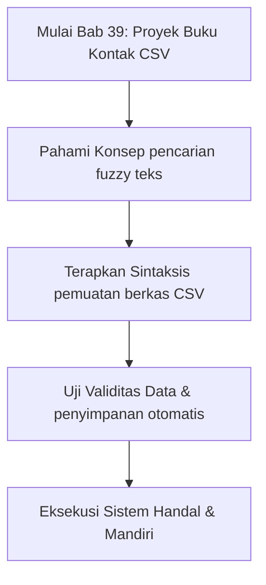
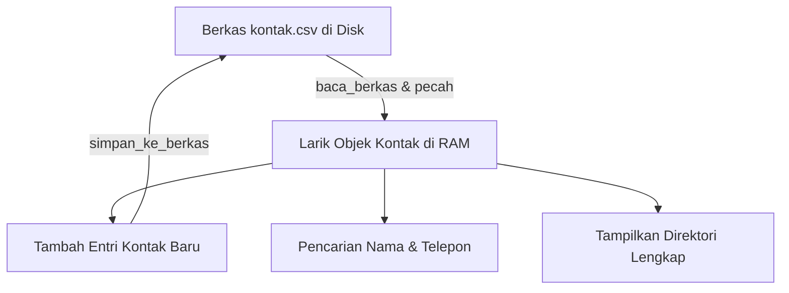

## Bab 39: Proyek Mandiri 3 - Buku Kontak & Manajemen Data Berbasis CSV

### 39.1 Arsitektur Aplikasi Buku Kontak



Proyek ketiga adalah aplikasi penyimpanan informasi buku kontak telepon dan surel yang mendukung pemuatan data awal dari berkas CSV, penambahan kontak baru, pencarian nama secara cerdas (*fuzzy match*), serta penyimpanan kembali ke disk secara permanen.



### 39.2 Implementasi Kode Program Utuh

```widya
// ==========================================================
// PROYEK 3: BUKU KONTAK & MANAJEMEN DATA CSV
// ==========================================================

struktur Kontak {
    id,
    nama,
    telepon,
    email,
    kategori
}

struktur PengelolaKontak {
    berkas_sumber,
    koleksi
}

implementasi PengelolaKontak {
    fungsi baru(nama_berkas) {
        variabel pk = PengelolaKontak {
            berkas_sumber: nama_berkas,
            koleksi: []
        };
        pk.muat_dari_disk();
        kembalikan pk;
    }
    
    fungsi muat_dari_disk(diri) {
        jika (bukan berkas_ada(diri.berkas_sumber)) {
            // Berkas belum ada, buat template baru dengan header
            tulis_berkas(diri.berkas_sumber, "ID,Nama,Telepon,Email,Kategori\n");
            kembalikan;
        }
        
        tetap mentah = baca_berkas(diri.berkas_sumber);
        tetap baris = pecah(mentah, "\n");
        diri.koleksi = [];
        
        variabel i = 1; // Lewati baris header
        selama (i < panjang(baris)) {
            tetap b = pangkas(baris[i]);
            jika (panjang(b) > 0) {
                tetap kol = pecah(b, ",");
                jika (panjang(kol) >= 5) {
                    tetap k = Kontak {
                        id: kol[0],
                        nama: kol[1],
                        telepon: kol[2],
                        email: kol[3],
                        kategori: kol[4]
                    };
                    tambah(diri.koleksi, k);
                }
            }
            i = i + 1;
        }
    }
    
    fungsi tambah_kontak(diri, nama, telp, mail, kategori) {
        tetap id_baru = "KNT-" + teks(panjang(diri.koleksi) + 1);
        tetap k = Kontak {
            id: id_baru,
            nama: nama,
            telepon: telp,
            email: mail,
            kategori: kategori
        };
        tambah(diri.koleksi, k);
        diri.simpan_ke_disk();
        cetak("Kontak [" + nama + "] berhasil ditambahkan dengan ID " + id_baru);
    }
    
    fungsi cari_berdasarkan_nama(diri, kata_kunci) {
        cetak("Hasil pencarian untuk kata kunci '" + kata_kunci + "':");
        variabel ditemukan = 0;
        
        untuk k dalam diri.koleksi {
            jika (mengandung(ke_huruf_kecil(k.nama), ke_huruf_kecil(kata_kunci))) {
                cetak("-> [" + k.id + "] " + k.nama + " | HP: " + k.telepon 
                      + " | Mail: " + k.email + " (" + k.kategori + ")");
                ditemukan = ditemukan + 1;
            }
        }
        
        jika (ditemukan == 0) {
            cetak("   (Tidak ditemukan kontak yang sesuai)");
        }
    }
    
    fungsi simpan_ke_disk(diri) {
        variabel naskah = "ID,Nama,Telepon,Email,Kategori\n";
        untuk k dalam diri.koleksi {
            naskah = naskah + k.id + "," + k.nama + "," + k.telepon + "," 
                     + k.email + "," + k.kategori + "\n";
        }
        tulis_berkas(diri.berkas_sumber, naskah);
    }
}

// Menjalankan Aplikasi Pengelola Kontak
variabel buku = PengelolaKontak::baru("buku_telepon.csv");

buku.tambah_kontak("Dr. Bambang Sutrisno", "081234567890", "bambang@univ.ac.id", "Dosen");
buku.tambah_kontak("Ir. Ratna Kusuma", "081987654321", "ratna@arsitek.co.id", "Kolega");
buku.tambah_kontak("Ahmad Fauzi, S.Kom", "085512344321", "fauzi@widya.id", "Developer");

buku.cari_berdasarkan_nama("ratna");
buku.cari_berdasarkan_nama("kom");
```

### 39.3 Rangkuman Desain Proyek 3
- Format CSV merupakan standar pertukaran data tabular yang ringan dan mudah diintegrasikan dengan aplikasi lain (misal LibreOffice Calc atau Excel).
- Desain arsitektur berbasis objek `PengelolaKontak` mengisolasi manipulasi file I/O dari logika pencarian memori.
- Pencarian cerdas (*case-insensitive partial match*) mempermudah penemuan data kontak secara fleksibel.

### 39.4 Latihan Mandiri & Evaluasi Pemahaman
1. Apa risiko integritas data jika bidang nama atau alamat kontak mengandung tanda koma (`,`) saat disimpan ke CSV tanpa tanda kutip pembungkus?
2. Mengapa operasi pemuatan data awal dari disk (`muat_dari_disk`) wajib dijalankan secara otomatis saat inisialisasi objek pengelola kontak?
3. **Tantangan Praktik**: Rancanglah metode `cari_berdasarkan_awalan_telepon(diri, prefix)` yang menyaring kontak yang memiliki nomor telepon dengan awalan tertentu (misalnya "0812")!

---

### 39.5 Latihan Soal Pilihan Ganda (10 Soal)

Pilihlah satu jawaban yang paling tepat (A, B, C, atau D) untuk menguji penguasaan materi bab ini:

**1. Apa fokus utama pembahasan dalam Bab 39 (Proyek Buku Kontak CSV)?**
- A. Membahas secara mendalam Manajemen data persisten
- B. Mengonfigurasi kabel jaringan lokal
- C. Memperbaiki motherboard komputer
- D. Menghapus database peladen

**2. Manakah kata kunci atau sintaksis yang menjadi inti materi bab ini?**
- A. Kata kunci `pemuatan berkas CSV`
- B. perintah format disk
- C. bahasa assembly x86
- D. tag HTML

**3. Mengapa konsep pencarian fuzzy teks sangat penting dalam rekayasa perangkat lunak modern?**
- A. Menjamin efisiensi komputasi dan keterbacaan kode secara modular
- B. Hanya formalitas akademis
- C. Agar program berjalan lambat
- D. Mengurangi resolusi layar

**4. Dalam pengolahan data, bagaimana penyimpanan otomatis memengaruhi performa memori?**
- A. Mengoptimalkan struktur alokasi data di RAM secara efisien
- B. Membuat memori penuh seketika
- C. Menghapus seluruh file disk
- D. Menghentikan kipas prosesor

**5. Manakah best practice yang dianjurkan dalam menerapkan materi Bab 39?**
- A. Menerapkan validasi data dan isolasi ruang lingkup yang bersih
- B. Menulis seluruh kode dalam satu baris panjang
- C. Mengabaikan penanganan kesalahan
- D. Menggunakan variabel global sembarangan

**6. Apa risiko yang timbul jika pemrogram mengabaikan kaidah pencarian fuzzy teks?**
- A. Munculnya kutu logika atau kerentanan runtime saat data ekstrem masuk
- B. Komputer langsung terbakar
- C. Kecepatan internet naik dua kali lipat
- D. Keyboard tidak berfungsi

**7. Bagaimana kompilator Widya-Lang memproses instruksi yang berkaitan dengan pemuatan berkas CSV?**
- A. Divalidasi pada tahap analisis semantik dan diterjemahkan ke instruksi biner native
- B. Dikirimkan ke cloud pihak ketiga
- C. Diterjemahkan baris per baris secara lambat
- D. Diabaikan seluruhnya

**8. Di lingkungan industri, penerapan modul Bab 39 lazim ditemukan pada...**
- A. Sistem perbankan, backend peladen, aplikasi sains data, dan otomatisasi bisnis
- B. Hanya pada kalkulator saku sederhana
- C. Hanya pada game lawas 8-bit
- D. Tidak pernah digunakan di industri

**9. Fungsi pendukung apa yang paling sering dikombinasikan dengan materi bab ini?**
- A. Fungsi bawaan `cetak()`, `teks()`, atau asersi pengujian `pastikan()`
- B. Perintah mematikan komputer
- C. Fungsi memutar musik
- D. Fungsi mencetak kertas printer

**10. Setelah menuntaskan Bab 39, kompetensi apa yang diharapkan dikuasai oleh pembaca?**
- A. Mampu merancang, mengimplementasikan, dan menguji solusi berbasis Manajemen data persisten secara mandiri
- B. Mampu merakit kabel listrik tegangan tinggi
- C. Mampu mendesain grafis vektor 3D
- D. Mampu memasang antena radio
