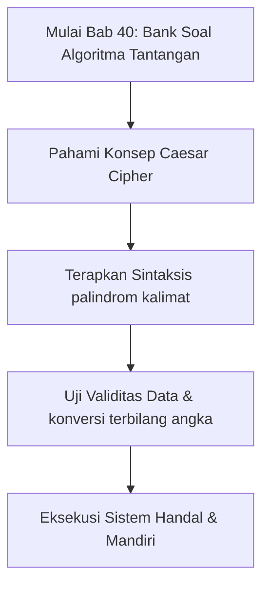

## Bab 40: Bank Soal Tantangan dan Kunci Solusi Berbobot

Untuk mengasah kemahiran Anda dalam memecahkan masalah (*problem solving*), selesaikan kelima tantangan algoritma fundamental di bawah ini:

### 40.1 Tantangan 1: Pemeriksa Kalimat Palindrom Sempurna



**Deskripsi Soal**: Sebuah kalimat disebut palindrom jika dibaca sama dari depan maupun dari belakang, dengan mengabaikan tanda baca, spasi, dan perbedaan huruf besar/kecil. Buatlah fungsi `adalah_palindrom(teks)`!

```widya
fungsi bersihkan_alfanumerik(s) {
    tetap huruf_sah = "abcdefghijklmnopqrstuvwxyz0123456789";
    variabel hasil = "";
    variabel i = 0;
    tetap s_kecil = ke_huruf_kecil(s);
    
    selama (i < panjang(s_kecil)) {
        tetap c = s_kecil[i];
        jika (mengandung(huruf_sah, c)) {
            hasil = hasil + c;
        }
        i = i + 1;
    }
    kembalikan hasil;
}

fungsi adalah_palindrom(kalimat) {
    tetap murni = bersihkan_alfanumerik(kalimat);
    variabel kiri = 0;
    variabel kanan = panjang(murni) - 1;
    
    selama (kiri < kanan) {
        jika (murni[kiri] != murni[kanan]) {
            kembalikan salah;
        }
        kiri = kiri + 1;
        kanan = kanan - 1;
    }
    kembalikan benar;
}

cetak("Kasus 1: " + teks(adalah_palindrom("Kasur ini rusak"))); // benar
cetak("Kasus 2: " + teks(adalah_palindrom("Ibu Ratna antar ubi"))); // benar
cetak("Kasus 3: " + teks(adalah_palindrom("Widya Bahasa Indonesia"))); // salah
```

### 40.2 Tantangan 2: Enkripsi Sandi Kaisar (Caesar Cipher)
**Deskripsi Soal**: Buatlah fungsi enkripsi pesan rahasia yang menggeser setiap karakter alfabet sebanyak $k$ langkah ke depan.

```widya
fungsi enkripsi_kaisar(pesan, geser) {
    tetap alfabet = "abcdefghijklmnopqrstuvwxyz";
    tetap len = panjang(alfabet);
    variabel hasil = "";
    variabel i = 0;
    
    selama (i < panjang(pesan)) {
        tetap c = ke_huruf_kecil(pesan[i]);
        tetap pos = indeks_dari(alfabet, c);
        
        jika (pos >= 0) {
            tetap pos_baru = (pos + geser) % len;
            hasil = hasil + alfabet[pos_baru];
        } lainnya {
            hasil = hasil + c; // Biarkan spasi & angka tetap
        }
        i = i + 1;
    }
    kembalikan hasil;
}

tetap sandi = enkripsi_kaisar("serang fajar hari ini", 3);
cetak("Hasil Enkripsi Caesar (geser 3): " + sandi);
```

### 40.3 Tantangan 3: Algoritma Pengurutan Seleksi (*Selection Sort*)
**Deskripsi Soal**: Urutkan larik bilangan acak dari nilai terkecil ke terbesar (*ascending*) secara manual tanpa bantuan fungsi urut bawaan.

```widya
fungsi urutkan_seleksi(larik_data) {
    variabel n = panjang(larik_data);
    variabel i = 0;
    
    selama (i < n - 1) {
        variabel indeks_min = i;
        variabel j = i + 1;
        
        selama (j < n) {
            jika (larik_data[j] < larik_data[indeks_min]) {
                indeks_min = j;
            }
            j = j + 1;
        }
        
        // Tukar elemen terkecil ke posisi i
        tetap tampung = larik_data[i];
        larik_data[i] = larik_data[indeks_min];
        larik_data[indeks_min] = tampung;
        
        i = i + 1;
    }
}

variabel angka_acak = [64, 25, 12, 22, 11, 90, 3];
cetak("Sebelum Diurutkan: " + gabung(angka_acak, ", "));
urutkan_seleksi(angka_acak);
cetak("Setelah Diurutkan: " + gabung(angka_acak, ", "));
```

### 40.4 Tantangan 4: Konversi Angka ke Kata Terbilang Bahasa Indonesia
**Deskripsi Soal**: Buatlah fungsi yang mengubah representasi numerik integer (0 hingga 999.999) menjadi ucapan kata bahasa Indonesia baku (misal: 125000 -> "seratus dua puluh lima ribu").

```widya
fungsi sebut_angka_dasar(n) {
    tetap kata = ["nol", "satu", "dua", "tiga", "empat", "lima", "enam", "tujuh", "delapan", "sembilan", "sepuluh", "sebelas"];
    jika (n <= 11) {
        kembalikan kata[n];
    } jika_tidak jika (n < 20) {
        kembalikan kata[n - 10] + " belas";
    } jika_tidak jika (n < 100) {
        tetap puluhan = n / 10;
        tetap sisa = n % 10;
        jika (sisa == 0) {
            kembalikan kata[puluhan] + " puluh";
        }
        kembalikan kata[puluhan] + " puluh " + kata[sisa];
    } jika_tidak jika (n < 200) {
        kembalikan "seratus " + sebut_angka_dasar(n - 100);
    } jika_tidak jika (n < 1000) {
        tetap ratusan = n / 100;
        tetap sisa = n % 100;
        jika (sisa == 0) {
            kembalikan kata[ratusan] + " ratus";
        }
        kembalikan kata[ratusan] + " ratus " + sebut_angka_dasar(sisa);
    }
    kembalikan "";
}

cetak("42    -> " + sebut_angka_dasar(42));
cetak("105   -> " + sebut_angka_dasar(105));
cetak("789   -> " + sebut_angka_dasar(789));
```

### 40.5 Latihan Mandiri & Evaluasi Pemahaman
1. Mengapa teknik dua penunjuk (*two-pointer*) pada pemeriksaan palindrom memiliki kompleksitas memori tambahan $O(1)$, lebih hemat dibandingkan teknik pembalikan teks (*reverse string*)?
2. Bagaimana strategi menangani angka dalam rentang jutaan atau miliaran pada algoritma konversi angka terbilang bahasa Indonesia?
3. **Tantangan Praktik**: Buatlah fungsi `dekripsi_kaisar(pesan_rahasia, kunci_geser)` yang mengembalikan pesan terenkripsi ke teks asli dengan pergeseran mundur!

---

### 40.6 Latihan Soal Pilihan Ganda (10 Soal)

Pilihlah satu jawaban yang paling tepat (A, B, C, atau D) untuk menguji penguasaan materi bab ini:

**1. Apa fokus utama pembahasan dalam Bab 40 (Bank Soal Algoritma Tantangan)?**
- A. Membahas secara mendalam Pemecahan masalah komputasi
- B. Mengonfigurasi kabel jaringan lokal
- C. Memperbaiki motherboard komputer
- D. Menghapus database peladen

**2. Manakah kata kunci atau sintaksis yang menjadi inti materi bab ini?**
- A. Kata kunci `palindrom kalimat`
- B. perintah format disk
- C. bahasa assembly x86
- D. tag HTML

**3. Mengapa konsep Caesar Cipher sangat penting dalam rekayasa perangkat lunak modern?**
- A. Menjamin efisiensi komputasi dan keterbacaan kode secara modular
- B. Hanya formalitas akademis
- C. Agar program berjalan lambat
- D. Mengurangi resolusi layar

**4. Dalam pengolahan data, bagaimana konversi terbilang angka memengaruhi performa memori?**
- A. Mengoptimalkan struktur alokasi data di RAM secara efisien
- B. Membuat memori penuh seketika
- C. Menghapus seluruh file disk
- D. Menghentikan kipas prosesor

**5. Manakah best practice yang dianjurkan dalam menerapkan materi Bab 40?**
- A. Menerapkan validasi data dan isolasi ruang lingkup yang bersih
- B. Menulis seluruh kode dalam satu baris panjang
- C. Mengabaikan penanganan kesalahan
- D. Menggunakan variabel global sembarangan

**6. Apa risiko yang timbul jika pemrogram mengabaikan kaidah Caesar Cipher?**
- A. Munculnya kutu logika atau kerentanan runtime saat data ekstrem masuk
- B. Komputer langsung terbakar
- C. Kecepatan internet naik dua kali lipat
- D. Keyboard tidak berfungsi

**7. Bagaimana kompilator Widya-Lang memproses instruksi yang berkaitan dengan palindrom kalimat?**
- A. Divalidasi pada tahap analisis semantik dan diterjemahkan ke instruksi biner native
- B. Dikirimkan ke cloud pihak ketiga
- C. Diterjemahkan baris per baris secara lambat
- D. Diabaikan seluruhnya

**8. Di lingkungan industri, penerapan modul Bab 40 lazim ditemukan pada...**
- A. Sistem perbankan, backend peladen, aplikasi sains data, dan otomatisasi bisnis
- B. Hanya pada kalkulator saku sederhana
- C. Hanya pada game lawas 8-bit
- D. Tidak pernah digunakan di industri

**9. Fungsi pendukung apa yang paling sering dikombinasikan dengan materi bab ini?**
- A. Fungsi bawaan `cetak()`, `teks()`, atau asersi pengujian `pastikan()`
- B. Perintah mematikan komputer
- C. Fungsi memutar musik
- D. Fungsi mencetak kertas printer

**10. Setelah menuntaskan Bab 40, kompetensi apa yang diharapkan dikuasai oleh pembaca?**
- A. Mampu merancang, mengimplementasikan, dan menguji solusi berbasis Pemecahan masalah komputasi secara mandiri
- B. Mampu merakit kabel listrik tegangan tinggi
- C. Mampu mendesain grafis vektor 3D
- D. Mampu memasang antena radio
