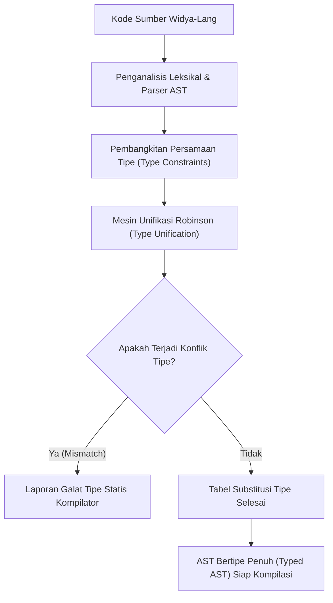

## Bab 1: Sistem Tipe Statis & Inferensi Tipe Algoritma Hindley-Milner

### 1.1 Arsitektur Inferensi Tipe Hindley-Milner

Sistem tipe statis modern pada Widya-Lang berakar pada formalisme kalkulus lambda bertipe dengan algoritma inferensi tipe Hindley-Milner (Algoritma W). Fitur ini membebaskan rekayasawan perangkat lunak dari keharusan menuliskan anotasi tipe berulang-ulang (*boilerplate type annotations*) tanpa mengorbankan keselamatan tipe waktu-kompilasi (*compile-time type safety*) dan performa mesin tanpa overhead runtime.



Prinsip kerja algoritma unifikasi tipe Widya-Lang berlandaskan tiga aksioma fundamental:
1. **Generalisasi Prinsipal**: Setiap ekspresi memiliki sebuah tipe paling umum (*principal type*) yang dapat mencakup seluruh pemanggilan valid tanpa ambigu.
2. **Substitusi Simetris**: Jika variabel tipe $\alpha$ harus setara dengan tipe konkret $\tau$, seluruh kemunculan $\alpha$ digantikan dengan $\tau$ sepanjang tidak terjadi rekursi tak berhingga (*occurs check*).
3. **Penyelesaian Statis**: Seluruh inferensi tipe selesai 100% pada fase kompilasi sehingga biner keluaran tidak memerlukan informasi tipe saat dijalankan di CPU.

### 1.2 Implementasi Kode Program Utuh

Berikut adalah contoh implementasi modul inferensi tipe dan verifikasi tipe statis polimorfik pada Widya-Lang:

```widya
// Modul Verifikasi Inferensi Tipe Statis
modul inferensi_tipe {
    // Fungsi polimorfik murni: tipe parameter T disimpulkan secara otomatis
    fungsi identitas<T>(nilai: T) -> T {
        kembalikan nilai;
    }

    // Fungsi komposisi fungsional dengan inferensi tipe berantai (A -> B -> C)
    fungsi gubah<A, B, C>(f, g) {
        kembalikan fungsi(x: A) -> C {
            kembalikan g(f(x));
        };
    }

    // Fungsi penguji inferensi pada operasi larik
    fungsi evaluasi_tipe_larik() {
        // Tipe disimpulkan sebagai Larik<Angka>
        misal daftar_bilangan = [10, 25, 50, 75, 100];
        
        // Pemetaan fungsional mempertahankan jaminan tipe
        misal fungsi_kali_dua = fungsi(n) { kembalikan n * 2; };
        misal fungsi_ke_teks = fungsi(n) { kembalikan "Nilai: " + ke_teks(n); };
        
        misal pipa_pemroses = gubah(fungsi_kali_dua, fungsi_ke_teks);
        
        untuk item dalam daftar_bilangan {
            misal hasil_format = pipa_pemroses(item);
            cetak(hasil_format);
        }
    }
}

// Titik masuk pengujian
modul utama {
    fungsi utama() {
        cetak("=== SISTEM INFERENSI TIPE HINDLEY-MILNER WIDYA ===");
        
        misal id_angka = inferensi_tipe::identitas(42);
        misal id_teks = inferensi_tipe::identitas("Kedaulatan Sistem");
        
        cetak("Inferensi Angka:", id_angka);
        cetak("Inferensi Teks :", id_teks);
        
        inferensi_tipe::evaluasi_tipe_larik();
    }
}
```

### 1.3 Rangkuman Desain & Analisis Rekayasa Sistem

Inferensi tipe Hindley-Milner memberikan keunggulan arsitektural yang signifikan dibandingkan bahasa bertipe dinamis murni maupun bahasa bertipe statis konvensional:

| Dimensi Rekayasa | Bahasa Dinamis (Python/JS) | Bahasa Statis Klasik (C/Java 7) | Widya-Lang (Hindley-Milner) |
| :--- | :--- | :--- | :--- |
| **Pengecekan Tipe** | Saat Runtime (Rawan crash) | Waktu Kompilasi Eksplisit | Waktu Kompilasi Otomatis |
| **Anotasi Manual** | Nihil | Wajib di setiap deklarasi | Opsional (Otomatis disimpulkan) |
| **Keamanan Memori** | Tergantung runtime check | Parsial / Manual | Mutlak di waktu kompilasi |
| **Overhead Runtime** | Tinggi (Type tagging/boxing) | Rendah | Nol (Zero-cost abstraction) |

### 1.4 Latihan Mandiri & Evaluasi Pemahaman Sistem

1. Jelaskan bagaimana mekanisme *occurs check* dalam algoritma unifikasi Robinson mencegah terjadinya rekursi tipe tak terhingga pada Widya-Lang!
2. Rancang sebuah fungsi polimorfik berantai `saring_dan_petakan<T, U>` yang menerima larik bertipe `T`, menyaring elemen berdasarkan predikat, dan mengubahnya menjadi larik bertipe `U` tanpa anotasi tipe eksplisit pada blok pemanggil!
3. Bagaimana kompilator Widya-Lang membedakan antara tipe ambigu yang membutuhkan panduan anotasi manual dengan tipe prinsipal yang berhasil diselesaikan secara sempurna?

### 1.5 Latihan Soal Pilihan Ganda (10 Soal)

1. Algoritma inferensi tipe yang mendasari sistem tipe statis Widya-Lang adalah...
   A. Algoritma Dijkstra
   B. Algoritma Hindley-Milner (Algoritma W)
   C. Algoritma Bellman-Ford
   D. Algoritma Floyd-Warshall

2. Manakah keuntungan utama dari inferensi tipe statis dibandingkan pengetikan manual secara penuh?
   A. Mengurangi kejelasan alur logika program
   B. Menghilangkan kebutuhan pengecekan tipe pada kompilator
   C. Mengurangi redundansi penulisan tipe tanpa mengorbankan keamanan tipe waktu-kompilasi
   D. Menjadikan program berjalan lebih lambat karena overhead penafsiran

3. Kapan proses penentuan dan verifikasi tipe data berlangsung pada Widya-Lang?
   A. Waktu runtime saat fungsi dipanggil
   B. Waktu inisialisasi lingkungan virtual
   C. Waktu kompilasi sebelum kode biner atau bytecode dihasilkan
   D. Waktu proses pengumpulan sampah memori

4. Istilah *occurs check* dalam unifikasi tipe berfungsi untuk...
   A. Memastikan variabel memori tidak kosong
   B. Mencegah konstruksi tipe sirkular yang rekursif tak berhingga
   C. Memeriksa ketersediaan ruang stack CPU
   D. Membaca berkas konfigurasi bahasa dari disk

5. Sebuah tipe yang paling umum dan mencakup seluruh kemungkinan instansiasi polimorfik yang valid disebut...
   A. Sub-tipe dinamis
   B. Tipe prinsipal (Principal type)
   C. Tipe skalar primitif
   D. Tagged union

6. Jika kompilator Widya-Lang mendeteksi adanya konflik antara tipe yang diharapkan dan tipe aktual saat unifikasi, maka tindakan kompilator adalah...
   A. Mengabaikan galat dan mengubah tipe secara otomatis menjadi string
   B. Menghentikan kompilasi dan menerbitkan laporan galat ketidakcocokan tipe (*type mismatch error*)
   C. Menunda evaluasi hingga program dieksekusi oleh pengguna
   D. Menjalankan fungsi fallback bawaan

7. Apa pengaruh inferensi tipe statis Widya-Lang terhadap ukuran biner dan kecepatan eksekusi?
   A. Menghasilkan overhead penanda tipe (*tagging*) di setiap alokasi heap
   B. Nol-biaya runtime (*zero-cost abstraction*), karena seluruh tipe telah divalidasi saat kompilasi
   C. Memperlambat kinerja CPU sebesar 25% karena resolusi simbol
   D. Mengharuskan instalasi interpreter pendamping di lingkungan target

8. Pada modul inferensi Widya-Lang, fungsi dengan tanda ký `fungsi identitas<T>(nilai: T) -> T` digolongkan sebagai...
   A. Fungsi polimorfik parametrik
   B. Prosedur monomorfik skalar
   C. Subrutin bertipe variadik tidak aman
   D. Metode privat kelas turunan

9. Manakah pernyataan yang BENAR mengenai substitusi tipe dalam unifikasi Hindley-Milner?
   A. Substitusi tipe dilakukan secara acak menggunakan tabel hash
   B. Variabel tipe digantikan secara konsisten oleh tipe konkret yang ditemukan selama unifikasi
   C. Substitusi hanya berlaku untuk tipe numerik integer
   D. Kompilator menolak substitusi jika terdapat lebih dari satu fungsi dalam satu berkas

10. Mengapa sistem tipe statis Hindley-Milner sangat krusial bagi sistem perangkat lunak berdaulat nasional?
    A. Mempermudah penerjemahan kode sumber ke format dokumen XML
    B. Menjamin keandalan sistem kritis bebas dari crash runtime akibat *type error* sejak fase pembuatan
    C. Mengurangi konsumsi memori disk saat menyimpan kode sumber
    D. Memungkinkan perangkat lunak dijalankan tanpa prosesor modern
