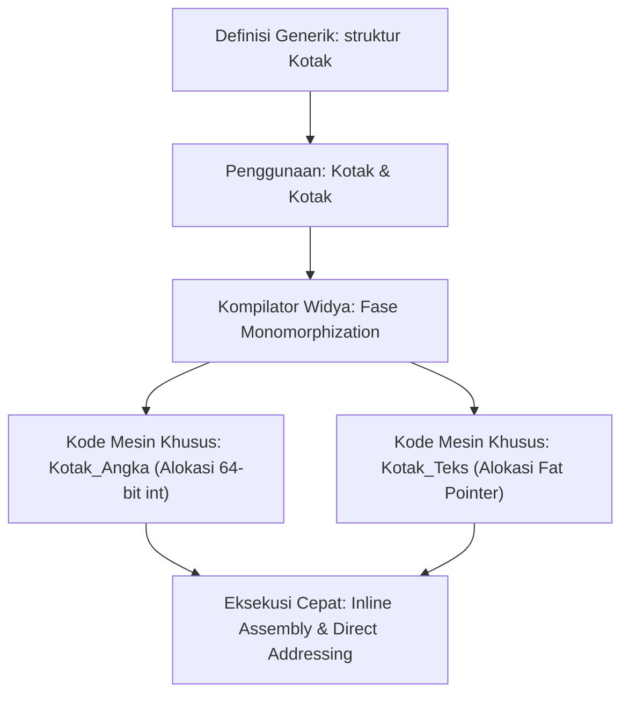

## Bab 2: Fungsi & Struktur Generik Tingkat Lanjut (<T, U>)

### 2.1 Monomorphization vs Dynamic Dispatch

Generik merupakan fondasi abstraksi perangkat lunak tingkat tinggi yang memungkinkan algoritma dan struktur data dirancang sekali dan diterapkan pada berbagai jenis tipe data. Widya-Lang menerapkan strategi kompilasi **Monomorphization** secara default, di mana kompilator membangkitkan salinan kode mesin khusus untuk setiap instansiasi tipe konkret pada waktu kompilasi.



Karakteristik utama strategi Monomorphization:
1. **Kecepatan Puncak (Zero Virtual Table Overhead)**: Tidak ada *vtable lookup* atau *pointer dereferencing* ganda saat pemanggilan metode; seluruh alamat memori fungsi diketahui pasti saat kompilasi.
2. **Optimalisasi Penggabungan Kode (Inlining)**: Kompilator dapat melakukan *inlining* fungsi secara agresif sehingga beban pemanggilan fungsi (*function call overhead*) hilang sepenuhnya.
3. **Penyelarasan Tata Letak Memori (Memory Layout Alignment)**: Struktur data disimpan dalam format *flat struct* di stack atau heap tanpa pembungkus penanda tipe (*no type boxing*).

### 2.2 Implementasi Kode Program Utuh

Berikut implementasi struktur generik multi-parameter dengan pembatas kapabilitas (*type bounds*):

```widya
// Definisi antarmuka kemampuan (Trait)
antarmuka Terhitung {
    fungsi hitung_nilai() -> Angka;
}

// Struktur data generik berpasangan
struktur Pasangan<T, U> {
    kiri: T,
    kanan: U,

    fungsi baru(k: T, kn: U) -> Pasangan<T, U> {
        kembalikan Pasangan { kiri: k, kanan: kn };
    }

    fungsi ambil_kiri(diri) -> T {
        kembalikan diri.kiri;
    }

    fungsi ambil_kanan(diri) -> U {
        kembalikan diri.kanan;
    }

    fungsi tukar(diri) -> Pasangan<U, T> {
        kembalikan Pasangan { kiri: diri.kanan, kanan: diri.kiri };
    }
}

// Struktur antrean generik berbasis larik dinamis
struktur AntreanGenerik<T> {
    elemen: Larik<T>,

    fungsi baru() -> AntreanGenerik<T> {
        kembalikan AntreanGenerik { elemen: [] };
    }

    fungsi dorong(diri, item: T) {
        diri.elemen.tambah(item);
    }

    fungsi tarik(diri) -> Mungkin<T> {
        jika diri.elemen.panjang() == 0 {
            kembalikan Mungkin::Kosong;
        }
        misal pertama = diri.elemen.ambil(0);
        diri.elemen.hapus(0);
        kembalikan Mungkin::Ada(pertama);
    }
}

modul utama {
    fungsi utama() {
        cetak("=== DEMO FUNGSI & STRUKTUR GENERIK WIDYA ===");
        
        // Instansiasi Pasangan dengan tipe campuran
        misal konfigurasi = Pasangan::baru("PortServer", 8080);
        cetak("Kunci Konfigurasi:", konfigurasi.ambil_kiri());
        cetak("Nilai Konfigurasi:", konfigurasi.ambil_kanan());

        misal terbalik = konfigurasi.tukar();
        cetak("Hasil Pertukaran :", terbalik.ambil_kiri(), "->", terbalik.ambil_kanan());

        // Antrean generik untuk pesan log
        misal antrean_log = AntreanGenerik::baru();
        antrean_log.dorong("[INFO] Server diinisialisasi");
        antrean_log.dorong("[WARN] Pemakaian memori 70%");
        antrean_log.dorong("[INFO] Paket data diterima");

        misal log_pertama = antrean_log.tarik();
        cocokkan log_pertama {
            Mungkin::Ada(pesan) => cetak("Pesan Diproses:", pesan),
            Mungkin::Kosong => cetak("Antrean Kosong")
        }
    }
}
```

### 2.3 Rangkuman Desain & Analisis Rekayasa Sistem

Perbandingan arsitektural antara Monomorphization (Widya-Lang / Rust) dengan Dynamic Dispatch / Type Erasure (Java / Go):

| Aspek Arsitektur | Monomorphization (Widya-Lang) | Type Erasure (Java) | Dynamic Dispatch (Interface Go) |
| :--- | :--- | :--- | :--- |
| **Representasi Biner** | Spesifik per tipe konkret | Dihapus menjadi `Object` | Menggunakan pasangan pointer (*iface*) |
| **Efisiensi Cache CPU** | Sangat Tinggi (Data lokal & rata) | Rendah (Banyak pointer hopping) | Sedang |
| **Dukungan Tipe Primitif** | Penuh tanpa alokasi heap | Perlu boxing (`Integer`, dll) | Perlu alokasi saat konversi |
| **Ukuran Berkas Biner** | Lebih besar jika banyak tipe | Seragam dan lebih ringkas | Seragam dan moderat |

### 2.4 Latihan Mandiri & Evaluasi Pemahaman Sistem

1. Mengapa strategi Monomorphization dapat meningkatkan peluang kompilator untuk melakukan optimasi *loop vectorization* dan *inlining*?
2. Buatlah struktur generik `PohonBiner<T>` yang mendukung penambahan elemen terurut, di mana tipe `T` wajib memenuhi kapabilitas perbandingan (*orderable*)!
3. Dalam kondisi sistem apa peningkatan ukuran biner (*binary bloat*) akibat Monomorphization menjadi pertimbangan kritis, dan bagaimana mitigasinya?

### 2.5 Latihan Soal Pilihan Ganda (10 Soal)

1. Proses di mana kompilator membangkitkan kode mesin konkret untuk setiap varian tipe generik yang digunakan disebut...
   A. Polymorphic Inversion
   B. Monomorphization
   C. Bytecode Interpretation
   D. Dynamic Virtualization

2. Keunggulan utama dari kode generik yang di-monomorphize pada waktu kompilasi adalah...
   A. Mengurangi konsumsi memori hard disk pada fase instalasi
   B. Menghapus kebutuhan tabel fungsi virtual (vtable) sehingga eksekusi setara fungsi biasa
   C. Mengizinkan variabel global diubah dari proses eksternal
   D. Mempercepat proses kompilasi awal sebesar 90%

3. Apa konsekuensi potensial dari penggunaan generik yang sangat luas dengan beragam tipe pada strategi Monomorphization?
   A. Kerusakan register prosesor
   B. Peningkatan ukuran biner keluaran (*code bloat*)
   C. Kegagalan prosesor dalam membaca cache instruksi L1
   D. Penurunan throughput I/O jaringan

4. Bagaimana cara Widya-Lang merepresentasikan struktur generik `Pasangan<Angka, Teks>` di dalam memori komputer?
   A. Membungkus kedua nilai ke dalam objek referensi terpisah di heap
   B. Menyusun kedua field secara sekuensial dan padat (*flat*) sesuai tata letak struct biner
   C. Mengonversi seluruh nilai menjadi string ASCII terenkripsi
   D. Menyimpan pointer alamat ke tabel global interpreter

5. Manakah sintaksis yang benar untuk mendeklarasikan struktur generik dengan dua parameter tipe pada Widya-Lang?
   A. `struktur Kotak[T, U] { a: T, b: U }`
   B. `struktur Kotak<T, U> { a: T, b: U }`
   C. `tipe Kotak: (T, U) -> struct`
   D. `kelas Kotak<generik T, generik U>`

6. Dalam penanganan tipe generik, apa yang dimaksud dengan *Type Bounds*?
   A. Batas maksimum ukuran memori yang dapat dialokasikan oleh variabel generik
   B. Pembatasan tipe generik agar wajib memenuhi kontrak antarmuka (*trait*) tertentu
   C. Penghapusan tipe secara paksa saat mencapai lingkup blok kode akhir
   D. Validasi lisensi perangkat lunak saat kompilasi berjalan

7. Apakah instansiasi `AntreanGenerik<Angka>` dan `AntreanGenerik<Teks>` berbagi kode mesin fungsi yang sama pada memori teks saat dieksekusi?
   A. Ya, keduanya berbagi kode yang sama persis melalui casting pointer
   B. Tidak, masing-masing memiliki blok instruksi mesin tersendiri yang dioptimalkan untuk tipenya
   C. Ya, karena Widya-Lang menggunakan interpreter berbasis Python
   D. Tergantung apakah sistem operasi mendukung arsitektur multi-core

8. Kapan pembuktian keabsahan batasan tipe generik (*type constraints verification*) dilakukan?
   A. Saat eksekusi mencapai pemanggilan fungsi terkait
   B. Saat fase analisis semantik kompilator sebelum pembentukan biner
   C. Saat sistem operasi memuat berkas ELF ke memori utama
   D. Saat pengguna menekan tombol enter pada konsol

9. Manakah pernyataan yang paling tepat mengenai hubungan generik dengan konsep *Zero-Cost Abstraction*?
   A. Abstraksi generik tidak memungut biaya lisensi perangkat lunak
   B. Anda tidak membayar penalti kinerja runtime untuk abstraksi yang tidak Anda gunakan
   C. Biaya alokasi memori selalu bernilai nol byte
   D. Kompiler tidak memerlukan daya pemrosesan tambahan

10. Mengapa fitur generik sangat penting dalam merancang pustaka struktur data berdaulat?
    A. Menghindarkan timbal balik konversi tipe (*casting*) yang rentan galat runtime
    B. Memungkinkan penulisan kode tanpa dokumentasi teknis
    C. Membatasi eksekusi program hanya pada sistem operasi Linux
    D. Mempercepat koneksi soket jaringan secara langsung
