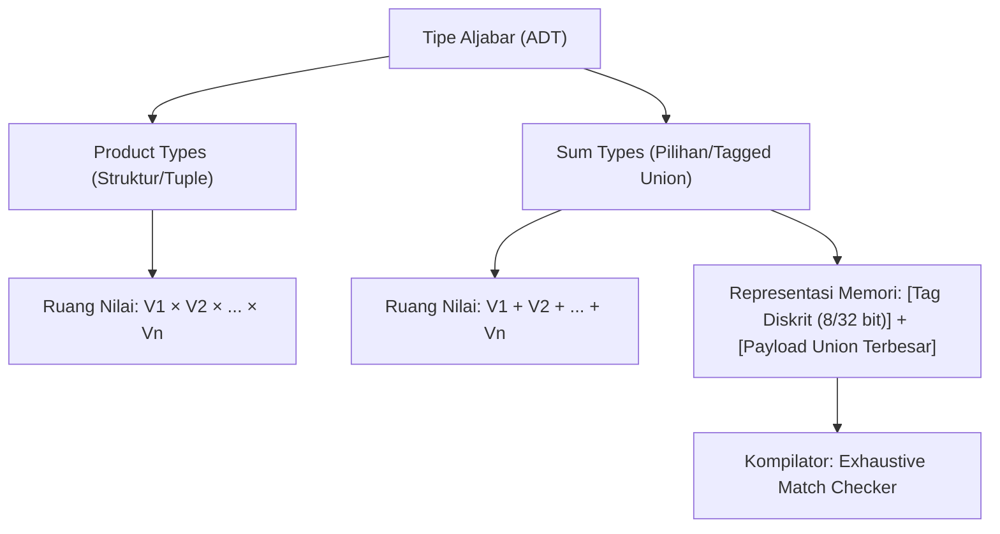

## Bab 3: Algebraic Data Types (ADT) & Pattern Matching

### 3.1 Teori Tipe Aljabar (Sum Types & Product Types)

Dalam teori tipe komputasi, sistem tipe dapat dimodelkan secara aljabar melalui dua kategori dasar:
1. **Product Types (Tipe Perkalian)**: Struktur atau Tuple, di mana ruang nilai gabungan adalah hasil kali perkalian kartesian dari ruang nilai setiap anggotanya. Contoh: `struktur Titik { x: Angka, y: Angka }`.
2. **Sum Types (Tipe Penjumlahan / Tagged Union)**: Enumerasi cerdas (`pilihan`), di mana ruang nilai gabungan adalah jumlah total dari varian-varian yang mungkin saling eksklusif.



Widya-Lang mengimplementasikan *Sum Types* dengan representasi memori **Tagged Union** yang sangat efisien:
- Sebuah penanda diskrit (*discriminant tag*) berukuran kecil (biasanya 1 atau 4 byte) menentukan varian aktif.
- Area memori muatan (*payload*) digunakan bersama (*union*), di mana ukurannya setara dengan varian muatan terbesar.
- Kompilator menjamin secara formal bahwa hanya varian aktif yang dapat diakses melalui pencocokan pola (*Pattern Matching*).

### 3.2 Implementasi Kode Program Utuh

Berikut penerapan `pilihan` dengan beragam muatan data dan evaluasi pencocokan pola mendalam:

```widya
// Definisi ADT untuk protokol paket jaringan
pilihan PaketJaringan {
    Ping,
    TeksPesan(Teks),
    DataBiner(Larik<Angka>),
    PermintaanOtentikasi { pengguna: Teks, token: Angka }
}

// ADT untuk status pemrosesan transaksi keuangan
pilihan StatusPembayaran {
    Tertunda,
    Terverifikasi { id_referensi: Teks, jumlah: Angka },
    Gagal { kode_kesalahan: Angka, alasan: Teks }
}

modul pengolah_protokol {
    fungsi proses_paket(paket: PaketJaringan) -> Teks {
        cocokkan paket {
            PaketJaringan::Ping => {
                kembalikan "Respon: PONG dari Node Nusantara";
            },
            PaketJaringan::TeksPesan(isi) => {
                kembalikan "Menerima Pesan: '" + isi + "' (Panjang: " + ke_teks(isi.panjang()) + ")";
            },
            PaketJaringan::DataBiner(byte_arr) => {
                kembalikan "Menerima Data Biner Sejumlah " + ke_teks(byte_arr.panjang()) + " byte";
            },
            PaketJaringan::PermintaanOtentikasi { pengguna, token } => {
                jika token == 9988 {
                    kembalikan "Otentikasi Berhasil untuk Pengguna: " + pengguna;
                } lainnya {
                    kembalikan "Otentikasi Ditolak: Token Tidak Sah!";
                }
            }
        }
    }

    fungsi evaluasi_transaksi(status: StatusPembayaran) {
        cocokkan status {
            StatusPembayaran::Tertunda => {
                cetak("[TRANSAKSI] Menunggu konfirmasi pembayaran...");
            },
            StatusPembayaran::Terverifikasi { id_referensi, jumlah } jika jumlah >= 1000000 => {
                cetak("[TRANSAKSI PRIORITAS TINGGI] Ref:", id_referensi, "Nominal: Rp", jumlah);
            },
            StatusPembayaran::Terverifikasi { id_referensi, jumlah } => {
                cetak("[TRANSAKSI REGULER] Ref:", id_referensi, "Nominal: Rp", jumlah);
            },
            StatusPembayaran::Gagal { kode_kesalahan, alasan } => {
                cetak("[TRANSAKSI GAGAL] Kode:", kode_kesalahan, "Alasan:", alasan);
            }
        }
    }
}

modul utama {
    fungsi utama() {
        cetak("=== SISTEM EVALUASI ADT & PATTERN MATCHING WIDYA ===");

        misal p1 = PaketJaringan::Ping;
        misal p2 = PaketJaringan::TeksPesan("Kedaulatan Sandi Nasional");
        misal p3 = PaketJaringan::PermintaanOtentikasi { pengguna: "satria_cyber", token: 9988 };

        cetak(pengolah_protokol::proses_paket(p1));
        cetak(pengolah_protokol::proses_paket(p2));
        cetak(pengolah_protokol::proses_paket(p3));

        misal bayar1 = StatusPembayaran::Terverifikasi { id_referensi: "TX-2026-001", jumlah: 5000000 };
        misal bayar2 = StatusPembayaran::Gagal { kode_kesalahan: 403, alasan: "Saldo Tidak Mencukupi" };

        pengolah_protokol::evaluasi_transaksi(bayar1);
        pengolah_protokol::evaluasi_transaksi(bayar2);
    }
}
```

### 3.3 Rangkuman Desain & Analisis Rekayasa Sistem

Pattern Matching pada Widya-Lang bukan sekadar pengganti konstruksi `switch-case` konvensional, melainkan instrumen pembuktian matematis terhadap ruang status sistem:

| Fitur | Switch-Case Tradisional (C/Java) | Pattern Matching Widya-Lang |
| :--- | :--- | :--- |
| **Pengecekan Tuntas (Exhaustive)** | Tidak (Mudah terjadi cabang terlewat) | Ya (Wajib tuntas; galat kompilasi jika ada varian tertinggal) |
| **Ekstraksi Data (Destructuring)** | Tidak mendukung ekstraksi payload | Mendukung ekstraksi instan data tersemat secara aman |
| **Klausa Penjaga (Pattern Guards)** | Tidak mendukung ekspresi logika tambahan | Mendukung sintaksis `jika <kondisi>` langsung pada cabang pola |
| **Bentuk Ekspresi** | Sering berupa instruksi prosedur (*statement*) | Merupakan ekspresi murni (*expression*) yang mengembalikan nilai |

### 3.4 Latihan Mandiri & Evaluasi Pemahaman Sistem

1. Mengapa kompilator Widya-Lang wajib memvalidasi sifat *exhaustiveness* saat mengevaluasi blok `cocokkan` pada tipe `pilihan`?
2. Bagaimana representasi memori *tagged union* menjamin efisiensi ukuran struktur data saat salah satu varian memiliki muatan besar sementara varian lainnya tidak memiliki muatan?
3. Rancang sebuah ADT `EkspresiMatematika` yang merepresentasikan ekspresi pohon biner aritmetika (Konstanta, Tambah, Kali, Kurang) dan buat fungsi evaluator rekursif menggunakan `cocokkan`!

### 3.5 Latihan Soal Pilihan Ganda (10 Soal)

1. Dalam teori sistem tipe, struktur data yang menggabungkan beberapa tipe di mana nilainya merupakan salah satu dari varian yang mungkin disebut...
   A. Product Type
   B. Sum Type (Tagged Union / ADT)
   C. Primitive Array
   D. Dynamic Virtual Table

2. Kata kunci pada Widya-Lang yang digunakan untuk mendeklarasikan tipe data aljabar *Sum Type* adalah...
   A. `pilihan`
   B. `varian`
   C. `antarmuka`
   D. `gabungan`

3. Apa yang terjadi jika seorang pengembang tidak menangani salah satu varian `pilihan` di dalam blok `cocokkan` tanpa klausa default?
   A. Program tetap berjalan dan menghasilkan nilai null saat runtime
   B. Kompilator menolak kompilasi dengan pesan galat ketidaktuntasan pola (*non-exhaustive pattern error*)
   C. Nilai variabel secara otomatis dihapus dari memori stack
   D. Sistem operasi menjalankan eksekusi fallback ke proses latar belakang

4. Bagian memori pada Tagged Union yang berfungsi menyimpan identitas varian mana yang sedang aktif dinamakan...
   A. Frame Pointer
   B. Discriminant Tag
   C. Heap Reference
   D. Vtable Offset

5. Klausa penjaga (*pattern guard*) pada blok pencocokan pola Widya-Lang dinyatakan menggunakan kata kunci...
   A. `hanya`
   B. `jika`
   C. `ketika`
   D. `selama`

6. Manakah dari pilihan berikut yang merupakan contoh *Product Type* pada Widya-Lang?
   A. `pilihan Status { Aktif, Nonaktif }`
   B. `struktur Koordinat { x: Angka, y: Angka }`
   C. `fungsi hitung() -> Angka`
   D. `modul Jaringan`

7. Bagaimana ukuran memori total dari sebuah Tagged Union ditentukan oleh kompilator?
   A. Jumlah akumulatif seluruh ukuran memori dari setiap varian tanpa terkecuali
   B. Ukuran penanda diskriminan ditambah ukuran dari varian muatan terbesar yang mungkin
   C. Selalu berukuran tetap 64 byte pada arsitektur 64-bit
   D. Ditentukan secara dinamis saat objek dialokasikan di runtime

8. Apa keunggulan destrukturisasi langsung pada pattern matching dibandingkan pemanggilan metode pengambil (*getter*) tradisional?
   A. Menghilangkan risiko mengakses properti yang tidak eksis pada status terkait
   B. Mempercepat koneksi internet pada aplikasi web
   C. Memungkinkan pengabaian tipe data statis
   D. Mengurangi penggunaan memori ROM pada mikrokontroler

9. Apakah blok `cocokkan` pada Widya-Lang dapat digunakan sebagai ekspresi yang mengembalikan nilai?
   A. Tidak, hanya berfungsi sebagai struktur kontrol alur percabangan biasa
   B. Ya, setiap cabang dapat mengembalikan nilai dengan tipe yang konsisten
   C. Hanya bisa jika program dijalankan dalam mode debug
   D. Hanya berlaku untuk pencocokan nilai angka bulat

10. Mengapa integrasi ADT dan Pattern Matching sangat krusial dalam rekayasa protokol jaringan dan sistem pertahanan siber?
    A. Mempermudah pembuatan dokumen PDF laporan serangan
    B. Menjamin seluruh format pesan anomali atau varian paket tertangani secara formal tanpa celah keadaan tak terduga
    C. Mengizinkan pemantauan proses dari jarak jauh tanpa kata sandi
    D. Mengurangi kecepatan enkripsi data agar hemat baterai
