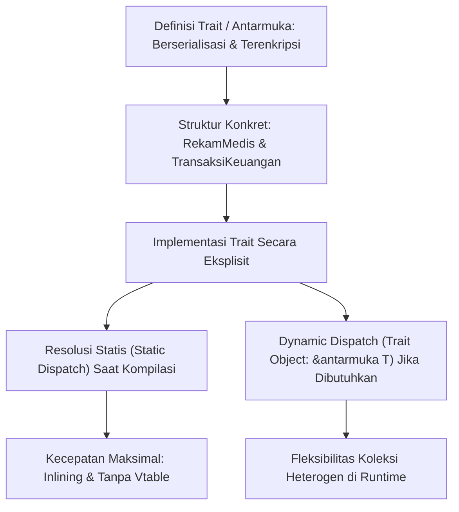

## Bab 4: Trait, Protokol Interface, dan Komposisi Berorientasi Sistem

### 4.1 Desain Trait Berdaulat

Konsep pewarisan kelas hierarkis tradisional (*classical class inheritance*) pada paradigma berorientasi objek klasik sering menimbulkan masalah arsitektur laten seperti kerapuhan kelas dasar (*fragile base class problem*), duplikasi hierarki, dan ambiguitas pewarisan ganda (*diamond problem*). Widya-Lang mengadopsi paradigma **Komposisi Berbasis Trait (Antarmuka Kemampuan)**.



Prinsip fundamental Trait pada Widya-Lang:
1. **Pemisahan Data dan Perilaku**: `struktur` hanya mendefinisikan skema tata letak data biner; `antarmuka` mendefinisikan kontrak perilaku fungsional.
2. **Implementasi Terpisah (Retroactive Modeling)**: Sebuah trait dapat diimplementasikan untuk tipe yang sudah ada tanpa memodifikasi definisi awal tipe tersebut.
3. **Metode Bawaan (Default Implementations)**: Trait dapat menyediakan implementasi dasar yang dapat langsung digunakan atau ditimpa (*override*) oleh struktur pengadopsi.

### 4.2 Implementasi Kode Program Utuh

Berikut implementasi trait untuk serialisasi data dan kalkulasi hash integritas sistem:

```widya
// Antarmuka kemampuan serialisasi ke representasi string biner
antarmuka Berserialisasi {
    fungsi ke_format_kustom(diri) -> Teks;
}

// Antarmuka kemampuan audit keamanan sistem
antarmuka Terverifikasi {
    fungsi hitung_cek_jumlah(diri) -> Angka;
    
    // Implementasi metode bawaan (Default Method)
    fungsi validasi_integritas(diri) -> Boolean {
        kembalikan diri.hitung_cek_jumlah() > 0;
    }
}

// Struktur 1: Paket Sensor Maritim Nusantara
struktur SensorMaritim {
    id_pelampung: Teks,
    salinitas: Angka,
    suhu_permukaan: Angka
}

// Struktur 2: Dokumen Kependudukan Berdaulat
struktur KTPDigital {
    nik: Teks,
    nama_lengkap: Teks,
    kode_wilayah: Angka
}

// Implementasi Trait Berserialisasi untuk SensorMaritim
implementasi Berserialisasi untuk SensorMaritim {
    fungsi ke_format_kustom(diri) -> Teks {
        kembalikan "MARITIM|" + diri.id_pelampung + "|" + ke_teks(diri.salinitas) + "|" + ke_teks(diri.suhu_permukaan);
    }
}

// Implementasi Trait Terverifikasi untuk SensorMaritim
implementasi Terverifikasi untuk SensorMaritim {
    fungsi hitung_cek_jumlah(diri) -> Angka {
        kembalikan diri.salinitas * 31 + diri.suhu_permukaan;
    }
}

// Implementasi Trait Berserialisasi untuk KTPDigital
implementasi Berserialisasi untuk KTPDigital {
    fungsi ke_format_kustom(diri) -> Teks {
        kembalikan "KTP|" + diri.nik + "|" + diri.nama_lengkap + "|" + ke_teks(diri.kode_wilayah);
    }
}

// Fungsi generik dengan pembatas Trait majemuk (Multiple Trait Bounds)
fungsi kirim_ke_pusat_data<T: Berserialisasi + Terverifikasi>(entitas: T) {
    jika entitas.validasi_integritas() {
        misal muatan = entitas.ke_format_kustom();
        cetak("[PUSAT DATA TERKONEKSI] Mengirim Paket Aman:", muatan);
    } lainnya {
        cetak("[PERINGATAN SISTEM] Paket Ditolak: Gagal Uji Integritas!");
    }
}

modul utama {
    fungsi utama() {
        cetak("=== SISTEM TRAIT & KOMPOSISI BERDAULAT WIDYA ===");

        misal sensor_natuna = SensorMaritim {
            id_pelampung: "BUOY-NTN-09",
            salinitas: 34,
            suhu_permukaan: 29
        };

        misal ktp_warga = KTPDigital {
            nik: "3171012345670001",
            nama_lengkap: "Arya Wiraraja",
            kode_wilayah: 3171
        };

        // Pemanggilan via trait bounds
        kirim_ke_pusat_data(sensor_natuna);

        // Akses langsung trait pada KTPDigital
        cetak("Format Ekspor KTP:", ktp_warga.ke_format_kustom());
    }
}
```

### 4.3 Rangkuman Desain & Analisis Rekayasa Sistem

Perbandingan arsitektural antara Trait Composition (Widya-Lang / Rust) dengan Pewarisan Kelas (Java / C++):

| Aspek Arsitektur | Pewarisan Kelas Tradisional | Komposisi Trait Widya-Lang |
| :--- | :--- | :--- |
| **Keterkaitan Antar-Modul** | Gandengan Kuat (*Tight Coupling*) | Lepas & Independen (*Loose Coupling*) |
| **Masalah Diamond Problem** | Rentan terjadi konflik metode turunan | Dicegah secara formal melalui resolusi eksplisit |
| **Fleksibilitas Desain** | Hierarki kaku dari kelas dasar | Komposisi horizontal berbagai kemampuan modular |
| **Dispatch Pemanggilan** | Dominan *Dynamic Dispatch* via vtable | Dominan *Static Dispatch* (Inlined & Zero-Cost) |

### 4.4 Latihan Mandiri & Evaluasi Pemahaman Sistem

1. Jelaskan mengapa komposisi berbasis trait lebih aman dan terhindar dari *fragile base class problem* dalam proyek rekayasa perangkat lunak skala nasional!
2. Buatlah antarmuka `Kompresibel` dengan metode `kompres(diri) -> Larik<Angka>` dan implementasikan pada struktur `BerkasTeks` dan `BerkasGambar`!
3. Bagaimana mekanisme pembatas trait majemuk (`T: Berserialisasi + Terverifikasi`) diverifikasi secara ketat oleh kompilator pada fase monomorphization?

### 4.5 Latihan Soal Pilihan Ganda (10 Soal)

1. Konsep antarmuka kapabilitas fungsional yang dapat diadopsi oleh berbagai struktur pada Widya-Lang dinamakan...
   A. Kelas Virtual
   B. Trait (Antarmuka Kemampuan)
   C. Subrutin Global
   D. Namespace Prosedur

2. Kata kunci yang digunakan untuk mengaitkan sebuah trait dengan struktur konkret pada Widya-Lang adalah...
   A. `terapkan`
   B. `implementasi ... untuk ...`
   C. `wariskan ... ke ...`
   D. `sambung`

3. Apa keuntungan utama dari metode bawaan (*default method implementation*) dalam sebuah trait?
   A. Menghilangkan kebutuhan alokasi RAM saat eksekusi
   B. Mengizinkan trait menyediakan perilaku default tanpa memaksa setiap struktur menuliskan implementasi ulang
   C. Mempercepat koneksi soket jaringan nirkabel
   D. Mengunci struktur agar tidak dapat ditambahkan field baru

4. Keadaan di mana sebuah struktur mewarisi implementasi yang bertentangan dari dua kelas induk yang berbeda dalam OOP tradisional dikenal sebagai...
   A. Memory Leaking Issue
   B. Diamond Problem (Masalah Berlian)
   C. Buffer Overflow Vulnerability
   D. Cache Invalidation Hazard

5. Manakah sintaksis pembatas trait majemuk (*multiple trait bounds*) yang sah pada fungsi generik Widya-Lang?
   A. `fungsi simpan<T: TraitA + TraitB>(data: T)`
   B. `fungsi simpan<T extends TraitA and TraitB>(data: T)`
   C. `fungsi simpan(data: T with TraitA, TraitB)`
   D. `fungsi simpan[T is TraitA | TraitB](data: T)`

6. Apakah dimungkinkan untuk mengimplementasikan trait baru terhadap struktur data yang telah didefinisikan sebelumnya di modul lain?
   A. Tidak, struktur bersifat tertutup permanen setelah dikompilasi
   B. Ya, melalui mekanisme pemodelan retroaktif (*retroactive modeling*) selama aturan orphan rule dipatuhi
   C. Hanya bisa jika kode sumber diubah langsung secara manual
   D. Hanya berlaku untuk tipe data primitif angka

7. Apa yang dimaksud dengan *Static Dispatch* pada pemanggilan metode trait?
   A. Pemanggilan fungsi yang ditentukan alamatnya saat kompilasi tanpa menggunakan tabel vtable
   B. Pemanggilan fungsi acak berdasarkan urutan abjad modul
   C. Penundaan eksekusi fungsi sampai sistem idle
   D. Pembagian beban eksekusi ke semua core prosesor secara statis

8. Ketika sebuah fungsi membutuhkan fleksibilitas untuk menerima berbagai jenis struktur yang mengimplementasikan trait yang sama di dalam satu larik homogen, konstruksi yang digunakan adalah...
   A. Pure Monomorphic Array
   B. Trait Objects (Dynamic Dispatch via Pointer Referensi)
   C. Global Memory Map
   D. Unsafe Shared Variable

9. Pemisahan tegas antara deklarasi skema data (`struktur`) dan deklarasi kontrak perilaku (`antarmuka`) bertujuan untuk...
   A. Menambah jumlah baris kode agar dokumen terlihat tebal
   B. Meningkatkan modularitas, kemudahan pemeliharaan, dan prinsip tanggung jawab tunggal (*Single Responsibility Principle*)
   C. Memperlambat proses pengujian unit
   D. Membatasi pengembang agar tidak membuat variabel baru

10. Mengapa pemakaian Trait sangat dianjurkan dalam arsitektur mikrokernel dan subsistem perangkat lunak berdaulat?
    A. Karena membatasi pemakaian memori hanya sebesar 16 KB
    B. Karena memudahkan penggantian modul driver perangkat keras secara plug-and-play tanpa merusak stabilitas inti sistem
    C. Karena tidak memerlukan pemeriksaan lisensi komersial
    D. Karena mengharuskan seluruh kode ditulis menggunakan huruf kapital
