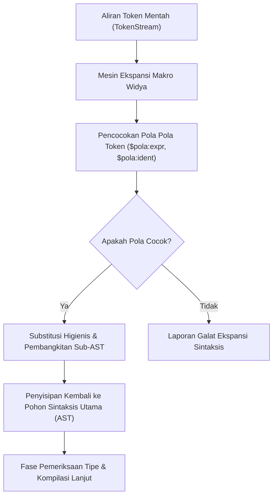

## Bab 5: Sistem Makro Sintaksis & Metaprogramming Waktu-Kompilasi

### 5.1 Siklus Transformasi AST Makro

Metaprogramming adalah kapabilitas bahasa pemrograman untuk memperlakukan kode program sebagai data komputasi. Widya-Lang menyediakan sistem **Makro Higienis Deklaratif** (*Hygienic Syntax Macros*) yang dieksekusi secara ketat pada fase ekspansi AST sebelum analisis semantik dan pembangkitan kode mesin.



Prinsip fundamental sistem makro Widya-Lang:
1. **Kebersihan Ruang Nama (Hygienic Scoping)**: Variabel lokal yang dibangkitkan oleh makro tidak akan mencemari atau bertabrakan dengan variabel di lingkup pemanggil (*no variable shadowing accidents*).
2. **Keamanan Tipe Waktu Kompilasi**: Kode hasil ekspansi makro tetap diverifikasi 100% oleh sistem inferensi tipe statis Hindley-Milner.
3. **Pemberantasan Kode Berulang (Boilerplate Elimination)**: Memungkinkan pembuatan DSL (*Domain Specific Language*) mini untuk pemetaan data, logging, dan pengujian sistem.

### 5.2 Implementasi Kode Program Utuh

Berikut adalah contoh deklarasi makro untuk pembuatan kamus cepat dan penegasan pengujian otomatis (*test assertion*):

```widya
// Modul perkakas metaprogramming
modul perkakas_makro {
    // Makro deklaratif untuk penegasan kondisi pengujian (assertion)
    makro_aturan! tegaskan_setara {
        ($kiri:ekspresi, $kanan:ekspresi, $pesan:literal) => {
            jika ($kiri) != ($kanan) {
                cetak("[PENGUJIAN GAGAL] " + $pesan);
                cetak("  Nilai Sebenarnya:", $kiri);
                cetak("  Nilai Diharapkan:", $kanan);
                lempar "Pengujian Gagal: " + $pesan;
            } lainnya {
                cetak("[PENGUJIAN SUKSES] " + $pesan);
            }
        };
    }

    // Makro pembuatan pemetaan konfigurasi biner
    makro_aturan! bangun_kamus {
        ($( $kunci:literal => $nilai:ekspresi ),*) => {
            {
                misal _peta = Kamus::baru();
                $(
                    _peta.sisip($kunci, $nilai);
                )*
                _peta
            }
        };
    }

    // Fungsi penguji hasil ekspansi makro
    fungsi uji_metaprogramming() {
        misal konfigurasi_server = bangun_kamus!(
            "nama_node" => "Nusantara-Core-01",
            "port_layanan" => 9090,
            "replika" => 3
        );

        cetak("Konfigurasi Node:", konfigurasi_server.ambil("nama_node"));
        cetak("Port Layanan    :", konfigurasi_server.ambil("port_layanan"));

        misal hasil_hitung = 15 * 4;
        tegaskan_setara!(hasil_hitung, 60, "Verifikasi perhitungan kuantum");
    }
}

modul utama {
    fungsi utama() {
        cetak("=== SISTEM MAKRO HIGIENIS & METAPROGRAMMING WIDYA ===");
        perkakas_makro::uji_metaprogramming();
    }
}
```

### 5.3 Rangkuman Desain & Analisis Rekayasa Sistem

Perbandingan arsitektural antara Makro Higienis Widya-Lang dengan Makro Preprocessor Klasik C/C++:

| Aspek Arsitektur | Preprocessor C/C++ (`#define`) | Makro Higienis Widya-Lang |
| :--- | :--- | :--- |
| **Tingkat Operasi** | Manipulasi Teks Mentah String | Manipulasi Pohon Sintaksis (*AST Tokens*) |
| **Keamanan Ruang Nama** | Tidak Aman (Rentan pencemaran nama) | Aman Mutlak (Hygienic Lexical Scoping) |
| **Pemeriksaan Tipe** | Tidak Ada (Dapat loloskan kode rusak) | Lengkap pada hasil ekspansi AST |
| **Kemudahan Debugging** | Sulit dilacak saat terjadi ekspansi liar | Terstruktur dengan pesan jejak kompilator (*macro backtrace*) |

### 5.4 Latihan Mandiri & Evaluasi Pemahaman Sistem

1. Mengapa sistem makro higienis dianggap jauh lebih unggul dibandingkan manipulasi string preprocessor pada bahasa tingkat rendah konvensional?
2. Rancanglah makro `hitung_waktu_eksekusi!($blok)` yang secara otomatis mengukur durasi waktu pemrosesan blok kode tertentu dalam satuan mikrodetik!
3. Bagaimana kompilator Widya-Lang mencegah terjadinya rekursi ekspansi makro tak berhingga (*infinite macro expansion*)?

### 5.5 Latihan Soal Pilihan Ganda (10 Soal)

1. Fase pada kompilator Widya-Lang di mana sistem makro dievaluasi dan diperluas adalah...
   A. Fase Runtime Eksekusi Biner
   B. Fase Ekspansi Pohon Sintaksis Abstrak (AST Expansion)
   C. Fase Optimasi Paging Virtual OS
   D. Fase Alokasi Register Hardware

2. Istilah *Hygienic Macro* (Makro Higienis) merujuk pada kapabilitas makro untuk...
   A. Menghapus virus dan malware dari berkas sumber
   B. Mencegah benturan nama variabel lokal dengan variabel di luar lingkup pemanggil
   C. Mensterilkan memori RAM sebelum sistem dijalankan
   D. Memformat indentasi kode secara otomatis

3. Kata kunci yang digunakan untuk mendefinisikan aturan makro deklaratif pada Widya-Lang adalah...
   A. `definisikan!`
   B. `makro_aturan!`
   C. `templat_sintaks`
   D. `prapengolah`

4. Penanda desimal `$kunci:literal` dalam aturan pola makro Widya-Lang mencocokkan token bertipe...
   A. Nilai konstan harfiah seperti angka atau string teks langsung
   B. Semua jenis struktur data di heap
   C. Nama modul pustaka eksternal
   D. Alamat memori pointer fisik

5. Manakah simbol pengulang yang digunakan pada makro Widya-Lang untuk menangani nol atau lebih kecocokan token berulang?
   A. `$( ... )*`
   B. `#[ ... ]+`
   C. `loop( ... )`
   D. `<repeat ...>`

6. Apakah kode hasil ekspansi makro pada Widya-Lang mengalami pemeriksaan tipe statis?
   A. Tidak, karena makro berada di luar jangkauan kompilator
   B. Ya, seluruh kode yang dibangkitkan tetap dianalisis oleh sistem tipe statis
   C. Hanya jika makro dideklarasikan dengan kata kunci khusus `ketat`
   D. Hanya ketika program dijalankan di server produksi

7. Apa bahaya utama dari makro preprocessor berbasis teks mentah (`#define`) dalam bahasa C yang dieliminasi oleh Widya-Lang?
   A. Ukuran hard disk komputer cepat penuh
   B. Efek samping evaluasi berulang (*double evaluation*) dan pencemaran ruang nama variabel
   C. Tidak dapat mencetak output ke layar monitor
   D. Membatasi penulisan komentar program

8. Manakah dari pilihan berikut yang merupakan kasus penggunaan terbaik untuk metaprogramming makro?
   A. Membuat algoritma pengurutan angka standar
   B. Membangun DSL deklaratif, penegasan pengujian otomatis, dan eliminasi kode berulang
   C. Menggantikan seluruh fungsi fungsional dalam program
   D. Mengatur kecerahan layar monitor komputer

9. Jika sebuah makro gagal menemukan pola aturan yang cocok dengan ekspresi masukan, tindakan kompilator adalah...
   A. Mengabaikan baris tersebut dan melanjutkan kompilasi
   B. Menerbitkan laporan galat ekspansi makro dan membatalkan proses kompilasi
   C. Mengisi parameter yang hilang dengan angka nol
   D. Menjalankan fungsi bawaan sistem operasi

10. Mengapa metaprogramming makro sangat berharga dalam perancangan kerangka kerja mikrokernel berdaulat?
    A. Mengizinkan pembangkitan lapisan abstraksi I/O perangkat keras yang efisien tanpa beban vtable runtime
    B. Memungkinkan eksekusi kode tanpa membutuhkan daya listrik prosesor
    C. Menghapus kebutuhan lisensi sistem operasi
    D. Memungkinkan penyimpanan kode sumber langsung di dalam BIOS
