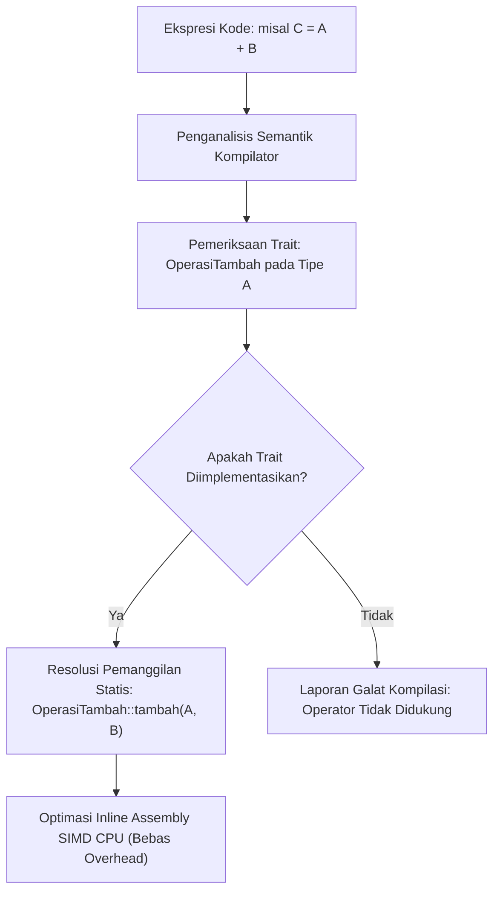

## Bab 6: Polimorfisme Ad-hoc, Operator Overloading, dan Koersi Tipe Aman

### 6.1 Tabel Dispatch Operator

Polimorfisme ad-hoc adalah kapabilitas bahasa di mana simbol operasi yang sama dapat memiliki semantik perilaku yang berbeda tergantung pada tipe data operan yang terlibat. Widya-Lang menyediakan **Operator Overloading Terkontrol** melalui implementasi Trait khusus tanpa mengorbankan keterbacaan kode (*no unexpected behavior*).



Prinsip dasar overloading operator pada Widya-Lang:
1. **Berbasis Kontrak Trait Baku**: Operator tidak dapat ditimpa secara bebas tanpa dasar; setiap operator memetakan ke trait standar seperti `OperasiTambah`, `OperasiKurang`, `OperasiKali`, dan `OperasiBanding`.
2. **Tanpa Efek Samping Tersembunyi**: Praktik rekayasa terbaik melarang overloading operator mengubah status global di luar kembalian matematisnya.
3. **Koersi Tipe Eksplisit & Aman**: Widya-Lang tidak melakukan konversi tipe implisit yang dapat menimbulkan hilangnya presisi angka (*lossy implicit casting*).

### 6.2 Implementasi Kode Program Utuh

Berikut implementasi operasi aljabar vektor 3D dengan overloading operator matematis:

```widya
// Trait standar operasi penjumlahan
antarmuka OperasiTambah<Kanan> {
    tipe Keluaran;
    fungsi tambah(diri, kanan: Kanan) -> Keluaran;
}

// Trait standar operasi perkalian skalar
antarmuka OperasiKali<Kanan> {
    tipe Keluaran;
    fungsi kali(diri, kanan: Kanan) -> Keluaran;
}

// Trait standar perbandingan kesetaraan
antarmuka OperasiSetara<Kanan> {
    fungsi setara(diri, kanan: Kanan) -> Boolean;
}

// Struktur Vektor Tiga Dimensi untuk Komputasi Grafika & Fisika
struktur Vektor3D {
    x: Angka,
    y: Angka,
    z: Angka,

    fungsi baru(x: Angka, y: Angka, z: Angka) -> Vektor3D {
        kembalikan Vektor3D { x: x, y: y, z: z };
    }

    fungsi panjang(diri) -> Angka {
        // Kuadrat panjang vektor: x^2 + y^2 + z^2
        kembalikan (diri.x * diri.x) + (diri.y * diri.y) + (diri.z * diri.z);
    }
}

// Implementasi operator '+' untuk Vektor3D + Vektor3D
implementasi OperasiTambah<Vektor3D> untuk Vektor3D {
    tipe Keluaran = Vektor3D;

    fungsi tambah(diri, kanan: Vektor3D) -> Vektor3D {
        kembalikan Vektor3D {
            x: diri.x + kanan.x,
            y: diri.y + kanan.y,
            z: diri.z + kanan.z
        };
    }
}

// Implementasi operator '*' untuk Vektor3D * Skalar Angka
implementasi OperasiKali<Angka> untuk Vektor3D {
    tipe Keluaran = Vektor3D;

    fungsi kali(diri, skalar: Angka) -> Vektor3D {
        kembalikan Vektor3D {
            x: diri.x * skalar,
            y: diri.y * skalar,
            z: diri.z * skalar
        };
    }
}

// Implementasi kesetaraan '=='
implementasi OperasiSetara<Vektor3D> untuk Vektor3D {
    fungsi setara(diri, kanan: Vektor3D) -> Boolean {
        kembalikan diri.x == kanan.x dan diri.y == kanan.y dan diri.z == kanan.z;
    }
}

modul utama {
    fungsi utama() {
        cetak("=== SISTEM OPERATOR OVERLOADING & VEKTOR 3D WIDYA ===");

        misal v1 = Vektor3D::baru(10, 20, 30);
        misal v2 = Vektor3D::baru(5, 15, 25);

        // Menggunakan implementasi operator overloading
        misal v_jumlah = v1.tambah(v2);
        misal v_skalar = v1.kali(3);

        cetak("V1 + V2      : (", v_jumlah.x, ",", v_jumlah.y, ",", v_jumlah.z, ")");
        cetak("V1 * 3       : (", v_skalar.x, ",", v_skalar.y, ",", v_skalar.z, ")");
        cetak("Apakah V1==V2: ", v1.setara(v2));
        cetak("Panjang Kuadrat V1:", v1.panjang());
    }
}
```

### 6.3 Rangkuman Desain & Analisis Rekayasa Sistem

Filosofi overloading operator pada Widya-Lang menjamin harmoni antara ekspresi matematis yang elegan dan keselamatan rekayasa sistem:

| Prinsip Desain | Pendekatan Bahasa Liar (C++) | Pendekatan Kaku (Java) | Pendekatan Berdaulat (Widya-Lang) |
| :--- | :--- | :--- | :--- |
| **Dukungan Operator** | Bebas tanpa batasan semantik | Dilarang sepenuhnya | Terikat pada Trait resmi standar |
| **Presedensi Operator** | Dapat diubah atau membingungkan | Tidak relevan | Presedensi matematis baku tidak berubah |
| **Koersi Tipe Otomatis** | Implisit (Berbahaya bagi presisi) | Implisit pada tipe tertentu | Wajib eksplisit (Aman & transparan) |
| **Resolusi Pemanggilan** | Rentan ambiguitas konversi | Hanya pemanggilan metode | Terpetakan pasti saat kompilasi |

### 6.4 Latihan Mandiri & Evaluasi Pemahaman Sistem

1. Mengapa Widya-Lang mewajibkan koersi tipe secara eksplisit dan melarang konversi implisit yang berisiko memotong presisi desimal?
2. Implementasikan operator pengurangan `OperasiKurang` dan perkalian titik (*dot product*) antar dua buah objek `Vektor3D`!
3. Bagaimana kompilator Widya-Lang mengoptimalkan pemanggilan metode operator overloading menjadi instruksi biner prosesor SIMD (*Single Instruction Multiple Data*)?

### 6.5 Latihan Soal Pilihan Ganda (10 Soal)

1. Konsep di mana sebuah operator seperti `+` atau `*` dapat diterapkan pada tipe data kustom bentukan pengembang disebut...
   A. Dynamic Encapsulation
   B. Operator Overloading (Polimorfisme Ad-hoc)
   C. Variable Shadowing
   D. Heap Compaction

2. Di Widya-Lang, mekanisme operator overloading diatur secara terstruktur melalui...
   A. File teks konfigurasi eksternal
   B. Implementasi Trait antarmuka operasi standar
   C. Perintah konsol terminal saat eksekusi
   D. Penulisan nama variabel dengan awalan khusus

3. Mengapa Widya-Lang menolak konversi tipe otomatis yang bersifat menyusutkan presisi (*lossy implicit type coercion*)?
   A. Karena memperlambat koneksi WiFi komputer
   B. Untuk mencegah terjadinya kutu sistem laten (*subtle bugs*) akibat pemotongan bit data tanpa disadari
   C. Karena memori kartu grafis tidak mendukung tipe float
   D. Agar kode program hanya dapat dibaca oleh penulis aslinya

4. Manakah nama Trait standar yang bertanggung jawab atas perilaku operator perkalian `*`?
   A. `OperasiGanda`
   B. `OperasiKali`
   C. `OperasiFaktor`
   D. `OperasiLipat`

5. Apakah pengembang diizinkan membuat simbol operator baru yang tidak terdaftar dalam tata bahasa inti Widya-Lang?
   A. Ya, pengembang bebas membuat simbol apa saja seperti `@@@`
   B. Tidak, hanya operator baku yang telah didefinisikan dalam tabel tata bahasa yang dapat di-overload
   C. Hanya bisa jika sistem operasi di-root
   D. Hanya berlaku untuk program di bidang kecerdasan buatan

6. Bagaimana presedensi (tingkat prioritas) operator dievaluasi ketika suatu operator kustom digunakan?
   A. Operator kustom selalu dievaluasi paling awal
   B. Mengikuti tabel presedensi matematis standar yang telah ditetapkan secara statis pada tata bahasa bahasa
   C. Dievaluasi secara acak tergantung beban CPU
   D. Berdasarkan urutan abjad nama struktur

7. Manakah pernyataan yang BENAR mengenai dampak operator overloading terhadap performa biner kompilasi Widya-Lang?
   A. Mengakibatkan penurunan kecepatan CPU hingga 50%
   B. Nihil penalti performa (Zero-Cost), karena metode operator langsung di-inlining ke dalam register CPU
   C. Membutuhkan alokasi memori heap tambahan di setiap operasi penjumlahan
   D. Memerlukan penundaan eksekusi hingga koneksi jaringan tersedia

8. Trait standar yang digunakan untuk mengimplementasikan operator pembanding kesetaraan `==` adalah...
   A. `OperasiCocok`
   B. `OperasiSetara`
   C. `OperasiSama`
   D. `OperasiIdentik`

9. Mengapa overloading operator tidak boleh memiliki efek samping (*side effects*) seperti mengubah state global atau menulis ke disk?
   A. Karena dapat memicu kerusakan monitor
   B. Karena melanggar intuisi semantik matematis dan membuat kode sulit diuji serta dianalisis keamanannya
   C. Karena dilarang oleh lisensi open source
   D. Karena memori RAM akan langsung terkunci permanen

10. Dalam rekayasa mesin simulasi fisika atau kriptografi, overloading operator memberikan manfaat utama berupa...
    A. Kemudahan mengekspresikan formula matematika kompleks secara bersih, alami, dan bebas dari overhead runtime
    B. Menghapus kebutuhan pengujian perangkat lunak
    C. Mengurangi kebutuhan daya listrik pendingin ruangan server
    D. Mempercepat waktu booting komputer server
