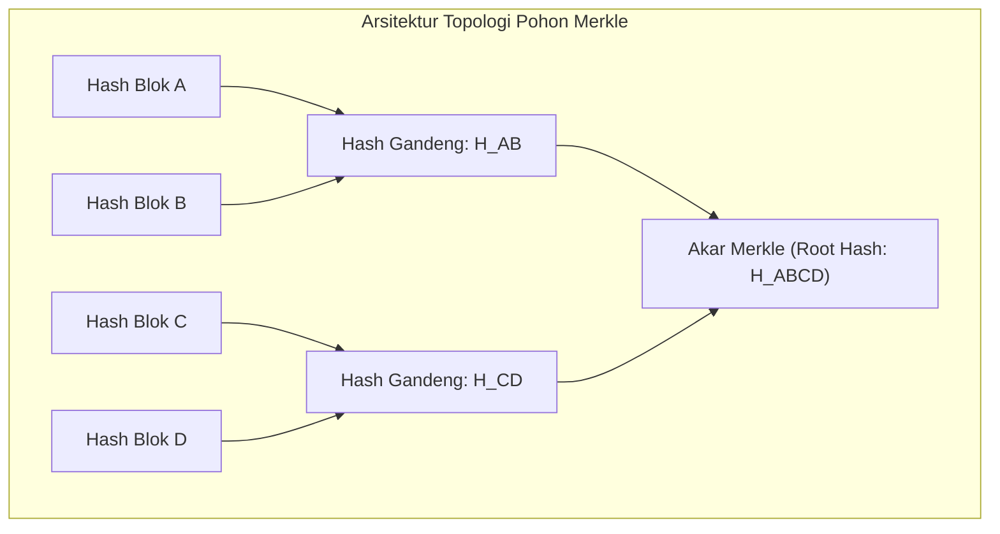

## Bab 7: Struktur Data Lanjut: Pohon Merkle, Trie, dan Skip List

### 7.1 Topologi Struktur Data Tingkat Sistem

Struktur data primitif seperti larik dan kamus standar sering tidak memadai untuk memenuhi tuntutan sistem terdistribusi, basis data berkecepatan tinggi, dan verifikasi kriptografis. Widya-Lang mendukung perancangan struktur data tingkat lanjut yang efisien secara memori dan berkinerja tinggi:
1. **Pohon Merkle (Merkle Tree)**: Pohon biner kriptografis di mana setiap simpul daun merepresentasikan hash data mentah dan simpul non-daun merepresentasikan hash dari gabungan anak-anaknya.
2. **Prefix Trie (Pohon Awalan)**: Struktur pohon pencarian berderajat banyak untuk pencarian string instan dengan kompleksitas waktu proporsional terhadap panjang kunci $O(k)$, independen dari jumlah entri $N$.
3. **Skip List**: Struktur data probabilistik berbasis daftar bertingkat yang menawarkan performa pencarian, penyisipan, dan penghapusan setara pohon seimbang $O(\log N)$ dengan implementasi konkurensi yang jauh lebih sederhana.



### 7.2 Implementasi Kode Program Utuh

Berikut implementasi Pohon Merkle sederhana untuk verifikasi integritas log audit berdaulat:

```widya
// Modul Struktur Data Kriptografis Lanjut
modul struktur_lanjut {
    // Fungsi hash sederhana 64-bit berbasis algoritma FNV-1a untuk demo simulasi
    fungsi hash_fnv1a(teks_input: Teks) -> Angka {
        misal hash = 1469598103934665603; // FNV offset basis
        misal bytes = teks_input.ke_larik_byte();
        untuk b dalam bytes {
            hash = hash ^ b;
            hash = (hash * 1099511628211) & 18446744073709551615;
        }
        kembalikan hash;
    }

    // Menggabungkan dan melakukan hashing terhadap dua buah nilai hash
    fungsi hash_gabung(hash_kiri: Angka, hash_kanan: Angka) -> Angka {
        misal kombinasi = ke_teks(hash_kiri) + ":" + ke_teks(hash_kanan);
        kembalikan hash_fnv1a(kombinasi);
    }

    // Struktur Simpul Pohon Merkle
    struktur SimpulMerkle {
        nilai_hash: Angka,
        kiri: Mungkin<Kotak<SimpulMerkle>>,
        kanan: Mungkin<Kotak<SimpulMerkle>>
    }

    // Struktur Pengelola Pohon Merkle
    struktur PohonMerkle {
        akar: Mungkin<Kotak<SimpulMerkle>>,
        jumlah_daun: Angka,

        fungsi baru() -> PohonMerkle {
            kembalikan PohonMerkle {
                akar: Mungkin::Kosong,
                jumlah_daun: 0
            };
        }

        fungsi bangun_dari_larik(daftar_data: Larik<Teks>) -> PohonMerkle {
            jika daftar_data.panjang() == 0 {
                kembalikan PohonMerkle::baru();
            }

            // 1. Buat simpul daun dari setiap data teks
            misal tingkat_saat_ini: Larik<SimpulMerkle> = [];
            untuk d in daftar_data {
                misal h = hash_fnv1a(d);
                tingkat_saat_ini.tambah(SimpulMerkle {
                    nilai_hash: h,
                    kiri: Mungkin::Kosong,
                    kanan: Mungkin::Kosong
                });
            }

            // 2. Bangun tingkatan pohon ke atas hingga tersisa tepat 1 akar
            selama tingkat_saat_ini.panjang() > 1 {
                misal tingkat_berikutnya: Larik<SimpulMerkle> = [];
                misal i = 0;
                selama i < tingkat_saat_ini.panjang() {
                    misal simpul_kiri = tingkat_saat_ini.ambil(i);
                    misal simpul_kanan = jika i + 1 < tingkat_saat_ini.panjang() {
                        tingkat_saat_ini.ambil(i + 1)
                    } lainnya {
                        // Jika ganjil, duplikasikan simpul kiri
                        simpul_kiri
                    };

                    misal h_gabungan = hash_gabung(simpul_kiri.nilai_hash, simpul_kanan.nilai_hash);
                    tingkat_berikutnya.tambah(SimpulMerkle {
                        nilai_hash: h_gabungan,
                        kiri: Mungkin::Ada(Kotak::baru(simpul_kiri)),
                        kanan: Mungkin::Ada(Kotak::baru(simpul_kanan))
                    });

                    i += 2;
                }
                tingkat_saat_ini = tingkat_berikutnya;
            }

            kembalikan PohonMerkle {
                akar: Mungkin::Ada(Kotak::baru(tingkat_saat_ini.ambil(0))),
                jumlah_daun: daftar_data.panjang()
            };
        }

        fungsi ambil_akar_hash(diri) -> Angka {
            cocokkan diri.akar {
                Mungkin::Ada(ref_akar) => kembalikan ref_akar.nilai_hash,
                Mungkin::Kosong => kembalikan 0
            }
        }
    }
}

modul utama {
    fungsi utama() {
        cetak("=== SISTEM POHON MERKLE AUDIT DATA BERDAULAT ===");

        misal transaksi_blok = [
            "TX-001: Transfer Dana Kas Negara Rp 50.000.000",
            "TX-002: Alokasi Anggaran Riset Satelit Rp 75.000.000",
            "TX-003: Pembayaran Logistik Maritim Rp 20.000.000",
            "TX-004: Subsidi Pupuk Petani Mandiri Rp 35.000.000"
        ];

        misal pohon = struktur_lanjut::PohonMerkle::bangun_dari_larik(transaksi_blok);
        misal akar_hash = pohon.ambil_akar_hash();

        cetak("Jumlah Transaksi Terverifikasi :", pohon.jumlah_daun);
        cetak("Akar Kriptografis Merkle (Root):", akar_hash);
    }
}
```

### 7.3 Rangkuman Desain & Analisis Rekayasa Sistem

Perbandingan karakteristik teknis ketiga struktur data sistem lanjut:

| Karakteristik | Pohon Merkle | Prefix Trie | Skip List |
| :--- | :--- | :--- | :--- |
| **Tujuan Utama** | Verifikasi integritas data anti-pemalsuan | Pencarian awalan string ultra-cepat | Indeks terurut alternatif B-Tree / AVL |
| **Kompleksitas Pencarian** | $O(\log N)$ untuk verifikasi audit path | $O(K)$ di mana $K$ adalah panjang string | $O(\log N)$ probabilistik |
| **Penyimpanan Tambahan** | Hash per simpul perantara | Node per karakter bersama | Penunjuk pointer bertingkat (Forward pointers) |
| **Kemudahan Konkurensi** | Sangat baik (Imutabel setelah dibangun) | Baik dengan fine-grained locking | Luar biasa (Lock-free skiplist sangat populer) |

### 7.4 Latihan Mandiri & Evaluasi Pemahaman Sistem

1. Jelaskan bagaimana pembuktian audit Merkle (*Merkle Audit Proof / Path*) memungkinkan klien ringan (*light client*) memverifikasi keabsahan data tanpa mengunduh seluruh isi basis data!
2. Rancang struktur data Prefix Trie sederhana pada Widya-Lang yang mendukung metode `sisip(kata: Teks)` dan `cari_awalan(prefiks: Teks) -> Boolean`!
3. Mengapa struktur data Skip List sering dipilih sebagai fondasi mesin penyimpanan basis data *Log-Structured Merge-tree* (LSM-Tree) dibandingkan pohon merah-hitam (*Red-Black Tree*)?

### 7.5 Latihan Soal Pilihan Ganda (10 Soal)

1. Karakteristik utama dari Pohon Merkle adalah...
   A. Simpul daun menyimpan alamat IP pengguna
   B. Setiap simpul non-daun menyimpan nilai hash dari gabungan nilai hash simpul anak-anaknya
   C. Mengalokasikan seluruh memori ke satu segmen stack CPU
   D. Memformat dokumen teks secara otomatis

2. Kompleksitas waktu untuk memverifikasi keabsahan sebuah data pada Pohon Merkle dengan $N$ daun adalah...
   A. $O(N^2)$
   B. $O(\log N)$
   C. $O(N!)$
   D. $O(1)$ mutlak

3. Struktur data pohon yang sangat optimal untuk pencarian kamus kata dan pelengkapan otomatis (*autocomplete*) adalah...
   A. Heap Biner
   B. Prefix Trie (Pohon Radix)
   C. Larik Sirkular
   D. Queue FIFO

4. Pada struktur data Skip List, bagaimana tingkatan simpul (*node level*) ditentukan saat penyisipan data baru?
   A. Ditentukan berdasarkan abjad nama variabel
   B. Ditentukan secara probabilistik (misalnya melalui pelemparan koin simulasi)
   C. Ditentukan oleh kecepatan koneksi jaringan
   D. Ditentukan secara manual oleh pengguna melalui konsol

5. Mengapa Pohon Merkle sangat vital dalam arsitektur basis data terdistribusi dan sistem rantai blok (*blockchain*)?
   A. Menghilangkan kebutuhan kabel ethernet
   B. Memungkinkan deteksi perubahan atau manipulasi data sekecil apapun secara instan dan efisien
   C. Menjadikan kode program bebas dari proses kompilasi
   D. Mengurangi penggunaan memori monitor

6. Struktur pointer pembungkus memori heap berukuran aman pada Widya-Lang yang digunakan dalam implementasi simpul rekursif adalah...
   A. `Kotak<T>`
   B. `PointerMentah<T>`
   C. `Dinamis`
   D. `Tumpukan`

7. Apa yang dilakukan kompilator/fungsi pembangunan Pohon Merkle jika jumlah daun bernilai ganjil?
   A. Membatalkan seluruh proses pembangunan pohon
   B. Menduplikasi simpul ganjil terakhir agar terbentuk pasangan seimbang
   C. Menambahkan angka nol pada simpul pertama
   D. Mengabaikan data terakhir tersebut

8. Keunggulan Skip List dibandingkan Pohon Seimbang (seperti Red-Black Tree atau AVL) dalam lingkungan konkurensi paralel adalah...
   A. Tidak memerlukan ruang memori sama sekali
   B. Algoritma penyeimbangan ulang (*rebalancing*) tidak rumit, sehingga operasi penulisan *lock-free* lebih mudah diwujudkan
   C. Skip list hanya bisa dijalankan pada sistem operasi 32-bit
   D. Data selalu otomatis tersimpan ke disk flash drive

9. Pada Prefix Trie, kompleksitas waktu pencarian string dengan panjang $k$ karakter adalah...
   A. $O(k)$
   B. $O(2^k)$
   C. $O(N \times k)$
   D. $O(\log k)$

10. Penerapan struktur data Pohon Merkle pada repositori kedaulatan data nasional bertujuan untuk...
    A. Memastikan integritas rekam log audit tidak dapat diubah secara diam-diam oleh pihak manapun (*tamper-evident logging*)
    B. Menghapus rekaman transaksi lama secara otomatis setiap hari
    C. Mempercepat proses pencetakan dokumen kertas
    D. Mengharuskan enkripsi dijalankan menggunakan perangkat buatan luar negeri
