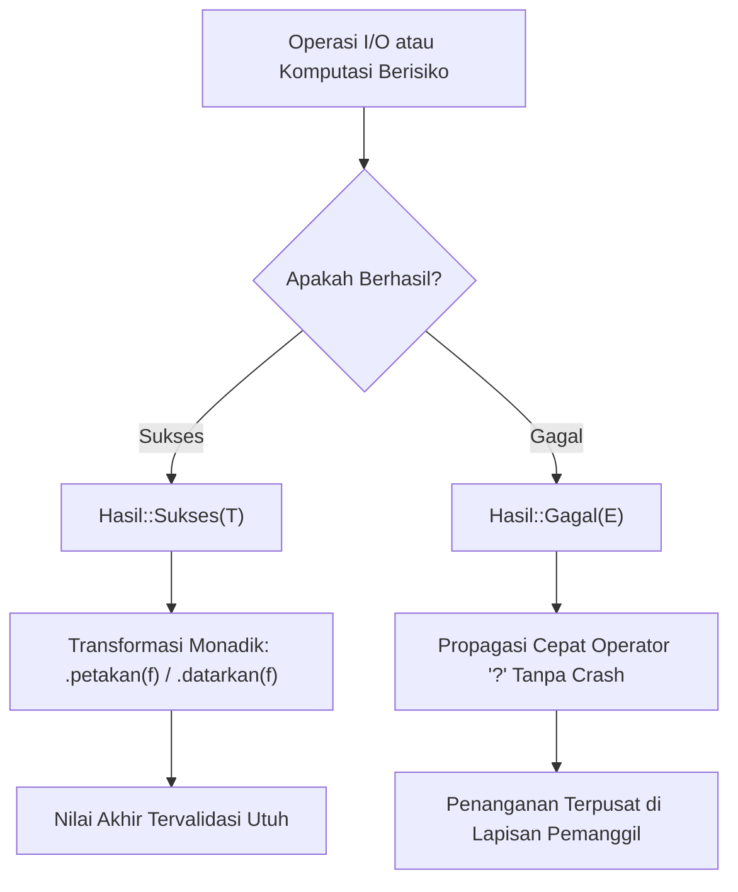

## Bab 8: Penanganan Galat Monadik: Result & Option Monad Lanjut

### 8.1 Alur Monadik Mungkin<T> dan Hasil<T, E>

Penemu konsep pointer `null`, Sir Tony Hoare, menyebut introduksi null reference sebagai *"kesalahan bernilai miliaran dolar"* (*billion-dollar mistake*) karena telah memicu kerusakan sistem, kerentanan keamanan siber, dan insiden crash memori yang tak terhitung jumlahnya. Widya-Lang **tidak memiliki nilai `null` atau `nil`**.

Sebagai gantinya, seluruh kemungkinan ketiadaan data atau kegagalan komputasi dimodelkan secara matematis melalui dua monad standar:
1. **`Mungkin<T>` (Option Monad)**: Memodelkan nilai yang ada (`Mungkin::Ada(nilai)`) atau tidak ada (`Mungkin::Kosong`).
2. **`Hasil<T, E>` (Result Monad)**: Memodelkan operasi yang sukses menghasilkan data (`Hasil::Sukses(nilai)`) atau gagal membawa informasi galat (`Hasil::Gagal(galat)`).



Prinsip operasi monadik pada Widya-Lang:
- **Kompilator Menolak Kelalaian**: Anda tidak dapat mengakses nilai di dalam `Mungkin<T>` atau `Hasil<T, E>` tanpa secara eksplisit menangani kasus ketiadaan atau kegagalannya terlebih dahulu.
- **Komposabilitas Fungsional**: Operasi dapat dirangkai secara bersih menggunakan metode `petakan` (*map*) dan `datarkan` (*and_then / flat_map*).
- **Operator Propagasi Cepat (`?`)**: Memungkinkan fungsi keluar lebih awal (*early return*) dengan nilai galat jika operasi gagal, mengeliminasi kode bertingkat (*pyramid of doom*).

### 8.2 Implementasi Kode Program Utuh

Berikut implementasi alur pemrosesan konfigurasi sistem dan transaksi basis data menggunakan operasi monadik:

```widya
// Definisi tipe galat kustom sistem
pilihan GalatSistem {
    BerkasTidakDitemukan(Teks),
    FormatTidakSah(Teks),
    AksesDitolak
}

// Simulasi modul pembaca konfigurasi
modul pembaca_konfigurasi {
    impor super::GalatSistem;

    fungsi baca_berkas(nama_berkas: Teks) -> Hasil<Teks, GalatSistem> {
        jika nama_berkas == "sistem.cfg" {
            kembalikan Hasil::Sukses("PORT=8080;NODE=Nusantara;REPLIKA=4");
        } lainnya {
            kembalikan Hasil::Gagal(GalatSistem::BerkasTidakDitemukan(nama_berkas));
        }
    }

    fungsi urai_port(konten: Teks) -> Hasil<Angka, GalatSistem> {
        // Cari substring PORT=
        jika konten.mengandung("PORT=8080") {
            kembalikan Hasil::Sukses(8080);
        } lainnya {
            kembalikan Hasil::Gagal(GalatSistem::FormatTidakSah("Kunci PORT tidak ditemukan"));
        }
    }

    // Fungsi orkestrasi yang merangkai operasi monadik
    fungsi muat_port_server(nama_berkas: Teks) -> Hasil<Angka, GalatSistem> {
        // Menggunakan perantaian fungsional monadik
        kembalikan baca_berkas(nama_berkas).datarkan(fungsi(konten) {
            kembalikan urai_port(konten);
        });
    }

    // Evaluasi menggunakan Option Monad (Mungkin)
    fungsi cari_pengaturan_cadangan(kunci: Teks) -> Mungkin<Teks> {
        jika kunci == "TIMEOUT" {
            kembalikan Mungkin::Ada("3000ms");
        }
        kembalikan Mungkin::Kosong;
    }
}

modul utama {
    fungsi utama() {
        cetak("=== SISTEM EVALUASI MONADIK HASIL & MUNGKIN WIDYA ===");

        // Kasus 1: Berkas valid
        misal hasil_valid = pembaca_konfigurasi::muat_port_server("sistem.cfg");
        cocokkan hasil_valid {
            Hasil::Sukses(port) => cetak("[SUKSES] Port Server Terkonfigurasi:", port),
            Hasil::Gagal(galat) => cetak("[GAGAL] Terjadi Kesalahan Konfigurasi")
        }

        // Kasus 2: Berkas tidak ditemukan
        misal hasil_rusak = pembaca_konfigurasi::muat_port_server("hilang.cfg");
        cocokkan hasil_rusak {
            Hasil::Sukses(p) => cetak("[SUKSES] Port:", p),
            Hasil::Gagal(GalatSistem::BerkasTidakDitemukan(berkas)) => {
                cetak("[GAGAL DITANGANI] Berkas tidak ada di disk:", berkas);
            },
            Hasil::Gagal(lainnya) => cetak("[GAGAL UMUM]")
        }

        // Kasus 3: Pencarian pengaturan cadangan via Mungkin
        misal opsi_timeout = pembaca_konfigurasi::cari_pengaturan_cadangan("TIMEOUT");
        misal timeout_terpilih = opsi_timeout.buka_atau("5000ms (Default)");
        cetak("Waktu Tunggu Operasi:", timeout_terpilih);
    }
}
```

### 8.3 Rangkuman Desain & Analisis Rekayasa Sistem

Perbandingan mekanisme penanganan galat antara Exception Klasik dengan Monadic Result:

| Fitur Rekayasa | Penanganan Eksepsi (Java/Python `try-catch`) | Penanganan Monadik Widya-Lang (`Hasil<T, E>`) |
| :--- | :--- | :--- |
| **Transparansi Tanda Tangan** | Tersembunyi (Tidak terlihat dari return type) | Eksplisit pada tipe kembalian fungsi |
| **Overhead Kinerja** | Berat (Alokasi stack unwinding & trace) | Nol (Sama seperti mengembalikan struct biasa) |
| **Keterprediksian Alur** | Tidak beraturan (Lompatan non-lokal goto) | Teratur (Mengikuti aliran kontrol normal) |
| **Risiko Lupa Menangani** | Sangat Tinggi (Memicu crash tak terduga) | Nol (Kompilator memaksa penanganan) |

### 8.4 Latihan Mandiri & Evaluasi Pemahaman Sistem

1. Jelaskan mengapa penghapusan nilai `null` dan penggantiannya dengan `Mungkin<T>` secara fundamental meningkatkan ketahanan keamanan siber perangkat lunak!
2. Buatlah fungsi `bagi_aman(pembilang: Angka, penyebut: Angka) -> Hasil<Angka, Teks>` dan gunakan metode `.petakan()` untuk mengalikan hasil pembagian dengan angka 10!
3. Bagaimana mekanisme kerja operator tanda tanya `?` dalam menyederhanakan propagasi galat tanpa kehilangan jejak diagnostik sistem?

### 8.5 Latihan Soal Pilihan Ganda (10 Soal)

1. Mengapa bahasa pemrograman Widya-Lang tidak menyediakan nilai referensi `null` atau `nil`?
   A. Karena menghemat alokasi memori swap di hard disk
   B. Untuk mengeliminasi kerentanan dereferensi null pointer yang merupakan biang keladi utama crash sistem (*billion-dollar mistake*)
   C. Karena memori kartu grafis modern tidak mengenal representasi nol
   D. Agar penulisan program menjadi lebih panjang

2. Dua varian yang dimiliki oleh monad `Mungkin<T>` pada Widya-Lang adalah...
   A. `Mungkin::Benar` dan `Mungkin::Salah`
   B. `Mungkin::Ada(T)` dan `Mungkin::Kosong`
   C. `Mungkin::Positif` dan `Mungkin::Negatif`
   D. `Mungkin::Aktif` dan `Mungkin::Pasif`

3. Struktur data standar yang memodelkan hasil operasi sukses atau informasi penyebab kegagalan adalah...
   A. `Larik<T>`
   B. `Hasil<T, E>`
   C. `Kamus<K, V>`
   D. `Tuple<A, B>`

4. Metode monadik yang digunakan untuk mengubah nilai sukses di dalam `Hasil::Sukses(nilai)` tanpa mengubah status galat adalah...
   A. `.hapus()`
   B. `.petakan(f)`
   C. `.reset()`
   D. `.duplikasi()`

5. Operator propagasi cepat yang digunakan untuk menyederhanakan penanganan galat berantai tanpa kode bersarang adalah...
   A. Operator seru `!`
   B. Operator tanda tanya `?`
   C. Operator tilde `~`
   D. Operator panah `=>`

6. Apa keuntungan metode `.buka_atau(default)` pada tipe `Mungkin<T>`?
   A. Menghapus data dari memori RAM secara permanen
   B. Mengambil nilai yang ada atau mengembalikan nilai fallback default yang aman jika kosong tanpa memicu crash
   C. Mematikan proses kompilator secara instan
   D. Mengirimkan nilai ke server pemantau jaringan

7. Manakah kelemahan mendasar dari mekanisme penanganan galat *Exception Unwinding* (seperti `try-catch` di Java/C++) yang dihindari oleh Widya-Lang?
   A. Tidak dapat menampilkan pesan galat dalam bahasa Indonesia
   B. Biaya overhead performa yang sangat tinggi saat eksepsi dilempar serta alur kontrol tak terduga (*non-local jumps*)
   C. Mengharuskan komputer memiliki prosesor 64-core
   D. Mengunci sistem berkas secara permanen

8. Kapan kompilator Widya-Lang memvalidasi bahwa nilai di dalam `Hasil<T, E>` telah ditangani secara aman?
   A. Saat eksekusi mencapai akhir baris kode di runtime
   B. Saat fase analisis semantik kompilasi, di mana kompilator menolak biner jika ada nilai Hasil yang diabaikan (*must-use result*)
   C. Saat sistem operasi me-reboot komputer
   D. Saat pengguna menekan kombinasi tombol Ctrl+C

9. Fungsi yang menerima `T` dan mengembalikan `Hasil<U, E>` dapat dirangkai secara mulus dengan operasi sebelumnya menggunakan metode...
   A. `.datarkan(f)` (and_then / flat_map)
   B. `.sambung_teks()`
   C. `.urutkan()`
   D. `.balikkan()`

10. Mengapa penanganan galat berbasis monad sangat penting dalam arsitektur perangkat lunak misi kritis seperti kendali kedirgantaraan atau perbankan nasional?
    A. Karena menjamin seluruh kemungkinan skenario kegagalan wajib diperhitungkan dan ditangani secara eksplisit sejak waktu rancangan
    B. Karena membuat berkas biner tidak dapat dihapus oleh administrator
    C. Karena mempercepat pengunduhan berkas lewat internet
    D. Karena mengabaikan seluruh kesalahan sistem agar program tetap berjalan terus
