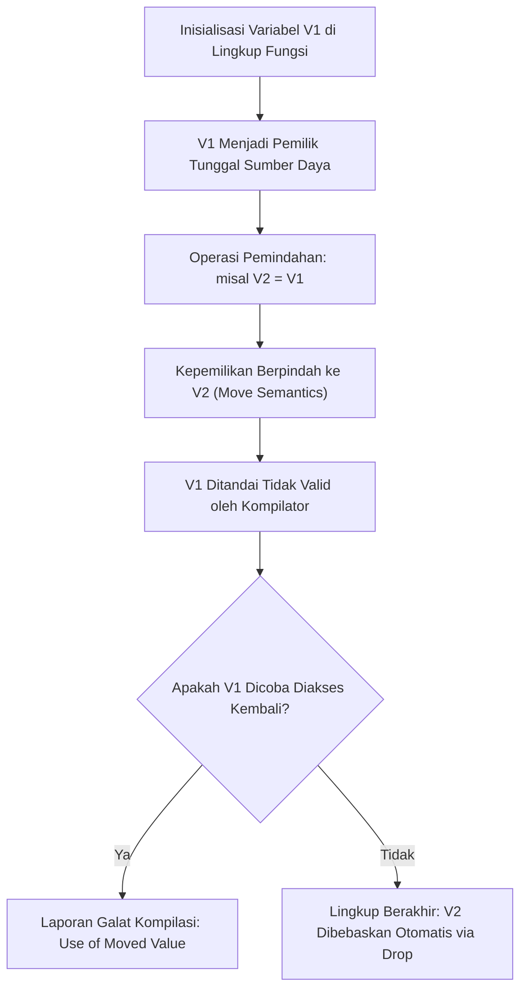

## Bab 9: Model Kepemilikan (Ownership) & Borrow Checker Statis

### 9.1 Mekanisme Pelacakan Pemilik Memori

Mayoritas bahasa pemrograman modern terpecah ke dalam dua kubu manajemen memori yang memiliki kompromi berat:
1. **Manajemen Memori Manual (C/C++)**: Menawarkan kecepatan tertinggi tetapi sangat rentan terhadap kebocoran memori (*memory leak*), dereferensi pointer liar (*dangling pointer*), dan penggunaan memori setelah dibebaskan (*use-after-free*).
2. **Pengumpul Sampah Otomatis / Garbage Collector (Go/Java/C#)**: Menjamin keselamatan memori tetapi menimbulkan jeda acak tak terduga (*stop-the-world latency*), jejak memori yang membengkak, dan ketidakcocokan untuk sistem bare-metal atau *real-time*.

Widya-Lang menghadirkan **Model Kepemilikan Statis (Static Ownership Model)** yang diverifikasi sepenuhnya saat kompilasi melalui penganalisis pinjaman (*Borrow Checker*).



Hukum fundamental kepemilikan Widya-Lang:
1. **Satu Pemilik Tunggal**: Setiap nilai sumber daya di memori hanya dimiliki oleh satu variabel pemilik (*owner*) pada satu waktu.
2. **Semantik Pemindahan (Move Semantics)**: Ketika kepemilikan dipindahkan ke variabel lain atau dilewatkan ke fungsi, variabel asal dinonaktifkan secara permanen.
3. **Pembersihan Otomatis (Automatic Drop)**: Ketika variabel pemilik keluar dari cakupan blok kode (`}`), memori dan sumber daya yang dikelolanya langsung dibebaskan seketika tanpa perlu pemanggilan `free()` manual.

### 9.2 Implementasi Kode Program Utuh

Berikut pembuktian semantik pemindahan kepemilikan dan transfer sumber daya aman pada Widya-Lang:

```widya
// Modul simulasi buffer memori biner berukuran besar
struktur BufferKripto {
    id_buffer: Teks,
    kapasitas: Angka,
    data_biner: Larik<Angka>,

    fungsi buat(id: Teks, cap: Angka) -> BufferKripto {
        cetak("[ALOKASI MEMORI] Buffer dialokasikan:", id, "(Ukuran:", cap, "byte)");
        kembalikan BufferKripto {
            id_buffer: id,
            kapasitas: cap,
            data_biner: [0, 128, 255, 64]
        };
    }

    // Metode yang mengonsumsi diri (Taking ownership)
    fungsi proses_dan_hancurkan(diri) {
        cetak("[PEMROSESAN SELESAI] Buffer", diri.id_buffer, "diproses dan dibebaskan dari RAM.");
        // Saat keluar blok, memori diri.data_biner otomatis di-drop
    }
}

modul utama {
    fungsi konsumsi_data(buf: BufferKripto) {
        cetak("Menerima kepemilikan buffer:", buf.id_buffer);
        buf.proses_dan_hancurkan();
    }

    fungsi utama() {
        cetak("=== SISTEM KEPEMILIKAN MEMORI STATIS WIDYA ===");

        // 1. Alokasi awal: buffer_a adalah pemilik sah
        misal buffer_a = BufferKripto::buat("BUF-RAHASIA-01", 4096);
        cetak("Pemilik aktif saat ini:", buffer_a.id_buffer);

        // 2. Pemindahan kepemilikan (Move) ke buffer_b
        misal buffer_b = buffer_a;
        // Catatan: buffer_a sekarang tidak lagi valid di mata kompilator!
        cetak("Kepemilikan berhasil dipindahkan ke buffer_b:", buffer_b.id_buffer);

        // 3. Melewatkan kepemilikan ke fungsi lain
        konsumsi_data(buffer_b);
        // Setelah baris ini, buffer_b telah dikonsumsi dan dibebaskan.

        cetak("Sistem kembali ke status stabil tanpa kebocoran memori.");
    }
}
```

### 9.3 Rangkuman Desain & Analisis Rekayasa Sistem

Perbandingan arsitektural antara Manajemen Memori Manual, Garbage Collection, dan Model Kepemilikan Widya-Lang:

| Dimensi Rekayasa | Alokasi Manual (C/C++) | Garbage Collector (Java/Go) | Model Kepemilikan (Widya-Lang) |
| :--- | :--- | :--- | :--- |
| **Keamanan Memori** | Nol (Rentan Use-After-Free) | Aman di Runtime | Aman Mutlak di Waktu Kompilasi |
| **Jeda Eksekusi (Pause)** | Nol (Deterministik) | Ada (Stop-The-World Jeda) | Nol Mutlak (Deterministik Penuh) |
| **Konsumsi Memori** | Minimal | Membengkak (Overhead GC heap) | Minimal (Tepat sesuai kebutuhan) |
| **Waktu Deteksi Cacat** | Saat Crash di Lingkungan Klien | Saat Runtime Error | Langsung Ditolak oleh Kompilator |

### 9.4 Latihan Mandiri & Evaluasi Pemahaman Sistem

1. Jelaskan bagaimana kompilator Widya-Lang melacak perpindahan status variabel melalui analisis aliran data statis (*static dataflow analysis*)!
2. Apa yang akan terjadi jika seorang pemrogram mencoba mengakses properti `buffer_a.id_buffer` setelah perintah `misal buffer_b = buffer_a` dieksekusi?
3. Rancanglah sebuah struktur `PengelolaBerkasKritis` yang secara otomatis menutup descriptor berkas Linux saat objek pemilik keluar dari cakupan blok fungsi!

### 9.5 Latihan Soal Pilihan Ganda (10 Soal)

1. Paradigma manajemen memori yang digunakan oleh Widya-Lang untuk menjamin keselamatan memori tanpa jeda pengumpul sampah adalah...
   A. Mark-and-Sweep Garbage Collector
   B. Model Kepemilikan Statis (Static Ownership & Borrow Checker)
   C. Manual malloc dan free berbasis penanda void
   D. Alokasi acak memori swap

2. Berapa jumlah variabel yang diizinkan menjadi pemilik sah (*exclusive owner*) atas suatu nilai sumber daya pada satu waktu di Widya-Lang?
   A. Tepat satu variabel pemilik
   B. Maksimal dua variabel berpasangan
   C. Tidak terbatas asalkan tipenya sama
   D. Tergantung kapasitas memori RAM

3. Ketika sebuah variabel pemilik dilewatkan ke fungsi lain tanpa tanda peminjaman, maka peristiwa yang terjadi adalah...
   A. Nilai diduplikasi secara mendalam (Deep Copy)
   B. Terjadi pemindahan kepemilikan (*Move Semantics*), dan variabel lama menjadi tidak valid
   C. Variabel lama diubah nilainya menjadi nol
   D. Kompilator menolak kompilasi karena dilarang memanggil fungsi

4. Apa yang dimaksud dengan operasi pembersihan otomatis (*Automatic Drop*) pada Widya-Lang?
   A. Penghapusan baris kode dari editor teks
   B. Pembebasan memori dan pelepasan sumber daya secara instan tepat saat variabel pemilik keluar dari kurung kurawal lingkupnya
   C. Penghentian paksa proses oleh kernel Linux
   D. Pembersihan cache browser

5. Manakah dari jenis galat memori berikut yang berhasil dieliminasi 100% pada fase kompilasi oleh sistem kepemilikan Widya-Lang?
   A. Use-After-Free dan Double-Free
   B. Kesalahan ejaan nama variabel
   C. Kehabisan ruang disk server
   D. Kesalahan logika matematika bisnis

6. Variabel yang telah dipindahkan (*moved*) kepemilikannya jika dicoba untuk dibaca kembali akan mengakibatkan...
   A. Program mengeluarkan nilai null saat dijalankan
   B. Kompilator menolak kompilasi dengan pesan galat penggunaan nilai yang sudah dipindahkan (*use of moved value*)
   C. Komputer restart secara otomatis
   D. Sistem operasi mengunduh salinan baru dari repositori

7. Tipe data primitif berukuran tetap seperti `Angka` (integer 64-bit) dan `Boolean` menerapkan semantik...
   A. Peminjaman eksklusif mutabel
   B. Semantik Salin (*Copy Semantics*), di mana data diduplikasi secara efisien di stack register
   C. Pemindahan mutlak tanpa sisa
   D. Pointer heap tidak langsung

8. Mengapa ketiadaan Garbage Collector sangat krusial bagi sistem operasi berdaulat dan kendali wahana militer nirawak (drone)?
   A. Karena Garbage Collector memerlukan koneksi internet 5G
   B. Karena jeda acak (*unpredictable latency*) dari Garbage Collector dapat menyebabkan kegagalan sistem kendali pada saat-saat kritis
   C. Agar berkas program dapat disimpan dalam format MP3
   D. Karena prosesor militer tidak memiliki instruksi aritmetika

9. Apakah pembebasan memori pada model kepemilikan Widya-Lang menimbulkan beban penalti performa saat program berjalan?
   A. Ya, setara dengan algoritma pengurutan cepat
   B. Tidak, instruksi pembebasan memori disisipkan secara deterministik saat kompilasi (*Zero-Cost Abstraction*)
   C. Hanya pada komputer yang tidak memiliki GPU
   D. Hanya jika program memiliki lebih dari 10.000 baris

10. Mengapa model kepemilikan Widya-Lang disebut sebagai pilar utama kedaulatan perangkat lunak sistem?
    A. Karena membebaskan bangsa dari ketergantungan pada runtime engine raksasa milik korporasi multinasional
    B. Karena mewajibkan pemakaian monitor buatan lokal
    C. Karena melarang penggunaan angka desimal ganjil
    D. Karena mengharuskan program dijalankan di laboratorium khusus
