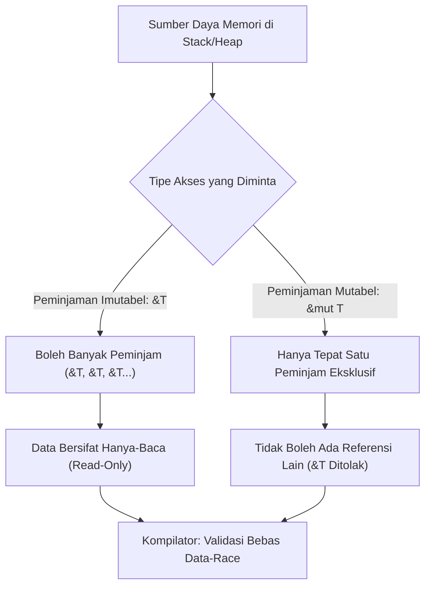

## Bab 10: Teorema Aliasing XOR Mutability & Siklus Hidup Referensi (Lifetimes)

### 10.1 Hukum Eksklusivitas Akses Memori

Salah satu sumber celah keamanan siber paling mematikan dalam rekayasa sistem adalah **Kondisi Balapan Data (Data Race)** dan korupsi iterator, yang terjadi ketika dua bagian kode berbeda mengakses lokasi memori yang sama secara bersamaan di mana setidaknya salah satu akses melakukan perubahan (mutasi).

Widya-Lang menegakkan teorema matematika keselamatan memori yang dikenal sebagai:
$$\text{Akses Memori Valid} = \text{Banyak Pembaca Imutabel (Aliasing)} \oplus \text{Satu Penulis Mutabel (Mutability)}$$



Aturan Peminjaman (*Borrowing Rules*):
1. **Peminjaman Imutabel (`&T`)**: Anda dapat membuat sebanyak mungkin referensi hanya-baca ke sebuah data. Selama referensi ini aktif, data asal tidak boleh dimutasi.
2. **Peminjaman Mutabel (`&mut T`)**: Anda hanya dapat membuat tepat satu referensi tulis ke sebuah data. Selama referensi mutabel ini aktif, tidak boleh ada referensi lain (baik imutabel maupun mutabel).
3. **Siklus Hidup (*Lifetimes* `'a`)**: Kompilator memastikan bahwa referensi tidak akan pernah hidup lebih lama daripada data yang ditunjuknya (*mencegah Dangling Pointer*).

### 10.2 Implementasi Kode Program Utuh

Berikut implementasi validasi peminjaman referensi dan anotasi siklus hidup pada Widya-Lang:

```widya
// Modul manipulasi data terstruktur aman
struktur RekamanAudit {
    nomor_seri: Angka,
    nama_entitas: Teks,
    status_verifikasi: Boolean
}

modul pengelola_audit {
    impor super::RekamanAudit;

    // Fungsi peminjaman imutabel: hanya membaca data
    fungsi cetak_rekaman(rekam: &RekamanAudit) {
        cetak("[AUDIT INFO] Seri #", rekam.nomor_seri, "| Entitas:", rekam.nama_entitas);
        // rekam.status_verifikasi = benar; // DITOLAK: Peminjaman imutabel tidak boleh dimutasi!
    }

    // Fungsi peminjaman mutabel: mengubah data secara eksklusif
    fungsi tandai_terverifikasi(rekam: &mut RekamanAudit) {
        rekam.status_verifikasi = benar;
        cetak("[AUDIT UPDATE] Entitas", rekam.nama_entitas, "telah resmi diverifikasi!");
    }

    // Fungsi dengan anotasi siklus hidup: memastikan referensi kembalian valid
    fungsi pilih_nama_terpanjang<'a>(nama1: &'a Teks, nama2: &'a Teks) -> &'a Teks {
        jika nama1.panjang() >= nama2.panjang() {
            kembalikan nama1;
        } lainnya {
            kembalikan nama2;
        }
    }
}

modul utama {
    fungsi utama() {
        cetak("=== SISTEM PEMINJAMAN & SIKLUS HIDUP REFERENSI WIDYA ===");

        misal mut log_rahasia = RekamanAudit {
            nomor_seri: 10992,
            nama_entitas: "Badan Siber Nasional",
            status_verifikasi: salah
        };

        // 1. Peminjaman imutabel ganda secara aman
        misal ref_baca1 = &log_rahasia;
        misal ref_baca2 = &log_rahasia;
        cetak("Akses via Pembaca 1:", ref_baca1.nama_entitas);
        cetak("Akses via Pembaca 2:", ref_baca2.nomor_seri);
        // Lingkup ref_baca1 dan ref_baca2 selesai di sini...

        // 2. Peminjaman mutabel eksklusif
        pengelola_audit::tandai_terverifikasi(&mut log_rahasia);

        // 3. Pengecekan status akhir
        cetak("Status Verifikasi Akhir:", log_rahasia.status_verifikasi);

        // 4. Evaluasi siklus hidup referensi
        misal instansi_a = "Kementerian Pertahanan RI";
        misal instansi_b = "Badan Riset dan Inovasi Nasional";
        misal terpilih = pengelola_audit::pilih_nama_terpanjang(&instansi_a, &instansi_b);
        cetak("Nama Instansi Terpanjang:", *terpilih);
    }
}
```

### 10.3 Rangkuman Desain & Analisis Rekayasa Sistem

Perbandingan penanganan pointer liar dan perlindungan konkurensi:

| Masalah Keamanan | Bahasa C / C++ | Bahasa Dinamis (Python) | Widya-Lang (Borrow Checker) |
| :--- | :--- | :--- | :--- |
| **Dangling Pointer** | Rentan fatal (Akses memori mati) | Dihindari via GC overhead | Ditolak 100% saat kompilasi via Lifetimes |
| **Data Race Konkuren** | Sangat rentan jika multi-thread | Dibatasi oleh GIL (Global Lock) | Dieliminasi mutlak via Aliasing XOR Mutability |
| **Iterator Invalidation** | Sangat umum saat memodifikasi array | Memicu RuntimeError | Ditolak langsung oleh kompilator |
| **Biaya Pelacakan** | Nol (Namun tidak aman) | Sangat mahal di runtime | Nol mutlak (Selesai pada waktu kompilasi) |

### 10.4 Latihan Mandiri & Evaluasi Pemahaman Sistem

1. Jelaskan mengapa sebuah program tidak boleh memiliki peminjaman mutabel (`&mut T`) aktif pada saat peminjaman imutabel (`&T`) sedang digunakan!
2. Apa fungsi parameter siklus hidup `'a` (*lifetime parameter*) dalam tanda tangan fungsi pemilih teks di atas, dan bagaimana kompilator memanfaatkannya?
3. Buatlah contoh skenario kode yang memicu galat *borrow checker* akibat *iterator invalidation* (mengubah isi larik saat sedang diiterasi) dan jelaskan cara memperbaikinya!

### 10.5 Latihan Soal Pilihan Ganda (10 Soal)

1. Teorema mendasar keselamatan peminjaman memori pada Widya-Lang menyatakan bahwa...
   A. Semua variabel harus dapat diakses secara bersamaan oleh semua thread
   B. Sebuah data dapat memiliki banyak pembaca imutabel ATAU tepat satu peminjam mutabel, tetapi tidak keduanya bersamaan
   C. Data mutabel tidak boleh disimpan di memori RAM
   D. Peminjaman referensi hanya boleh dilakukan pada hari kerja

2. Simbol operator yang digunakan untuk membuat referensi peminjaman hanya-baca (imutabel) adalah...
   A. `*`
   B. `&`
   C. `@`
   D. `$`

3. Simbol operator yang digunakan untuk membuat referensi peminjaman eksklusif tulis (mutabel) adalah...
   A. `&mut`
   B. `mut*`
   C. `&tulis`
   D. `->mut`

4. Tujuan utama dari pelacakan siklus hidup referensi (*Lifetimes*) oleh kompilator Widya-Lang adalah...
   A. Menghitung waktu kadaluarsa lisensi aplikasi
   B. Memastikan bahwa sebuah referensi tidak pernah menunjuk ke lokasi memori yang telah dibebaskan (*Dangling Pointer Prevention*)
   C. Mempercepat koneksi internet satelit
   D. Mengatur rotasi log berkas setiap 24 jam

5. Bagaimana notasi formal untuk parameter siklus hidup generik pada Widya-Lang dituliskan?
   A. `<'a>`
   B. `[lifetime: a]`
   C. `(usia_a)`
   D. `#!a`

6. Apa yang terjadi jika seorang pemrogram mencoba mengubah nilai variabel melalui referensi imutabel `&T`?
   A. Nilai variabel berubah secara normal
   B. Kompilator menolak kompilasi dengan pesan galat pelanggaran imutabilitas (*cannot mutate through immutable reference*)
   C. Komputer langsung masuk ke mode hemat daya
   D. Nilai variabel diubah menjadi string acak

7. Apakah pemeriksaan pinjaman (*borrow checking*) pada Widya-Lang menyisakan kode instruksi tambahan pada biner hasil kompilasi?
   A. Ya, kode biner membengkak sebesar 40%
   B. Tidak sama sekali, seluruh analisis selesai pada waktu kompilasi (*Zero-Cost Abstraction*)
   C. Hanya jika dijalankan pada mikroprosesor 8-bit
   D. Hanya ketika mode pengujian aktif

8. Kondisi di mana dua thread membaca dan menulis lokasi memori yang sama tanpa sinkronisasi dinamakan...
   A. Deadlock
   B. Data Race (Balapan Data)
   C. Starvation
   D. Stack Overflow

9. Mengapa dereferensi pointer liar (*dangling pointer*) sangat berbahaya bagi sistem kedaulatan informasi nasional?
   A. Karena dapat dieksploitasi oleh peretas untuk mengeksekusi kode jahat (*remote code execution*) melalui celah korupsi memori
   B. Karena membuat printer tidak dapat mencetak dokumen rahasia
   C. Karena memotong bandwidth internet server
   D. Karena mengharuskan admin mengganti monitor komputer

10. Apakah referensi mutabel `&mut T` dapat disalin (*copied*) secara otomatis oleh kompilator?
    A. Ya, dapat disalin tanpa batas
    B. Tidak, referensi mutabel hanya dapat dipindahkan (*reborrowed/moved*) untuk menjamin keunikan akses eksklusif
    C. Hanya bisa jika ukuran memori di bawah 4 byte
    D. Hanya berlaku untuk array satu dimensi
