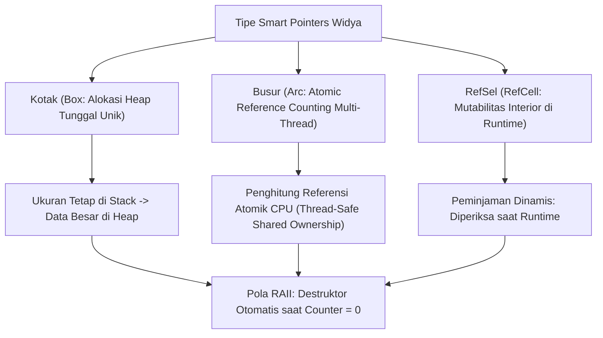

## Bab 11: Smart Pointers & Pola RAII (Resource Acquisition Is Initialization)

### 11.1 Hirarki Smart Pointers Sistem

Dalam arsitektur sistem tingkat lanjut, pengelolaan memori stack memiliki keterbatasan ruang dan ukuran yang harus diketahui secara statis saat kompilasi. Untuk mengelola data dinamis berukuran besar, struktur rekursif, atau sumber daya dengan kepemilikan bersama, Widya-Lang menyediakan **Penunjuk Pintar (Smart Pointers)** yang menerapkan pola **RAII (Resource Acquisition Is Initialization)**.



Tiga jenis Smart Pointer utama pada Widya-Lang:
1. **`Kotak<T>` (Box)**: Mengalokasikan nilai ke memori heap dengan kepemilikan tunggal yang eksklusif. Pointer berukuran tetap disimpan di stack, sementara data sebenarnya berada di heap.
2. **`Busur<T>` (Atomic Reference Counted / Arc)**: Memungkinkan kepemilikan bersama atas suatu nilai yang aman diakses lintas utas paralel (*thread-safe*). Memori dibebaskan tepat ketika penghitung referensi bernilai nol.
3. **`RefSel<T>` (Interior Mutability)**: Memungkinkan pemutasisan data di dalam struktur yang dideklarasikan imutabel dengan memindahkan penegakan aturan peminjaman ke waktu runtime.

### 11.2 Implementasi Kode Program Utuh

Berikut implementasi struktur pohon direktori rekursif dan sumber daya berkas otomatis berbasis RAII:

```widya
// 1. Struktur simpul rekursif menggunakan Kotak<T>
struktur SimpulDirektori {
    nama_folder: Teks,
    subfolder_kiri: Mungkin<Kotak<SimpulDirektori>>,
    subfolder_kanan: Mungkin<Kotak<SimpulDirektori>>
}

// 2. Struktur Pengelola Handle Berkas dengan Pola RAII murni
struktur BerkasAmanRAII {
    deskriptor_id: Angka,
    nama_berkas: Teks,

    fungsi buka(nama: Teks) -> BerkasAmanRAII {
        cetak("[RAII ACQUISITION] Membuka deskriptor berkas:", nama);
        kembalikan BerkasAmanRAII {
            deskriptor_id: 3, // Simulasi FD Linux
            nama_berkas: nama
        };
    }

    fungsi tulis(diri, data: Teks) {
        cetak("[RAII I/O] Menulis ke berkas", diri.nama_berkas, "->", data);
    }
}

// Implementasi Trait Pelepasan (Drop) untuk pembersihan otomatis
implementasi Pelepasan untuk BerkasAmanRAII {
    fungsi lepas(mut diri) {
        cetak("[RAII RELEASE] Destruktor terpanggil: Menutup deskriptor FD", diri.deskriptor_id, "untuk", diri.nama_berkas);
        // Di sini instruksi syscall close(fd) dieksekusi secara otomatis
    }
}

modul utama {
    fungsi simulasi_lingkup_raii() {
        cetak("--- Masuk ke dalam Lingkup Blok Terbatas ---");
        misal berkas_log = BerkasAmanRAII::buka("/var/log/kedaulatan.log");
        berkas_log.tulis("Sistem pertahanan siber aktif penuh.");
        cetak("--- Akan keluar dari Lingkup Blok Terbatas ---");
        // Di sini variabel berkas_log keluar dari lingkup, dan trait Pelepasan otomatis dipanggil!
    }

    fungsi utama() {
        cetak("=== SISTEM SMART POINTERS & POLA RAII WIDYA ===");

        // Membangun pohon rekursif dengan Kotak<T>
        misal struktur_folder = SimpulDirektori {
            nama_folder: "akar_sistem",
            subfolder_kiri: Mungkin::Ada(Kotak::baru(SimpulDirektori {
                nama_folder: "biner_inti",
                subfolder_kiri: Mungkin::Kosong,
                subfolder_kanan: Mungkin::Kosong
            })),
            subfolder_kanan: Mungkin::Ada(Kotak::baru(SimpulDirektori {
                nama_folder: "konfigurasi_sandi",
                subfolder_kiri: Mungkin::Kosong,
                subfolder_kanan: Mungkin::Kosong
            }))
        };

        cetak("Direktori Akar Berhasil Dibangun di Heap:", struktur_folder.nama_folder);

        // Demonstrasi siklus hidup RAII
        simulasi_lingkup_raii();

        cetak("Kembali ke fungsi utama: Sumber daya berkas terkonfirmasi tertutup bersih.");
    }
}
```

### 11.3 Rangkuman Desain & Analisis Rekayasa Sistem

Perbandingan manajemen siklus hidup sumber daya antara RAII dengan paradigma non-RAII:

| Fitur | Paradigma Manual (C `malloc/close`) | Paradigma Blok Try-Finally (Java/Python) | Paradigma RAII Widya-Lang |
| :--- | :--- | :--- | :--- |
| **Kapan Sumber Daya Bebas** | Kapanpun pemrogram memanggil `free` | Di akhir blok `finally` eksplisit | Deterministik saat keluar cakupan (`}`) |
| **Risiko Lupa Menutup** | Sangat Tinggi (Resource leak) | Moderat (Jika lupa tulis finally) | Nol Mutlak (Otomatis oleh kompilator) |
| **Dukungan Struktur Rekursif** | Raw pointer berbahaya | Objek heap dinamis lambat | Aman dan elegan via `Kotak<T>` |
| **Penanganan Berbagi Lintas Thread** | Kunci manual rentan deadlock | Sinkronisasi berat monitor Java | Aman via Atomic Reference Count (`Busur<T>`) |

### 11.4 Latihan Mandiri & Evaluasi Pemahaman Sistem

1. Jelaskan bagaimana pola RAII menjamin bahwa berkas atau koneksi basis data selalu ditutup secara bersih bahkan ketika fungsi keluar lebih awal akibat adanya sinyal galat!
2. Mengapa struktur data yang memiliki referensi ke dirinya sendiri (*recursive types*) tidak dapat dialokasikan langsung di memori stack dan mewajibkan penggunaan `Kotak<T>`?
3. Rancanglah sebuah struktur sinkronisasi `KunciMutexAman<T>` yang mengimplementasikan RAII sehingga saat kunci dilepas, data otomatis terkunci kembali!

### 11.5 Latihan Soal Pilihan Ganda (10 Soal)

1. Konsep rekayasa perangkat lunak di mana masa hidup alokasi sumber daya diikatkan secara ketat pada masa hidup suatu variabel objek disebut...
   A. Object-Oriented Inheritance
   B. Resource Acquisition Is Initialization (RAII)
   C. Just-In-Time Compilation
   D. Asynchronous Event Looping

2. Tipe smart pointer pada Widya-Lang yang digunakan untuk mengalokasikan data tunggal secara unik di memori heap adalah...
   A. `Kotak<T>` (Box)
   B. `Vektor<T>`
   C. `Tumpukan<T>`
   D. `Daftar<T>`

3. Mengapa struktur rekursif seperti simpul pohon wajib menggunakan pointer pembungkus seperti `Kotak<T>`?
   A. Agar ukuran memori simpul pada stack dapat diketahui secara pasti saat kompilasi
   B. Karena memori heap lebih murah daripada memori stack
   C. Agar data tidak dapat dibaca oleh sistem operasi
   D. Karena bahasa pemrograman tidak mendukung rekursi tanpa kotak

4. Tipe smart pointer berpenghitung referensi aman multi-thread yang digunakan untuk berbagi kepemilikan lintas utas adalah...
   A. `Busur<T>` (Atomic Reference Counting / Arc)
   B. `Saluran<T>`
   C. `Kunci<T>`
   D. `Utas<T>`

5. Trait bawaan pada Widya-Lang yang dieksekusi secara otomatis oleh kompilator saat suatu objek keluar dari cakupan lingkupnya adalah...
   A. `Pelepasan` (Drop)
   B. `Penghapusan`
   C. `Terminasi`
   D. `Pembersihan`

6. Apa yang terjadi pada nilai memori di heap yang dikelola oleh `Busur<T>` ketika salah satu salinan referensinya keluar dari lingkup fungsi?
   A. Memori langsung dihapus seketika
   B. Nilai penghitung referensi didekrementasi satu; jika mencapai nol, memori heap dibebaskan
   C. Seluruh thread lain langsung berhenti bekerja
   D. Terjadi error kebocoran memori

7. Pola mutabilitas interior (*interior mutability*) yang disediakan oleh tipe seperti `RefSel<T>` memungkinkan...
   A. Mengubah nilai data melalui referensi imutabel dengan validasi peminjaman di waktu runtime
   B. Menghapus seluruh proteksi memori sistem operasi
   C. Menulis langsung ke sektor hard disk tanpa driver
   D. Mengabaikan aturan matematika dalam perhitungan angka

8. Manakah dari skenario berikut yang merupakan contoh penerapan prinsip RAII yang paling ideal?
   A. Menutup koneksi soket jaringan dan deskriptor file secara otomatis saat objek pengelola keluar dari fungsi
   B. Mengubah format teks menjadi huruf besar
   C. Menginstal pembaruan perangkat lunak dari internet
   D. Mengompresi berkas gambar JPEG

9. Di manakah pointer alamat memori dari sebuah `Kotak<T>` disimpan?
   A. Di memori stack pemanggil
   B. Di server cloud eksternal
   C. Di kartu memori SIM card
   D. Di partisi swap Linux

10. Mengapa pemanfaatan RAII dan Smart Pointers sangat penting dalam pembangunan perangkat lunak perbankan dan kedaulatan data?
    A. Mencegah kebocoran sumber daya sistem (*resource leak*) seperti kebocoran memori dan koneksi database yang dapat melumpuhkan layanan nasional
    B. Menjamin saldo nasabah bertambah secara otomatis setiap hari
    C. Menghilangkan kebutuhan enkripsi sandi
    D. Mempercepat koneksi internet pengguna
