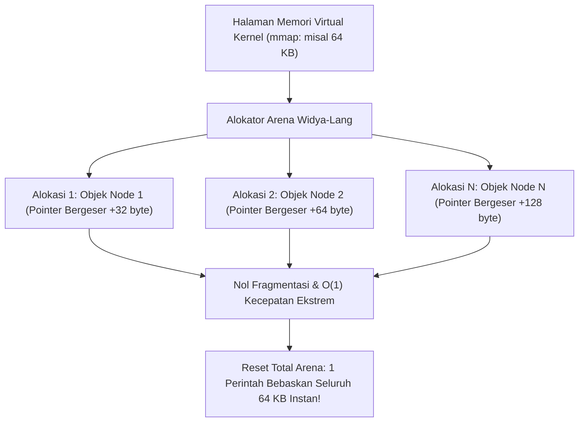

## Bab 12: Perancang Alokator Memori Mandiri (Arena, Pool, & Stack Allocator)

### 12.1 Arsitektur Chunk & Fragmentasi Memori

Alokator memori umum bawaan sistem operasi (seperti `malloc/free` pada glibc) dirancang untuk menangani beban kerja acak umum. Namun, pada sistem berkinerja ekstrem—seperti mesin permainan (*game engine*), parser berkas raksasa, atau router jaringan berkecepatan tinggi—alokator umum menimbulkan dua masalah kritis:
1. **Fragmentasi Memori Eksternal**: Alokasi dan dealokasi acak memecah ruang memori menjadi celah-celah kecil tak beraturan sehingga alokasi baru gagal meskipun total memori bebas masih mencukupi.
2. **Overhead Sinkronisasi Global**: `malloc` menggunakan penguncian mutex internal untuk keselamatan multi-thread yang menimbulkan kemacetan (*contention*) saat jutaan alokasi kecil terjadi per detik.

Widya-Lang mendukung perancangan **Alokator Memori Kustom (Custom Memory Allocators)** berbasis blok memori mandiri.



Dua arsitektur alokator khusus paling populer:
- **Arena Allocator (Linear/Bump Allocator)**: Alokasi dilakukan hanya dengan memajukan penunjuk offset memori (*pointer bumping*). Tidak ada dealokasi per objek; seluruh memori dibebaskan sekaligus secara instan dalam $O(1)$.
- **Pool Allocator (Fixed-size Block Allocator)**: Membagi memori ke dalam kumpulan blok berukuran seragam dengan daftar bebas (*free-list*). Alokasi dan dealokasi objek berukuran sama terjadi dalam waktu $O(1)$ tanpa fragmentasi.

### 12.2 Implementasi Kode Program Utuh

Berikut implementasi Alokator Arena linier mandiri pada Widya-Lang:

```widya
// Modul Alokator Arena Mandiri Berdaulat
struktur AlokatorArena {
    buffer_memori: Larik<Angka>,
    kapasitas_total: Angka,
    penunjuk_offset: Angka,

    fungsi baru(kapasitas: Angka) -> AlokatorArena {
        cetak("[ALOKATOR ARENA] Menginisialisasi ruang memori linier sebesar", kapasitas, "byte");
        misal buf: Larik<Angka> = [];
        // Inisialisasi ruang buffer kosong
        untuk i dalam 0..kapasitas {
            buf.tambah(0);
        }
        kembalikan AlokatorArena {
            buffer_memori: buf,
            kapasitas_total: kapasitas,
            penunjuk_offset: 0
        };
    }

    // Alokasi memori berukuran n_byte dengan penyelarasan 8-byte
    fungsi alokasi(mut diri, n_byte: Angka) -> Hasil<Angka, Teks> {
        // Penyelarasan memori (Alignment ke kelipatan 8)
        misal selaras = (n_byte + 7) & (~7);
        
        jika diri.penunjuk_offset + selaras > diri.kapasitas_total {
            kembalikan Hasil::Gagal("Memori Arena Penuh: Out of Memory!");
        }

        misal alamat_offset = diri.penunjuk_offset;
        diri.penunjuk_offset += selaras;
        
        cetak("  [ARENA ALLOC] Alokasi", selaras, "byte pada offset:", alamat_offset, 
              "| Sisa Memori:", diri.kapasitas_total - diri.penunjuk_offset, "byte");
        
        kembalikan Hasil::Sukses(alamat_offset);
    }

    // Reset seluruh alokasi secara instan dalam O(1)
    fungsi reset_total(mut diri) {
        diri.penunjuk_offset = 0;
        cetak("[ARENA RESET] Seluruh memori arena dibersihkan secara instan O(1)!");
    }

    fungsi pemakaian(diri) -> Angka {
        kembalikan diri.penunjuk_offset;
    }
}

modul utama {
    fungsi utama() {
        cetak("=== SISTEM ALOKATOR MEMORI ARENA MANDIRI WIDYA ===");

        // Membuat arena berkapasitas 1024 byte (1 KB)
        misal mut arena = AlokatorArena::baru(1024);

        // Alokasi blok memori untuk elemen parser
        misal entri1 = arena.alokasi(64);
        misal entri2 = arena.alokasi(128);
        misal entri3 = arena.alokasi(32);

        cetak("Total Memori Terpakai Saat Ini:", arena.pemakaian(), "byte dari 1024 byte");

        // Setelah satu siklus request parser selesai, bersihkan seluruh arena sekaligus
        arena.reset_total();

        cetak("Memori Terpakai Pasca-Reset   :", arena.pemakaian(), "byte (Siap digunakan kembali)");
    }
}
```

### 12.3 Rangkuman Desain & Analisis Rekayasa Sistem

Perbandingan performa antara General-Purpose Allocator dengan Custom Arena Allocator:

| Kriteria Kinerja | General Allocator (`malloc`) | Custom Arena Allocator | Custom Pool Allocator |
| :--- | :--- | :--- | :--- |
| **Kompleksitas Alokasi** | $O(N)$ pencarian blok bebas | $O(1)$ mutlak (Pointer bump) | $O(1)$ mutlak (Ambil dari Free-List) |
| **Kompleksitas Dealokasi** | $O(1)$ s/d $O(N)$ penggabungan blok | $O(1)$ seluruh memori sekaligus | $O(1)$ per blok ke Free-List |
| **Tingkat Fragmentasi** | Tinggi seiring waktu berjalan | Nol (Alokasi linier padat) | Nol (Ukuran blok seragam) |
| **Kesesuaian Penggunaan** | Alokasi acak jangka panjang | Pemrosesan per-frame / per-request | Kolam koneksi / partikel grafis |

### 12.4 Latihan Mandiri & Evaluasi Pemahaman Sistem

1. Mengapa alokator arena linier (*bump allocator*) memiliki kecepatan alokasi yang jauh mengungguli `malloc` konvensional pada pemrosesan permintaan HTTP per-request?
2. Apa yang dimaksud dengan *memory alignment* (penyelarasan memori) dan mengapa alamat alokasi sebaiknya diselaraskan ke kelipatan 8 atau 16 byte pada prosesor 64-bit modern?
3. Rancanglah sebuah Pool Allocator pada Widya-Lang yang membagi buffer 4 KB menjadi blok-blok tetap berukuran 64 byte dengan mekanisme *free-list*!

### 12.5 Latihan Soal Pilihan Ganda (10 Soal)

1. Masalah pada manajemen memori di mana memori bebas terpecah menjadi potongan-potongan kecil yang tidak dapat digunakan untuk alokasi besar dinamakan...
   A. Internal Memory Inversion
   B. Fragmentasi Memori Eksternal
   C. Deadlock
   D. Buffer Overflow

2. Prinsip kerja dari alokator memori tipe Arena (Linear Allocator) adalah...
   A. Menghapus objek satu per satu secara acak
   B. Mengalokasikan memori hanya dengan memajukan penunjuk offset (pointer bump) dan membersihkan semuanya secara serentak
   C. Mengompresi memori menggunakan algoritma ZIP
   D. Meminta izin ke server pusat setiap kali ada alokasi

3. Kompleksitas waktu untuk melakukan alokasi dan reset total pada Arena Allocator adalah...
   A. $O(N^2)$
   B. $O(1)$ mutlak
   C. $O(\log N)$
   D. $O(N!)$

4. Penyelarasan memori (*Memory Alignment*) ke batas 8-byte pada arsitektur CPU 64-bit bertujuan untuk...
   A. Memastikan instruksi pembacaan bus memori CPU bekerja pada kecepatan optimal tanpa penalty siklus tambahan
   B. Menghemat kapasitas hard disk
   C. Memformat tampilan teks pada terminal
   D. Membatasi pemakaian listrik baterai laptop

5. Alokator memori kustom yang membagi memori menjadi blok-blok berukuran identik dan mengelolanya dengan daftar bebas (*free-list*) dinamakan...
   A. Stack Pointer
   B. Pool Allocator (Fixed-size Allocator)
   C. Garbage Collector
   D. Swap Pager

6. Kasus penggunaan yang paling tepat untuk penerapan Arena Allocator adalah...
   A. Pemrosesan request siklus pendek (seperti penanganan permintaan HTTP web atau per-frame game)
   B. Penyimpanan basis data permanen selama 10 tahun
   C. Sistem pembaruan firmware mikrokontroler
   D. Penulisan dokumen teks secara manual

7. Apa kelemahan utama dari Arena Allocator murni jika dibandingkan dengan alokator umum?
   A. Tidak dapat membebaskan memori satu objek secara individual sebelum seluruh arena di-reset
   B. Program tidak dapat dijalankan di lingkungan Linux
   C. Ukuran program menjadi 10 kali lebih besar
   D. Tidak mendukung tipe data angka

8. Bagaimana Alokator Memori Kustom meningkatkan performa pada lingkungan multi-thread?
   A. Dengan mematikan semua thread lain secara paksa
   B. Dengan menyediakan alokator lokal per-thread (*Thread-Local Arena*) sehingga menghilangkan perebutan kunci (*lock contention*) pada alokator global
   C. Dengan mempercepat putaran kipas pendingin CPU
   D. Dengan mengganti koneksi kabel jaringan

9. Pada implementasi alokator, istilah *Free-List* mengacu pada...
   A. Daftar perangkat lunak yang berlisensi gratis
   B. Struktur data berantai yang melacak blok-blok memori yang sedang kosong dan siap dialokasikan kembali
   C. Daftar pengguna yang terbebas dari pajak
   D. Daftar berkas log yang dapat dihapus dari hard disk

10. Mengapa penguasaan perancangan alokator memori kustom sangat esensial bagi insinyur kedaulatan perangkat lunak sistem?
    A. Memungkinkan penciptaan sistem berkinerja tinggi yang deterministik, mandiri, dan bebas dari kelemahan runtime pustaka asing
    B. Menghapus kewajiban memiliki sertifikasi programmer
    C. Mengurangi kebutuhan memori monitor komputer
    D. Mempercepat pengetikan kode sumber pada keyboard
