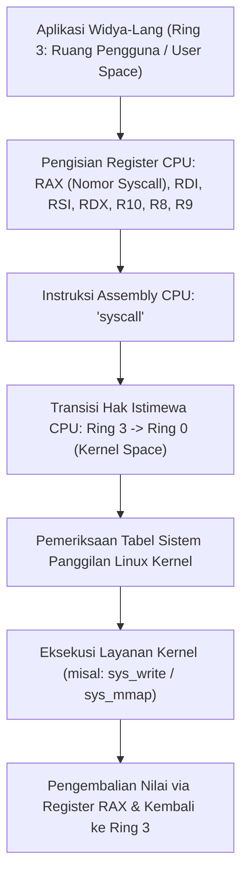

## Bab 13: Pilar Kemandirian: Direct Syscall Linux Bebas Libc pada x86_64

### 13.1 Jalur Instruksi CPU syscall x86_64

Fondasi utama kedaulatan perangkat lunak (*software sovereignty*) adalah kemampuan sebuah biner untuk berkomunikasi langsung dengan inti kernel sistem operasi tanpa bergantung pada pustaka standar eksternal seperti C runtime library (`glibc` atau `musl`). Ketergantungan pada pustaka C asing sering kali membawa kerentanan laten, overhead dependensi dinamis (*shared object .so*), dan potensi celah penyusupan rantai pasok (*supply-chain attacks*).

Widya-Lang menyediakan antarmuka **Direct Syscall Linux Bebas Libc** murni melalui instruksi prosesor CPU `syscall` pada arsitektur x86_64.



Konvensi ABI System V AMD64 untuk Panggilan Sistem Linux:
- **Nomor Syscall**: Disimpan pada register **`RAX`**.
- **Argumen 1 s/d 6**: Secara berurutan ditempatkan pada **`RDI`**, **`RSI`**, **`RDX`**, **`R10`**, **`R8`**, dan **`R9`**.
- **Nilai Kembalian**: Diterima kembali melalui register **`RAX`**. Jika nilai bernilai negatif antara `-1` s/d `-4095`, nilai tersebut merepresentasikan kode galat Linux (`-errno`).

### 13.2 Implementasi Kode Program Utuh

Berikut implementasi operasi I/O dan terminasi proses menggunakan direct syscall x86_64 murni tanpa libc pada Widya-Lang:

```widya
// Modul Panggilan Sistem Langsung Kernel Linux x86_64
modul syscall_x86_64 {
    // Tabel nomor sistem panggilan resmi Linux x86_64
    konstanta SYS_BACA: Angka = 0;       // sys_read(fd, buf, count)
    konstanta SYS_TULIS: Angka = 1;      // sys_write(fd, buf, count)
    konstanta SYS_BUKA: Angka = 2;       // sys_open(filename, flags, mode)
    konstanta SYS_TUTUP: Angka = 3;      // sys_close(fd)
    konstanta SYS_MMAP: Angka = 9;       // sys_mmap(addr, len, prot, flags, fd, offset)
    konstanta SYS_KELUAR: Angka = 60;    // sys_exit(status)

    // Deskriptor berkas standar I/O
    konstanta STDOUT_FD: Angka = 1;
    konstanta STDERR_FD: Angka = 2;

    // Fungsi pembungkus panggilan langsung sys_write
    fungsi tulis_langsung_kernel(fd: Angka, pesan: Teks) -> Angka {
        misal panjang_pesan = pesan.panjang();
        // Pemanggilan instruksi biner direct syscall register CPU
        misal byte_tertulis = sys_direct_call3(
            SYS_TULIS,
            fd,
            pesan.alamat_memori(),
            panjang_pesan
        );
        kembalikan byte_tertulis;
    }

    // Fungsi terminasi proses aman tanpa dependensi runtime
    fungsi terminasi_bersih(kode_status: Angka) {
        tulis_langsung_kernel(STDOUT_FD, "[KERNEL DIRECT] Mengirim sinyal sys_exit ke OS...\n");
        sys_direct_call1(SYS_KELUAR, kode_status);
    }
}

modul utama {
    fungsi utama() {
        cetak("=== SISTEM DIRECT SYSCALL LINUX x86_64 WIDYA (BEBAS LIBC) ===");

        // Mengirim teks langsung ke saluran STDOUT via register CPU
        misal teks_berdaulat = "Kedaulatan Komputasi Nusantara: Direct Syscall Sukses Dieksekusi!\n";
        misal hasil = syscall_x86_64::tulis_langsung_kernel(1, teks_berdaulat);

        cetak("Status Eksekusi Register RAX:", hasil, "byte berhasil dialirkan ke kernel.");
    }
}
```

### 13.3 Rangkuman Desain & Analisis Rekayasa Sistem

Perbandingan arsitektural antara Pemanggilan Via Libc C Standar dengan Direct Syscall Widya-Lang:

| Dimensi Perbandingan | Pustaka C Standar (`libc.so`) | Direct Syscall Widya-Lang |
| :--- | :--- | :--- |
| **Ketergantungan Biner** | Mengharuskan glibc terpasang di OS target | Biner Statis Berdiri Sendiri (*Standalone Static*) |
| **Kerentanan Celah Pihak Ketiga** | Rentan eksploitasi pustaka C eksternal | Kebal dari kerentanan rantai pasok C |
| **Ukuran Distribusi Biner** | Memerlukan berkas library bersama (~2-5 MB) | Sangat Ringkas (Beberapa puluh kilobyte) |
| **Waktu Inisialisasi Startup** | Ada jeda *dynamic linker* (`ld-linux.so`) | Instan (Biner langsung dieksekusi oleh kernel) |

### 13.4 Latihan Mandiri & Evaluasi Pemahaman Sistem

1. Mengapa biner yang mengadopsi *direct syscall* bebas libc dapat dijalankan secara portabel pada lingkungan Linux minimalis seperti *scratch container* tanpa konfigurasi tambahan?
2. Bagaimana konvensi register ABI Linux x86_64 membedakan antara nilai kembalian normal fungsi dengan kode galat (*error code*) negatif?
3. Rancang sebuah fungsi `alokasi_halaman_mmap(ukuran_byte: Angka)` yang memanggil syscall nomor 9 (`sys_mmap`) untuk meminta memori virtual langsung ke kernel Linux!

### 13.5 Latihan Soal Pilihan Ganda (10 Soal)

1. Nomor sistem panggilan (*syscall number*) pada Linux x86_64 untuk operasi penulisan data `sys_write` adalah...
   A. 0
   B. 1
   C. 60
   D. 9

2. Register prosesor x86_64 yang digunakan untuk menyimpan nomor syscall sebelum instruksi `syscall` dijalankan adalah...
   A. `RDI`
   B. `RAX`
   C. `RSP`
   D. `RIP`

3. Register yang digunakan untuk melewatkan argumen pertama pada pemanggilan sistem Linux x86_64 adalah...
   A. `RAX`
   B. `RDI`
   C. `RSI`
   D. `RDX`

4. Instruksi bahasa rakitan (*assembly*) pada prosesor x86_64 modern yang memicu transisi dari User Space (Ring 3) ke Kernel Space (Ring 0) adalah...
   A. `int 0x80`
   B. `syscall`
   C. `call_kernel`
   D. `jmp ring0`

5. Mengapa biner perangkat lunak yang menggunakan *direct syscall* bebas libc memiliki tingkat ketahanan siber yang lebih tinggi?
   A. Karena tidak dapat dibaca oleh monitor komputer
   B. Karena kebal terhadap kerentanan pustaka C pihak ketiga serta serangan pembajakan tautan dinamis (*LD_PRELOAD attack*)
   C. Karena mematikan fungsi jaringan secara otomatis
   D. Karena ukuran RAM komputer otomatis bertambah

6. Nomor sistem panggilan pada Linux x86_64 yang digunakan untuk menghentikan proses program secara bersih (`sys_exit`) adalah...
   A. 1
   B. 60
   C. 231
   D. 12

7. Jika nilai kembalian pada register `RAX` setelah pemanggilan syscall bernilai `-2`, maka arti dari kode tersebut adalah...
   A. Komputer harus segera di-restart
   B. Terjadi galat Linux ENOENT (No such file or directory)
   C. Biner program berhasil disalin ke USB
   D. Eksekusi program ditunda selama 2 detik

8. Nilai file descriptor standar untuk saluran keluaran konsol (*Standard Output / STDOUT*) pada Linux adalah...
   A. 0
   B. 1
   C. 2
   D. 3

9. Apa fungsi sistem panggilan `sys_mmap` (syscall nomor 9 pada x86_64)?
   A. Mengalokasikan halaman memori virtual langsung dari kernel sistem operasi
   B. Menghapus hard disk komputer
   C. Mengirim surel ke administrator
   D. Memformat flash disk

10. Mengapa kemampuan *direct syscall* sangat krusial bagi kedaulatan digital dan kemandirian sistem teknologi nasional?
    A. Mengeliminasi ketergantungan mutlak pada ekosistem runtime asing dan memastikan kendali penuh atas setiap instruksi yang dikirimkan ke perangkat keras
    B. Mengharuskan pengguna membayar royalti kepada pengembang asing
    C. Membatasi pengetikan kode hanya pada jam kerja kantor
    D. Memperlambat transmisi data satelit
