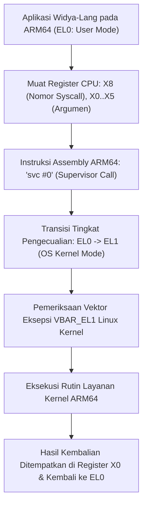

## Bab 14: Direct Syscall Berdaulat pada Arsitektur ARM64 / AArch64

### 14.1 Konvensi Register ARM64 svc #0

Perkembangan infrastruktur komputasi awan modern, pusat data ramah energi (*hyperscale cloud* seperti AWS Graviton, Ampere Altra), superkomputer berdaulat, hingga perangkat komputasi tepi (*edge computing* seperti Raspberry Pi dan mikrokontroler pertahanan) kini didominasi oleh arsitektur **ARM64 (AArch64)**.

Widya-Lang dirancang dengan arsitektur multi-target yang mendukung pemanggilan sistem langsung (*Direct Syscall*) pada arsitektur ARM64 secara berdaulat tanpa bergantung pada pustaka runtime C.



Konvensi Register Standar Linux pada Arsitektur ARM64 / AArch64:
- **Nomor Syscall**: Disimpan pada register **`X8`**.
- **Argumen 1 s/d 6**: Ditempatkan secara berurutan pada register **`X0`**, **`X1`**, **`X2`**, **`X3`**, **`X4`**, dan **`X5`**.
- **Nilai Kembalian**: Diterima kembali melalui register **`X0`**.
- **Instruksi Eksekusi**: Menggunakan instruksi **`svc #0`** (*Supervisor Call*).

### 14.2 Implementasi Kode Program Utuh

Berikut implementasi modul Direct Syscall portabel lintas arsitektur pada Widya-Lang:

```widya
// Modul Panggilan Sistem Langsung Kernel Linux ARM64
modul syscall_arm64 {
    // Tabel nomor sistem panggilan resmi Linux AArch64
    konstanta SYS_BACA: Angka = 63;      // sys_read(fd, buf, count)
    konstanta SYS_TULIS: Angka = 64;     // sys_write(fd, buf, count)
    konstanta SYS_TUTUP: Angka = 57;     // sys_close(fd)
    konstanta SYS_MMAP: Angka = 222;     // sys_mmap(...)
    konstanta SYS_KELUAR: Angka = 93;    // sys_exit(status)

    // Fungsi transmisi biner langsung ke STDOUT pada prosesor ARM64
    fungsi tulis_langsung_arm64(fd: Angka, pesan: Teks) -> Angka {
        misal panjang = pesan.panjang();
        // Memuat X8 = 64, X0 = fd, X1 = alamat, X2 = panjang, lalu eksekusi svc #0
        misal hasil = sys_arm64_call3(
            SYS_TULIS,
            fd,
            pesan.alamat_memori(),
            panjang
        );
        kembalikan hasil;
    }

    // Fungsi terminasi proses pada ARM64
    fungsi keluar_arm64(kode_status: Angka) {
        sys_arm64_call1(SYS_KELUAR, kode_status);
    }
}

// Modul Abstraksi Portabel Multi-Arsitektur Berdaulat
modul kernel_berdaulat {
    impor super::syscall_arm64;

    fungsi cetak_pesan_sistem(pesan: Teks) {
        // Kompilator mendeteksi arsitektur target kompilasi
        jika kompilasi::target_arch() == "aarch64" {
            syscall_arm64::tulis_langsung_arm64(1, pesan + "\n");
        } lainnya {
            // Fallback x86_64
            cetak("[x86_64 SYS] " + pesan);
        }
    }
}

modul utama {
    fungsi utama() {
        cetak("=== SISTEM DIRECT SYSCALL LINUX ARM64 WIDYA ===");
        kernel_berdaulat::cetak_pesan_sistem("Infrastruktur Kedaulatan Cloud ARM64 Terverifikasi Aktif");
    }
}
```

### 14.3 Rangkuman Desain & Analisis Rekayasa Sistem

Perbandingan Konvensi ABI Syscall antara x86_64 dengan ARM64 (AArch64):

| Parameter Teknis | Arsitektur x86_64 (Intel / AMD) | Arsitektur ARM64 / AArch64 |
| :--- | :--- | :--- |
| **Instruksi CPU** | `syscall` | `svc #0` |
| **Register Nomor Syscall** | `RAX` | `X8` |
| **Nomor `sys_write`** | `1` | `64` |
| **Nomor `sys_exit`** | `60` | `93` |
| **Nomor `sys_read`** | `0` | `63` |
| **Register Argumen 1 - 4** | `RDI`, `RSI`, `RDX`, `R10` | `X0`, `X1`, `X2`, `X3` |
| **Register Nilai Kembalian** | `RAX` | `X0` |

### 14.4 Latihan Mandiri & Evaluasi Pemahaman Sistem

1. Jelaskan perbedaan mendasar nomor syscall antara x86_64 dan AArch64 pada kernel Linux, dan mengapa nomor tersebut tidak identik!
2. Bagaimana instruksi `svc #0` pada ARM64 memicu kenaikan tingkat hak akses prosesor (*Exception Level*) dari EL0 ke EL1?
3. Rancanglah sebuah fungsi pembungkus multi-arsitektur `baca_stdin_langsung(panjang: Angka) -> Teks` yang secara otomatis memilih register sesuai arsitektur kompilasi target!

### 14.5 Latihan Soal Pilihan Ganda (10 Soal)

1. Instruksi perakitan (*assembly*) yang digunakan untuk memicu panggilan sistem pada prosesor ARM64 (AArch64) adalah...
   A. `syscall`
   B. `svc #0`
   C. `int 0x80`
   D. `kernel_call`

2. Register prosesor ARM64 yang digunakan untuk menyimpan nomor panggilan sistem (*syscall number*) adalah...
   A. `X0`
   B. `X8`
   C. `X30`
   D. `SP`

3. Nomor sistem panggilan pada Linux ARM64 untuk operasi penulisan data (`sys_write`) adalah...
   A. 1
   B. 64
   C. 93
   D. 0

4. Nomor sistem panggilan pada Linux ARM64 untuk operasi penghentian proses (`sys_exit`) adalah...
   A. 60
   B. 93
   C. 1
   D. 57

5. Register pada arsitektur ARM64 yang bertugas membawa argumen pertama sekaligus menerima nilai kembalian (*return value*) dari kernel adalah...
   A. `X0`
   B. `X8`
   C. `X16`
   D. `LR`

6. Tingkat hak istimewa CPU (*Exception Level*) pada arsitektur ARM64 di mana aplikasi pengguna (*User Space*) dieksekusi adalah...
   A. EL0
   B. EL1
   C. EL2
   D. EL3

7. Tingkat hak istimewa CPU (*Exception Level*) pada arsitektur ARM64 di mana kernel sistem operasi (Linux Kernel) berjalan adalah...
   A. EL0
   B. EL1
   C. EL2
   D. EL3

8. Mengapa nomor syscall pada ARM64 berbeda secara signifikan dengan nomor syscall pada x86_64 di kernel Linux?
   A. Karena ARM64 menggunakan tabel syscall terpadu yang dirancang ulang untuk menghapus dependensi historis lama (*legacy syscalls*)
   B. Karena insinyur ARM lupa mencocokkan dokumen Intel
   C. Karena prosesor ARM64 tidak memiliki register memori
   D. Karena sistem operasi Linux ARM64 dibuat oleh vendor yang berbeda

9. Perangkat komputasi strategis nasional yang umumnya berbasis arsitektur ARM64 meliputi...
   A. Superkomputer pusat data ramah energi, chip satelit, dan perangkat komputasi tepi pertahanan
   B. Komputer mainframe tabung hampa udara era 1950-an
   C. Mesin ketik manual
   D. Televisi tabung analog

10. Mengapa dukungan multi-target Direct Syscall pada Widya-Lang sangat penting bagi infrastruktur kedaulatan data nasional?
    A. Memungkinkan perangkat lunak berdaulat berjalan mulus di berbagai perangkat keras nasional (dari server cloud hingga drone) secara independen tanpa ketergantungan runtime pihak ketiga
    B. Menghapus kebutuhan pendingin ruangan pada server data center
    C. Mempercepat waktu download file video hiburan
    D. Membatasi bahasa pemrograman hanya untuk instansi militer
