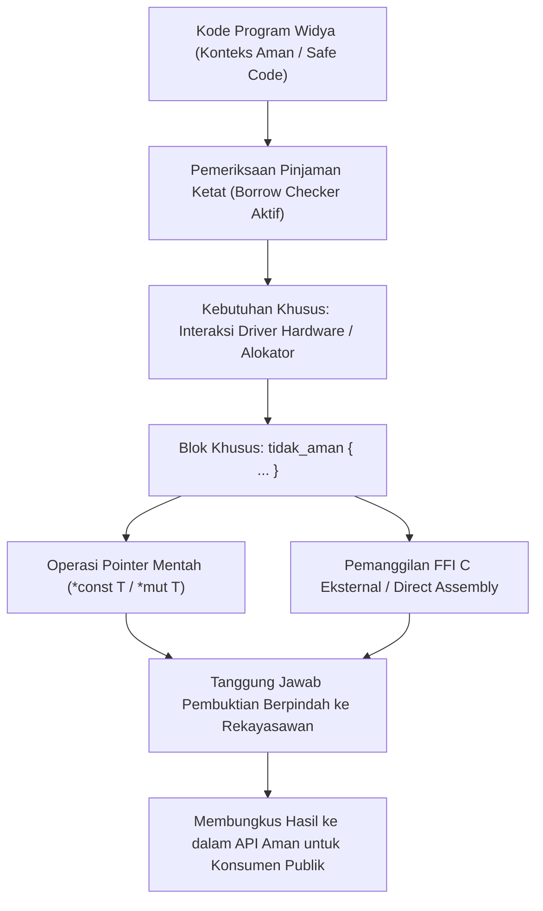

## Bab 15: Blok Tidak Aman (Unsafe Blocks) & Manipulasi Pointer Mentah

### 15.1 Batasan Area Aman vs Area Rendah

Widya-Lang menjamin keselamatan memori secara mutlak pada 99% bagian program melalui sistem kepemilikan dan *borrow checker*. Namun, untuk membangun perangkat lunak sistem tingkat paling rendah—seperti driver perangkat keras, subsistem mikrokernel, alokator memori, atau integrasi kode assembly langsung—komputer terkadang harus melakukan operasi yang tidak dapat dibuktikan keselamatannya secara otomatis oleh kompilator.

Untuk kebutuhan ini, Widya-Lang menyediakan mekanisme **Blok Tidak Aman (`tidak_aman`)** yang membungkus operasi berisiko tinggi di balik dinding batas abstraksi yang aman (*Safe Abstraction Boundary*).



Hak istimewa khusus yang hanya diizinkan di dalam blok `tidak_aman`:
1. **Dereferensi Pointer Mentah**: Membaca atau menulis alamat memori fisik melalui pointer mentah (`*const T` atau `*mut T`).
2. **Pemanggilan Fungsi Eksternal (FFI)**: Memanggil simbol fungsi C atau pustaka dinamis tak terverifikasi.
3. **Akses dan Mutasi Variabel Global Mutabel**: Mengubah status bersama tingkat rendah tanpa sinkronisasi statis.
4. **Implementasi Trait Tidak Aman**: Mengadopsi kontrak antarmuka yang memerlukan garansi manual dari pemrogram.

### 15.2 Implementasi Kode Program Utuh

Berikut implementasi pembungkusan operasi memori tingkat rendah menjadi antarmuka aman:

```widya
// Modul abstraksi memori berkinerja tinggi
modul memori_rendah {
    // Struktur buffer biner padat tanpa overhead
    struktur BufferRendah {
        alamat_awal: Angka,
        panjang: Angka,

        // Konstruktor aman yang mengelola blok memori
        fungsi buat_simulasi(ukuran: Angka) -> BufferRendah {
            // Simulasi alamat memori fisik yang dialokasikan
            misal fake_addr = 0x7FFF0000;
            kembalikan BufferRendah {
                alamat_awal: fake_addr,
                panjang: ukuran
            };
        }

        // Metode aman yang membungkus operasi tidak_aman secara internal
        fungsi tulis_byte_aman(diri, indeks: Angka, nilai_byte: Angka) -> Hasil<Boolean, Teks> {
            jika indeks < 0 atau indeks >= diri.panjang {
                kembalikan Hasil::Gagal("Indeks Melebihi Batas Alokasi (Buffer Overflow Dicegah)!");
            }

            // Operasi tingkat rendah dibungkus di dalam blok tidak_aman
            tidak_aman {
                // Di sini terjadi manipulasi pointer memori secara presisi
                misal alamat_target = diri.alamat_awal + indeks;
                sys_tulis_memori_langsung(alamat_target, nilai_byte);
            }

            kembalikan Hasil::Sukses(benar);
        }

        fungsi baca_byte_aman(diri, indeks: Angka) -> Hasil<Angka, Teks> {
            jika indeks < 0 atau indeks >= diri.panjang {
                kembalikan Hasil::Gagal("Indeks Di Luar Jangkauan!");
            }

            misal mut data = 0;
            tidak_aman {
                misal alamat_target = diri.alamat_awal + indeks;
                data = sys_baca_memori_langsung(alamat_target);
            }
            kembalikan Hasil::Sukses(data);
        }
    }
}

modul utama {
    fungsi utama() {
        cetak("=== SISTEM BLOK TIDAK_AMAN & POINTER RENDAH WIDYA ===");

        misal buffer = memori_rendah::BufferRendah::buat_simulasi(256);

        // Konsumen menggunakan antarmuka publik yang aman 100%
        misal status_tulis = buffer.tulis_byte_aman(10, 0xFF);
        cocokkan status_tulis {
            Hasil::Sukses(_) => cetak("[MEMORI OK] Byte 0xFF berhasil ditulis ke offset 10."),
            Hasil::Gagal(e) => cetak("[GALAT]", e)
        }

        // Uji coba pencegahan buffer overflow
        misal uji_bahaya = buffer.tulis_byte_aman(300, 0xAA);
        cocokkan uji_bahaya {
            Hasil::Sukses(_) => cetak("Berhasil"),
            Hasil::Gagal(e) => cetak("[PERTAHANAN SISTEM BERHASIL] Percobaan Akses Liar Digagalkan:", e)
        }
    }
}
```

### 15.3 Rangkuman Desain & Analisis Rekayasa Sistem

Filosofi pemisahan Safe vs Unsafe pada Widya-Lang:

| Dimensi Rekayasa | Pendekatan C/C++ Murni | Pendekatan Widya-Lang |
| :--- | :--- | :--- |
| **Zona Bahaya** | 100% dari seluruh kode program rentan galat memori | Terisolasi ketat hanya pada blok `tidak_aman` (~1%) |
| **Kemudahan Audit** | Seluruh baris kode wajib diaudit keamanannya | Tim audit siber cukup memfokuskan telaah pada blok `tidak_aman` |
| **Kecepatan Rendah** | Cepat tetapi tanpa jaminan formal | Cepat pada level biner dengan pembuktian abstraksi aman |
| **Pencegahan Eksploitasi** | Sangat sulit (Rentan serangan Zero-Day) | Mudah diaudit dan dibentengi secara formal |

### 15.4 Latihan Mandiri & Evaluasi Pemahaman Sistem

1. Jelaskan mengapa kata kunci `tidak_aman` (*unsafe*) pada Widya-Lang tidak berarti kode tersebut buruk atau salah, melainkan menandakan bahwa tanggung jawab pembuktian keabsahan berpindah ke rekayasawan!
2. Rancanglah sebuah fungsi `salin_memori_cepat(sumber: Angka, tujuan: Angka, jumlah_byte: Angka)` yang memindahkan data antar blok memori fisik menggunakan blok `tidak_aman` dengan validasi tumpang tindih (*overlap validation*)!
3. Bagaimana teknik pembungkusan *Safe Abstraction Boundary* melindungi konsumen pustaka dari bahaya dereferensi pointer null atau pointer liar?

### 15.5 Latihan Soal Pilihan Ganda (10 Soal)

1. Kata kunci pada Widya-Lang yang digunakan untuk membuka kapabilitas operasi memori tingkat rendah yang tidak dapat divalidasi otomatis oleh kompilator adalah...
   A. `bahaya`
   B. `tidak_aman`
   C. `mentah`
   D. `bebas`

2. Manakah dari operasi berikut yang HANYA diizinkan di dalam blok `tidak_aman`?
   A. Melakukan perulangan `untuk` pada larik
   B. Mendereferensikan pointer mentah (*dereferencing raw pointers*)
   C. Menjumlahkan dua angka integer
   D. Mencetak teks ke konsol

3. Jenis tipe data pointer mentah hanya-baca pada Widya-Lang direpresentasikan sebagai...
   A. `*const T`
   B. `&T`
   C. `Kotak<T>`
   D. `Nilai<T>`

4. Jenis tipe data pointer mentah yang dapat diubah nilainya pada Widya-Lang direpresentasikan sebagai...
   A. `*mut T`
   B. `&mut T`
   C. `Dinamis<T>`
   D. `Tumpukan<T>`

5. Prinsip *Safe Abstraction Boundary* (Batas Abstraksi Aman) mengajarkan bahwa...
   A. Seluruh kode program harus ditulis dalam blok `tidak_aman`
   B. Kode tingkat rendah di dalam `tidak_aman` wajib dibungkus dalam fungsi atau struktur yang menyediakan antarmuka aman bagi pemanggil luar
   C. Pemrogram dilarang menggunakan fungsi matematika
   D. Setiap variabel harus diberi kata sandi

6. Apakah keberadaan blok `tidak_aman` menonaktifkan pemeriksaan pinjaman (*borrow checker*) pada variabel aman lainnya di luar blok?
   A. Ya, borrow checker mati total di seluruh berkas
   B. Tidak sama sekali, aturan borrow checker tetap berlaku penuh pada seluruh variabel aman di dalam maupun di luar blok
   C. Hanya berlaku pada sistem operasi Windows
   D. Hanya ketika mode rilis diaktifkan

7. Apa keuntungan strategis bagi tim audit keamanan siber nasional dengan adanya pembatasan blok `tidak_aman`?
   A. Auditor cukup mengaudit blok-blok `tidak_aman` yang terisolasi untuk menemukan potensi celah korupsi memori, alih-alih membaca jutaan baris kode secara acak
   B. Auditor tidak perlu membaca kode program sama sekali
   C. Auditor dapat menghapus berkas biner secara otomatis
   D. Auditor dapat mengubah lisensi perangkat lunak secara sepihak

8. Dereferensi terhadap pointer mentah yang menunjuk ke alamat memori yang tidak sah atau telah dibebaskan akan memicu...
   A. Kesalahan segmentasi (*Segmentation Fault*) atau perilaku tak terdefinisi (*Undefined Behavior*)
   B. Teks dicetak dalam format huruf tebal
   C. Kompilator memberikan diskon pembelian lisensi
   D. Penambahan kapasitas hard disk

9. Manakah skenario di mana penggunaan blok `tidak_aman` benar-benar diperlukan dan sah secara arsitektural?
   A. Mengurutkan daftar nama warga secara alfabetis
   B. Mengembangkan driver perangkat keras MMIO, subsistem alokator memori kustom, atau integrasi assembly FFI
   C. Menghitung luas persegi panjang
   D. Mengubah warna latar belakang aplikasi web

10. Mengapa pemisahan Safe vs Unsafe sangat fundamental dalam menjaga kedaulatan perangkat lunak sistem nasional?
    A. Memberikan fleksibilitas penuh untuk mengontrol perangkat keras secara langsung tanpa kehilangan perlindungan keselamatan memori matematis pada mayoritas aplikasi
    B. Mengharuskan seluruh komputer menggunakan prosesor buatan satu pabrikan saja
    C. Mengurangi kecepatan transmisi satelit demi penghematan daya
    D. Membatasi penulisan komentar program hanya pada hari libur nasional
