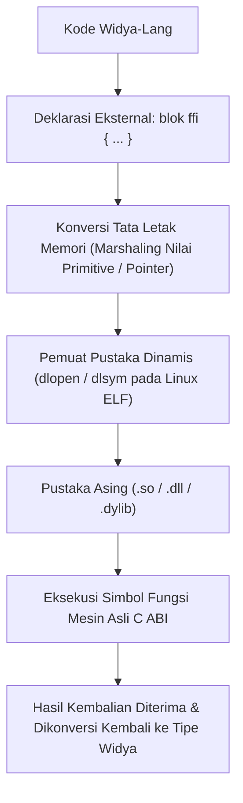

## Bab 16: Antarmuka Fungsi Asing (Foreign Function Interface / FFI C ABI)

### 16.1 Arsitektur Jembatan FFI C

Meskipun Widya-Lang mampu beroperasi secara independen dan mandiri, dalam ekosistem industri dunia nyata sering kali diperlukan interaksi dengan pustaka warisan (*legacy libraries*), pustaka matematika terakselerasi GPU (seperti CUDA atau ROCm), driver sistem operasi tertutup, atau sistem komputasi berkinerja tinggi yang ditulis dalam bahasa C/C++ atau Rust.

Widya-Lang menyediakan fasilitas **Foreign Function Interface (FFI)** berkinerja tinggi berbasis **C Application Binary Interface (C ABI)** standar internasional.



Tiga pilar interoperabilitas FFI pada Widya-Lang:
1. **Konvensi Pemanggilan C (C Calling Convention - cdecl/System V)**: Register CPU dan stack disusun persis sesuai spesifikasi biner standar C sehingga pemanggilan fungsi terjadi tanpa perantara emulasi.
2. **Representasi Tata Letak Memori Selaras (`#[tata_letak(C)]`)**: Menjamin struktur data pada Widya-Lang memiliki *padding*, *alignment*, dan offset byte yang identik dengan `struct` pada bahasa C.
3. **Isolasi Keamanan**: Seluruh pemanggilan fungsi FFI secara otomatis digolongkan sebagai operasi berisiko yang wajib dieksekusi di dalam blok `tidak_aman`.

### 16.2 Implementasi Kode Program Utuh

Berikut implementasi integrasi pemanggilan pustaka C standar (`libm.so` untuk matematika dan fungsi sistem) pada Widya-Lang:

```widya
// Modul Jembatan Antarmuka FFI C
modul ffi_jembatan {
    // Blok deklarasi simbol pustaka dinamis eksternal C
    blok_eksternal "libm.so.6" {
        // Deklarasi fungsi akar kuadrat double sqrt(double x)
        fungsi sqrt(nilai: Desimal) -> Desimal;
        
        // Deklarasi fungsi sinus double sin(double x)
        fungsi sin(sudut_rad: Desimal) -> Desimal;

        // Deklarasi fungsi daya double pow(double basis, double eksponen)
        fungsi pow(basis: Desimal, eksponen: Desimal) -> Desimal;
    }

    // Pembungkus aman (Safe Wrapper) untuk konsumen Widya-Lang
    fungsi akar_kuadrat_aman(x: Desimal) -> Hasil<Desimal, Teks> {
        jika x < 0.0 {
            kembalikan Hasil::Gagal("Tidak dapat menghitung akar kuadrat dari bilangan negatif!");
        }

        misal mut hasil = 0.0;
        tidak_aman {
            // Pemanggilan simbol C ABI eksternal
            hasil = sqrt(x);
        }
        kembalikan Hasil::Sukses(hasil);
    }

    fungsi hitung_hipotenusa(alas: Desimal, tinggi: Desimal) -> Desimal {
        misal mut h = 0.0;
        tidak_aman {
            misal a2 = pow(alas, 2.0);
            misal t2 = pow(tinggi, 2.0);
            h = sqrt(a2 + t2);
        }
        kembalikan h;
    }
}

modul utama {
    fungsi utama() {
        cetak("=== SISTEM FFI C ABI & INTEROPERABILITAS WIDYA ===");

        // Menggunakan pembungkus aman
        misal hasil_akar = ffi_jembatan::akar_kuadrat_aman(144.0);
        cocokkan hasil_akar {
            Hasil::Sukses(nilai) => cetak("[FFI SUKSES] sqrt(144.0) =", nilai),
            Hasil::Gagal(e) => cetak("[FFI GALAT]", e)
        }

        misal hipotenusa = ffi_jembatan::hitung_hipotenusa(3.0, 4.0);
        cetak("[FFI GEOMETRI] Hipotenusa Segitiga (3, 4) =", hipotenusa);
    }
}
```

### 16.3 Rangkuman Desain & Analisis Rekayasa Sistem

Pertimbangan rekayasa saat menerapkan integrasi FFI:

| Aspek Integrasi | Keuntungan Teknis | Risiko & Biaya Mitigasi |
| :--- | :--- | :--- |
| **Pemanfaatan Ekosistem** | Memanfaatkan jutaan baris kode C yang teruji | Wajib memverifikasi pointer null dari fungsi C |
| **Akselerasi Perangkat Keras** | Mengakses driver GPU vendor secara langsung | Potensi kebocoran memori di sisi pustaka asing |
| **Kecepatan Pemanggilan** | Kecepatan asli biner (*native call speed*) | Rentan crash jika definisi signature tipe berbeda |
| **Isolasi Keamanan** | Terisolasi rapi di balik blok `tidak_aman` | Tim audit wajib meninjau data marshaling |

### 16.4 Latihan Mandiri & Evaluasi Pemahaman Sistem

1. Mengapa pemanggilan fungsi eksternal melalui FFI C ABI selalu dianggap tidak aman (*unsafe*) oleh kompilator Widya-Lang?
2. Apa yang dimaksud dengan *Data Marshaling* dalam konteks FFI, dan mengapa konversi tipe string Widya (UTF-8 berpanjang eksplisit) ke string C (`const char*` berakhiran null `\0`) membutuhkan penanganan khusus?
3. Rancanglah deklarasi FFI untuk memanggil fungsi kompresi data `zlib` atau pustaka kriptografi C eksternal dan buat pembungkus amannya!

### 16.5 Latihan Soal Pilihan Ganda (10 Soal)

1. Antarmuka standar biner yang digunakan untuk menghubungkan kode Widya-Lang dengan pustaka C/C++ eksternal dinamakan...
   A. Foreign Function Interface (FFI C ABI)
   B. Virtual Machine Monitor
   C. WebAssembly Runtime
   D. SQL Query Engine

2. Kata kunci atau blok yang digunakan untuk mendeklarasikan fungsi-fungsi dari pustaka luar pada Widya-Lang adalah...
   A. `blok_eksternal`
   B. `impor_asing`
   C. `pustaka_luar`
   D. `tautkan_c`

3. Mengapa setiap pemanggilan fungsi FFI wajib dibungkus di dalam blok `tidak_aman`?
   A. Karena pustaka luar tidak dapat dijamin keselamatannya oleh borrow checker Widya-Lang
   B. Karena memperlambat kecepatan prosesor sebesar 80%
   C. Karena dilarang oleh undang-undang telekomunikasi
   D. Agar biner otomatis terenkripsi

4. Anotasi tata letak yang memastikan struktur data pada Widya-Lang memiliki perataan dan ukuran byte yang identik dengan struct C adalah...
   A. `#[tata_letak(C)]`
   B. `#[model_c]`
   C. `#[format_biner]`
   D. `#[struktur_rata]`

5. Perbedaan mendasar representasi string teks pada Widya-Lang dibandingkan string bahasa C konvensional adalah...
   A. Widya-Lang menggunakan fat pointer (alamat memori + panjang eksplisit), sedangkan string C diakhiri karakter null byte `\0`
   B. String C selalu dienkripsi
   C. Widya-Lang hanya mendukung huruf vokal
   D. String C disimpan di floppy disk

6. Pustaka dinamis bersama (*shared library*) pada sistem operasi Linux umumnya memiliki ekstensi berkas...
   A. `.so`
   B. `.dll`
   C. `.dylib`
   D. `.exe`

7. Fungsi sistem pada Linux yang digunakan untuk memuat pustaka biner bersama ke ruang memori proses adalah...
   A. `dlopen`
   B. `sys_load`
   C. `mem_fetch`
   D. `link_binary`

8. Apa risiko terbesar jika definisi tipe data (*signature*) pada deklarasi `blok_eksternal` tidak cocok dengan fungsi C aslinya?
   A. Kerusakan tumpukan stack memori (*Stack Corruption*) dan crash fatal
   B. Warna monitor komputer berubah menjadi biru
   C. Keyboard komputer tidak merespons
   D. Koneksi internet terputus seketika

9. Praktik rekayasa perangkat lunak terbaik saat menggunakan FFI pada Widya-Lang adalah...
   A. Membuka blok `tidak_aman` di seluruh program
   B. Membungkus pemanggilan FFI di dalam fungsi pembungkus yang aman (*Safe Wrapper*) yang memvalidasi masukan dan luaran
   C. Menghapus penanganan galat
   D. Mengabaikan nilai kembalian dari fungsi C

10. Mengapa fitur FFI C ABI tetap sangat berharga dalam ekosistem kedaulatan teknologi nasional?
    A. Memungkinkan integrasi strategis dengan pustaka akselerasi kecerdasan buatan (seperti CUDA Tensor) dan driver perangkat keras khusus tanpa harus menulis ulang jutaan baris kode dasar yang sudah ada
    B. Mengharuskan pengembang membeli perangkat lunak berbayar dari luar negeri
    C. Mengurangi memori hard disk server hingga 90%
    D. Membatasi pengembang agar tidak membuat program baru
