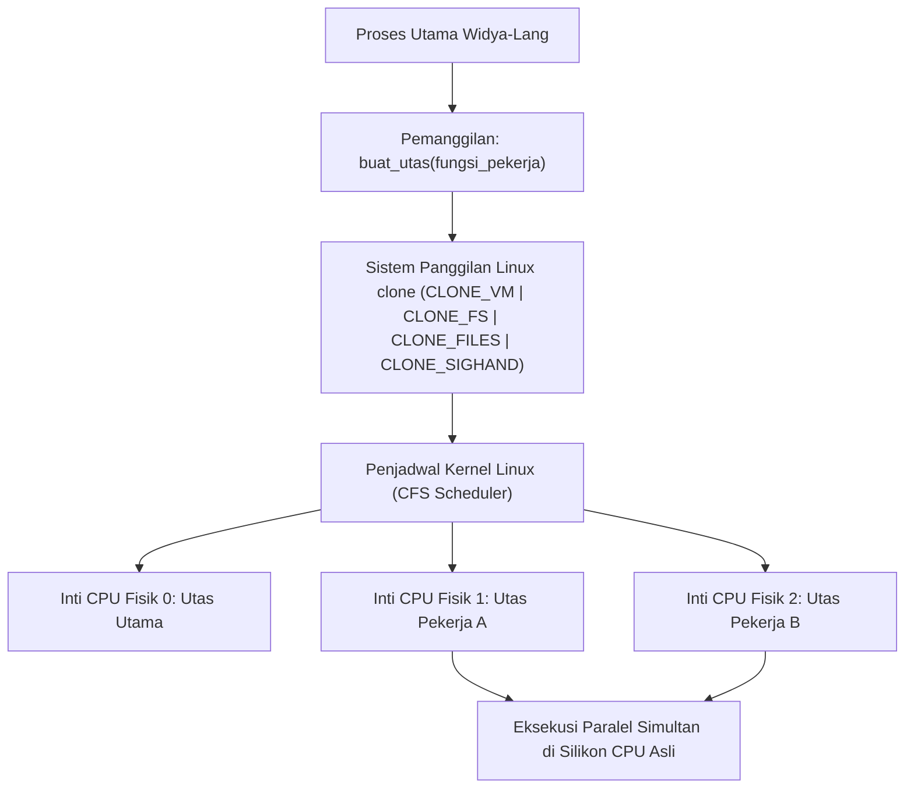

## Bab 17: Utas Paralel Tingkat Kernel OS (Multi-Threading) Murni

### 17.1 Pemetaan Utas 1:1 Kernel OS

Dalam era prosesor multi-inti (*multi-core processors*) modern dengan puluhan hingga ratusan inti pemrosesan fisik, perangkat lunak yang hanya berjalan pada satu inti (*single-threaded*) menyia-nyiakan lebih dari 90% daya komputasi perangkat keras. Widya-Lang mengimplementasikan **Model Utas 1:1 Kernel Murni (Native 1:1 Kernel Threading)**, di mana setiap utas yang dibuat pada bahasa dipetakan langsung ke utas sistem operasi (melalui *syscall* `clone` pada Linux) tanpa lapisan runtime perantara yang berat.



Karakteristik arsitektur konkurensi Widya-Lang:
1. **Paralelisme Sejati (True Hardware Parallelism)**: Berbeda dengan bahasa yang terkendala oleh *Global Interpreter Lock (GIL)*, Widya-Lang mengeksekusi instruksi pada inti fisik yang berbeda secara bersamaan.
2. **Keselamatan Memori Lintas Utas**: Penganalisis pinjaman (*Borrow Checker*) secara otomatis memvalidasi bahwa data yang dikirim ke utas lain memenuhi kontrak `DapatDikirim` (*Send*) dan `DapatDibagi` (*Sync*).
3. **Penyatuan Deterministik (`gabung_utas`)**: Memungkinkan utas utama menunggu penyelesaian komputasi paralel dan mengambil nilai hasil kembalian secara aman.

### 17.2 Implementasi Kode Program Utuh

Berikut implementasi kalkulasi intensif paralel multi-core untuk pemrosesan matriks radar maritim:

```widya
// Modul Pemrosesan Paralel Multi-Core Berdaulat
modul komputasi_paralel {
    // Fungsi komputasi simulasi intensif beban CPU
    fungsi hitung_analisis_sektor(id_sektor: Angka, jumlah_iterasi: Angka) -> Angka {
        cetak("[UTAS AKTIF] Sektor", id_sektor, "memulai kalkulasi numerik...");
        misal mut akumulator = 0;
        untuk i dalam 0..jumlah_iterasi {
            akumulator += (i * 3) ^ (id_sektor + 7);
        }
        cetak("[UTAS SELESAI] Sektor", id_sektor, "menuntaskan pemrosesan!");
        kembalikan akumulator;
    }

    fungsi jalankan_orkestrasi_paralel() {
        misal jumlah_inti = 4;
        misal iterasi_per_inti = 100000;
        misal mut daftar_handle: Larik<HandleUtas<Angka>> = [];

        cetak("[ORKESTRATOR] Menebarkan 4 utas pekerja ke inti CPU terpisah...");

        // 1. Membuat dan meluncurkan 4 utas paralel secara simultan
        untuk id dalam 1..5 {
            misal handle = buat_utas(fungsi() {
                kembalikan hitung_analisis_sektor(id, iterasi_per_inti);
            });
            daftar_handle.tambah(handle);
        }

        // 2. Mengumpulkan dan menggabungkan seluruh hasil perhitungan (Join)
        misal mut total_skor = 0;
        untuk h in daftar_handle {
            // gabung_utas menunggu hingga utas terkait selesai (Synchronous join)
            misal hasil_sektor = gabung_utas(h);
            total_skor += hasil_sektor;
        }

        cetak("[ORKESTRATOR] Seluruh utas berhasil digabung. Total Skor Akumulasi:", total_skor);
    }
}

modul utama {
    fungsi utama() {
        cetak("=== SISTEM MULTI-THREADING PARALEL KERNEL WIDYA ===");
        komputasi_paralel::jalankan_orkestrasi_paralel();
    }
}
```

### 17.3 Rangkuman Desain & Analisis Rekayasa Sistem

Perbandingan model konkurensi antara GIL (Python), M:N Green Threads (Go), dan 1:1 Kernel Threads (Widya-Lang / Rust):

| Parameter Teknis | Model GIL (Python) | Model M:N Runtime (Go) | Model 1:1 Kernel (Widya-Lang) |
| :--- | :--- | :--- | :--- |
| **Pemanfaatan Inti CPU** | Terbatas 1 Inti untuk bytecode | Multi-Inti via Goroutine scheduler | Multi-Inti Penuh via Kernel OS |
| **Overhead Runtime** | Tinggi (Interpreter state) | Sedang (Runtime scheduler internal) | Nol (Langsung dikelola oleh Linux kernel) |
| **Interoperabilitas Syscall** | Terhalang lock interpreter | Perlu handling non-blocking khusus | Alami dan instan tanpa perantara |
| **Jaminan Keselamatan Data** | Tidak ada (Rentan race condition) | Terbatas (Perlu flag `-race`) | Mutlak di waktu kompilasi via tipe Send/Sync |

### 17.4 Latihan Mandiri & Evaluasi Pemahaman Sistem

1. Jelaskan bagaimana Hukum Amdahl (*Amdahl's Law*) membatasi peningkatan kecepatan maksimum (*speedup*) sebuah sistem paralel saat jumlah inti CPU ditingkatkan!
2. Mengapa bahasa pemrograman yang memiliki *Global Interpreter Lock* (GIL) tidak dapat mencapai paralelisme multi-core sejati untuk beban kerja komputasi murni (*CPU-bound*)?
3. Rancang sebuah fungsi `pencarian_paralel<T>(larik_raksasa: Larik<T>, target: T) -> Mungkin<Angka>` yang membagi larik menjadi 4 segmen independen untuk dipindai oleh 4 utas paralel!

### 17.5 Latihan Soal Pilihan Ganda (10 Soal)

1. Model pemetaan utas (*threading model*) yang diterapkan oleh Widya-Lang pada sistem operasi Linux adalah...
   A. Model 1:1 Utas Kernel Murni (Native Kernel Threads)
   B. Model N:1 Green Threads tanpa pemanfaatan multi-core
   C. Model simulasi berbasis timer interrupt tunggal
   D. Model eksekusi sekuensial bergantian

2. Fungsi bawaan pada Widya-Lang yang digunakan untuk meluncurkan sebuah tugas ke utas paralel baru adalah...
   A. `jalankan_latar()`
   B. `buat_utas()`
   C. `inisiasi_proses()`
   D. `lempar_tugas()`

3. Fungsi yang digunakan untuk menunggu hingga suatu utas paralel menyelesaikan pekerjaannya dan mengambil nilai kembaliannya adalah...
   A. `tunggu_selesai()`
   B. `gabung_utas()`
   C. `sinkronisasi()`
   D. `kunci_utas()`

4. Sistem panggilan (*syscall*) pada kernel Linux yang mendasari pembentukan utas berkinerja tinggi pada arsitektur 1:1 adalah...
   A. `fork`
   B. `clone`
   C. `execve`
   D. `vfork`

5. Mengapa Widya-Lang dapat mengeksekusi komputasi paralel sejati di berbagai inti prosesor secara simultan?
   A. Karena tidak memiliki Global Interpreter Lock (GIL) yang membatasi eksekusi ke satu thread
   B. Karena kompilator meminta izin ke server cloud
   C. Karena memori kartu grafis diubah menjadi memori CPU
   D. Karena seluruh kode otomatis diubah menjadi bahasa HTML

6. Tipe penanda (*marker trait*) pada sistem tipe Widya-Lang yang menandakan bahwa kepemilikan sebuah tipe data aman untuk dipindahkan ke utas lain adalah...
   A. `DapatDisalin`
   B. `DapatDikirim` (Send)
   C. `DapatDihapus`
   D. `DapatDibaca`

7. Tipe penanda (*marker trait*) yang menandakan bahwa referensi imutabel sebuah tipe data aman untuk diakses bersama oleh banyak utas paralel secara simultan adalah...
   A. `DapatDibagi` (Sync)
   B. `DapatDikunci`
   C. `ImutabelTotal`
   D. `ParalelAman`

8. Hukum matematika komputasi yang menjelaskan bahwa percepatan maksimal program paralel dibatasi oleh bagian sekuensial yang tidak dapat diparalelkan adalah...
   A. Hukum Moore
   B. Hukum Amdahl
   C. Hukum Little
   D. Hukum Conway

9. Apa bahaya terbesar dari pembuatan ribuan utas kernel OS (1:1) tanpa pembatasan kolam utas (*thread pool*)?
   A. CPU akan meledak karena kelebihan tegangan
   B. Pemborosan memori untuk stack tiap utas (biasanya 2-8 MB per thread) dan overhead *context switching* kernel yang berlebihan
   C. Keyboard dan mouse komputer tidak dapat digerakkan
   D. Koneksi internet otomatis terputus

10. Mengapa keandalan multi-threading tingkat rendah sangat esensial bagi sistem radar maritim dan pertahanan udara nasional?
    A. Memungkinkan pemrosesan jutaan sinyal pantulan sensor secara instan (*real-time processing*) tanpa ada jeda atau data yang hilang
    B. Mengizinkan pemantauan layar radar melalui aplikasi media sosial
    C. Mengurangi kebutuhan bahan bakar generator listrik
    D. Mengharuskan instalasi sistem operasi komersial tertutup
