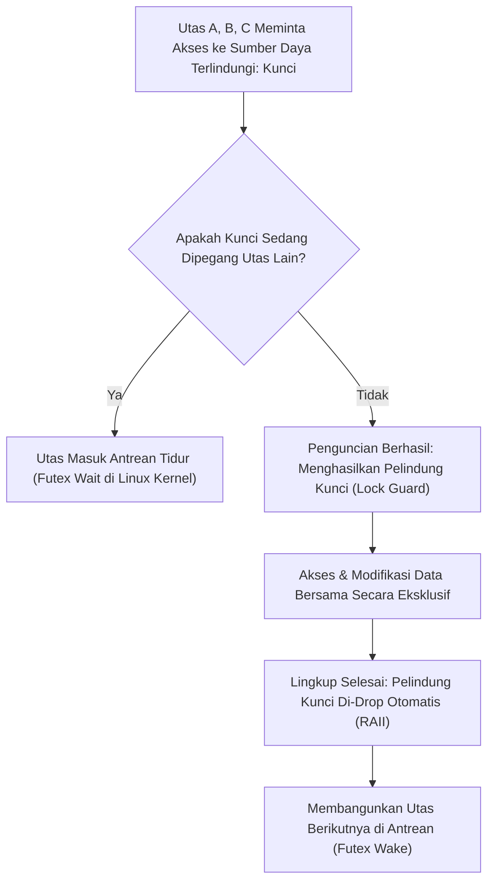

## Bab 18: Primitif Sinkronisasi Memori: Mutex, RwLock, dan Operasi Atomik CPU

### 18.1 Mekanisme Penguncian Mutual Exclusion

Ketika banyak utas paralel membutuhkan akses ke data bersama yang dapat dimutasi (*shared mutable state*), sistem wajib menerapkan mekanisme sinkronisasi memori untuk mencegah kerusakan integritas data. Widya-Lang menyediakan tiga tingkatan primitif sinkronisasi memori berdaulat:
1. **Operasi Atomik CPU (`AtomikAngka`, `AtomikBoolean`)**: Sinkronisasi tingkat paling rendah tanpa penguncian (*lock-free*) yang memanfaatkan instruksi perangkat keras atomik prosesor CPU (seperti `LOCK CMPXCHG` pada x86 atau `LDREX/STREX` / `CAS` pada ARM64).
2. **Kunci Eksklusif (`Kunci<T>` / Mutex)**: Menjamin hanya tepat satu utas yang dapat mengakses dan memodifikasi data pada satu waktu melalui pola RAII pembungkus pelindung (*Lock Guard*).
3. **Kunci Pembaca-Penulis (`KunciBacaTulis<T>` / RwLock)**: Mengizinkan banyak pembaca mengakses data secara bersamaan (*concurrent readers*), tetapi hanya tepat satu penulis eksklusif yang diizinkan memutasi data saat tidak ada pembaca aktif.



Prinsip keselamatan sinkronisasi Widya-Lang:
- **Data Dibungkus di Dalam Kunci**: Berbeda dengan C/C++ di mana mutex dan data dideklarasikan terpisah (sehingga pemrogram bisa lupa mengunci), pada Widya-Lang data dibungkus di dalam `Kunci<T>` sehingga data **mustahil diakses** tanpa memperoleh kunci pengaman terlebih dahulu.
- **Bebas Kebocoran Kunci (No Forgotten Unlock)**: Penguncian dilepaskan secara otomatis tepat saat variabel penjaga (*guard*) keluar dari cakupan blok fungsi melalui pola RAII.

### 18.2 Implementasi Kode Program Utuh

Berikut implementasi penghitung transaksi terdistribusi menggunakan operasi atomik dan pembaruan saldo brankas berbasis `Kunci<T>`:

```widya
// Modul Brankas Keuangan Aman Lintas Utas
struktur SaldoBrankas {
    kunci_kas: Kunci<Angka>,
    total_transaksi_sukses: AtomikAngka,

    fungsi baru(modal_awal: Angka) -> SaldoBrankas {
        kembalikan SaldoBrankas {
            kunci_kas: Kunci::baru(modal_awal),
            total_transaksi_sukses: AtomikAngka::baru(0)
        };
    }

    // Penambahan dana secara aman menggunakan Mutex RAII
    fungsi setor_dana(diri, jumlah: Angka) {
        // 1. Memperoleh kunci penjaga (Lock Guard)
        misal mut guard_kas = diri.kunci_kas.kunci();
        
        // 2. Memodifikasi nilai terlindungi
        *guard_kas += jumlah;
        
        // 3. Menambah penghitung transaksi secara atomik hardware (Lock-Free)
        diri.total_transaksi_sukses.tambah(1);
        
        // guard_kas otomatis dilepaskan saat fungsi ini keluar
    }

    fungsi ambil_saldo(diri) -> Angka {
        misal guard_kas = diri.kunci_kas.kunci();
        kembalikan *guard_kas;
    }
}

modul utama {
    fungsi utama() {
        cetak("=== SISTEM SINKRONISASI MUTEX & ATOMIK CPU WIDYA ===");

        // Menggunakan Busur (Arc) untuk berbagi brankas lintas utas
        misal brankas_nasional = Busur::baru(SaldoBrankas::baru(10000000));
        misal mut daftar_utas = [];

        cetak("Saldo Awal Brankas: Rp", brankas_nasional.ambil_saldo());
        cetak("Meluncurkan 5 utas penyetoran paralel simultan...");

        // Meluncurkan 5 utas yang masing-masing menyetor Rp 1.000.000
        untuk i dalam 1..6 {
            misal ref_brankas = brankas_nasional.klon();
            misal h = buat_utas(fungsi() {
                ref_brankas.setor_dana(1000000);
            });
            daftar_utas.tambah(h);
        }

        // Menunggu seluruh transaksi tuntas
        untuk h in daftar_utas {
            gabung_utas(h);
        }

        cetak("--- Seluruh Transaksi Paralel Selesai ---");
        cetak("Saldo Akhir Brankas     : Rp", brankas_nasional.ambil_saldo());
        cetak("Total Transaksi Terhitung: ", brankas_nasional.total_transaksi_sukses.muat(), "kali");
    }
}
```

### 18.3 Rangkuman Desain & Analisis Rekayasa Sistem

Perbandingan karakteristik ketiga instrumen sinkronisasi:

| Karakteristik | Operasi Atomik CPU | Kunci Eksklusif (`Kunci<T>`) | Kunci Pembaca-Penulis (`KunciBacaTulis<T>`) |
| :--- | :--- | :--- | :--- |
| **Mekanisme** | Instruksi CPU Hardware murni | Penguncian Mutual Exclusion via Kernel | Penguncian Terpisah Baca vs Tulis |
| **Overhead Kinerja** | Terendah (Hanya siklus bus CPU) | Sedang (Perlu sistem panggilan futex saat kontensi) | Sedang-Tinggi (Pelacakan jumlah pembaca) |
| **Skalabilitas Baca** | Sangat Tinggi | Terbatas (Antrean serial) | Sangat Tinggi (Banyak pembaca simultan) |
| **Kompleksitas Data** | Terbatas pada tipe integer/boolean | Sembarang struktur data kompleks | Sembarang struktur data kompleks |

### 18.4 Latihan Mandiri & Evaluasi Pemahaman Sistem

1. Jelaskan bagaimana desain pembungkusan data di dalam `Kunci<T>` pada Widya-Lang secara mutlak mencegah pemrogram mengakses data terlindungi tanpa memperoleh kunci pengaman terlebih dahulu!
2. Apa yang dimaksud dengan fenomena kebuntuan sistem (*Deadlock*), dan bagaimana aturan pemesanan kunci (*Lock Ordering Rule*) dapat menghindarkan sistem dari deadlock?
3. Rancang sebuah cache data memori menggunakan `KunciBacaTulis<Kamus<Teks, Teks>>` yang memaksimalkan throughput pembacaan data tanpa memblokir pembaca lain!

### 18.5 Latihan Soal Pilihan Ganda (10 Soal)

1. Primitif sinkronisasi memori tingkat perangkat keras yang bekerja tanpa penguncian (*lock-free*) menggunakan instruksi atomik prosesor adalah...
   A. `AtomikAngka`
   B. `Kunci<T>`
   C. `KunciBacaTulis<T>`
   D. `Saluran<T>`

2. Mekanisme penguncian pada Widya-Lang yang menjamin hanya tepat satu utas yang dapat mengakses data bersama pada satu waktu dinamakan...
   A. Semaphore Biner
   B. Kunci Eksklusif (`Kunci<T>` / Mutex)
   C. Garbage Collector
   D. Coroutine Yield

3. Bagaimana cara pelepasan kunci (*unlock*) dilakukan pada struktur `Kunci<T>` di Widya-Lang?
   A. Pemrogram wajib memanggil fungsi `buka_kunci()` secara manual
   B. Kunci dilepaskan secara otomatis tepat saat penjaga kunci (*Lock Guard*) keluar dari cakupan blok kodenya melalui prinsip RAII
   C. Kunci dilepaskan oleh sistem operasi setiap 5 detik
   D. Kunci tidak pernah dilepaskan hingga komputer dimatikan

4. Kondisi kebuntuan di mana dua utas saling menunggu kunci yang dipegang oleh utas lainnya tanpa pernah melepaskannya dinamakan...
   A. Race Condition
   B. Deadlock (Kebuntuan)
   C. Starvation
   D. Priority Inversion

5. Kapan penggunaan `KunciBacaTulis<T>` (RwLock) jauh lebih menguntungkan dibandingkan `Kunci<T>` (Mutex)?
   A. Ketika beban kerja didominasi oleh operasi penulisan data yang sangat sering
   B. Ketika beban kerja didominasi oleh operasi pembacaan data yang sangat masif dengan frekuensi pembaruan data yang jarang
   C. Ketika komputer hanya memiliki satu inti CPU
   D. Ketika program tidak membutuhkan penyimpanan memori

6. Sistem panggilan kernel Linux yang digunakan oleh implementasi Mutex modern untuk menidurkan dan membangunkan utas yang mengantre adalah...
   A. `futex` (Fast Userspace Mutex)
   B. `kill`
   C. `mprotect`
   D. `ptrace`

7. Apa bahaya dari mengakses variabel global mutabel tanpa menggunakan primitif sinkronisasi pada aplikasi multi-thread?
   A. Data Race yang menyebabkan korupsi memori dan perhitungan nilai yang salah
   B. Hard disk komputer otomatis terformat
   C. Program tidak dapat disimpan ke flash disk
   D. Tampilan monitor berkedip

8. Instruksi atomik prosesor yang membandingkan nilai memori saat ini dengan nilai yang diharapkan dan hanya memperbaruinya jika cocok dinamakan...
   A. Read-After-Write
   B. Compare-And-Swap (CAS) / CMPXCHG
   C. Test-And-Reset
   D. Fetch-And-Drop

9. Di dalam arsitektur multi-core, operasi atomik CPU menjamin koordinasi antar inti melalui...
   A. Protokol Koherensi Cache CPU (seperti MESI/MOESI) dan penguncian bus memori
   B. Transmisi sinyal inframerah
   C. Pemanggilan fungsi BIOS secara terus-menerus
   D. Pengaturan voltase adaptor daya

10. Mengapa pemakaian Mutex berbasis RAII sangat krusial dalam perangkat lunak perbankan terdistribusi berdaulat?
    A. Mencegah anomali saldo ganda (*double spending*) dan menjamin integritas catatan keuangan tanpa risiko kebocoran kunci akibat eksepsi sistem
    B. Menghapus kewajiban pembayaran pajak transaksi
    C. Mempercepat waktu transfer uang melalui kabel tembaga
    D. Mengharuskan server disimpan di bunker bawah tanah
