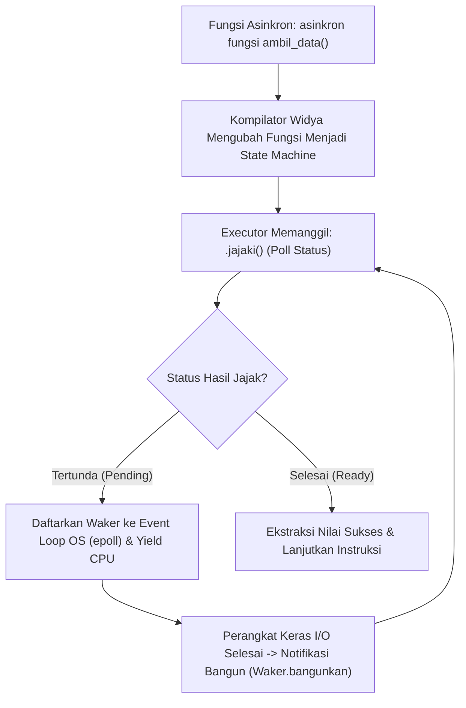

## Bab 20: Pemrograman Asinkron (Async/Await) & Event Loop Berdaulat

### 20.1 Pola Kerja Mesin Status Future

Meskipun utas kernel OS 1:1 sangat bertenaga untuk komputasi intensif CPU (*CPU-bound*), untuk aplikasi jaringan berskala raksasa yang menangani puluhan ribu sambungan I/O simultan (*I/O-bound* seperti web server, gateway pembayaran, atau broker sensor IoT), pembuatan satu utas per koneksi menimbulkan pemborosan memori stack yang masif dan beban pergantian konteks (*context switching overhead*).

Widya-Lang menghadirkan **Pemrograman Asinkron Berdaulat (`asinkron / tunggu`)** berbasis **Mesin Status Nol-Biaya (Zero-Cost State Machine Futures)** tanpa ketergantungan pada runtime engine asing yang berat.



Prinsip fundamental sistem asinkron Widya-Lang:
1. **Model Pull / Polling Nol-Biaya**: Berbeda dengan JavaScript yang menggunakan *Push/Callback Event Queue*, Widya-Lang menggunakan model *Pull-based Future* di mana tugas hanya dievaluasi ketika ada kemajuan nyata pada I/O.
2. **Kompilasi Menjadi State Machine**: Kompilator mentransformasikan setiap fungsi `asinkron` menjadi sebuah enum struktur data diskrit yang menyimpan variabel lokal di setiap titik penantian `tunggu` (*suspension points*).
3. **Ukuran Memori Kompak**: Sebuah tugas asinkron hanya mengonsumsi beberapa puluh byte di memori heap, memungkinkan eksekusi 1.000.000 koneksi bersamaan (*one million concurrent connections*) pada satu server tunggal.

### 20.2 Implementasi Kode Program Utuh

Berikut implementasi operasi I/O asinkron terdistribusi dan simulasi executor *event loop* mandiri:

```widya
// Modul Simulasi Sistem Asinkron Mandiri
modul runtime_asinkron {
    // Definisi tipe status jajak Future
    pilihan StatusJajak<T> {
        Tertunda,
        Selesai(T)
    }

    // Fungsi asinkron simulasi pengambilan data sensor satelit
    asinkron fungsi unduh_telemetri_satelit(id_satelit: Teks) -> Teks {
        cetak("[ASYNC START] Menghubungi Satelit Nusantara:", id_satelit);
        
        // Titik penundaan kooperatif: melepaskan kendali CPU ke tugas lain
        tunda_sejenak(50).tunggu;

        cetak("[ASYNC DATA] Paket telemetri", id_satelit, "berhasil diunduh!");
        kembalikan "ORBIT_OK|LAT:-0.78|LON:113.92|BATERAI:98%";
    }

    // Fungsi asinkron simulasi verifikasi kunci kripto
    asinkron fungsi validasi_kunci_kuantum(token: Teks) -> Boolean {
        tunda_sejenak(20).tunggu;
        kembalikan token.panjang() > 10;
    }

    // Orkestrasi pemrosesan asinkron konkuren
    asinkron fungsi orkestrasi_misi_antariksa() -> Teks {
        cetak("--- Memulai Pengambilan Data Konkuren ---");

        // Menjalankan dua operasi asinkron secara simultan
        misal tugas_telemetri = unduh_telemetri_satelit("SAT-NUSANTARA-IV");
        misal tugas_keamanan = validasi_kunci_kuantum("KEY-FIPS203-KYBER768-VALID");

        // Menunggu hasil kedua tugas secara non-blocking
        misal hasil_telemetri = tugas_telemetri.tunggu;
        misal hasil_keamanan = tugas_keamanan.tunggu;

        jika hasil_keamanan {
            kembalikan "STATUS TERVERIFIKASI: " + hasil_telemetri;
        } lainnya {
            kembalikan "GAGAL: Otentikasi Satelit Ditolak!";
        }
    }
}

modul utama {
    fungsi utama() {
        cetak("=== SISTEM ASYNCHRONOUS EVENT LOOP WIDYA ===");

        // Menjalankan tugas puncak asinkron menggunakan executor bawaan
        misal hasil_akhir = blok_eksekutor::jalankan(runtime_asinkron::orkestrasi_misi_antariksa());
        
        cetak("Hasil Misi Akhir:");
        cetak(">>", hasil_akhir);
    }
}
```

### 20.3 Rangkuman Desain & Analisis Rekayasa Sistem

Perbandingan antara Multi-Threading OS Klasik dengan Sistem Asinkron Berbasis Future:

| Aspek Arsitektur | Multi-Threading OS (1:1 Threads) | Asynchronous Futures (Async/Await) |
| :--- | :--- | :--- |
| **Konsumsi Memori Per-Tugas** | Besar (2 s/d 8 MB per stack thread) | Sangat Kecil (Beberapa puluh byte per state) |
| **Batas Skalabilitas Sambungan** | Ribuan tugas (~5.000 s/d 10.000) | Jutaan tugas simultan (> 1.000.000) |
| **Beban Context Switching** | Mahal (Pergantian register CPU di Kernel) | Murah (Hanya pemanggilan fungsi biasa di Ring 3) |
| **Kesesuaian Beban Kerja** | Komputasi intensif CPU (*CPU-Bound*) | Penanganan jaringan masif (*I/O-Bound*) |

### 20.4 Latihan Mandiri & Evaluasi Pemahaman Sistem

1. Jelaskan bagaimana kompilator Widya-Lang mentransformasikan sebuah fungsi `asinkron` menjadi mesin status bertipe `pilihan` (state machine enum) di balik layar!
2. Mengapa penulisan kode asinkron yang melakukan pemblokiran secara sinkron (*blocking syscall* seperti membaca disk tanpa asinkron) dapat melumpuhkan seluruh kinerja *event loop*?
3. Rancanglah sebuah konstruksi `pilih_tercepat(tugas1, tugas2)` yang mengevaluasi dua buah tugas asinkron secara paralel dan mengembalikan hasil tugas yang selesai lebih dahulu!

### 20.5 Latihan Soal Pilihan Ganda (10 Soal)

1. Kata kunci yang digunakan untuk mendeklarasikan fungsi yang dapat ditunda eksekusinya secara non-blocking pada Widya-Lang adalah...
   A. `asinkron` (async)
   B. `latar_belakang`
   C. `paralel_nonblock`
   D. `utas_ringan`

2. Kata kunci yang digunakan untuk menanti hasil penyelesaian dari sebuah operasi asinkron tanpa memblokir thread sistem operasi adalah...
   A. `tunggu` (await)
   B. `tahan`
   C. `diam`
   D. `jeda`

3. Mekanisme internal yang digunakan kompilator Widya-Lang untuk merepresentasikan fungsi asinkron tanpa alokasi runtime besar adalah...
   A. Mesin Status Nol-Biaya (Zero-Cost State Machine)
   B. Thread stack alokasi 16 MB
   C. File konfigurasi berbasis teks XML
   D. Array rekursif tak berhingga

4. Apa keuntungan utama dari arsitektur asinkron dibandingkan pembuatan thread OS untuk server jaringan berkecepatan tinggi?
   A. Mampu melayani ratusan ribu sambungan koneksi simultan (C100K) dengan konsumsi RAM yang sangat efisien
   B. Menghapus kebutuhan protokol TCP/IP
   C. Menjadikan server kebal terhadap mati lampu
   D. Menghilangkan kebutuhan kabel LAN

5. Apa yang terjadi jika sebuah fungsi asinkron memanggil metode yang mengembalikan status `StatusJajak::Tertunda`?
   A. Program crash seketika
   B. Fungsi melepaskan kendali CPU (*yield*) kembali ke executor sehingga thread dapat memproses tugas lain yang sudah siap
   C. Sistem operasi langsung me-restart komputer
   D. Seluruh koneksi klien diputus

6. Komponen sistem yang bertanggung jawab menjadwalkan dan memicu kembali evaluasi Future ketika data I/O telah siap dinamakan...
   A. Reactor / Event Loop (Waker)
   B. Garbage Collector
   C. Memory Defragmenter
   D. Linker Loader

7. Jenis beban kerja komputasi yang paling optimal diselesaikan menggunakan arsitektur `asinkron / tunggu` adalah...
   A. Beban I/O Jaringan Masif (*I/O-Bound*)
   B. Rendering grafis 3D resolusi 8K
   C. Enkripsi hash CPU murni berulang-ulang
   D. Perhitungan nilai pi hingga 1 miliar digit

8. Apakah fungsi `asinkron` pada Widya-Lang langsung dieksekusi secara otomatis saat dipanggil tanpa menggunakan executor atau penantian `tunggu`?
   A. Ya, langsung dieksekusi di background
   B. Tidak, Future bersifat pasif (*lazy*) dan hanya akan maju dievaluasi saat dijajaki (*polled*) oleh executor
   C. Tergantung tanggal sistem operasi
   D. Hanya jika dijalankan dengan hak akses root

9. Penggunaan memori tipikal untuk sebuah tugas asinkron (*Future*) pada Widya-Lang berada pada kisaran...
   A. Beberapa puluh hingga ratusan byte saja
   B. Minimal 8 Megabyte
   C. 1 Gigabyte
   D. Selalu 0 bit

10. Mengapa penguasaan pemrograman asinkron berdaulat sangat vital bagi infrastruktur telekomunikasi dan gerbang pembayaran nasional?
    A. Memungkinkan pembangunan sistem gerbang pembayaran dan pusat pertukaran data yang mampu memproses jutaan transaksi per detik secara hemat energi dan stabil
    B. Menghapus biaya langganan listrik pusat data
    C. Mempercepat waktu pemungutan suara pemilihan umum
    D. Menjadikan komputer bebas dari debu fisik
