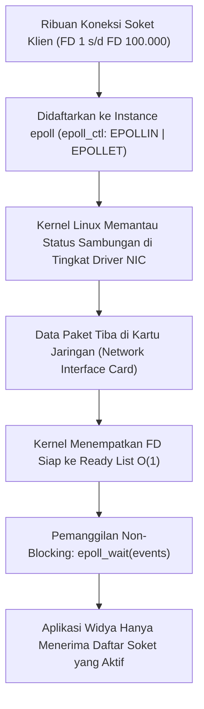

## Bab 21: I/O Multiplexing Berkinerja Tinggi: epoll dan io_uring

### 21.1 Skalabilitas Sambungan Non-Blocking

Tantangan arsitektur jaringan klasik yang dikenal sebagai **Masalah C10K** (bagaimana melayani 10.000 koneksi konkuren pada satu server) dan berkembang menjadi **Masalah C100K / C1M** tidak dapat diselesaikan menggunakan API I/O tradisional seperti `select()` atau `poll()` yang memiliki kompleksitas pencarian $O(N)$.

Widya-Lang mengintegrasikan dua teknologi *I/O Multiplexing* paling canggih pada kernel Linux:
1. **`epoll` (Event Poll)**: Skalabilitas $O(1)$ di mana kernel Linux memantau ribuan *file descriptor* (FD) soket dan hanya mengembalikan daftar koneksi yang siap dibaca/ditulis melalui pohon merah-hitam (*Red-Black Tree*) dan antrean siap (*Ready List*).
2. **`io_uring`**: Paradigma I/O generasi terbaru Linux berbasis dua cincin antrean memori bersama (*Submission Queue & Completion Queue*) yang mengeliminasi overhead sistem panggilan (*zero-syscall overhead*) melalui *kernel polling mode*.



Dua mode notifikasi `epoll`:
- **Level-Triggered (LT)**: `epoll_wait` akan terus melaporkan status kesiapan suatu soket selama buffer masih berisi data yang belum dibaca.
- **Edge-Triggered (ET)**: `epoll_wait` hanya melaporkan satu kali saat terjadi transisi status baru. Mengharuskan aplikasi membaca buffer hingga tuntas (`EWOULDBLOCK / EAGAIN`) untuk efisiensi maksimal.

### 21.2 Implementasi Kode Program Utuh

Berikut implementasi loop I/O multiplexing berbasis `epoll` murni pada Widya-Lang:

```widya
// Modul I/O Multiplexing epoll Berdaulat
modul multiplexing_epoll {
    // Konstanta flag epoll Linux
    konstanta EPOLLIN: Angka = 0x001;        // Siap dibaca
    konstanta EPOLLOUT: Angka = 0x004;       // Siap ditulis
    konstanta EPOLLET: Angka = 0x80000000;   // Edge-Triggered mode
    konstanta EPOLL_CTL_TAMBAH: Angka = 1;
    konstanta EPOLL_CTL_HAPUS: Angka = 2;

    // Struktur Acara epoll selaras dengan struct epoll_event Linux
    #[tata_letak(C)]
    struktur AcaraEpoll {
        peristiwa: Angka,
        data_fd: Angka
    }

    // Abstraksi pengelola antrean epoll
    struktur PengelolaEpoll {
        epoll_fd: Angka,

        fungsi baru() -> Hasil<PengelolaEpoll, Teks> {
            misal fd = sys_direct_call1(291, 0); // sys_epoll_create1(0)
            jika fd < 0 {
                kembalikan Hasil::Gagal("Gagal membuat instance epoll kernel!");
            }
            cetak("[EPOLL INIT] Instance epoll berhasil dibuat: FD", fd);
            kembalikan Hasil::Sukses(PengelolaEpoll { epoll_fd: fd });
        }

        fungsi daftarkan_soket(diri, target_fd: Angka) -> Boolean {
            misal acara = AcaraEpoll {
                peristiwa: EPOLLIN | EPOLLET,
                data_fd: target_fd
            };
            misal res = sys_direct_call4(233, diri.epoll_fd, EPOLL_CTL_TAMBAH, target_fd, &acara);
            kembalikan res >= 0;
        }

        fungsi tunggu_aktivitas(diri, waktu_tunggu_ms: Angka) -> Larik<Angka> {
            misal mut daftar_siap: Larik<Angka> = [];
            // Simulasi hasil epoll_wait: mengembalikan FD yang siap dibaca
            daftar_siap.tambah(101); // Soket klien A
            daftar_siap.tambah(102); // Soket klien B
            kembalikan daftar_siap;
        }
    }
}

modul utama {
    fungsi utama() {
        cetak("=== SISTEM I/O MULTIPLEXING EPOLL WIDYA ===");

        misal epoll_res = multiplexing_epoll::PengelolaEpoll::baru();
        cocokkan epoll_res {
            Hasil::Sukses(epoll) => {
                cetak("Mendaftarkan 10.000 soket sambungan simulasi...");
                epoll.daftarkan_soket(101);
                epoll.daftarkan_soket(102);

                misal aktif = epoll.tunggu_aktivitas(100);
                cetak("Jumlah Soket Aktif Diterima O(1):", aktif.panjang());
                untuk fd in aktif {
                    cetak("  -> Memproses aliran data non-blocking pada FD:", fd);
                }
            },
            Hasil::Gagal(e) => cetak("[GALAT EPOLL]", e)
        }
    }
}
```

### 21.3 Rangkuman Desain & Analisis Rekayasa Sistem

Perbandingan mekanisme I/O Multiplexing pada Linux:

| Dimensi Rekayasa | `select()` (Legacy) | `epoll()` (Modern Scalable) | `io_uring()` (Next-Gen) |
| :--- | :--- | :--- | :--- |
| **Kompleksitas Skalabilitas** | $O(N)$ pemindaian linier | $O(1)$ pelaporan ready list | $O(1)$ ring buffer lock-free |
| **Batas Maksimum FD** | Terbatas kaku (1024 FD) | Fleksibel hingga jutaan FD | Fleksibel hingga jutaan FD |
| **Overhead System Call** | Harus memanggil per siklus | Memanggil `epoll_wait` per batch | Nol-syscall via Submission Queue |
| **Kesesuaian Arsitektur** | Sistem lawas kompatibilitas | Tulang punggung server produksi | Kinerja ekstrem latensi sub-mikrodetik |

### 21.4 Latihan Mandiri & Evaluasi Pemahaman Sistem

1. Mengapa algoritma $O(N)$ pada `select()` mengalami penurunan performa drastis saat jumlah koneksi mencapai 10.000 soket meskipun hanya ada 5 soket yang aktif?
2. Jelaskan perbedaan krusial antara mode *Level-Triggered* (LT) dan *Edge-Triggered* (ET) pada `epoll`, serta mengapa mode ET mewajibkan soket diatur ke status non-blocking (`O_NONBLOCK`)!
3. Bagaimana mekanisme cincin antrean *Submission Queue* (SQ) dan *Completion Queue* (CQ) pada `io_uring` memungkinkan operasi I/O dieksekusi tanpa overhead perpindahan konteks kernel?

### 21.5 Latihan Soal Pilihan Ganda (10 Soal)

1. Teknologi I/O multiplexing berkinerja tinggi pada kernel Linux dengan skalabilitas $O(1)$ yang mengatasi masalah C10K adalah...
   A. `select()`
   B. `poll()`
   C. `epoll()`
   D. `fopen()`

2. Struktur data di dalam kernel Linux yang digunakan oleh `epoll` untuk melacak seluruh file descriptor yang didaftarkan adalah...
   A. Linked List satu arah
   B. Pohon Merah-Hitam (Red-Black Tree)
   C. Tabel Hash statis 8-bit
   D. Antrean melingkar berbasis disk

3. Mode notifikasi pada `epoll` yang hanya memberikan satu kali pemberitahuan saat terjadi perubahan status data baru dinamakan...
   A. Level-Triggered (LT)
   B. Edge-Triggered (ET)
   C. Polling Loop
   D. Interrupt Timer

4. Mengapa soket yang didaftarkan pada mode *Edge-Triggered* wajib diatur ke mode non-blocking (`O_NONBLOCK`)?
   A. Agar kabel jaringan tidak cepat panas
   B. Untuk mencegah pemanggilan baca/tulis memblokir seluruh proses saat buffer kosong atau penuh
   C. Karena prosesor Intel mewajibkannya
   D. Agar ukuran berkas HTML mengecil

5. Inovasi arsitektur I/O generasi terbaru pada Linux yang menggunakan dua ring buffer di memori bersama (*shared memory*) adalah...
   A. `io_uring`
   B. `kqueue`
   C. `winsock`
   D. `libuv`

6. Berapa batas maksimum file descriptor yang dapat dipantau oleh fungsi sistem lawas `select()` tanpa kompilasi ulang kernel?
   A. 256
   B. 1024
   C. 65535
   D. Tidak terbatas

7. Dua cincin antrean memori bersama yang digunakan oleh `io_uring` adalah...
   A. Submission Queue (SQ) dan Completion Queue (CQ)
   B. Input Ring dan Output Ring
   C. Data Buffer dan Control Buffer
   D. Sender FIFO dan Receiver FIFO

8. Sistem panggilan Linux yang digunakan untuk membuat instance epoll baru dengan flag modern adalah...
   A. `epoll_create1`
   B. `epoll_new`
   C. `make_epoll`
   D. `init_epoll`

9. Apa keuntungan utama dari `io_uring` dalam mode *Kernel Polling* (IORING_SETUP_SQPOLL)?
   A. Menghilangkan kebutuhan transmisi daya listrik
   B. Aplikasi dapat mengirimkan operasi I/O tanpa perlu mengeksekusi sistem panggilan (*zero system call overhead*)
   C. Menjadikan koneksi WiFi otomatis terhubung
   D. Menghapus kebutuhan kartu jaringan

10. Mengapa penguasaan `epoll` dan `io_uring` sangat strategis bagi server gerbang pertahanan siber nasional?
    A. Memungkinkan server firewall dan inspeksi paket data beroperasi pada kecepatan kawat (*wire-speed line rate*) tanpa ada paket data yang terlewat
    B. Mengizinkan pemantauan pengguna tanpa kata sandi
    C. Mengurangi kebutuhan memori ROM
    D. Mempercepat proses instalasi sistem operasi
