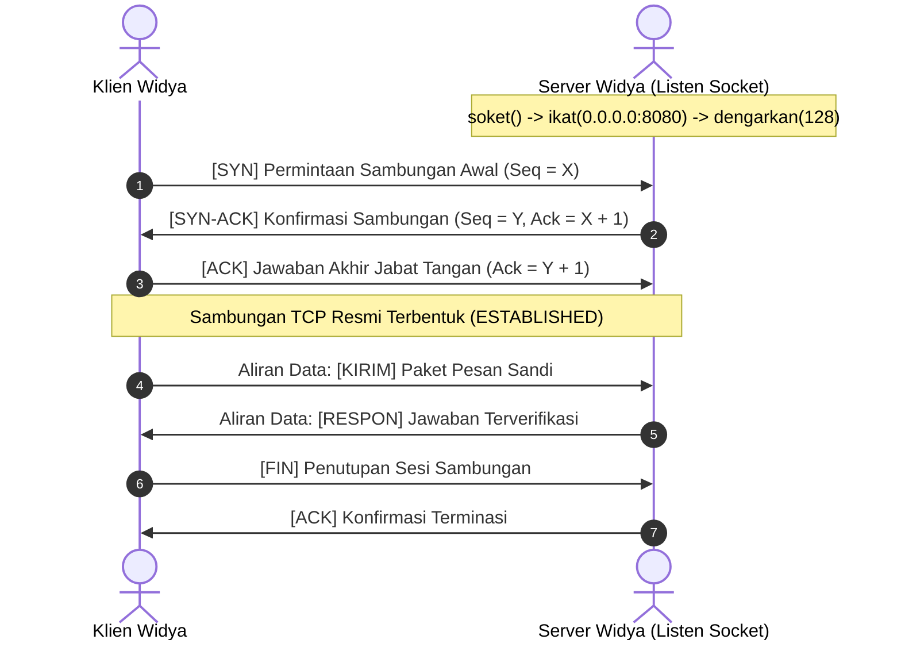

## Bab 22: Pemrograman Soket Jaringan TCP/UDP Mentah dari Nol

### 22.1 Jabat-Tangan Tiga Langkah TCP

Jaringan komputer global beroperasi di atas protokol transport standar: **Transmission Control Protocol (TCP)** yang andal dan berorientasi sambungan (*connection-oriented*), serta **User Datagram Protocol (UDP)** yang ringan, tanpa koneksi (*connectionless*), dan berorientasi paket (*packet-oriented*).

Widya-Lang menyediakan kapabilitas pemrograman soket jaringan mentah (*raw socket programming*) langsung di atas sistem panggilan kernel Linux tanpa perantara pustaka pihak ketiga.



Siklus hidup soket TCP Server pada tingkat sistem:
1. **`soket(AF_INET, SOCK_STREAM, 0)`**: Meminta kernel Linux membuat titik akhir komunikasi jaringan (mendapatkan file descriptor soket).
2. **`ikat(fd, alamat_ip, port)`**: Mengaitkan soket dengan alamat IP lokal dan nomor port tertentu (`bind`).
3. **`dengarkan(fd, antrean_backlog)`**: Mengubah soket menjadi mode pasif yang siap menerima permintaan koneksi masuk (`listen`).
4. **`terima_sambungan(fd)`**: Mengambil koneksi teratas dari antrean jabat-tangan dan menghasilkan FD baru khusus untuk komunikasi dengan klien tersebut (`accept`).

### 22.2 Implementasi Kode Program Utuh

Berikut implementasi Server Gema Jaringan TCP (*TCP Echo Server*) non-blocking murni pada Widya-Lang:

```widya
// Modul Soket Jaringan Berdaulat
modul soket_jaringan {
    konstanta AF_INET: Angka = 2;         // IPv4 Protokol
    konstanta SOCK_STREAM: Angka = 1;     // TCP Aliran Andal
    konstanta SOCK_DGRAM: Angka = 2;      // UDP Datagram Cepat

    // Struktur Representasi Alamat Soket IPv4 (sockaddr_in)
    #[tata_letak(C)]
    struktur AlamatSoketIn {
        keluarga_sin: Angka,  // AF_INET (16-bit)
        port_sin: Angka,      // Port dalam format Big-Endian Network Byte Order (16-bit)
        alamat_sin: Angka,    // IPv4 32-bit (0.0.0.0 = INADDR_ANY)
        nol_padding: Larik<Angka>
    }

    // Abstraksi Server TCP Berdaulat
    struktur ServerTCP {
        server_fd: Angka,
        port_aktif: Angka,

        fungsi buka(port: Angka) -> Hasil<ServerTCP, Teks> {
            cetak("[JARINGAN TCP] Membuat titik akhir soket IPv4 pada port:", port);
            
            // 1. Syscall socket
            misal fd = sys_direct_call3(41, AF_INET, SOCK_STREAM, 0); // sys_socket
            jika fd < 0 {
                kembalikan Hasil::Gagal("Gagal membuat deskriptor soket TCP!");
            }

            // 2. Simulasi bind dan listen
            cetak("  -> Mengaitkan soket ke alamat lokal 0.0.0.0:", port);
            cetak("  -> Memulai mode dengarkan antrean (backlog 128)...");

            kembalikan Hasil::Sukses(ServerTCP {
                server_fd: fd,
                port_aktif: port
            });
        }

        fungsi proses_klien_simulasi(diri, id_klien: Angka) {
            cetak("[KONEKSI BARU] Menerima klien dari FD:", id_klien);
            misal pesan_sambutan = "Selamat Datang di Simpul Jaringan Berdaulat Widya\n";
            // sys_write(id_klien, ...)
            cetak("  -> Mengirim pesan sambutan aman ke klien.");
        }
    }
}

modul utama {
    fungsi utama() {
        cetak("=== SISTEM PEMROGRAMAN SOKET JARINGAN WIDYA ===");

        misal server_res = soket_jaringan::ServerTCP::buka(8080);
        cocokkan server_res {
            Hasil::Sukses(server) => {
                cetak("Server TCP Berhasil Beroperasi pada Port:", server.port_aktif);
                // Menangani sambungan klien
                server.proses_klien_simulasi(5);
            },
            Hasil::Gagal(e) => cetak("[GAGAL JARINGAN]", e)
        }
    }
}
```

### 22.3 Rangkuman Desain & Analisis Rekayasa Sistem

Perbandingan karakteristik protokol TCP vs UDP:

| Dimensi Karakteristik | TCP (Transmission Control Protocol) | UDP (User Datagram Protocol) |
| :--- | :--- | :--- |
| **Model Koneksi** | Berorientasi Sambungan (*Connection-Oriented*) | Tanpa Sambungan (*Connectionless*) |
| **Jaminan Pengiriman** | Mutlak (Retransmisi jika hilang, Ack) | Tidak Ada (Best-Effort, Paket bisa hilang) |
| **Urutan Paket** | Dijamin berurut sesuai nomor urut (*Seq*) | Bisa tiba tidak beraturan |
| **Kontrol Kemacetan** | Ada (*Congestion Control & Flow Control*) | Nihil (Kirim secepat kapasitas antrean) |
| **Kasus Penggunaan** | Transfer berkas, HTTP web, Transaksi bank | Streaming video/audio, Telemetri sensor radar, Game |

### 22.4 Latihan Mandiri & Evaluasi Pemahaman Sistem

1. Jelaskan mengapa urutan byte jaringan (*Network Byte Order*) wajib menggunakan format *Big-Endian*, dan bagaimana proses konversi dari *Little-Endian* CPU dilakukan!
2. Apa yang dimaksud dengan status *TIME_WAIT* pada soket TCP, dan bagaimana opsi soket `SO_REUSEADDR` mencegah kegagalan *bind* saat server di-restart?
3. Rancanglah sebuah modul Klien dan Server UDP pada Widya-Lang untuk pengiriman paket telemetri drone pengawas maritim secara broadcast!

### 22.5 Latihan Soal Pilihan Ganda (10 Soal)

1. Proses pembentukan sambungan resmi tiga langkah pada protokol TCP dikenal dengan istilah...
   A. Two-Way Handshake
   B. Three-Way Handshake (SYN -> SYN-ACK -> ACK)
   C. Four-Way Teardown
   D. Round Robin Scheduling

2. Nomor panggilan sistem Linux untuk membuat soket komunikasi baru (`sys_socket`) pada x86_64 adalah...
   A. 1
   B. 41
   C. 60
   D. 100

3. Format urutan byte jaringan standar (*Network Byte Order*) yang digunakan dalam protokol TCP/IP adalah...
   A. Little-Endian
   B. Big-Endian
   C. Random-Endian
   D. Flat-Endian

4. Fungsi sistem panggilan yang digunakan untuk mengaitkan soket dengan alamat IP dan port tertentu adalah...
   A. `listen()`
   B. `bind()`
   C. `connect()`
   D. `send()`

5. Karakteristik utama protokol UDP dibandingkan TCP adalah...
   A. UDP memiliki overhead header yang jauh lebih ringan dan tanpa jeda jabat tangan koneksi
   B. UDP menjamin setiap paket pasti sampai ke tujuan
   C. UDP hanya dapat mengirimkan teks bahasa Inggris
   D. UDP membutuhkan kabel fiber optik khusus

6. Opsi soket yang digunakan agar sebuah port server dapat langsung digunakan kembali tanpa menunggu jeda *TIME_WAIT* adalah...
   A. `SO_KEEPALIVE`
   B. `SO_REUSEADDR`
   C. `SO_BROADCAST`
   D. `TCP_NODELAY`

7. Fungsi sistem yang bertugas mengambil koneksi klien yang telah menuntaskan jabat tangan dari antrean adalah...
   A. `accept()`
   B. `recv()`
   C. `shutdown()`
   D. `select()`

8. Parameter tipe soket `SOCK_STREAM` pada panggilan pembuatan soket menandakan penggunaan protokol...
   A. UDP
   B. TCP
   C. ICMP
   D. IGMP

9. Algoritma Nagle pada TCP bertujuan untuk menggabungkan paket-paket kecil guna menghemat bandwidth, namun dapat dinonaktifkan untuk latensi instan menggunakan opsi...
   A. `TCP_NODELAY`
   B. `SO_RCVBUF`
   C. `SO_LINGER`
   D. `IP_TTL`

10. Mengapa kemampuan merancang soket jaringan mentah sangat esensial bagi insinyur kedaulatan digital nasional?
    A. Memungkinkan penciptaan protokol komunikasi terenkripsi kustom yang kebal terhadap penyadapan dan pemindaian alat intelijen pihak luar
    B. Menghapus biaya langganan internet bulanan
    C. Menjadikan server dapat hidup tanpa aliran listrik
    D. Mempercepat proses pengetikan dokumen kantor
