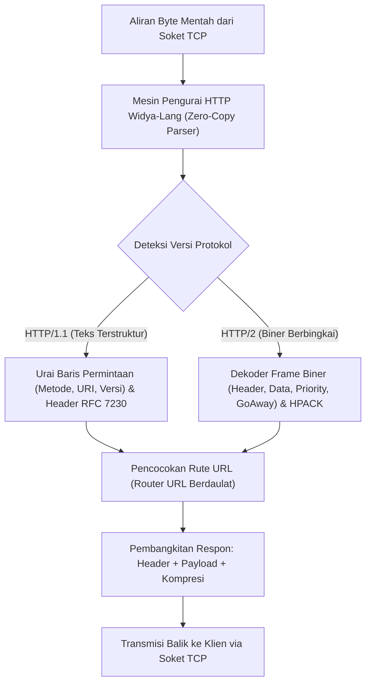

## Bab 23: Rekayasa Mesin Protokol HTTP/1.1 & HTTP/2 Mandiri

### 23.1 Alur Pengolahan Frame HTTP

Protokol **Hypertext Transfer Protocol (HTTP)** adalah fondasi utama pertukaran data pada World Wide Web dan antarmuka pemrograman aplikasi (RESTful API). Ketergantungan pada server web asing raksasa yang membengkak sering kali membawa jejak memori yang berat dan kerentanan keamanan yang kompleks.

Widya-Lang memfasilitasi pembangunan **Mesin Protokol HTTP/1.1 & HTTP/2 Berdaulat** dari nol (*from scratch*) dengan arsitektur parsing nir-salin (*zero-copy parsing*).



Evolusi arsitektur HTTP:
1. **HTTP/1.1**: Berbasis teks terbaca manusia dengan format baris permintaan, header kunci-nilai, dan pembatas baris kosong (`\r\n\r\n`). Rentan masalah *Head-of-Line Blocking* pada tingkat HTTP karena koneksi harus diproses berurutan.
2. **HTTP/2**: Berbasis format biner terbingkai (*binary framing*) dengan multiplexing penuh dalam satu koneksi TCP tunggal, kompresi header **HPACK**, dan prioritisasi aliran data (*Stream ID*).

### 23.2 Implementasi Kode Program Utuh

Berikut implementasi parser HTTP/1.1 ultra-cepat dan router API RESTful pada Widya-Lang:

```widya
// Modul Mesin Protokol Web HTTP/1.1 Berdaulat
modul mesin_http {
    pilihan MetodeHTTP {
        GET,
        POST,
        PUT,
        DELETE,
        TIDAK_DIKENAL
    }

    // Struktur Permintaan Klien HTTP
    struktur PermintaanHTTP {
        metode: MetodeHTTP,
        alur_uri: Teks,
        versi: Teks,
        header: Kamus<Teks, Teks>,
        badan_pesan: Teks
    }

    // Fungsi pengurai paket HTTP/1.1 nir-salin
    fungsi urai_permintaan(teks_mentah: Teks) -> Hasil<PermintaanHTTP, Teks> {
        misal baris_daftar = teks_mentah.pecah("\r\n");
        jika baris_daftar.panjang() == 0 {
            kembalikan Hasil::Gagal("Data permintaan kosong!");
        }

        // 1. Urai Request Line (misal: "GET /api/v1/kedaulatan HTTP/1.1")
        misal baris_pertama = baris_daftar.ambil(0).pecah(" ");
        jika baris_pertama.panjang() < 3 {
            kembalikan Hasil::Gagal("Format request line tidak sah!");
        }

        misal metode_str = baris_pertama.ambil(0);
        misal uri = baris_pertama.ambil(1);
        misal ver = baris_pertama.ambil(2);

        misal metode = cocokkan metode_str {
            "GET" => MetodeHTTP::GET,
            "POST" => MetodeHTTP::POST,
            "PUT" => MetodeHTTP::PUT,
            "DELETE" => MetodeHTTP::DELETE,
            _ => MetodeHTTP::TIDAK_DIKENAL
        };

        // 2. Urai Header
        misal peta_header = Kamus::baru();
        misal mut idx = 1;
        selama idx < baris_daftar.panjang() {
            misal b = baris_daftar.ambil(idx);
            jika b == "" {
                // Baris kosong menandakan akhir header
                idx += 1;
                keluar;
            }
            misal bagian = b.pecah(": ");
            jika bagian.panjang() >= 2 {
                peta_header.sisip(bagian.ambil(0), bagian.ambil(1));
            }
            idx += 1;
        }

        kembalikan Hasil::Sukses(PermintaanHTTP {
            metode: metode,
            alur_uri: uri,
            versi: ver,
            header: peta_header,
            badan_pesan: ""
        });
    }

    // Pembangkit respon HTTP baku
    fungsi buat_respon_json(kode_status: Angka, pesan_status: Teks, badan_json: Teks) -> Teks {
        misal mut resp = "HTTP/1.1 " + ke_teks(kode_status) + " " + pesan_status + "\r\n";
        resp += "Server: WidyaHTTP-Engine/2.6 (Nusantara)\r\n";
        resp += "Content-Type: application/json; charset=utf-8\r\n";
        resp += "Content-Length: " + ke_teks(badan_json.panjang()) + "\r\n";
        resp += "Connection: close\r\n\r\n";
        resp += badan_json;
        kembalikan resp;
    }
}

modul utama {
    fungsi utama() {
        cetak("=== SISTEM MESIN PROTOKOL HTTP/1.1 WIDYA ===");

        // Simulasi paket request yang diterima dari soket
        misal paket_masuk = "GET /api/v1/status_keamanan HTTP/1.1\r\nHost: node.nusantara.id\r\nAccept: application/json\r\n\r\n";

        misal hasil_urai = mesin_http::urai_permintaan(paket_masuk);
        cocokkan hasil_urai {
            Hasil::Sukses(req) => {
                cetak("[HTTP PARSER OK] Berhasil Mengurai Permintaan:");
                cetak("  URI Alur Target :", req.alur_uri);
                cetak("  Versi Protokol  :", req.versi);
                cetak("  Host Header     :", req.header.ambil("Host"));

                // Menghasilkan respon JSON
                misal badan_data = "{\"status\":\"AKTIF\",\"kedaulatan\":100}";
                misal respon_lengkap = mesin_http::buat_respon_json(200, "OK", badan_data);
                cetak("\nRespon HTTP yang Dibangkitkan:");
                cetak(respon_lengkap);
            },
            Hasil::Gagal(e) => cetak("[HTTP GALAT]", e)
        }
    }
}
```

### 23.3 Rangkuman Desain & Analisis Rekayasa Sistem

Perbandingan arsitektural antara HTTP/1.1 dengan HTTP/2:

| Parameter Protokol | HTTP/1.1 | HTTP/2 |
| :--- | :--- | :--- |
| **Format Representasi** | Teks ASCII Terbaca Manusia | Biner Berbingkai (*Binary Framing*) |
| **Multiplexing** | Tidak Ada (Perlu banyak koneksi TCP terpisah) | Penuh (Banyak request/response dalam 1 TCP) |
| **Kompresi Header** | Tidak Ada (Redundansi teks berulang) | Kompresi HPACK (Tabel dinamis & Huffman) |
| **Server Push** | Tidak Didukung | Didukung (Server mengirim aset proaktif) |
| **Head-of-Line Blocking** | Terjadi di tingkat HTTP | Terjadi di tingkat TCP paket drop |

### 23.4 Latihan Mandiri & Evaluasi Pemahaman Sistem

1. Jelaskan mengapa format biner berbingkai (*binary framing*) pada HTTP/2 secara dramatis meningkatkan efisiensi transmisi dibandingkan penguraian teks pada HTTP/1.1!
2. Bagaimana mekanisme kompresi header HPACK pada HTTP/2 mencegah redundansi pengiriman header yang sama berulang-ulang melalui tabel statis dan dinamis?
3. Rancanglah sebuah router HTTP pada Widya-Lang yang memetakan pola jalur URL (seperti `/pengguna/:id`) ke fungsi penangan (*handler*) controller secara aman!

### 23.5 Latihan Soal Pilihan Ganda (10 Soal)

1. Pasangan karakter pemisah standar yang memisahkan antara blok header HTTP dan badan pesan (*body*) pada protokol HTTP/1.1 adalah...
   A. `\n\n`
   B. `\r\n\r\n`
   C. `---`
   D. `;;`

2. Pembaruan arsitektural paling mendasar yang diperkenalkan oleh protokol HTTP/2 dibandingkan HTTP/1.1 adalah...
   A. Penggunaan format biner berbingkai (Binary Framing) dan multiplexing dalam satu koneksi TCP
   B. Penghapusan penggunaan alamat IP
   C. Mengganti warna tampilan peramban web
   D. Membatasi ukuran gambar maksimal 10 KB

3. Algoritma kompresi header khusus yang digunakan secara resmi pada protokol HTTP/2 adalah...
   A. Gzip
   B. HPACK
   C. Snappy
   D. Bzip2

4. Masalah pada HTTP/1.1 di mana permintaan lambat memblokir seluruh antrean permintaan berikutnya pada koneksi TCP yang sama dinamakan...
   A. Deadlock
   B. Head-of-Line Blocking (HoL Blocking)
   C. Starvation
   D. Cache Thrashing

5. Header HTTP yang digunakan oleh klien untuk memberi tahu server tipe konten yang dapat diterima adalah...
   A. `Accept`
   B. `Host`
   C. `User-Agent`
   D. `Cookie`

6. Kode status HTTP yang merepresentasikan bahwa permintaan berhasil dieksekusi dengan baik (*Success*) adalah...
   A. 200 OK
   B. 404 Not Found
   C. 500 Internal Server Error
   D. 301 Moved Permanently

7. Fitur pada HTTP/2 di mana server dapat mengirimkan sumber daya (seperti berkas CSS atau JS) ke klien sebelum klien memintanya dinamakan...
   A. Server Polling
   B. Server Push
   C. Reverse Proxy
   D. Web Socket

8. Header HTTP yang wajib ada pada setiap permintaan HTTP/1.1 sesuai standar RFC 7230 untuk memfasilitasi virtual hosting adalah...
   A. `Host`
   B. `Server`
   C. `Content-Type`
   D. `Date`

9. Mengapa teknik *Zero-Copy Parsing* sangat diutamakan dalam perancangan mesin HTTP berkecepatan tinggi?
   A. Menghilangkan alokasi memori string berulang di heap saat membaca header sehingga menghemat siklus CPU secara drastis
   B. Menghapus kebutuhan lisensi server
   C. Mempercepat koneksi kabel listrik
   D. Menjadikan kode sumber bebas dari fungsi perulangan

10. Mengapa kepemilikan mesin server HTTP berdaulat sangat penting bagi infrastruktur kedaulatan data nasional?
    A. Menjamin gerbang pertukaran data API nasional tidak disusupi modul backdoor tersembunyi yang lazim ditemukan pada paket perangkat lunak asing yang tidak diaudit
    B. Menghapus kebutuhan nama domain internet
    C. Mengurangi biaya kuota internet pengguna
    D. Membatasi akses website hanya untuk pejabat pemerintah
