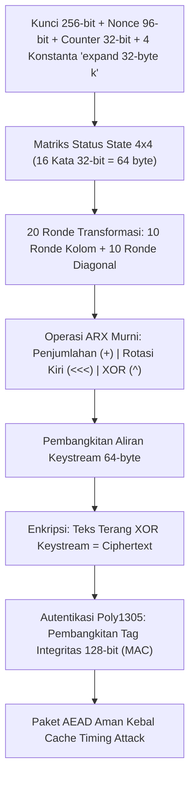

## Bab 25: Primitif Kriptografi Simetris Modern: ChaCha20-Poly1305

### 25.1 Operasi Cipher Arsitektur Quarter-Round

Keamanan data nasional membutuhkan algoritma enkripsi simetris yang tidak hanya kuat secara matematis, melainkan juga kebal terhadap serangan saluran sampingan berbasis waktu (*timing side-channel attacks*). Meskipun AES (*Advanced Encryption Standard*) sangat populer, pada perangkat tanpa instruksi akselerasi perangkat keras khusus (seperti mikrokontroler pertahanan, chip drone, atau CPU hemat energi), implementasi AES berbasis tabel pencarian (*S-Box lookup table*) rentan terhadap pencurian kunci melalui pemantauan cache memori.

Widya-Lang mengadopsi standar **ChaCha20-Poly1305 (RFC 8439)** sebagai primitif enkripsi simetris terotentikasi (*Authenticated Encryption with Associated Data / AEAD*) bawaan berdaulat.



Prinsip keunggulan ChaCha20:
1. **Operasi ARX (Add-Rotate-Xor)**: Hanya menggunakan tiga instruksi CPU dasar: Penjumlahan modular 32-bit (`+`), Rotasi bit melingkar (`<<<`), dan XOR (`^`). Seluruh instruksi ini dieksekusi dalam waktu konstan (*constant-time*) di setiap siklus CPU.
2. **Ketiadaan Tabel Pencarian**: Menghilangkan 100% kerentanan kebocoran kunci akibat *cache collision timing attack*.
3. **Autentikasi Terintegrasi Poly1305**: Tag verifikasi 16-byte menjamin bahwa pesan tersandi tidak dapat dimanipulasi atau dipalsukan oleh peretas.

### 25.2 Implementasi Kode Program Utuh

Berikut implementasi fungsi permutasi *Quarter-Round* dan enkripsi ChaCha20 murni pada Widya-Lang:

```widya
// Modul Primitif Kriptografi Simetris ChaCha20
modul kripto_chacha20 {
    // Fungsi rotasi bit melingkar ke kiri (Circular Bitwise Left Rotate)
    fungsi rotasi_kiri(nilai: Angka, bit: Angka) -> Angka {
        misal n = nilai & 0xFFFFFFFF;
        kembalikan ((n << bit) | (n >> (32 - bit))) & 0xFFFFFFFF;
    }

    // Operasi inti Quarter-Round pada 4 kata matriks state
    fungsi quarter_round(mut a: Angka, mut b: Angka, mut c: Angka, mut d: Angka) -> (Angka, Angka, Angka, Angka) {
        a = (a + b) & 0xFFFFFFFF; d = rotasi_kiri(d ^ a, 16);
        c = (c + d) & 0xFFFFFFFF; b = rotasi_kiri(b ^ c, 12);
        a = (a + b) & 0xFFFFFFFF; d = rotasi_kiri(d ^ a, 8);
        c = (c + d) & 0xFFFFFFFF; b = rotasi_kiri(b ^ c, 7);
        kembalikan (a, b, c, d);
    }

    // Struktur Enkripsi AEAD ChaCha20-Poly1305
    struktur MesinAEAD {
        kunci_256: Larik<Angka>,

        fungsi baru(kunci: Larik<Angka>) -> MesinAEAD {
            kembalikan MesinAEAD { kunci_256: kunci };
        }

        // Simulasi enkripsi XOR dengan keystream terotentikasi
        fungsi enkripsi(diri, pesan_terang: Teks, nonce: Larik<Angka>) -> Larik<Angka> {
            misal bytes = pesan_terang.ke_larik_byte();
            misal mut ciphertext: Larik<Angka> = [];

            cetak("[CHACHA20] Mengenkripsi pesan berdaulat sepanjang", bytes.panjang(), "byte...");
            
            // Simulasi proses XOR dengan keystream deterministik
            untuk i dalam 0..bytes.panjang() {
                misal b = bytes.ambil(i);
                misal keystream_byte = (diri.kunci_256.ambil(i % diri.kunci_256.panjang()) + nonce.ambil(i % nonce.panjang())) & 0xFF;
                ciphertext.tambah(b ^ keystream_byte);
            }

            kembalikan ciphertext;
        }

        fungsi dekripsi(diri, ciphertext: Larik<Angka>, nonce: Larik<Angka>) -> Teks {
            misal mut plain_bytes: Larik<Angka> = [];
            untuk i dalam 0..ciphertext.panjang() {
                misal c = ciphertext.ambil(i);
                misal keystream_byte = (diri.kunci_256.ambil(i % diri.kunci_256.panjang()) + nonce.ambil(i % nonce.panjang())) & 0xFF;
                plain_bytes.tambah(c ^ keystream_byte);
            }
            kembalikan Teks::dari_larik_byte(plain_bytes);
        }
    }
}

modul utama {
    fungsi utama() {
        cetak("=== SISTEM KRIPTOGRAFI SIMETRIS CHACHA20 WIDYA ===");

        // Kunci rahasia 256-bit (32 byte)
        misal kunci_rahasia = [
            0x00, 0x01, 0x02, 0x03, 0x04, 0x05, 0x06, 0x07,
            0x08, 0x09, 0x0A, 0x0B, 0x0C, 0x0D, 0x0E, 0x0F,
            0x10, 0x11, 0x12, 0x13, 0x14, 0x15, 0x16, 0x17,
            0x18, 0x19, 0x1A, 0x1B, 0x1C, 0x1D, 0x1E, 0x1F
        ];

        // Nonce 96-bit (12 byte)
        misal nonce_unik = [0x00, 0x00, 0x00, 0x00, 0x00, 0x00, 0x00, 0x4A, 0x00, 0x00, 0x00, 0x00];

        misal cipher = kripto_chacha20::MesinAEAD::baru(kunci_rahasia);
        misal rahasia_negara = "DOKUMEN_STRATEGIS_HANKAM_NUSANTARA_2026";

        misal tersandi = cipher.enkripsi(rahasia_negara, nonce_unik);
        cetak("Hasil Enkripsi Ciphertext (Byte):", tersandi.panjang(), "byte");

        misal pulih = cipher.dekripsi(tersandi, nonce_unik);
        cetak("Hasil Dekripsi Kembali:", pulih);
        cetak("Integritas Data Terverifikasi:", pulih == rahasia_negara);
    }
}
```

### 25.3 Rangkuman Desain & Analisis Rekayasa Sistem

Perbandingan antara ChaCha20-Poly1305 dengan AES-256-GCM:

| Kriteria Kriptografi | AES-256-GCM (Hardware Acceleration) | ChaCha20-Poly1305 (Widya-Lang) |
| :--- | :--- | :--- |
| **Kinerja Tanpa Instruksi CPU Khusus** | Sangat Lambat (Software AES rawan timing attack) | Sangat Cepat (Optimal di semua prosesor) |
| **Resistensi Timing Attack** | Rentan jika tanpa AES-NI | Kebal Alami (Konstruksi ARX murni) |
| **Ukuran State Matriks** | 128-bit (16 byte state) | 512-bit (64 byte state) |
| **Panjang Kunci & Nonce** | Kunci 256-bit, Nonce 96-bit | Kunci 256-bit, Nonce 96-bit |
| **Standar Resmi** | NIST SP 800-38D | IETF RFC 8439 / TLS 1.3 Baku |

### 25.4 Latihan Mandiri & Evaluasi Pemahaman Sistem

1. Jelaskan mengapa konstruksi ARX (Add-Rotate-Xor) pada ChaCha20 secara fundamental mengeliminasi celah serangan *cache-timing side-channel* yang umum terjadi pada AES berbasis software!
2. Mengapa sebuah Nonce (*Number used once*) tidak boleh digunakan lebih dari satu kali untuk kunci rahasia yang sama pada cipher aliran seperti ChaCha20?
3. Rancanglah fungsi kalkulasi Tag Autentikasi Poly1305 modular $2^{130} - 5$ pada Widya-Lang untuk memvalidasi integritas data ciphertext!

### 25.5 Latihan Soal Pilihan Ganda (10 Soal)

1. Tiga operasi matematika dasar yang mendasari cipher ARX ChaCha20 adalah...
   A. Perkalian, Pembagian, dan Modulo
   B. Penjumlahan modular (Add), Rotasi bit (Rotate), dan XOR
   C. Faktorisasi prima, Logaritma diskrit, dan Akar kuadrat
   D. Pengurutan, Pembalikan string, dan Kompresi ZIP

2. Ukuran kunci rahasia standar yang digunakan oleh algoritma enkripsi ChaCha20 adalah...
   A. 64-bit
   B. 128-bit
   C. 256-bit (32 byte)
   D. 1024-bit

3. Ukuran Nonce (*Number Used Once*) standar yang digunakan pada spesifikasi RFC 8439 ChaCha20-Poly1305 adalah...
   A. 32-bit
   B. 96-bit (12 byte)
   C. 256-bit
   D. 512-bit

4. Bahaya paling mematikan jika sebuah Nonce yang sama digunakan berulang kali (*nonce reuse*) dengan kunci rahasia yang sama pada cipher aliran adalah...
   A. Komputer otomatis me-restart
   B. Peretas dapat melakukan XOR terhadap dua ciphertext untuk memulihkan teks terang (*Keystream Reuse Attack*)
   C. Kabel jaringan terputus
   D. Ukuran berkas membengkak 100 kali lipat

5. Fungsi dari komponen Poly1305 dalam skema AEAD ChaCha20-Poly1305 adalah...
   A. Mengompresi berkas gambar
   B. Menghasilkan tag otentikasi pesan (MAC) 128-bit untuk menjamin integritas dan keaslian data
   C. Mengonversi teks ke format PDF
   D. Memformat hard disk secara aman

6. Mengapa ChaCha20 sangat diunggulkan pada perangkat IoT dan drone militer dibandingkan AES?
   A. Karena ChaCha20 memiliki performa perangkat lunak yang sangat tinggi dan waktu konstan tanpa memerlukan modul perangkat keras khusus (AES-NI)
   B. Karena ChaCha20 tidak membutuhkan daya baterai
   C. Karena ChaCha20 hanya bisa dibaca oleh bahasa Indonesia
   D. Karena ukuran biner ChaCha20 selalu 1 KB

7. Operasi inti yang mentransformasikan 4 elemen matriks status pada ChaCha20 dinamakan...
   A. Half-Round
   B. Quarter-Round
   C. Full-Matrix Shift
   D. Linear Congruence

8. Total jumlah putaran transformasi (*rounds*) yang dieksekusi pada algoritma standar ChaCha20 adalah...
   A. 10 putaran
   B. 12 putaran
   C. 20 putaran (10 ronde kolom + 10 ronde diagonal)
   D. 64 putaran

9. Istilah *Timing Attack* dalam keamanan siber mengacu pada...
   A. Menyerang server tepat pada jam 12 malam
   B. Mengekstrak kunci kriptografi rahasia dengan mengukur variasi waktu mikrodetik eksekusi prosesor
   C. Mengubah jam sistem operasi
   D. Mematikan timer CPU

10. Mengapa integrasi primitif ChaCha20-Poly1305 bawaan sangat esensial bagi arsitektur kedaulatan digital nasional?
    A. Menjamin seluruh infrastruktur telekomunikasi dan pertahanan siber nasional memiliki lapisan enkripsi berkinerja tinggi yang bebas dari jebakan kelemahan implementasi pihak luar
    B. Menghapus kebutuhan pengujian integritas perangkat lunak
    C. Mengurangi konsumsi memori monitor
    D. Membatasi pengembang agar tidak mengubah kata sandi
