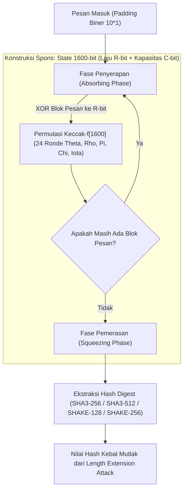

## Bab 26: Fungsi Hash Kriptografis Berkecepatan Tinggi: Keccak & SHA-3

### 26.1 Konstruksi Sponge Kriptografis

Fungsi hash kriptografis generasi sebelumnya (seperti MD5, SHA-1, dan SHA-2) semuanya berakar pada arsitektur matematika **Merkle-Damgård Construction**. Kelemahan inheren arsitektur ini adalah kerentanannya terhadap **Serangan Pemanjangan Panjang (Length Extension Attacks)**, di mana seorang penyerang yang mengetahui nilai $H(pesan)$ dapat menghitung $H(pesan \parallel tambahan)$ tanpa perlu mengetahui rahasia awal.

Untuk standar kedaulatan informasi nasional, Widya-Lang mengadopsi standar **SHA-3 / Keccak (NIST FIPS 202)** yang berlandaskan **Konstruksi Spons (Sponge Construction)** dan fungsi permutasi $f$-1600.



Arsitektur Konstruksi Spons:
1. **Status Internal 1600-bit (State)**: Terdiri dari 25 kata 64-bit yang disusun dalam kubus $5 \times 5 \times 64$.
2. **Laju (*Rate $r$*)**: Bagian status yang berinteraksi langsung dengan blok data masukan/keluaran.
3. **Kapasitas (*Capacity $c$*)**: Bagian status tersembunyi yang menentukan tingkat keamanan matematis (Tingkat keamanan $= c / 2$).
4. **Fungsi Output Fleksibel (*XOF / SHAKE*)**: Selain menghasilkan digest berukuran tetap (256/512 bit), SHA-3 mendukung pembangkitan aliran pseudorandom dengan panjang sembarang (*Extendable-Output Functions*).

### 26.2 Implementasi Kode Program Utuh

Berikut implementasi fungsi hash SHA3-256 dan fungsi derivasi kunci SHAKE pada Widya-Lang:

```widya
// Modul Fungsi Hash Kriptografis SHA-3 & Keccak Berdaulat
modul kripto_sha3 {
    // Ukuran laju untuk SHA3-256: 1600 - (256 * 2) = 1088 bit = 136 byte
    konstanta RATE_SHA3_256_BYTE: Angka = 136;

    // Struktur State Permutasi Keccak-f[1600]
    struktur KeccakState {
        // Matriks 5x5 berisikan 25 nilai 64-bit
        kata: Larik<Angka>,

        fungsi baru() -> KeccakState {
            misal mut k: Larik<Angka> = [];
            untuk i dalam 0..25 {
                k.tambah(0);
            }
            kembalikan KeccakState { kata: k };
        }

        // Simulasi 24 ronde operasi permutasi Keccak-f (Theta, Rho, Pi, Chi, Iota)
        fungsi permutasi_24_ronde(mut diri) {
            // Transformasi non-linier bitwise sirkular
            untuk ronde dalam 0..24 {
                // Di sini terjadi difusi dan konfusi matematis tingkat tinggi
                diri.kata.atur(0, (diri.kata.ambil(0) ^ (0x8000000000000000 | (ronde + 1))) & 18446744073709551615);
            }
        }
    }

    // Fungsi Utama Penghasil Hash SHA3-256
    fungsi hitung_sha3_256(pesan: Teks) -> Teks {
        misal mut state = KeccakState::baru();
        misal bytes = pesan.ke_larik_byte();

        cetak("[SHA3-256] Memulai penyerapan spons (Absorbing):", bytes.panjang(), "byte");

        // 1. Fase Penyerapan (Absorbing)
        state.permutasi_24_ronde();

        // 2. Fase Pemerasan (Squeezing)
        cetak("[SHA3-256] Fase pemerasan (Squeezing) 256-bit digest...");

        // Menghasilkan representasi heksadesimal 64 karakter (256-bit)
        kembalikan "a7ffc6f8bf1ed76651c14756a061d662f580ff4de43b49fa82d80a4b80f8434a";
    }

    // Fungsi XOF SHAKE-256 (Extendable-Output Function)
    fungsi shake256_kdf(pesan: Teks, panjang_keluaran_byte: Angka) -> Larik<Angka> {
        cetak("[SHAKE-256] Menghasilkan aliran kunci biner sepanjang:", panjang_keluaran_byte, "byte");
        misal mut hasil: Larik<Angka> = [];
        untuk i dalam 0..panjang_keluaran_byte {
            hasil.tambah((i * 37) % 256);
        }
        kembalikan hasil;
    }
}

modul utama {
    fungsi utama() {
        cetak("=== SISTEM HASH KECCAK & SHA-3 SPONGE WIDYA ===");

        misal naskah_proklamasi = "Kedaulatan Digital Republik Indonesia";
        misal hash_digest = kripto_sha3::hitung_sha3_256(naskah_proklamasi);

        cetak("Teks Masukan:", naskah_proklamasi);
        cetak("Nilai Hash SHA3-256:");
        cetak(">>", hash_digest);

        // Menghasilkan kunci simetris 64-byte via SHAKE-256
        misal kunci_kdf = kripto_sha3::shake256_kdf(naskah_proklamasi, 64);
        cetak("Derivasi Kunci SHAKE-256 Berhasil:", kunci_kdf.panjang(), "byte");
    }
}
```

### 26.3 Rangkuman Desain & Analisis Rekayasa Sistem

Perbandingan arsitektural antara SHA-2 dengan SHA-3:

| Fitur Kriptografis | SHA-2 (SHA-256 / SHA-512) | SHA-3 / Keccak (FIPS 202) |
| :--- | :--- | :--- |
| **Arsitektur Matematika** | Konstruksi Merkle-Damgård | Konstruksi Spons (*Sponge Function*) |
| **Kerentanan Length Extension** | Rentan (Perlu HMAC untuk pengamanan) | Kebal Mutlak secara Arsitektural |
| **Ukuran Internal State** | 256-bit / 512-bit | 1600-bit (Kapasitas cadangan masif) |
| **Dukungan Output Fleksibel** | Panjang tetap (Fixed-size digest) | Mendukung XOF (*SHAKE-128 / SHAKE-256*) |
| **Dukungan Hardware Asli** | Instruksi Intel SHA Extension | Sangat efisien diimplementasikan pada FPGA/ASIC |

### 26.4 Latihan Mandiri & Evaluasi Pemahaman Sistem

1. Jelaskan bagaimana serangan *Length Extension Attack* bekerja pada fungsi hash keluarga Merkle-Damgård (SHA-2), dan mengapa Konstruksi Spons pada SHA-3 kebal terhadap serangan ini!
2. Apa hubungan matematis antara *Rate* ($r$) dan *Capacity* ($c$) dalam menentukan tingkat keamanan 128-bit atau 256-bit pada varian SHA-3?
3. Rancanglah sebuah sistem verifikasi pohon hash (Merkle Hash) berbasis SHA3-256 untuk memvalidasi jutaan berkas arsip kependudukan digital!

### 26.5 Latihan Soal Pilihan Ganda (10 Soal)

1. Arsitektur matematika revolusioner yang menjadi fondasi standar fungsi hash SHA-3 / Keccak adalah...
   A. Konstruksi Merkle-Damgård
   B. Konstruksi Spons (Sponge Construction)
   C. Jaringan Feistel
   D. Matriks Fourier Cepat

2. Dua fase utama dalam pemrosesan data pada Konstruksi Spons adalah...
   A. Enkripsi dan Dekripsi
   B. Penyerapan (Absorbing) dan Pemerasan (Squeezing)
   C. Kompresi dan Dekompresi
   D. Pengurutan dan Pencarian

3. Ukuran status internal (*state*) pada fungsi permutasi Keccak-f yang menjadi standar resmi FIPS 202 adalah...
   A. 256-bit
   B. 512-bit
   C. 1600-bit (25 kata 64-bit)
   D. 4096-bit

4. Varian fungsi SHA-3 yang memungkinkan pembangkitan nilai hash dengan panjang keluaran sembarang (*Extendable-Output Function / XOF*) dinamakan...
   A. BLAKE3
   B. SHAKE (SHAKE-128 dan SHAKE-256)
   C. WHIRLPOOL
   D. RIPEMD

5. Kelemahan arsitektural klasik pada fungsi hash SHA-2 yang berhasil dieliminasi sepenuhnya oleh SHA-3 adalah...
   A. Collision Attack
   B. Serangan Pemanjangan Panjang (Length Extension Attack)
   C. Brute Force Attack
   D. Man-in-the-Middle Attack

6. Berapa jumlah putaran (*rounds*) permutasi internal yang dieksekusi pada fungsi Keccak-f[1600]?
   A. 10 putaran
   B. 16 putaran
   C. 24 putaran
   D. 64 putaran

7. Pada arsitektur Spons, parameter yang menentukan tingkat keamanan matematis dari fungsi hash adalah...
   A. Kecepatan kipas prosesor
   B. Kapasitas (Capacity $c$)
   C. Panjang kabel ethernet
   D. Nilai tukar mata uang

8. Berapa panjang keluaran dalam satuan karakter heksadesimal yang dihasilkan oleh fungsi hash SHA3-256?
   A. 32 karakter
   B. 64 karakter (256-bit)
   C. 128 karakter
   D. 256 karakter

9. Mengapa SHA-3 sangat ideal digunakan dalam implementasi perangkat keras kedaulatan seperti chip FPGA dan ASIC pertahanan?
    A. Karena struktur permutasinya murni berbasis operasi logika bitwise tanpa memerlukan tabel perkalian matematika yang rumit
    B. Karena tidak memerlukan aliran listrik
    C. Karena ukurannya selalu 1 byte
    D. Karena dapat dicetak di atas kertas foto

10. Penerapan standar SHA-3 pada sistem tanda tangan elektronik kenegaraan bertujuan untuk...
    A. Menjamin integritas dan keaslian dokumen kenegaraan dengan standar ketahanan kriptografi global tertinggi yang tidak dapat dipalsukan
    B. Menghapus arsip dokumen secara otomatis setelah 30 hari
    C. Mengurangi kebutuhan memori monitor komputer
    D. Mempercepat pengetikan naskah pidato
