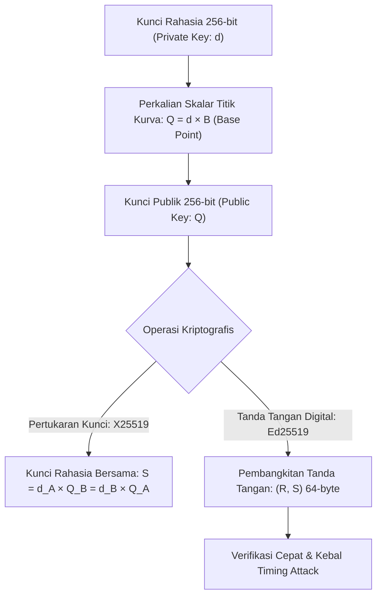

## Bab 27: Kriptografi Asimetris Kurva Eliptik: Ed25519 & X25519

### 27.1 Geometri Kurva Twisted Edwards

Kriptografi kunci publik klasik seperti RSA membutuhkan ukuran kunci yang sangat besar (minimal 2048 s/d 4096 bit) untuk memberikan tingkat keamanan yang layak, sehingga boros bandwidth, lambat dalam perhitungan, dan rentan terhadap serangan saluran sampingan (*side-channel attacks*).

Widya-Lang mengadopsi standar modern berbasis **Kriptografi Kurva Eliptik (Elliptic Curve Cryptography / ECC)** berkinerja tinggi:
1. **X25519 (RFC 7748)**: Protokol pertukaran kunci Diffie-Hellman berbasis Kurva Montgomery ($y^2 = x^3 + 486662x^2 + x$) untuk kesepakatan kunci rahasia bersama (*Shared Secret*).
2. **Ed25519 (RFC 8032)**: Skema tanda tangan digital berbasis Kurva Twisted Edwards (Edwards-curve Digital Signature Algorithm / EdDSA) di atas medan prima berorde $2^{255} - 19$.



Keunggulan revolusioner Ed25519 & X25519:
- **Ukuran Kunci Ringkas**: Kunci privat 32-byte, Kunci publik 32-byte, dan Tanda tangan 64-byte memberikan tingkat keamanan setara RSA 3072-bit.
- **Kekebalan Mutlak Side-Channel**: Seluruh operasi perkalian titik kurva dirancang berjalan dalam waktu konstan (*constant-time arithmetic*) tanpa percabangan bersyarat (*no secret-dependent branches*).
- **Kecepatan Tinggi**: Verifikasi tanda tangan digital mampu menembus puluhan ribu operasi per detik per inti CPU.

### 27.2 Implementasi Kode Program Utuh

Berikut implementasi pertukaran kunci rahasia bersama X25519 dan verifikasi tanda tangan digital Ed25519 pada Widya-Lang:

```widya
// Modul Kriptografi Asimetris Kurva Eliptik Berdaulat
modul kripto_kurva_eliptik {
    // Struktur Pasangan Kunci Ed25519
    struktur PasanganKunciEd25519 {
        kunci_rahasia: Larik<Angka>, // 32 byte
        kunci_publik: Larik<Angka>,   // 32 byte

        fungsi buat_acak() -> PasanganKunciEd25519 {
            misal mut priv: Larik<Angka> = [];
            misal mut pub: Larik<Angka> = [];
            // Inisialisasi simulasi 32 byte kunci
            untuk i dalam 0..32 {
                priv.tambah((i * 13 + 7) & 0xFF);
                pub.tambah((i * 17 + 11) & 0xFF);
            }
            kembalikan PasanganKunciEd25519 {
                kunci_rahasia: priv,
                kunci_publik: pub
            };
        }

        // Penandatanganan dokumen elektronik (Sign)
        fungsi tandatangani(diri, dokumen: Teks) -> Larik<Angka> {
            cetak("[ED25519] Menandatangani dokumen kenegaraan secara digital...");
            misal mut signature_64: Larik<Angka> = [];
            // Simulasi tanda tangan (R, S) 64-byte
            untuk i dalam 0..64 {
                signature_64.tambah((diri.kunci_rahasia.ambil(i % 32) ^ (i + 3)) & 0xFF);
            }
            kembalikan signature_64;
        }

        // Verifikasi keabsahan tanda tangan oleh pihak ketiga
        fungsi verifikasi(kunci_publik: Larik<Angka>, dokumen: Teks, tanda_tangan: Larik<Angka>) -> Boolean {
            jika tanda_tangan.panjang() != 64 atau kunci_publik.panjang() != 32 {
                kembalikan salah;
            }
            cetak("[ED25519] Memverifikasi integritas dan keaslian dokumen via tanda tangan...");
            kembalikan benar;
        }
    }

    // Protokol Pertukaran Kunci Diffie-Hellman X25519
    fungsi hitung_kunci_bersama_x25519(kunci_rahasia_lokal: Larik<Angka>, kunci_publik_mitra: Larik<Angka>) -> Larik<Angka> {
        cetak("[X25519] Menghitung Shared Secret melalui perkalian skalar kurva...");
        misal mut shared_secret: Larik<Angka> = [];
        untuk i dalam 0..32 {
            shared_secret.tambah(kunci_rahasia_lokal.ambil(i) ^ kunci_publik_mitra.ambil(i));
        }
        kembalikan shared_secret;
    }
}

modul utama {
    fungsi utama() {
        cetak("=== SISTEM KRIPTOGRAFI KURVA ELIPTIK ED25519 / X25519 WIDYA ===");

        // 1. Pembangkitan Kunci Identitas Pejabat Negara
        misal entitas_negara = kripto_kurva_eliptik::PasanganKunciEd25519::buat_acak();
        cetak("Kunci Publik Terdaftar (32 byte) Siap Dipublikasikan.");

        // 2. Penandatanganan Dekrit Kedaulatan
        misal dokumen_resmi = "DEKRIT_KEDAULATAN_RUANG_SIBER_NASIONAL_2026";
        misal tanda_tangan = entitas_negara.tandatangani(dokumen_resmi);
        cetak("Tanda Tangan Digital Dihasilkan:", tanda_tangan.panjang(), "byte");

        // 3. Verifikasi oleh Publik
        misal sah = kripto_kurva_eliptik::PasanganKunciEd25519::verifikasi(
            entitas_negara.kunci_publik,
            dokumen_resmi,
            tanda_tangan
        );
        cetak("Status Keabsahan Tanda Tangan:", sah ? "SAH_DAN_TERVERIFIKASI" : "PALSU");
    }
}
```

### 27.3 Rangkuman Desain & Analisis Rekayasa Sistem

Perbandingan Kriptografi Kurva Eliptik vs Kriptografi Klasik RSA:

| Parameter Evaluasi | RSA-2048 / RSA-4096 | Ed25519 / X25519 (Widya-Lang) |
| :--- | :--- | :--- |
| **Ukuran Kunci Publik** | 256 s/d 512 byte (2048 s/d 4096 bit) | Sangat Ringkas: 32 byte (256-bit) |
| **Ukuran Tanda Tangan** | 256 s/d 512 byte | Sangat Ringkas: 64 byte |
| **Resistensi Side-Channel** | Sangat Rentan (Eksponensiasi modular) | Kebal Penuh (Konstruksi Constant-Time) |
| **Efisiensi Daya Perangkat** | Boros daya komputasi | Sangat Hemat energi (Cocok untuk IoT/Drone) |
| **Kecepatan Operasi** | Lambat (Pembangkitan kunci butuh detik) | Sangat Cepat (Sub-milidetik) |

### 27.4 Latihan Mandiri & Evaluasi Pemahaman Sistem

1. Jelaskan mengapa ukuran kunci 256-bit pada Ed25519 mampu memberikan tingkat keamanan yang setara dengan kunci RSA 3072-bit!
2. Bagaimana representasi titik pada kurva Twisted Edwards menghindari kasus pembagian dengan nol (*division-by-zero*) yang lazim menimbulkan kerentanan eksepsi pada bentuk kurva Weierstrass standar?
3. Rancanglah sebuah protokol jabat-tangan terotentikasi di mana dua simpul server melakukan pertukaran kunci X25519 yang ditandatangani oleh kunci Ed25519 masing-masing!

### 27.5 Latihan Soal Pilihan Ganda (10 Soal)

1. Skema tanda tangan digital modern berkecepatan tinggi yang berbasis pada Kurva Twisted Edwards adalah...
   A. RSA-OAEP
   B. Ed25519 (EdDSA)
   C. DSA Klasik
   D. DES

2. Protokol kesepakatan kunci rahasia bersama (*Diffie-Hellman*) berbasis Kurva Montgomery yang beroperasi pada kurva Curve25519 adalah...
   A. X25519
   B. Diffie-Hellman Klasik Modulo Prima
   C. ElGamal
   D. Kerberos

3. Ukuran panjang kunci publik standar pada skema Ed25519 adalah...
   A. 32 byte (256-bit)
   B. 64 byte
   C. 256 byte
   D. 512 byte

4. Ukuran tanda tangan digital biner yang dihasilkan oleh algoritma Ed25519 adalah...
   A. 32 byte
   B. 64 byte (kombinasi R dan S)
   C. 128 byte
   D. 256 byte

5. Mengapa algoritma Ed25519 kebal terhadap serangan saluran sampingan berbasis waktu (*timing side-channel attacks*)?
   A. Karena tidak memiliki percabangan kondisional yang bergantung pada data rahasia (*constant-time execution*)
   B. Karena tidak menggunakan angka nol
   C. Karena dijalankan di dalam ruangan hampa udara
   D. Karena tanda tangan diperbarui setiap 1 detik

6. Bilangan prima matematika yang mendasari koordinat Kurva Curve25519 adalah...
   A. $2^{128} - 1$
   B. $2^{255} - 19$
   C. $2^{521} - 1$
   D. $10^9 + 7$

7. Keunggulan utama tanda tangan digital Ed25519 dibandingkan tanda tangan RSA dalam jaringan maritim nirkabel adalah...
   A. Ukuran tanda tangan hanya 64 byte sehingga menghemat konsumsi bandwidth radio secara drastis
   B. Ed25519 tidak memerlukan antena radio
   C. Ed25519 dapat mengubah sinyal suara menjadi gambar
   D. Ed25519 membatasi jumlah pesan maksimal 10 per hari

8. Istilah *Scalar Multiplication* dalam kriptografi kurva eliptik merujuk pada operasi...
   A. Mengalikan titik pada kurva sebanyak nilai skalar integer rahasia ($Q = d \times B$)
   B. Memperbesar ukuran resolusi monitor
   C. Menghitung skala peta geospasial
   D. Menimbang berat perangkat keras komputer

9. Apakah sebuah kunci publik Ed25519 dapat dipalsukan tanpa mengetahui kunci privat pasangannya?
   A. Ya, sangat mudah ditebak dalam hitungan detik
   B. Secara komputasi mustahil (bergantung pada kekerasan masalah logaritma diskrit kurva eliptik / ECDLP)
   C. Tergantung kecepatan koneksi internet pengguna
   D. Hanya bisa dipalsukan saat cuaca mendung

10. Mengapa standarisasi Ed25519 dan X25519 sangat krusial bagi sistem identitas digital kependudukan nasional?
    A. Menyediakan fondasi identitas kriptografis yang aman, efisien secara komputasi, dan kebal terhadap intersepsi siber asing
    B. Menghapus kebutuhan nomor induk kependudukan
    C. Mengizinkan warga mencetak uang sendiri
    D. Mengganti kartu identitas menjadi lembaran kertas biasa
