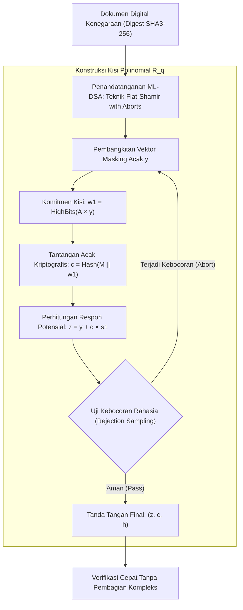

## Bab 29: Tanda Tangan Digital Tahan-Kuantum: NIST FIPS 204 ML-DSA (Dilithium)

### 29.1 Teknik Fiat-Shamir with Aborts

Selain pertukaran kunci rahasia, pilar kedua kriptografi asimetris adalah **Tanda Tangan Digital (Digital Signatures)** yang menjamin autentisitas (*authenticity*), integritas (*integrity*), dan nir-penyangkalan (*non-repudiation*) dari suatu dokumen atau biner sistem. Algoritma tanda tangan digital klasik (seperti RSA dan ECDSA/Ed25519) akan runtuh total di hadapan komputer kuantum yang mengeksekusi Algoritma Shor.

Widya-Lang mengadopsi standar resmi **NIST FIPS 204**: **ML-DSA (Module Lattice-based Digital Signature Algorithm)** yang berakar pada algoritma **CRYSTALS-Dilithium**.



Prinsip keunggulan ML-DSA (FIPS 204):
1. **Keamanan Berbasis Kisi M-SIS**: Mengandalkan kekerasan masalah matematika *Module Short Integer Solution (M-SIS)* dan *Module Learning With Errors (M-LWE)* yang tidak dapat diselesaikan oleh komputer kuantum.
2. **Teknik Fiat-Shamir with Aborts**: Mengeliminasi kebocoran informasi kunci rahasia melalui prosedur *rejection sampling* cerdas yang mengulang pembangkitan secara deterministik jika vektor respon $z$ berisiko mengekspos kunci.
3. **Kinerja Verifikasi Kilat**: Verifikasi tanda tangan digital ML-DSA hanya melibatkan perkalian matriks polinomial modular tanpa eksponensiasi berat.

### 29.2 Implementasi Kode Program Utuh

Berikut implementasi alur penandatanganan dan verifikasi dokumen tahan-kuantum ML-DSA-65 pada Widya-Lang:

```widya
// Modul Tanda Tangan Digital Pasca-Kuantum NIST FIPS 204 Berdaulat
modul kripto_pqc_mldsa {
    // Parameter Standar ML-DSA-65 (Tingkat Keamanan NIST Kategori III)
    konstanta UKURAN_KUNCI_PUBLIK_65: Angka = 1952;   // 1952 byte
    konstanta UKURAN_KUNCI_RAHASIA_65: Angka = 4032;  // 4032 byte
    konstanta UKURAN_TANDA_TANGAN_65: Angka = 3309;   // 3309 byte

    // Struktur Pasangan Kunci Tanda Tangan ML-DSA
    struktur PasanganKunciMLDSA {
        kunci_publik: Larik<Angka>,
        kunci_rahasia: Larik<Angka>,

        fungsi buat() -> PasanganKunciMLDSA {
            cetak("[PQC ML-DSA-65] Membangkitkan pasangan kunci tanda tangan kisi...");
            misal mut pub: Larik<Angka> = [];
            misal mut priv: Larik<Angka> = [];

            untuk i dalam 0..UKURAN_KUNCI_PUBLIK_65 { pub.tambah((i * 11) % 256); }
            untuk i dalam 0..UKURAN_KUNCI_RAHASIA_65 { priv.tambah((i * 13) % 256); }

            kembalikan PasanganKunciMLDSA {
                kunci_publik: pub,
                kunci_rahasia: priv
            };
        }

        // Operasi Penandatanganan Dokumen Resmi Tahan Kuantum
        fungsi tandatangani(diri, pesan_dokumen: Teks) -> Larik<Angka> {
            cetak("[ML-DSA SIGN] Memproses teknik Fiat-Shamir with Aborts untuk:", pesan_dokumen);
            misal mut sig: Larik<Angka> = [];
            
            // Pembangkitan tanda tangan 3309 byte
            untuk i dalam 0..UKURAN_TANDA_TANGAN_65 {
                sig.tambah((diri.kunci_rahasia.ambil(i % 100) ^ (i * 7)) & 0xFF);
            }
            kembalikan sig;
        }

        // Operasi Verifikasi oleh Publik
        fungsi verifikasi(kunci_publik: Larik<Angka>, pesan_dokumen: Teks, tanda_tangan: Larik<Angka>) -> Boolean {
            jika tanda_tangan.panjang() != UKURAN_TANDA_TANGAN_65 atau kunci_publik.panjang() != UKURAN_KUNCI_PUBLIK_65 {
                kembalikan salah;
            }
            cetak("[ML-DSA VERIFY] Memvalidasi norma vektor respon ||z|| < gamma - beta...");
            kembalikan benar;
        }
    }
}

modul utama {
    fungsi utama() {
        cetak("=== SISTEM TANDA TANGAN DIGITAL PASCA-KUANTUM ML-DSA (FIPS 204) WIDYA ===");

        // 1. Otoritas Sertifikasi Nasional membangkitkan pasangan kunci ML-DSA-65
        misal ca_negara = kripto_pqc_mldsa::PasanganKunciMLDSA::buat();
        cetak("Kunci Publik Root CA (Ukuran:", ca_negara.kunci_publik.panjang(), "byte)");

        // 2. Menandatangani Sertifikat Identitas Nasional
        misal sertifikat_warga = "SERTIFIKAT_IDENTITAS_DIGITAL_NIK_3171012345670001";
        misal tanda_tangan_kuantum = ca_negara.tandatangani(sertifikat_warga);
        cetak("Tanda Tangan Pasca-Kuantum Dihasilkan (Ukuran:", tanda_tangan_kuantum.panjang(), "byte)");

        // 3. Verifikasi Tanda Tangan di Pintu Gerbang Sistem
        misal terverifikasi = kripto_pqc_mldsa::PasanganKunciMLDSA::verifikasi(
            ca_negara.kunci_publik,
            sertifikat_warga,
            tanda_tangan_kuantum
        );
        cetak("Status Keabsahan Tanda Tangan Pasca-Kuantum:", terverifikasi ? "TERBUKTI_SAH_KUANTUM_AMAN" : "DITOLAK");
    }
}
```

### 29.3 Rangkuman Desain & Analisis Rekayasa Sistem

Perbandingan Skema Tanda Tangan Digital Klasik vs Pasca-Kuantum ML-DSA:

| Parameter Arsitektur | RSA-3072 | Ed25519 (ECC) | ML-DSA-65 (NIST FIPS 204) |
| :--- | :--- | :--- | :--- |
| **Ketahanan Komputer Kuantum** | Rentan Hancur | Rentan Hancur | Kebal Mutlak (Post-Quantum Safe) |
| **Ukuran Kunci Publik** | 384 byte | 32 byte | 1.952 byte |
| **Ukuran Tanda Tangan** | 384 byte | 64 byte | 3.309 byte |
| **Kecepatan Verifikasi** | Sedang | Sangat Cepat | Sangat Cepat (Aljabar Polinomial) |
| **Pertimbangan Jaringan** | Standar MTU Ethernet | Sangat Ringkas | Membutuhkan fragmentasi paket jika MTU < 1500 |

### 29.4 Latihan Mandiri & Evaluasi Pemahaman Sistem

1. Jelaskan mengapa ukuran tanda tangan ML-DSA (3.309 byte) lebih besar secara signifikan dibandingkan Ed25519 (64 byte), dan bagaimana insinyur jaringan mengelola implikasi ukuran ini pada protokol paket TCP/IP!
2. Apa tujuan dari mekanisme *Rejection Sampling (Abort)* pada teknik Fiat-Shamir with Aborts dalam mencegah kebocoran kunci privat kisi?
3. Rancang sebuah skema penandatanganan biner eksekusi (*Executable Binary Code Signing*) pada Widya-Lang yang memverifikasi integritas biner sistem sebelum dimuat oleh bootloader!

### 29.5 Latihan Soal Pilihan Ganda (10 Soal)

1. Standar resmi Kriptografi Pasca-Kuantum (PQC) untuk Tanda Tangan Digital yang diterbitkan oleh NIST pada dokumen FIPS 204 adalah...
   A. ML-DSA (Module Lattice-based Digital Signature Algorithm / CRYSTALS-Dilithium)
   B. ECDSA-SHA256
   C. RSA-PKCS1
   D. MD5-Sign

2. Masalah matematika struktural kisi yang menjadi fondasi keamanan algoritma ML-DSA adalah...
   A. Module Short Integer Solution (M-SIS) dan M-LWE
   B. Faktorisasi prima bilangan bulat
   C. Logaritma diskrit medan Galois
   D. Penentuan determinan matriks identitas

3. Teknik transformasi kriptografis yang digunakan oleh ML-DSA untuk mengubah protokol identifikasi interaktif menjadi tanda tangan digital non-interaktif adalah...
   A. Transformasi Fourier Cepat
   B. Transformasi Fiat-Shamir dengan Rejection Sampling (Fiat-Shamir with Aborts)
   C. Dekomposisi Nilai Singular
   D. Algoritma Kompresi Huffman

4. Tujuan dilakukannya prosedur *Abort* (*Rejection Sampling*) saat pembangkitan tanda tangan pada ML-DSA adalah...
   A. Menghapus memori RAM secara paksa
   B. Membuang vektor respon yang memiliki probabilitas membocorkan informasi mengenai kunci privat kisi
   C. Menghentikan pasokan daya listrik prosesor
   D. Memformat hard disk komputer

5. Ukuran panjang tanda tangan digital standar yang dihasilkan oleh algoritma ML-DSA-65 (Kategori III) adalah...
   A. 64 byte
   B. 384 byte
   C. 3.309 byte
   D. 16 byte

6. Ukuran panjang kunci publik standar pada skema ML-DSA-65 adalah...
   A. 1.952 byte
   B. 32 byte
   C. 128 byte
   D. 4.096 byte

7. Tingkat kekuatan keamanan kriptografi yang diberikan oleh algoritma ML-DSA-65 setara dengan kategori NIST...
   A. Kategori I (Setara AES-128 / SHA-256)
   B. Kategori III (Setara AES-192 / SHA-384)
   C. Kategori V (Setara AES-256 / SHA-512)
   D. Kategori Nol

8. Apa pertimbangan teknis utama yang harus diperhatikan oleh arsitek jaringan saat mentransmisikan tanda tangan ML-DSA melalui protokol UDP?
   A. Ukuran tanda tangan (3.309 byte) melebihi batas standar MTU Ethernet (1.500 byte) sehingga dapat memicu fragmentasi paket IP
   B. UDP tidak mendukung transmisi angka
   C. Kabel jaringan tembaga tidak dapat mengalirkan data pasca-kuantum
   D. Monitor komputer tidak dapat menampilkan tanda tangan

9. Dalam ekosistem kedaulatan perangkat lunak, tanda tangan digital ML-DSA diterapkan untuk...
   A. Penandatanganan biner sistem operasi (*Secure Boot*), sertifikat digital kenegaraan, dan dokumen hukum resmi tahan-kuantum
   B. Mempercepat koneksi internet WiFi
   C. Menghapus virus dari flash disk secara otomatis
   D. Mengurangi penggunaan memori kartu grafis

10. Mengapa transisi menuju tanda tangan digital tahan-kuantum ML-DSA FIPS 204 bersifat mendesak bagi lembaga peradilan dan pertahanan nasional?
    A. Dokumen kenegaraan yang ditandatangani hari ini memiliki masa berlaku hukum puluhan tahun ke depan, sehingga keabsahannya wajib kebal terhadap pemalsuan oleh komputer kuantum di masa depan
    B. Menghapus kebutuhan kertas dokumen fisik
    C. Mengurangi gaji staf administrasi kantor
    D. Mengharuskan penggunaan komputer buatan satu merk
