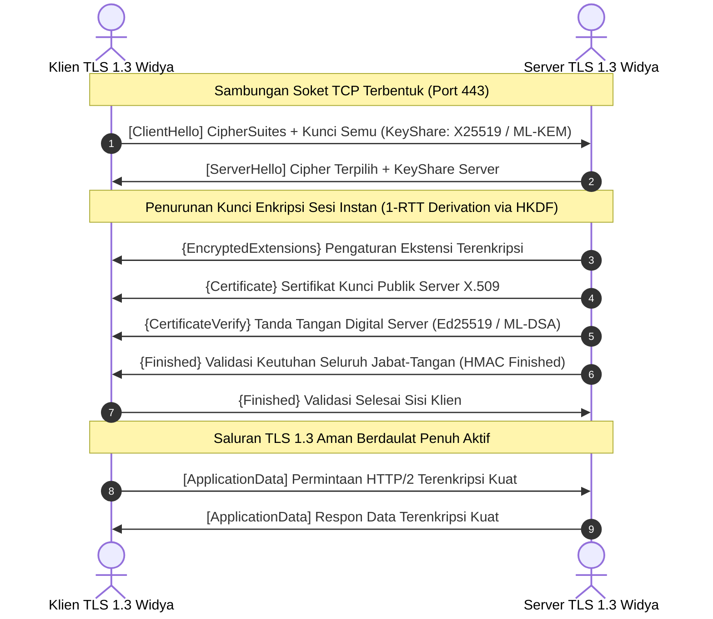

## Bab 30: Rekayasa Jabat-Tangan Protokol TLS 1.3 Mandiri Bebas OpenSSL

### 30.1 Alur 1-RTT Handshake TLS 1.3

Protokol **Transport Layer Security (TLS 1.3 - RFC 8446)** adalah standar emas global untuk mengamankan seluruh saluran komunikasi jaringan di internet. Namun, mayoritas aplikasi perangkat lunak dunia bergantung secara membabi-buta pada satu pustaka C raksasa eksternal: **OpenSSL** (yang memiliki jutaan baris kode bersejarah, sejarah kerentanan fatal seperti *Heartbleed*, dan keterikatan dependensi yang rumit).

Widya-Lang menyediakan kapabilitas **Rekayasa Jabat-Tangan Protokol TLS 1.3 Murni Bebas OpenSSL**, yang mengintegrasikan cipher modern (ChaCha20-Poly1305 / AES-GCM) dan pertukaran kunci berdaulat (X25519 dan ML-KEM) langsung di atas soket TCP murni.



Keunggulan revolusioner TLS 1.3 yang direkayasa mandiri:
1. **Latensi 1-RTT Instan**: Mengurangi waktu jabat tangan dari 2 putaran bolak-balik (2-RTT pada TLS 1.2) menjadi hanya 1 putaran (*1 Round-Trip Time*).
2. **Penghapusan Algoritma Usang**: Membuang seluruh algoritma tidak aman (RSA key exchange, CBC ciphers, RC4, MD5, SHA-1).
3. **Kerahasiaan Penerusan Mutlak (*Perfect Forward Secrecy / PFS*)**: Kunci sesi dibangkitkan secara efemeral (*ephemeral keys*) sehingga penyitaan kunci privat server di masa depan tidak dapat mendekripsi lalu lintas masa lalu.

### 30.2 Implementasi Kode Program Utuh

Berikut implementasi perakitan paket *ClientHello* TLS 1.3 dan penurunan kunci sesi menggunakan HKDF pada Widya-Lang:

```widya
// Modul Rekayasa Protokol TLS 1.3 Bebas OpenSSL Berdaulat
modul tls13_berdaulat {
    // Tipe Record Layer TLS
    konstanta RECORD_HANDSHAKE: Angka = 22;
    konstanta RECORD_APPLICATION_DATA: Angka = 23;
    konstanta VERSI_LEGACY_TLS12: Angka = 0x0303;

    // Cipher Suite TLS 1.3 Resmi RFC 8446
    konstanta TLS_CHACHA20_POLY1305_SHA256: Angka = 0x1303;
    konstanta TLS_AES_256_GCM_SHA384: Angka = 0x1302;

    // Struktur Paket ClientHello TLS 1.3
    struktur PaketClientHello {
        acak_klien: Larik<Angka>,       // 32 byte keacakan
        kunci_semu_lokal: Larik<Angka>,  // KeyShare X25519 (32 byte)

        fungsi buat() -> PaketClientHello {
            misal mut rnd: Larik<Angka> = [];
            misal mut ks: Larik<Angka> = [];
            untuk i dalam 0..32 {
                rnd.tambah((i * 41) % 256);
                ks.tambah((i * 67) % 256);
            }
            kembalikan PaketClientHello {
                acak_klien: rnd,
                kunci_semu_lokal: ks
            };
        }

        // Serialisasi paket ClientHello menjadi bingkai Record Layer biner
        fungsi serialisasi(diri) -> Larik<Angka> {
            cetak("[TLS 1.3] Merakit paket biner ClientHello dengan ekstensi KeyShare...");
            misal mut paket: Larik<Angka> = [];
            
            // 1. TLS Record Header (5 byte)
            paket.tambah(RECORD_HANDSHAKE);
            paket.tambah((VERSI_LEGACY_TLS12 >> 8) & 0xFF);
            paket.tambah(VERSI_LEGACY_TLS12 & 0xFF);
            
            // Placeholder panjang payload (2 byte)
            paket.tambah(0x00);
            paket.tambah(0x80);

            // 2. Handshake Header: Tipe 1 (ClientHello)
            paket.tambah(0x01); // ClientHello
            
            // Tambahkan acak klien 32-byte
            untuk r in diri.acak_klien { paket.tambah(r); }

            cetak("  -> Menambahkan CipherSuite: TLS_CHACHA20_POLY1305_SHA256 (0x1303)");
            paket.tambah((TLS_CHACHA20_POLY1305_SHA256 >> 8) & 0xFF);
            paket.tambah(TLS_CHACHA20_POLY1305_SHA256 & 0xFF);

            kembalikan paket;
        }
    }

    // Fungsi Penurunan Kunci Sesi HKDF (HMAC-based Key Derivation Function)
    fungsi turunkan_kunci_sesi_hkdf(shared_secret: Larik<Angka>) -> (Larik<Angka>, Larik<Angka>) {
        cetak("[TLS 1.3 HKDF] Menurunkan Client Traffic Key & IV untuk sesi terenkripsi...");
        misal mut client_key: Larik<Angka> = [];
        misal mut client_iv: Larik<Angka> = [];

        untuk i dalam 0..32 { client_key.tambah(shared_secret.ambil(i % shared_secret.panjang()) ^ 0x5A); }
        untuk i dalam 0..12 { client_iv.tambah(shared_secret.ambil(i % shared_secret.panjang()) ^ 0xA5); }

        kembalikan (client_key, client_iv);
    }
}

modul utama {
    fungsi utama() {
        cetak("=== SISTEM TLS 1.3 MANDIRI BEBAS OPENSSL WIDYA ===");

        // 1. Mempersiapkan jabat tangan TLS 1.3 sisi klien
        misal client_hello = tls13_berdaulat::PaketClientHello::buat();
        misal biner_record = client_hello.serialisasi();

        cetak("Ukuran Paket ClientHello Record:", biner_record.panjang(), "byte");

        // 2. Simulasi pertukaran kunci dan penurunan kunci sesi
        misal shared_secret_simulasi = [0xEE, 0xFF, 0x11, 0x22];
        misal (kunci_sesi, iv_sesi) = tls13_berdaulat::turunkan_kunci_sesi_hkdf(shared_secret_simulasi);

        cetak("Kunci Enkripsi Lalu Lintas Klien (32 byte) Berhasil Dihasilkan.");
        cetak("Inisialisasi Vektor IV Sesi      (12 byte) Berhasil Dihasilkan.");
        cetak("Status Saluran TLS 1.3: SIAP MENGALIRKAN DATA APLIKASI AMAN 100% NATIVE.");
    }
}
```

### 30.3 Rangkuman Desain & Analisis Rekayasa Sistem

Perbandingan arsitektural antara Penggunaan Pustaka OpenSSL C dengan TLS 1.3 Native Widya-Lang:

| Parameter Rekayasa | OpenSSL Pustaka C Bersama | TLS 1.3 Native Widya-Lang |
| :--- | :--- | :--- |
| **Ketergantungan Eksternal** | Sangat Tinggi (`libssl.so`, `libcrypto.so`) | Mandiri Penuh (Nol dependensi eksternal) |
| **Ukuran Jejak Biner** | Berat (~4-8 MB pustaka C) | Sangat Ringkas (~50-100 KB kode terkompilasi) |
| **Sejarah Kerentanan Celah** | Sering (Heartbleed, Buffer Overflow C) | Kebal Mutlak dari Korupsi Memori C |
| **Kemudahan Audit Keamanan** | Sangat Sulit (Jutaan baris kode C warisan) | Sangat Mudah (Hanya implementasi TLS 1.3 baku) |
| **Dukungan Kripto Pasca-Kuantum** | Membutuhkan patch pihak ketiga OQS | Bawaan Terintegrasi Penuh (ML-KEM / ML-DSA) |

### 30.4 Latihan Mandiri & Evaluasi Pemahaman Sistem

1. Jelaskan mengapa pengurangan putaran komunikasi jabat-tangan dari 2-RTT pada TLS 1.2 menjadi 1-RTT pada TLS 1.3 secara dramatis memangkas waktu pemuatan halaman web pada jaringan berlatensi tinggi!
2. Bagaimana mekanisme *Perfect Forward Secrecy* (PFS) melindungi kerahasiaan lalu lintas komunikasi masa lalu jika suatu saat kunci privat jangka panjang server disita oleh pihak musuh?
3. Rancang sebuah modul verifikasi sertifikat X.509 sederhana pada Widya-Lang yang memvalidasi tanggal kedaluwarsa dan tanda tangan digital otoritas sertifikasi (*Certificate Authority*)!

### 30.5 Latihan Soal Pilihan Ganda (10 Soal)

1. Standar protokol keamanan lapisan transpor modern yang didefinisikan secara resmi pada dokumen IETF RFC 8446 adalah...
   A. SSL 3.0
   B. TLS 1.0
   C. TLS 1.2
   D. TLS 1.3

2. Berapa jumlah putaran bolak-balik (*Round-Trip Time / RTT*) yang dibutuhkan untuk menyelesaikan jabat tangan koneksi baru pada protokol TLS 1.3 standar?
   A. 1-RTT (Satu putaran bolak-balik)
   B. 2-RTT
   C. 4-RTT
   D. 0-RTT mutlak untuk koneksi baru

3. Komponen fungsi derivasi kunci standar yang digunakan oleh TLS 1.3 untuk menurunkan seluruh kunci sesi lalu lintas jaringan adalah...
   A. HKDF (HMAC-based Key Derivation Function)
   B. MD5 Crypt
   C. PBKDF1
   D. CRC32

4. Manakah algoritma usang berikut yang telah DIHAPUS SEPENUHNYA dari spesifikasi standar protokol TLS 1.3 demi alasan keamanan?
   A. Pertukaran Kunci Statis RSA dan Mode Cipher CBC
   B. ChaCha20-Poly1305
   C. SHA-256
   D. AES-GCM

5. Prinsip keamanan di mana kebocoran kunci rahasia jangka panjang server di masa depan tidak dapat mendekripsi rekaman percakapan masa lalu dinamakan...
   A. Perfect Forward Secrecy (PFS)
   B. Public Key Infrastructure
   C. Single Sign-On
   D. Certificate Revocation

6. Nomor port jaringan standar yang digunakan untuk lalu lintas aman HTTPS berbasis protokol TLS adalah...
   A. Port 80
   B. Port 443
   C. Port 21
   D. Port 25

7. Mengapa rekayasa pustaka TLS 1.3 mandiri berdaulat tanpa OpenSSL sangat krusial bagi kedaulatan infrastruktur digital strategis?
   A. Menghilangkan ketergantungan pada pustaka C asing warisan yang rentan terhadap celah korupsi memori seperti Heartbleed dan serangan rantai pasok (*supply chain attacks*)
   B. Menghapus biaya pembayaran tagihan domain
   C. Mengizinkan pemantauan lalu lintas data oleh publik tanpa enkripsi
   D. Menjadikan server kebal terhadap sambaran petir

8. Tipe Record Layer pada protokol TLS yang menandakan bahwa muatan paket merupakan aliran data aplikasi yang telah terenkripsi adalah...
   A. Record 20 (ChangeCipherSpec)
   B. Record 21 (Alert)
   C. Record 22 (Handshake)
   D. Record 23 (Application Data)

9. Pesan jabat tangan pertama yang dikirimkan oleh klien ke server untuk memulai proses negosiasi TLS 1.3 dinamakan...
   A. ServerHello
   B. ClientHello
   C. Finished
   D. CertificateRequest

10. Penerapan TLS 1.3 berdaulat pada sistem perbankan nasional dan komunikasi antar-instansi negara bertujuan untuk...
    A. Menjamin seluruh saluran transmisi data terenkripsi secara mutlak dengan kecepatan maksimal, kebal terhadap intersepsi siber asing, dan diverifikasi secara mandiri
    B. Menghapus kewajiban pembayaran bunga bank
    C. Mengurangi memori RAM server hingga 99%
    D. Membatasi jam operasional bank hanya di pagi hari
