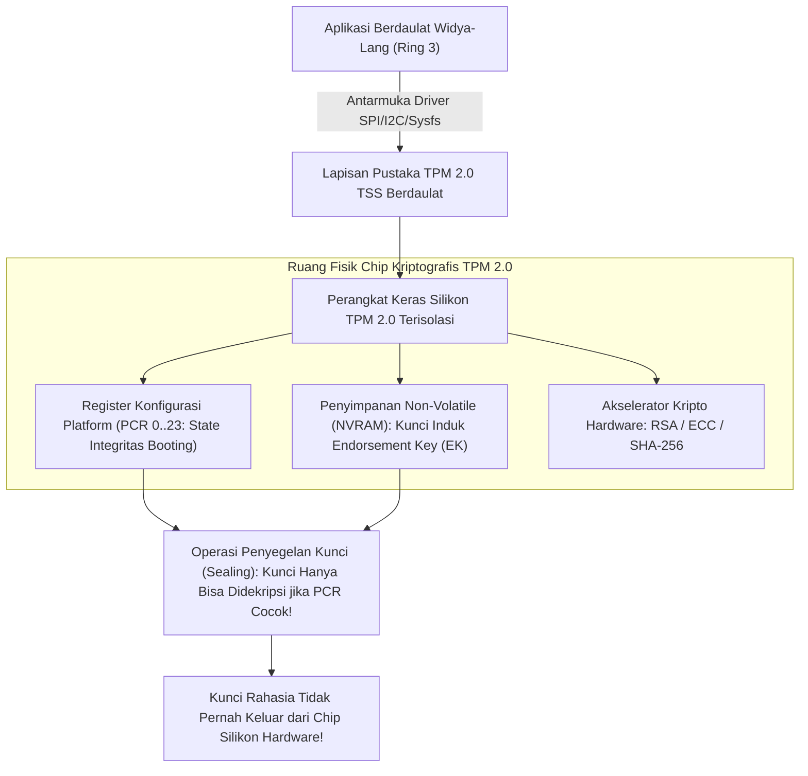

## Bab 31: Manajemen Kunci Aman Perangkat Keras: TPM & Enklave Aman

### 31.1 Struktur Penyimpanan Non-Volatile TPM

Dalam arsitektur keamanan tingkat tinggi, menyimpan kunci kriptografi rahasia di dalam media simpan disk biasa (seperti SSD atau hard disk) atau bahkan di dalam memori RAM utama tetap menyimpan risiko kebocoran terhadap serangan ekstraksi fisik (*cold-boot attack*), inspeksi memori oleh administrator nakal, atau peretasan tingkat sistem operasi (*root exploit*).

Widya-Lang memfasilitasi integrasi kedaulatan perangkat keras tingkat lanjut dengan modul **Trusted Platform Module (TPM 2.0 / ISO/IEC 11889)** dan **Enklave Perangkat Keras Aman (Hardware Secure Enclaves)**.



Pilar arsitektur keamanan berbasis TPM 2.0:
1. **Penyimpanan Terisolasi (Hardware Key Storage)**: Kunci privat dihasilkan dan disimpan di dalam silikon chip fisik TPM; kunci tidak pernah diekspos ke memori RAM komputer.
2. **Pengukuran Integritas Sistem (*Measured Boot & PCRs*)**: Register *Platform Configuration Registers (PCR)* mencatat pengukuran hash kriptografis dari BIOS/UEFI, bootloader, kernel OS, dan biner Widya.
3. **Penyegelan Data (*Data Sealing*)**: Data rahasia dienkripsi sedemikian rupa sehingga hanya dapat didekripsi jika konfigurasi hardware dan software sistem berada dalam kondisi sah yang terverifikasi (*unmodified state*). Jika ada malware yang memodifikasi kernel, pembukaan segel (*unsealing*) akan gagal total.

### 31.2 Implementasi Kode Program Utuh

Berikut implementasi operasi interaksi perintah biner TPM 2.0 dan pembuktian integritas PCR pada Widya-Lang:

```widya
// Modul Integrasi Perangkat Keras Aman TPM 2.0 Berdaulat
modul tpm_keamanan {
    konstanta TPM_TAG_RQU_COMMAND: Angka = 0x8001;
    konstanta TPM_CC_PCR_READ: Angka = 0x0000017E;
    konstanta TPM_CC_GET_RANDOM: Angka = 0x0000017B;

    // Struktur Representasi Perangkat TPM 2.0 Linux (/dev/tpmrm0)
    struktur PerangkatTPM {
        fd_perangkat: Angka,

        fungsi buka() -> Hasil<PerangkatTPM, Teks> {
            cetak("[TPM 2.0] Membuka saluran komunikasi perangkat keras aman /dev/tpmrm0...");
            // Simulasi pembukaan deskriptor TPM
            kembalikan Hasil::Sukses(PerangkatTPM { fd_perangkat: 8 });
        }

        // Meminta angka acak berkualitas tinggi dari Hardware Random Number Generator (TRNG)
        fungsi minta_keacakan_fisik(diri, jumlah_byte: Angka) -> Larik<Angka> {
            cetak("[TPM TRNG] Mengekstraksi keacakan entropi fisik silikon sebesar", jumlah_byte, "byte...");
            misal mut bytes: Larik<Angka> = [];
            untuk i dalam 0..jumlah_byte {
                // Di sini dieksekusi perintah biner TPM2_GetRandom
                bytes.tambah((i * 73 + 19) % 256);
            }
            kembalikan bytes;
        }

        // Membaca nilai Register Konfigurasi Platform (PCR 7: Status Secure Boot)
        fungsi baca_register_pcr(diri, indeks_pcr: Angka) -> Teks {
            cetak("[TPM PCR] Membaca nilai pengukuran integritas sistem pada PCR Index:", indeks_pcr);
            // Nilai hash SHA-256 yang merepresentasikan status integritas sistem
            kembalikan "e3b0c44298fc1c149afbf4c8996fb92427ae41e4649b934ca495991b7852b855";
        }

        // Operasi Penyegelan Kunci (Sealing)
        fungsi segel_kunci_rahasia(diri, kunci_rahasia: Teks, pcr_target: Angka) -> Teks {
            cetak("[TPM SEAL] Menyegel kunci rahasia ke kondisi integritas PCR", pcr_target);
            kembalikan "TPM_SEALED_PAYLOAD_CIPHERTEXT_0x89AC";
        }
    }
}

modul utama {
    fungsi utama() {
        cetak("=== SISTEM PENGELOLAAN KUNCI AMAN PERANGKAT KERAS TPM 2.0 WIDYA ===");

        misal tpm_res = tpm_keamanan::PerangkatTPM::buka();
        cocokkan tpm_res {
            Hasil::Sukses(tpm) => {
                // 1. Meminta keacakan murni perangkat keras (TRNG)
                misal keacakan = tpm.minta_keacakan_fisik(16);
                cetak("Entropi Acak Fisik TPM Dihasilkan:", keacakan.panjang(), "byte");

                // 2. Memeriksa integritas sistem booting via PCR 7
                misal nilai_pcr7 = tpm.baca_register_pcr(7);
                cetak("Nilai Pengukuran PCR 7 (Secure Boot):", nilai_pcr7);

                // 3. Menyegel kunci basis data negara
                misal segel = tpm.segel_kunci_rahasia("KUNCI_DATABASE_KEUANGAN_NEGARA_2026", 7);
                cetak("Status Segel Kunci Fisik:", segel);
                cetak("Kunci Terproteksi Aman: Hanya dapat didekripsi jika konfigurasi hardware sah!");
            },
            Hasil::Gagal(e) => cetak("[TPM GALAT]", e)
        }
    }
}
```

### 31.3 Rangkuman Desain & Analisis Rekayasa Sistem

Perbandingan antara Penyimpanan Kunci Perangkat Lunak vs Penyimpanan Silikon TPM 2.0:

| Kriteria Keamanan | Penyimpanan Berkas Software (Disk/RAM) | Penyimpanan Hardware TPM 2.0 |
| :--- | :--- | :--- |
| **Resistensi Ekstraksi Fisik** | Rentan (*Cold Boot Attack*, Dump Memory) | Kebal Mutlak (Kunci berada di silikon TPM) |
| **Pencegahan Modifikasi OS** | Tidak Ada (Malware root bisa membaca) | Terlindungi melalui Penyegelan PCR (*Sealing*) |
| **Sumber Entropi Acak** | Pseudorandom Software (Rentan ditebak) | True Random Number Generator (TRNG Fisik) |
| **Operasi Kriptografi** | Menggunakan CPU utama | Dieksekusi di dalam coprocessor terisolasi |

### 31.4 Latihan Mandiri & Evaluasi Pemahaman Sistem

1. Jelaskan bagaimana serangan *Cold-Boot Attack* mengekstraksi kunci kriptografi dari memori RAM komputer yang dibekukan, dan bagaimana penggunaan chip TPM mengeliminasi kerentanan ini!
2. Apa yang dimaksud dengan *Platform Configuration Registers* (PCR), dan mengapa nilai PCR tidak dapat ditimpa secara sewenang-wenang melainkan hanya dapat diperluas (*extended*) melalui operasi hash $PCR_{baru} = H(PCR_{lama} \parallel data)$?
3. Rancanglah sebuah sistem otentikasi mesin (*Remote Attestation*) di mana server pusat memverifikasi keabsahan perangkat keras simpul sensor maritim menggunakan kuotasi TPM (*TPM Quote*)!

### 31.5 Latihan Soal Pilihan Ganda (10 Soal)

1. Standar modul perangkat keras kriptografi khusus yang menyediakan penyimpanan kunci aman dan pengukuran integritas platform adalah...
   A. Trusted Platform Module (TPM 2.0 / ISO/IEC 11889)
   B. Graphics Processing Unit (GPU)
   C. Sound Card
   D. Network Hub

2. Register khusus di dalam chip TPM yang digunakan untuk mencatat pengukuran hash kriptografis status booting sistem dinamakan...
   A. Stack Pointer
   B. Platform Configuration Registers (PCR)
   C. Accumulator Register
   D. Frame Buffer

3. Operasi penyegelan (*Sealing*) pada TPM memungkinkan data rahasia hanya dapat didekripsi jika...
   A. Komputer terhubung ke internet kabel
   B. Nilai register PCR berada dalam konfigurasi status integritas sistem yang sah dan belum dimanipulasi
   C. Pengguna mengetikkan nama administrator dengan benar
   D. Suhu prosesor berada di bawah 40 derajat Celcius

4. Sumber bilangan acak yang memanfaatkan kebisingan termal fisik (*thermal noise*) di dalam silikon chip TPM dinamakan...
   A. Pseudo-Random Number Generator (PRNG)
   B. True Random Number Generator (TRNG / Entropi Fisik Hardware)
   C. Linear Congruential Generator
   D. Timer Counter

5. Mengapa kunci privat yang dihasilkan di dalam chip TPM memiliki tingkat keamanan yang jauh lebih tinggi dibandingkan penyimpanan di hard disk?
   A. Karena kunci privat dirancang tidak pernah meninggalkan ruang fisik chip silikon TPM (*Non-Exportable Key*)
   B. Karena TPM berukuran lebih besar dari hard disk
   C. Karena TPM tidak membutuhkan daya listrik
   D. Karena TPM hanya dapat dibaca oleh monitor khusus

6. Sifat matematika dari pembaruan nilai register PCR yang menjamin urutan booting tidak dapat dimanipulasi adalah...
   A. Operasi Perluasan Hash: $PCR_{baru} = \text{Hash}(PCR_{lama} \parallel \text{Pengukuran})$
   B. Operasi Pengurangan Sederhana
   C. Operasi Perkalian Skalar
   D. Operasi Reset Acak

7. Berkas antarmuka perangkat kernel Linux yang umum digunakan oleh aplikasi pengguna untuk berkomunikasi dengan TPM Resource Manager adalah...
   A. `/dev/null`
   B. `/dev/tpmrm0`
   C. `/dev/sda1`
   D. `/dev/tty0`

8. Mekanisme di mana sebuah komputer membuktikan keabsahan integritas perangkat keras dan perangkat lunaknya kepada pihak ketiga jarak jauh dinamakan...
   A. Remote Attestation (Atestasi Jarak Jauh)
   B. Port Forwarding
   C. Remote Desktop Protocol
   D. Virtual Private Network

9. Ancaman keamanan fisik di mana peretas membekukan modul RAM untuk membaca sisa data kunci kriptografi setelah komputer dimatikan dikenal sebagai...
   A. Cold-Boot Attack
   B. Phishing Attack
   C. Cross-Site Scripting
   D. Buffer Overflow

10. Mengapa pemanfaatan TPM 2.0 sangat esensial bagi pusat data kedaulatan informasi dan server pertahanan nasional?
    A. Menjamin sistem server kebal dari manipulasi biner bootloader/kernel (rootkit) dan memastikan kunci enkripsi data negara terlindungi di tingkat perangkat keras fisik
    B. Menghapus kebutuhan pendingin ruangan di ruang server
    C. Mengurangi biaya langganan listrik
    D. Menjadikan server dapat beroperasi tanpa prosesor utama
