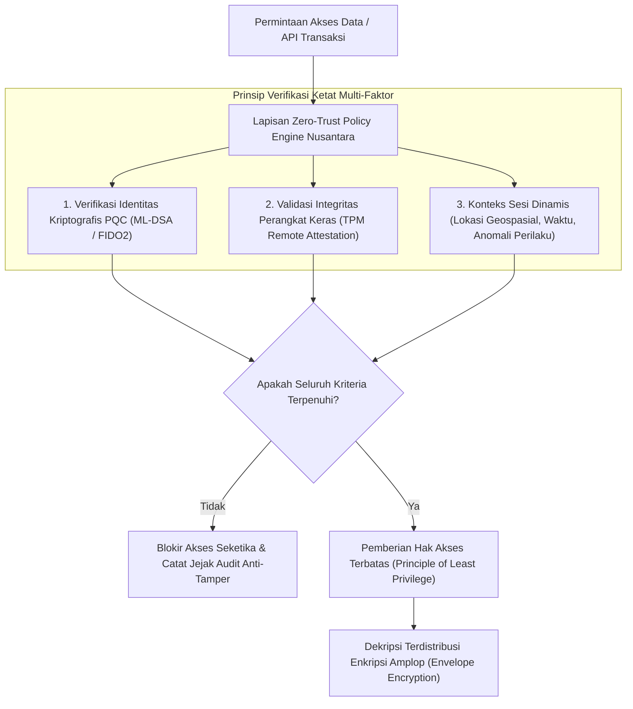

## Bab 32: Arsitektur Kedaulatan Data Zero-Trust & Enkripsi Terdistribusi

### 32.1 Prinsip Zero-Trust

Model keamanan perimeter tradisional berbasis dinding api (*Firewall / Castle-and-Moat Architecture*) mengasumsikan bahwa setiap entitas di dalam jaringan internal dapat dipercaya sepenuhnya. Paradigma usang ini terbukti gagal total di era komputasi modern, di mana ancaman orang dalam (*insider threats*), peretasan kredensial, dan penyusupan bertahap (*lateral movement*) sering kali melumpuhkan seluruh institusi negara.

Widya-Lang mengadopsi paradigma arsitektur keamanan **Zero-Trust (Nol-Kepercayaan)** berdaulat yang berakar pada aksioma fundamental:
> *"Jangan Pernah Percaya, Selalu Verifikasi (Never Trust, Always Verify)."*



Tiga pilar utama arsitektur Zero-Trust Widya-Lang:
1. **Verifikasi Eksplisit Berkelanjutan**: Setiap permintaan akses dievaluasi secara dinamis berdasarkan identitas subjek, status kesehatan perangkat, dan konteks lingkungan, bukan berdasarkan alamat IP.
2. **Hak Istimewa Terkecil (*Principle of Least Privilege*)**: Akses hanya diberikan sebatas apa yang benar-benar dibutuhkan untuk menyelesaikan tugas pada rentang waktu yang sangat terbatas (*Just-In-Time Access*).
3. **Asumsi Pelanggaran (*Assume Breach*)**: Seluruh data selalu dienkripsi dalam perjalanan (*in-transit*) dan saat disimpan (*at-rest*); setiap segmen jaringan diisolasi ketat untuk membatasi radius dampak serangan (*blast radius*).

### 32.2 Implementasi Kode Program Utuh

Berikut implementasi mekanisme Enkripsi Amplop (*Envelope Encryption*) terdistribusi dan mesin evaluasi kebijakan Zero-Trust pada Widya-Lang:

```widya
// Modul Enkripsi Amplop Terdistribusi Berdaulat
modul keamanan_zerotrust {
    // Struktur Kebijakan Konteks Akses
    struktur KonteksPermintaan {
        identitas_pengguna: Teks,
        peran_otoritas: Teks,
        skor_kesehatan_tpm: Angka,  // 0 - 100
        lokasi_wilayah: Teks
    }

    // Struktur Enkripsi Amplop (Envelope Encryption)
    struktur AmplopTerenkripsi {
        data_tersandi: Larik<Angka>,
        kunci_data_terenkripsi_dek: Larik<Angka> // Data Encryption Key (DEK) dienkripsi KEK
    }

    // Mesin Penilai Kebijakan Zero-Trust (Policy Decision Point)
    fungsi evaluasi_izin_akses(konteks: KonteksPermintaan, tingkat_klasifikasi: Teks) -> Boolean {
        cetak("[ZERO-TRUST PDP] Mengevaluasi izin akses untuk:", konteks.identitas_pengguna);
        
        // 1. Verifikasi integritas perangkat keras (Harus >= 90)
        jika konteks.skor_kesehatan_tpm < 90 {
            cetak("  [DITOLAK] Perangkat tidak memenuhi standar integritas TPM!");
            kembalikan salah;
        }

        // 2. Verifikasi wilayah kedaulatan data (Harus berada di wilayah Indonesia)
        jika konteks.lokasi_wilayah != "ID_NUSANTARA" {
            cetak("  [DITOLAK] Akses dari luar yurisdiksi wilayah kedaulatan!");
            kembalikan salah;
        }

        // 3. Evaluasi peran otoritas
        jika tingkat_klasifikasi == "SANGAT_RAHASIA" dan konteks.peran_otoritas != "PANGLIMA_SIBER" {
            cetak("  [DITOLAK] Otoritas tidak mencukupi untuk dokumen sangat rahasia!");
            kembalikan salah;
        }

        cetak("  [DIIZINKAN] Akses disetujui berdasarkan prinsip Zero-Trust.");
        kembalikan benar;
    }

    // Fungsi Enkripsi Amplop: Menghasilkan DEK unik per dokumen
    fungsi buat_amplop_aman(dokumen: Teks, kunci_induk_kek: Larik<Angka>) -> AmplopTerenkripsi {
        cetak("[ENVELOPE ENCRYPT] Membangkitkan Kunci Data (DEK) efemeral unik...");
        misal mut dek_acak: Larik<Angka> = [0x12, 0x34, 0x56, 0x78]; // Simulasi DEK
        misal bytes = dokumen.ke_larik_byte();

        // 1. Enkripsi data dokumen menggunakan DEK
        misal mut ciphertext: Larik<Angka> = [];
        untuk b in bytes {
            ciphertext.tambah(b ^ 0x55);
        }

        // 2. Enkripsi DEK menggunakan Kunci Induk (Key Encryption Key / KEK)
        misal mut dek_terenkripsi: Larik<Angka> = [];
        untuk k in dek_acak {
            dek_terenkripsi.tambah(k ^ kunci_induk_kek.ambil(0));
        }

        kembalikan AmplopTerenkripsi {
            data_tersandi: ciphertext,
            kunci_data_terenkripsi_dek: dek_terenkripsi
        };
    }
}

modul utama {
    fungsi utama() {
        cetak("=== SISTEM ARSITEKTUR KEDAULATAN DATA ZERO-TRUST WIDYA ===");

        // 1. Konteks Permintaan Akses dari Operator Satelit
        misal sesi_operator = keamanan_zerotrust::KonteksPermintaan {
            identitas_pengguna: "kolonel_adhitya@tni.mil.id",
            peran_otoritas: "PANGLIMA_SIBER",
            skor_kesehatan_tpm: 98,
            lokasi_wilayah: "ID_NUSANTARA"
        };

        // 2. Evaluasi Kebijakan Zero-Trust
        misal diizinkan = keamanan_zerotrust::evaluasi_izin_akses(sesi_operator, "SANGAT_RAHASIA");

        jika diizinkan {
            // 3. Eksekusi Enkripsi Amplop
            misal kunci_induk_nasional = [0xAA, 0xBB, 0xCC, 0xDD];
            misal dokumen_negara = "PETA_DISLOKASI_PASUKAN_PERTAHANAN_KEPULAUAN_2026";
            
            misal amplop = keamanan_zerotrust::buat_amplop_aman(dokumen_negara, kunci_induk_nasional);
            cetak("Enkripsi Amplop Tuntas:");
            cetak("  Ukuran Payload Tersandi (DEK) :", amplop.data_tersandi.panjang(), "byte");
            cetak("  Ukuran Kunci DEK Tersegel (KEK):", amplop.kunci_data_terenkripsi_dek.panjang(), "byte");
            cetak("Dokumen Terlindungi Penuh Sesuai Regulasi Pelindungan Data Pribadi (UU PDP).");
        }
    }
}
```

### 32.3 Rangkuman Desain & Analisis Rekayasa Sistem

Perbandingan Arsitektur Keamanan Perimeter Klasik vs Arsitektur Zero-Trust:

| Parameter Arsitektur | Keamanan Perimeter Tradisional | Arsitektur Zero-Trust Berdaulat |
| :--- | :--- | :--- |
| **Batas Kepercayaan** | Jaringan internal dipercaya penuh | Tidak ada kepercayaan inheren (*Never Trust*) |
| **Model Verifikasi** | Otentikasi satu kali saat login | Verifikasi terus-menerus per permintaan |
| **Manajemen Akses** | Akses luas ke seluruh subnet LAN | Hak akses terbatas (*Micro-segmentation*) |
| **Strategi Enkripsi** | Hanya di perbatasan luar (DMZ) | Menyeluruh: *In-Transit, At-Rest, In-Use* |
| **Metode Kunci Data** | Satu kunci bersama untuk semua | Enkripsi Amplop (Kunci unik per dokumen) |

### 32.4 Latihan Mandiri & Evaluasi Pemahaman Sistem

1. Jelaskan mengapa paradigma keamanan berbasis alamat IP atau jaringan internal LAN dianggap usang dan tidak memadai untuk membendung serangan spionase siber canggih (*Advanced Persistent Threat / APT*)!
2. Bagaimana mekanisme Enkripsi Amplop (*Envelope Encryption*) memungkinkan rotasi kunci induk (*Key Encryption Key / KEK*) dilakukan secara instan tanpa perlu mengenkripsi ulang petabyte data dokumen mentah?
3. Rancanglah sebuah sistem audit jejak kriptografis anti-manipulasi (*tamper-evident audit log*) di mana setiap aksi akses Zero-Trust dicatat ke dalam buku besar hash rantai blok (*blockchain ledger*)!

### 32.5 Latihan Soal Pilihan Ganda (10 Soal)

1. Aksioma filosofis mendasar yang menjadi pilar utama dari arsitektur keamanan Zero-Trust adalah...
   A. Percayai semua orang di dalam jaringan lokal
   B. Jangan Pernah Percaya, Selalu Verifikasi (Never Trust, Always Verify)
   C. Gunakan kata sandi yang sama di semua server
   D. Nonaktifkan firewall agar koneksi lancar

2. Pendekatan manajemen hak akses di mana pengguna hanya diberikan wewenang minimum yang mutlak diperlukan untuk menyelesaikan tugasnya dinamakan...
   A. Principle of Maximum Authority
   B. Principle of Least Privilege (Prinsip Hak Akses Terkecil)
   C. Open Access Policy
   D. Default Administrator Mode

3. Teknik kriptografi di mana data dienkripsi dengan Kunci Enkripsi Data (DEK) unik, dan DEK tersebut kemudian dienkripsi menggunakan Kunci Enkripsi Kunci (KEK) induk dinamakan...
   A. Enkripsi Amplop (Envelope Encryption)
   B. Enkripsi Simetris Sederhana
   C. Steganografi Gambar
   D. Hashing Satu Arah

4. Pemisahan jaringan ke dalam zona-zona terisolasi yang sangat kecil untuk membatasi pergerakan lateral peretas dinamakan...
   A. Mikrosegmentasi (Micro-segmentation)
   B. Virtual LAN 1000
   C. Subnet Masking Statis
   D. Bridge Connection

5. Komponen dalam arsitektur Zero-Trust yang bertugas mengevaluasi konteks permintaan dan mengambil keputusan apakah akses disetujui atau ditolak dinamakan...
   A. Policy Decision Point (PDP)
   B. Network Switch
   C. Web Browser
   D. Hard Disk Controller

6. Keuntungan utama dari teknik Enkripsi Amplop saat melakukan rotasi kunci enkripsi induk adalah...
   A. Menghapus data lama secara otomatis
   B. Hanya kunci DEK berukuran kecil yang perlu didekripsi dan dienkripsi ulang dengan KEK baru, tanpa perlu memproses ulang data raksasa
   C. Mengurangi bandwidth internet
   D. Mempercepat waktu booting komputer

7. Tiga status data yang wajib dilindungi dengan enkripsi pada arsitektur kedaulatan data modern adalah...
   A. Data in-Transit (Perjalanan), Data at-Rest (Penyimpanan), dan Data in-Use (Pemrosesan Memori)
   B. Data Teks, Data Gambar, dan Data Video
   C. Data Pagi, Data Siang, dan Data Malam
   D. Data Lokal, Data Regional, dan Data Internasional

8. Asumsi arsitektural dalam Zero-Trust yang menganggap bahwa sistem jaringan mungkin telah disusupi oleh peretas sehingga perlindungan mendalam wajib diterapkan dinamakan...
   A. Assume Breach (Asumsi Pelanggaran)
   B. False Sense of Security
   C. Perimeter Defense
   D. Ignorance Policy

9. Regulasi nasional Republik Indonesia yang mengatur kewajiban pelindungan data, privasi warga negara, dan tata kelola sistem elektronik berdaulat adalah...
   A. Undang-Undang Pelindungan Data Pribadi (UU PDP No. 27 Tahun 2022)
   B. Kitab Undang-Undang Hukum Dagang
   C. Peraturan Lalu Lintas Darat
   D. Undang-Undang Hak Cipta Musik

10. Mengapa implementasi arsitektur Zero-Trust dan enkripsi terdistribusi sangat vital bagi kedaulatan digital Republik Indonesia?
    A. Membentengi infrastruktur informasi vital nasional dari ancaman penyusupan siber global dan memastikan kendali mutlak atas data strategis bangsa berada di tangan bangsa sendiri
    B. Menghapus kebutuhan anggaran belanja pertahanan negara
    C. Mengizinkan publik mengunduh data rahasia intelijen
    D. Membatasi pengembang agar tidak merilis fitur baru
