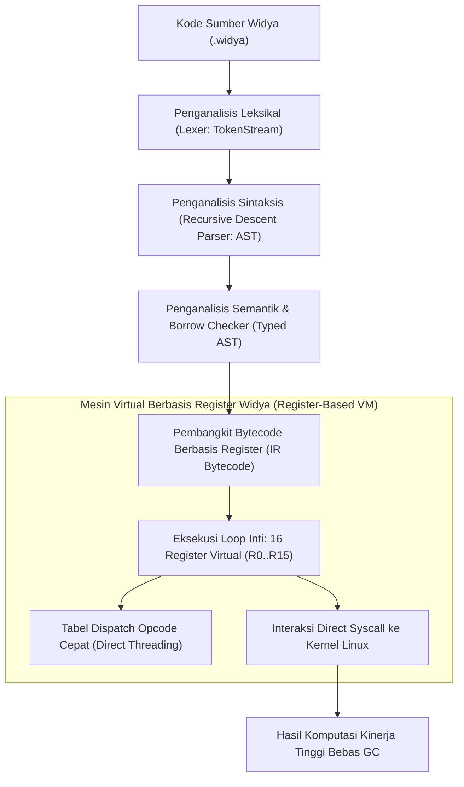

## Bab 33: Anatomi Kompilator & Mesin Virtual (VM) Berbasis Register Widya

### 33.1 Pipeline Kompilasi Widya

Memahami cara kerja internal dari bahasa pemrograman yang Anda gunakan adalah puncak keahlian seorang rekayasawan perangkat lunak sistem. Kompilator Widya-Lang dibangun dari nol (*from scratch*) tanpa menggunakan kerangka kerja eksternal berat (seperti LLVM yang berukuran ratusan megabyte), melainkan menerapkan **Arsitektur Kompilasi Mandiri 100% Native Rust**.



Perbedaan mendasar arsitektur Mesin Virtual:
1. **Stack-based VM (seperti JVM / Python VM)**: Operasi aritmetika menggunakan instruksi `push` dan `pop` pada tumpukan operand. Menghasilkan kode bytecode yang ringkas tetapi membutuhkan banyak instruksi instruksi memori per operasi.
2. **Register-based VM (Widya-Lang / LuaJIT / Dalvik)**: Menggunakan register virtual (misal `R0`, `R1`, `R2`) yang memetakan langsung ke register fisik prosesor modern. Mengurangi jumlah total instruksi bytecode hingga 35-50% dan meningkatkan efisiensi cache CPU.

### 33.2 Implementasi Kode Program Utuh

Berikut implementasi miniatur Mesin Virtual berbasis register 16-bit dengan instruksi matematika dan kontrol alur pada Widya-Lang:

```widya
// Modul Mini Mesin Virtual Berbasis Register Berdaulat
modul mesin_virtual {
    // Definisi Opcode Instruksi Bytecode
    konstanta OP_MUAT_KONSTANTA: Angka = 0x01;  // MUAT R_dest, Nilai
    konstanta OP_TAMBAH: Angka = 0x02;          // TAMBAH R_dest, R_src1, R_src2
    konstanta OP_KALI: Angka = 0x03;            // KALI R_dest, R_src1, R_src2
    konstanta OP_CETAK: Angka = 0x04;           // CETAK R_src
    konstanta OP_BERHENTI: Angka = 0xFF;        // BERHENTI

    // Struktur Instruksi 32-bit: [Opcode: 8-bit][R_dest: 8-bit][R_src1: 8-bit][R_src2: 8-bit]
    struktur InstruksiVM {
        opcode: Angka,
        reg_tujuan: Angka,
        reg_sumber1: Angka,
        reg_sumber2: Angka
    }

    // Struktur Mesin Virtual Berbasis Register
    struktur RegisterVM {
        register: Larik<Angka>,  // R0 s/d R15
        penunjuk_instruksi: Angka,
        program_instruksi: Larik<InstruksiVM>,

        fungsi baru(program: Larik<InstruksiVM>) -> RegisterVM {
            misal mut regs: Larik<Angka> = [];
            untuk i dalam 0..16 {
                regs.tambah(0);
            }
            kembalikan RegisterVM {
                register: regs,
                penunjuk_instruksi: 0,
                program_instruksi: program
            };
        }

        // Loop Eksekusi Utama (Fetch-Decode-Execute Cycle)
        fungsi eksekusi(mut diri) {
            cetak("[VM CORE] Memulai eksekusi siklus bytecode berbasis register...");
            misal mut berjalan = benar;

            selama berjalan dan diri.penunjuk_instruksi < diri.program_instruksi.panjang() {
                // 1. Fetch (Ambil instruksi)
                misal inst = diri.program_instruksi.ambil(diri.penunjuk_instruksi);
                diri.penunjuk_instruksi += 1;

                // 2. Decode & Execute (Urai & Eksekusi)
                cocokkan inst.opcode {
                    0x01 => {
                        // MUAT nilai langsung ke register
                        diri.register.atur(inst.reg_tujuan, inst.reg_sumber1);
                    },
                    0x02 => {
                        // TAMBAH R_dest = R_src1 + R_src2
                        misal v1 = diri.register.ambil(inst.reg_sumber1);
                        misal v2 = diri.register.ambil(inst.reg_sumber2);
                        diri.register.atur(inst.reg_tujuan, v1 + v2);
                    },
                    0x03 => {
                        // KALI R_dest = R_src1 * R_src2
                        misal v1 = diri.register.ambil(inst.reg_sumber1);
                        misal v2 = diri.register.ambil(inst.reg_sumber2);
                        diri.register.atur(inst.reg_tujuan, v1 * v2);
                    },
                    0x04 => {
                        // CETAK isi register
                        misal hasil = diri.register.ambil(inst.reg_tujuan);
                        cetak("  [VM STDOUT] Register R" + ke_teks(inst.reg_tujuan) + " =", hasil);
                    },
                    0xFF => {
                        cetak("[VM CORE] Menerima instruksi BERHENTI.");
                        berjalan = salah;
                    },
                    _ => {
                        cetak("[VM GALAT] Opcode tidak dikenal:", inst.opcode);
                        berjalan = salah;
                    }
                }
            }
            cetak("[VM CORE] Eksekusi tuntas.");
        }
    }
}

modul utama {
    fungsi utama() {
        cetak("=== SISTEM ANATOMI KOMPILATOR & MESIN VIRTUAL WIDYA ===");

        // Program Bytecode Simulasi:
        // R0 = 25
        // R1 = 4
        // R2 = R0 * R1  (Hasil: 100)
        // R3 = 50
        // R4 = R2 + R3  (Hasil: 150)
        // CETAK R4
        // BERHENTI
        misal program: Larik<mesin_virtual::InstruksiVM> = [
            mesin_virtual::InstruksiVM { opcode: 0x01, reg_tujuan: 0, reg_sumber1: 25, reg_sumber2: 0 },
            mesin_virtual::InstruksiVM { opcode: 0x01, reg_tujuan: 1, reg_sumber1: 4,  reg_sumber2: 0 },
            mesin_virtual::InstruksiVM { opcode: 0x03, reg_tujuan: 2, reg_sumber1: 0,  reg_sumber2: 1 },
            mesin_virtual::InstruksiVM { opcode: 0x01, reg_tujuan: 3, reg_sumber1: 50, reg_sumber2: 0 },
            mesin_virtual::InstruksiVM { opcode: 0x02, reg_tujuan: 4, reg_sumber1: 2,  reg_sumber2: 3 },
            mesin_virtual::InstruksiVM { opcode: 0x04, reg_tujuan: 4, reg_sumber1: 0,  reg_sumber2: 0 },
            mesin_virtual::InstruksiVM { opcode: 0xFF, reg_tujuan: 0, reg_sumber1: 0,  reg_sumber2: 0 }
        ];

        misal mut vm = mesin_virtual::RegisterVM::baru(program);
        vm.eksekusi();
    }
}
```

### 33.3 Rangkuman Desain & Analisis Rekayasa Sistem

Perbandingan arsitektural Stack VM vs Register VM:

| Karakteristik VM | Stack-based VM (JVM / WebAssembly) | Register-based VM (Widya-Lang / LuaJIT) |
| :--- | :--- | :--- |
| **Kepadatan Instruksi** | Sangat padat (Opcode 1-byte tanpa operand) | Lebih panjang (Opcode memuat nomor register) |
| **Jumlah Instruksi Total** | Banyak (Perlu operasi push/pop berulang) | Jauh Lebih Sedikit (30-50% lebih efisien) |
| **Pemetaan ke Hardware** | Buruk (CPU nyata berbasis register) | Alami (Pemetaan 1:1 ke register fisik CPU) |
| **Kecepatan Interpretasi** | Sedang (Beban memori stack overhead) | Sangat Cepat (Minim manipulasi stack) |
| **Kompleksitas Kompilator** | Mudah dihasilkan dari AST | Membutuhkan alokator register graph-coloring |

### 33.4 Latihan Mandiri & Evaluasi Pemahaman Sistem

1. Jelaskan bagaimana tahapan analisis leksikal (*Lexer*), parsing sintaksis (*Parser*), dan analisis semantik bekerja sama membangun *Abstract Syntax Tree* (AST) bertipe penuh pada Widya-Lang!
2. Mengapa Mesin Virtual berbasis register (*Register-based VM*) membutuhkan jumlah instruksi yang jauh lebih sedikit untuk mengevaluasi ekspresi matematika dibandingkan Mesin Virtual berbasis tumpukan (*Stack-based VM*)?
3. Rancanglah sebuah instruksi percabangan bersyarat `OP_LOMPAT_JIKA_NOL R_uji, Target_Alamat` pada modul RegisterVM di atas untuk mendukung perulangan `selama`!

### 33.5 Latihan Soal Pilihan Ganda (10 Soal)

1. Struktur data perantara berbentuk pohon hierarkis yang dihasilkan oleh parser dari aliran token kode sumber dinamakan...
   A. Abstract Syntax Tree (AST)
   B. B-Tree
   C. Hash Table
   D. Linked List

2. Tipe arsitektur Mesin Virtual yang digunakan oleh runtime Widya-Lang untuk efisiensi instruksi CPU adalah...
   A. Stack-based VM
   B. Register-based VM
   C. Turing Tape Machine
   D. Vacuum Tube Simulator

3. Siklus eksekusi fundamental yang dijalankan oleh mesin virtual prosesor secara berulang adalah...
   A. Fetch-Decode-Execute Cycle
   B. Read-Write-Format Cycle
   C. Install-Run-Delete Cycle
   D. Connect-Listen-Close Cycle

4. Keunggulan utama Register-based VM dibandingkan Stack-based VM dalam eksekusi kode adalah...
   A. Mengurangi jumlah total instruksi yang harus dieksekusi dan memiliki kedekatan alami dengan arsitektur CPU fisik
   B. Register-based VM tidak membutuhkan daya listrik
   C. Menghapus kebutuhan penulisan variabel
   D. Menjadikan program bebas dari kesalahan logika

5. Tahap kompilasi di mana teks mentah kode sumber dipecah menjadi unit-unit kata bermakna (*Token*) dinamakan...
   A. Code Generation
   B. Analisis Leksikal (Lexer / Tokenizer)
   C. Linking
   D. Assembler

6. Algoritma alokasi register klasik yang digunakan oleh kompilator modern untuk memetakan variabel virtual ke register fisik CPU adalah...
   A. Pewarnaan Graf (Graph Coloring Algorithm)
   B. Pencarian Biner
   C. Algoritma QuickSort
   D. Algoritma Prim

7. Register khusus yang bertugas menyimpan alamat memori atau indeks instruksi yang sedang/akan dieksekusi selanjutnya adalah...
   A. Program Counter (PC / Instruction Pointer)
   B. Stack Pointer (SP)
   C. Base Pointer (BP)
   D. Flags Register

8. Teknik optimasi Mesin Virtual di mana alamat kode penangan opcode langsung dilompati tanpa melalui percabangan `switch` terpusat dinamakan...
   A. Direct Threading
   B. Linear Search
   C. Bubble Sort
   D. Garbage Collection

9. Mengapa Widya-Lang memilih membangun arsitektur kompilator mandiri tanpa bergantung pada kerangka kerja raksasa LLVM?
   A. Untuk menjamin kemandirian teknologi penuh (100% Sovereign), waktu kompilasi yang instan, dan ukuran biner kompilator yang sangat ringkas tanpa beban ratusan megabyte dependensi asing
   B. Karena LLVM dilarang oleh undang-undang
   C. Karena LLVM hanya berjalan di ponsel
   D. Agar kode sumber tidak dapat dicetak

10. Menguasai arsitektur kompilator dan mesin virtual memberikan manfaat tertinggi bagi insinyur sistem yaitu...
    A. Kemampuan merancang bahasa domain khusus (*Domain Specific Language / DSL*), perkakas analisa kode statis, dan mengoptimalkan kinerja program hingga batas silikon perangkat keras
    B. Menghapus kebutuhan kabel LAN
    C. Mempercepat koneksi internet satelit
    D. Mengurangi penggunaan memori monitor komputer
