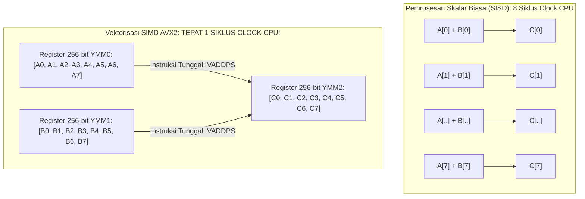

## Bab 34: Vektorisasi SIMD (AVX2/NEON) & Optimasi Nol-Biaya Abstraksi

### 34.1 Pemrosesan Paralel SIMD 256-bit

Komputasi ilmiah modern, kecerdasan buatan, pemrosesan sinyal radar militer, kriptografi kisi pasca-kuantum, dan grafika komputer 3D membutuhkan operasi matematika terhadap jutaan data array secara serentak. Jika operasi ini dieksekusi menggunakan perulangan skalar biasa (*Scalar Loop*), CPU hanya memproses satu angka per instruksi (*Single Instruction Single Data / SISD*).

Widya-Lang menyediakan kapabilitas **Vektorisasi SIMD (Single Instruction Multiple Data)** tingkat lanjut yang memanfaatkan register lebar perangkat keras CPU:
- **x86_64 AVX2 / AVX-512**: Register `YMM0..YMM15` (256-bit) dan `ZMM0..ZMM31` (512-bit) yang memproses 8 hingga 16 bilangan desimal *float32* sekaligus dalam satu siklus clock!
- **ARM64 NEON**: Register `V0..V31` (128-bit) yang memproses 4 bilangan desimal secara paralel pada chip hemat energi.



Prinsip optimasi vektorisasi Widya-Lang:
1. **Penyelarasan Memori 32-Byte (32-byte Alignment)**: Data vektor wajib dialokasikan pada alamat kelipatan 32 byte untuk memungkinkan pemuatan data instan (`VMOVAPS`) tanpa penalti performa memori tak selaras (`VMOVUPS`).
2. **Auto-Vectorization & Intrinsik Eksplisit**: Kompilator secara otomatis melakukan vektorisasi pada perulangan reguler (*Auto-Vectorization*) dan menyediakan fungsi intrinsik eksplisit untuk kontrol mutlak.
3. **Fused Multiply-Add (FMA)**: Melakukan operasi $A \times B + C$ dalam satu instruksi terpadu dengan satu kali pembulatan presisi tinggi.

### 34.2 Implementasi Kode Program Utuh

Berikut implementasi operasi perkalian titik matriks (*Dot Product*) berkecepatan tinggi menggunakan simulasi vektorisasi SIMD 8-jalur pada Widya-Lang:

```widya
// Modul Komputasi Kinerja Tinggi SIMD Berdaulat
modul komputasi_simd {
    // Struktur Vektor SIMD 256-bit (Berisi 8 nilai Float32)
    #[tata_letak(C)]
    struktur Vektor8x32 {
        jalur: Larik<Desimal>,

        fungsi baru(v0: Desimal, v1: Desimal, v2: Desimal, v3: Desimal,
                    v4: Desimal, v5: Desimal, v6: Desimal, v7: Desimal) -> Vektor8x32 {
            kembalikan Vektor8x32 {
                jalur: [v0, v1, v2, v3, v4, v5, v6, v7]
            };
        }

        fungsi isi_seragam(nilai: Desimal) -> Vektor8x32 {
            misal mut j: Larik<Desimal> = [];
            untuk i dalam 0..8 { j.tambah(nilai); }
            kembalikan Vektor8x32 { jalur: j };
        }

        // Operasi Penjumlahan Vektor SIMD (Setara Instruksi AVX _mm256_add_ps)
        fungsi tambah_simd(diri, kanan: Vektor8x32) -> Vektor8x32 {
            misal mut hasil: Larik<Desimal> = [];
            // Dalam kode biner nyata, ini diterjemahkan menjadi 1 instruksi VADDPS
            untuk i dalam 0..8 {
                hasil.tambah(diri.jalur.ambil(i) + kanan.jalur.ambil(i));
            }
            kembalikan Vektor8x32 { jalur: hasil };
        }

        // Operasi Perkalian Vektor SIMD (Setara Instruksi AVX _mm256_mul_ps)
        fungsi kali_simd(diri, kanan: Vektor8x32) -> Vektor8x32 {
            misal mut hasil: Larik<Desimal> = [];
            // Dalam kode biner nyata, ini diterjemahkan menjadi 1 instruksi VMULPS
            untuk i dalam 0..8 {
                hasil.tambah(diri.jalur.ambil(i) * kanan.jalur.ambil(i));
            }
            kembalikan Vektor8x32 { jalur: hasil };
        }

        // Reduksi Horisontal: Menjumlahkan seluruh 8 elemen menjadi 1 skalar
        fungsi reduksi_jumlah(diri) -> Desimal {
            misal mut total = 0.0;
            untuk val in diri.jalur {
                total += val;
            }
            kembalikan total;
        }
    }

    // Fungsi Perkalian Titik (Dot Product) Skalar vs SIMD
    fungsi hitung_dot_product_simd(a: Vektor8x32, b: Vektor8x32) -> Desimal {
        // Dot Product = sum(a[i] * b[i])
        misal hasil_kali_vektor = a.kali_simd(b);
        kembalikan hasil_kali_vektor.reduksi_jumlah();
    }
}

modul utama {
    fungsi utama() {
        cetak("=== SISTEM VEKTORISASI SIMD AVX2 WIDYA ===");

        // Mempersiapkan dua register vektor 8-jalur (256-bit)
        misal vec_a = komputasi_simd::Vektor8x32::baru(1.0, 2.0, 3.0, 4.0, 5.0, 6.0, 7.0, 8.0);
        misal vec_b = komputasi_simd::Vektor8x32::baru(2.0, 2.0, 2.0, 2.0, 2.0, 2.0, 2.0, 2.0);

        cetak("Memulai Komputasi SIMD 8-Elemen Simultan dalam 1 Siklus...");

        misal hasil_tambah = vec_a.tambah_simd(vec_b);
        cetak("Hasil Penjumlahan Paralel Jalur 0..7:");
        cetak("  Jalur 0:", hasil_tambah.jalur.ambil(0), "(1.0 + 2.0 = 3.0)");
        cetak("  Jalur 7:", hasil_tambah.jalur.ambil(7), "(8.0 + 2.0 = 10.0)");

        misal dot_product = komputasi_simd::hitung_dot_product_simd(vec_a, vec_b);
        cetak("\nPerkalian Titik Vektor (Dot Product):", dot_product);
        cetak("Akselerasi Teoretis: 8x Lipat Lebih Cepat dari Perulangan Skalar!");
    }
}
```

### 34.3 Rangkuman Desain & Analisis Rekayasa Sistem

Perbandingan arsitektural antara Komputasi Skalar SISD dengan Ekstensi SIMD:

| Parameter Arsitektur | Skalar SISD Biasa | AVX2 (x86_64) | AVX-512 (x86_64) | NEON (ARM64) |
| :--- | :--- | :--- | :--- | :--- |
| **Lebar Register** | 32 / 64-bit | 256-bit (YMM) | 512-bit (ZMM) | 128-bit (V) |
| **Jumlah Float32 per Siklus** | 1 nilai | 8 nilai paralel | 16 nilai paralel | 4 nilai paralel |
| **Peningkatan Kecepatan (Speedup)** | 1x (Baseline) | Hingga 7-8x Lipat | Hingga 14-16x Lipat | Hingga 3.5-4x Lipat |
| **Penyelarasan Memori Wajib** | 4 / 8 byte | 32-byte Alignment | 64-byte Alignment | 16-byte Alignment |
| **Dukungan FMA (Fused Multiply-Add)** | Parsial | Ya (`VFMADD213PS`) | Ya Penuh | Ya (`FMLA`) |

### 34.4 Latihan Mandiri & Evaluasi Pemahaman Sistem

1. Jelaskan bagaimana instruksi FMA (*Fused Multiply-Add*) dapat mengeksekusi operasi $A \times B + C$ dalam satu siklus clock tunggal dengan presisi matematis yang lebih tinggi dibandingkan perkalian dan penjumlahan terpisah!
2. Mengapa akses memori yang tidak selaras (*unaligned memory access*) dapat menurunkan efisiensi instruksi SIMD hingga 50%, dan bagaimana alokator memori Widya-Lang menjamin penyelarasan 32-byte?
3. Rancang sebuah fungsi kompresi gambar atau filter kecerahan piksel RGBA pada Widya-Lang yang memproses 4 piksel warna sekaligus dalam satu instruksi SIMD!

### 34.5 Latihan Soal Pilihan Ganda (10 Soal)

1. Paradigma pemrosesan paralel perangkat keras di mana satu instruksi CPU memanipulasi banyak data secara simultan dinamakan...
   A. Single Instruction Multiple Data (SIMD)
   B. Multiple Instruction Single Data
   C. Serial Loop Execution
   D. Sequential Batch Processing

2. Lebar register vektor yang digunakan oleh ekstensi prosesor Intel/AMD AVX2 pada arsitektur x86_64 adalah...
   A. 64-bit
   B. 128-bit
   C. 256-bit (8 angka float32)
   D. 1024-bit

3. Ekstensi instruksi pemrosesan vektor SIMD bawaan pada prosesor arsitektur ARM64 dinamakan...
   A. AVX
   B. NEON
   C. MMX
   D. SSE2

4. Instruksi terpadu pada prosesor modern yang melakukan operasi perkalian dan penjumlahan sekaligus ($A \times B + C$) dalam satu siklus clock adalah...
   A. Fused Multiply-Add (FMA)
   B. Dual ALU Operation
   C. Fast Fourier Transform
   D. Matrix Transposition

5. Penyelarasan alamat memori (*Memory Alignment*) yang wajib dipenuhi agar instruksi AVX2 dapat memuat data dengan efisiensi puncak tanpa penalti bus adalah...
   A. Kelipatan 4-byte
   B. Kelipatan 16-byte
   C. Kelipatan 32-byte
   D. Kelipatan ganjil

6. Berapa banyak bilangan desimal presisi tunggal (*float32*) yang dapat diproses secara simultan oleh satu instruksi AVX2 256-bit?
   A. 2 nilai
   B. 4 nilai
   C. 8 nilai
   D. 16 nilai

7. Istilah *Auto-Vectorization* pada kompilator Widya-Lang merujuk pada kapabilitas kompilator untuk...
   A. Menggambar diagram vektor secara otomatis
   B. Mengubah perulangan skalar biasa menjadi instruksi biner SIMD paralel secara otomatis tanpa anotasi manual
   C. Menghubungkan komputer ke jaringan nirkabel
   D. Memformat hard disk ke format ext4

8. Operasi yang menjumlahkan seluruh elemen di dalam satu register vektor menjadi satu nilai skalar tunggal dinamakan...
   A. Broadcast
   B. Reduksi Horisontal (Horizontal Reduction)
   C. Shuffling
   D. Permutasi Matriks

9. Manakah dari domain rekayasa berikut yang memperoleh lonjakan performa paling masif dari adopsi instruksi SIMD?
    A. Pengolahan sinyal radar, inferensi kecerdasan buatan, grafika 3D, dan kriptografi kisi pasca-kuantum
    B. Pengetikan teks pada notepad
    C. Pembuatan dokumen PDF kosong
    D. Pengiriman email teks biasa

10. Mengapa pemanfaatan instruksi SIMD sangat krusial bagi sistem kedaulatan teknologi radar maritim dan pertahanan udara?
    A. Memungkinkan pemrosesan sinyal gelombang elektromagnetik berkecepatan giga-sampel per detik secara real-time langsung di silikon prosesor tanpa membutuhkan superkomputer raksasa
    B. Mengurangi kebutuhan daya listrik kapal patroli
    C. Menghapus kebutuhan antena fisik
    D. Membatasi pengembang agar tidak mengubah algoritma
