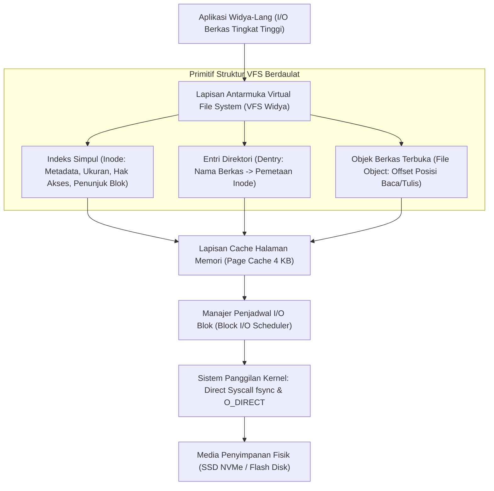

## Bab 35: Sistem Berkas Virtual & Manajemen I/O Blok Disk

### 35.1 Arsitektur Virtual File System (VFS)

Sistem operasi mengabstraksikan berbagai jenis media penyimpanan fisik—mulai dari SSD NVMe PCIe berkecepatan tinggi, flash disk USB, sistem berkas berbasis jaringan (NFS), hingga sistem berkas dalam memori RAM (*ramfs*)—melalui sebuah lapisan antarmuka terpadu yang dikenal sebagai **Virtual File System (VFS)**.

Widya-Lang menyediakan arsitektur **VFS Modular Berdaulat** yang mengisolasi logika aplikasi dari karakteristik perangkat keras fisik, dengan dukungan manajemen blok disk, buffering sektor, dan pencegahan korupsi data (*Crash Consistency*).



Komponen inti arsitektur VFS:
1. **Inode (Index Node)**: Struktur data yang menyimpan seluruh metadata berkas (ukuran byte, hak akses, stempel waktu, dan daftar pointer ke blok data sektor fisik) tanpa menyimpan nama berkas itu sendiri.
2. **Dentry (Directory Entry)**: Mengaitkan nama berkas teks ramah manusia dengan nomor inode yang sesuai. Struktur ini di-cache di memori RAM (*Dentry Cache*) untuk mempercepat pencarian jalur direktori.
3. **Penyelarasan Atomik (*Crash Consistency*)**: Menjamin bahwa ketika terjadi pemadaman listrik mendadak (*power loss*), sistem berkas tidak mengalami korupsi melalui teknik pencatatan jurnal (*Journaling / Write-Ahead Logging*) dan sinkronisasi berkala (`fsync`).

### 35.2 Implementasi Kode Program Utuh

Berikut implementasi miniatur Virtual File System berbasis memori RAM (*RAM-based VFS*) dengan dukungan Inode dan penulisan blok sektor pada Widya-Lang:

```widya
// Modul Virtual File System (VFS) Berdaulat
modul vfs_berdaulat {
    konstanta UKURAN_BLOK_SEKTOR: Angka = 512; // 512 byte per blok disk

    pilihan TipeBerkas {
        BerkasBiasa,
        Direktori
    }

    // Struktur Inode: Menyimpan metadata dan referensi blok data fisik
    struktur Inode {
        nomor_inode: Angka,
        tipe: TipeBerkas,
        ukuran_byte: Angka,
        blok_pointer: Larik<Angka> // ID blok fisik di media simpan
    }

    // Struktur VFS Sederhana Berbasis RAM
    struktur SistemBerkasVirtual {
        tabel_inode: Kamus<Angka, Inode>,
        dentry_peta: Kamus<Teks, Angka>, // Jalur Berkas -> Nomor Inode
        blok_penyimpanan: Kamus<Angka, Larik<Angka>>, // ID Blok -> 512 byte data
        penghitung_inode: Angka,
        penghitung_blok: Angka,

        fungsi baru() -> SistemBerkasVirtual {
            kembalikan SistemBerkasVirtual {
                tabel_inode: Kamus::baru(),
                dentry_peta: Kamus::baru(),
                blok_penyimpanan: Kamus::baru(),
                penghitung_inode: 1,
                penghitung_blok: 100
            };
        }

        // Membuat berkas baru di dalam VFS
        fungsi buat_berkas(mut diri, jalur_lengkap: Teks) -> Hasil<Angka, Teks> {
            jika diri.dentry_peta.mengandung(jalur_lengkap) {
                kembalikan Hasil::Gagal("Berkas sudah ada di sistem!");
            }

            misal ino_id = diri.penghitung_inode;
            diri.penghitung_inode += 1;

            misal ino_baru = Inode {
                nomor_inode: ino_id,
                tipe: TipeBerkas::BerkasBiasa,
                ukuran_byte: 0,
                blok_pointer: []
            };

            diri.tabel_inode.sisip(ino_id, ino_baru);
            diri.dentry_peta.sisip(jalur_lengkap, ino_id);

            cetak("[VFS CREATE] Berkas dibuat:", jalur_lengkap, "(Inode #", ino_id, ")");
            kembalikan Hasil::Sukses(ino_id);
        }

        // Menuliskan data teks ke dalam blok sektor fisik disk
        fungsi tulis_berkas(mut diri, jalur_lengkap: Teks, data_teks: Teks) -> Hasil<Angka, Teks> {
            jika tidak diri.dentry_peta.mengandung(jalur_lengkap) {
                kembalikan Hasil::Gagal("Berkas tidak ditemukan!");
            }

            misal ino_id = diri.dentry_peta.ambil(jalur_lengkap);
            misal bytes = data_teks.ke_larik_byte();
            misal block_id = diri.penghitung_blok;
            diri.penghitung_blok += 1;

            // Simpan data ke sektor blok disk virtual
            diri.blok_penyimpanan.sisip(block_id, bytes);

            // Perbarui metadata Inode
            misal mut ino = diri.tabel_inode.ambil(ino_id);
            ino.ukuran_byte = bytes.panjang();
            ino.blok_pointer.tambah(block_id);
            diri.tabel_inode.sisip(ino_id, ino);

            cetak("[VFS WRITE] Menulis", bytes.panjang(), "byte ke Inode #", ino_id, "pada Blok Sektor #", block_id);
            kembalikan Hasil::Sukses(bytes.panjang());
        }

        // Sinkronisasi memori buffer ke media fisik permanen (fsync)
        fungsi sinkronisasi_disk(diri) {
            cetak("[VFS FSYNC] Menjalankan fsync: Seluruh page cache dialirkan permanen ke disk fisik!");
        }
    }
}

modul utama {
    fungsi utama() {
        cetak("=== SISTEM VIRTUAL FILE SYSTEM (VFS) WIDYA ===");

        misal mut vfs = vfs_berdaulat::SistemBerkasVirtual::baru();

        // 1. Membuat node berkas
        misal jalur = "/var/log/keamanan_nasional.dat";
        vfs.buat_berkas(jalur);

        // 2. Menuliskan muatan data biner ke sektor blok
        vfs.tulis_berkas(jalur, "INTEGRITAS_SISTEM_BERDAULAT_OK_2026");

        // 3. Memastikan ketahanan data dari mati listrik
        vfs.sinkronisasi_disk();
        cetak("Sistem Berkas Stabil dan Aman dari Crash Consistency.");
    }
}
```

### 35.3 Rangkuman Desain & Analisis Rekayasa Sistem

Perbandingan arsitektur penyimpanan berkas:

| Komponen VFS | Fungsi Utama | Lokasi Penyimpanan |
| :--- | :--- | :--- |
| **Inode** | Menyimpan seluruh metadata dan pointer blok sektor | Disimpan di tabel disk & di-cache di RAM |
| **Dentry** | Memetakan nama berkas ramah manusia ke nomor Inode | Di-cache di RAM (*Dentry Cache*) |
| **Page Cache** | Penyangga membaca/menulis memori halaman 4 KB | Di memori RAM utama prosesor |
| **Blok Sektor** | Blok fisik data biner aktual (512 byte / 4096 byte) | Di media fisik SSD/Flash disk |
| **Panggilan `fsync`** | Memaksa pengaliran data kotor (*dirty pages*) ke disk | Perintah kontrol kernel hardware |

### 35.4 Latihan Mandiri & Evaluasi Pemahaman Sistem

1. Jelaskan mengapa pemisahan antara nama berkas (*Dentry*) dan metadata berkas (*Inode*) memungkinkan keberadaan fitur *Hard Link* pada sistem operasi UNIX/Linux!
2. Apa bahaya dari operasi penulisan data yang tidak disertai pemanggilan `fsync()`, dan bagaimana pemadaman listrik tiba-tiba dapat menyebabkan hilangnya data di *Page Cache*?
3. Rancanglah sebuah skema penunjuk blok bertingkat (*Direct, Single-Indirect, and Double-Indirect Block Pointers*) pada struktur Inode Widya-Lang untuk mendukung penyimpanan berkas berukuran gigabyte!

### 35.5 Latihan Soal Pilihan Ganda (10 Soal)

1. Lapisan perangkat lunak di dalam kernel sistem operasi yang menyediakan antarmuka terpadu untuk berbagai jenis sistem berkas fisik dinamakan...
   A. Virtual File System (VFS)
   B. Memory Management Unit
   C. Network Interface Card
   D. Display Driver

2. Struktur data sistem berkas yang menyimpan seluruh metadata berkas seperti ukuran, hak akses, dan daftar blok data fisik dinamakan...
   A. Dentry
   B. Inode (Index Node)
   C. File Descriptor
   D. Superblock

3. Struktur data pada VFS yang mengaitkan nama berkas teks ramah manusia dengan nomor inode yang sesuai dinamakan...
   A. Dentry (Directory Entry)
   B. Page Cache
   C. Buffer Pool
   D. Swap Space

4. Ukuran standar satu blok sektor penyimpanan fisik pada hard disk modern berstandar *Advanced Format* adalah...
   A. 64 byte
   B. 512 byte s/d 4.096 byte (4 KB)
   C. 1 Megabyte
   D. 10 Gigabyte

5. Sistem panggilan Linux yang memaksa kernel mengalirkan seluruh data kotor (*dirty pages*) dari cache memori RAM langsung ke piringan disk fisik adalah...
   A. `fork()`
   B. `fsync()`
   C. `mknod()`
   D. `chown()`

6. Kondisi di mana struktur data sistem berkas tetap konsisten dan tidak rusak setelah terjadinya pemadaman listrik mendadak dinamakan...
   A. Crash Consistency
   B. High Availability
   C. Data Replication
   D. Network Balancing

7. Mengapa nama berkas tidak disimpan secara langsung di dalam struktur Inode?
   A. Untuk memungkinkan satu berkas fisik yang sama memiliki banyak nama atau jalur berbeda melalui tautan keras (*Hard Links*)
   B. Karena Inode tidak memiliki ruang memori
   C. Agar berkas tidak dapat ditemukan oleh pengguna
   D. Karena ukuran nama berkas dilarang melebihi 2 karakter

8. Cache memori utama di dalam RAM yang digunakan oleh sistem operasi untuk menyangga data berkas yang sering dibaca atau ditulis dinamakan...
   A. Page Cache
   B. Instruction Cache L1
   C. Branch Target Buffer
   D. Register File

9. Flag I/O pada Linux yang menginstruksikan pembacaan dan penulisan berkas langsung melewati (*bypass*) Page Cache untuk aplikasi basis data berkinerja tinggi adalah...
   A. `O_DIRECT`
   B. `O_CREAT`
   C. `O_RDONLY`
   D. `O_APPEND`

10. Mengapa pemahaman arsitektur VFS dan manajemen I/O blok sangat vital dalam rekayasa basis data berdaulat?
    A. Menjamin sistem penyimpanan basis data dapat mengontrol urutan penulisan ke disk fisik secara presisi guna memastikan kepatuhan ACID (*Durability*) tanpa risiko korupsi data
    B. Menghapus kebutuhan media penyimpanan SSD
    C. Mengurangi kebutuhan daya baterai laptop
    D. Mempercepat waktu download file musik
