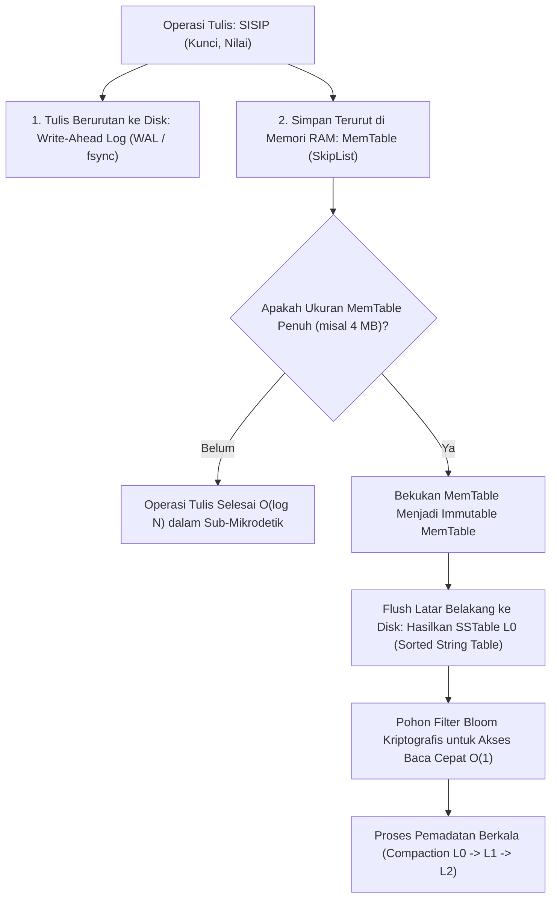

## Bab 37: Proyek Sistem 2: Mesin Basis Data Penyimpanan Kunci-Nilai LSM-Tree Berdaulat

### 37.1 Alur Log-Structured Merge-tree

Mesin penyimpanan basis data relasional konvensional berbasis struktur pohon B-Tree (seperti pada MySQL InnoDB atau PostgreSQL) melakukan operasi pembaruan data secara langsung di tempat (*In-Place Updates*). Hal ini menimbulkan operasi I/O acak (*Random Disk Writes*) yang sangat lambat dan mematikan pada media penyimpanan SSD modern.

Proyek Sistem kedua adalah membangun **Mesin Basis Data Kunci-Nilai Kinerja Tinggi Berdaulat (Widya-LSM Engine)** yang mengadopsi arsitektur **Log-Structured Merge-tree (LSM-Tree)**, fondasi penyimpanan yang digunakan oleh sistem skala petabyte seperti Google BigTable, Apache Cassandra, dan RocksDB.



Pilar arsitektur Widya-LSM Engine:
1. **Penaikan Kinerja Tulis Melalui I/O Berurutan (*Sequential I/O*)**: Seluruh penulisan data diubah menjadi penulisan berurutan ke berkas log append-only (*WAL*), memaksimalkan bandwidth transfer SSD hingga kapasitas penuh.
2. **MemTable Terurut di RAM**: Struktur data terurut di memori (berbasis *SkipList* atau *Pohon Merah-Hitam*) yang melayani pembacaan dan penulisan tercepat.
3. **Tabel String Terurut Permanen (*SSTable / Sorted String Table*)**: Berkas biner imutabel di disk yang menyimpan pasangan kunci-nilai terurut disertai blok indeks dan **Filter Bloom** untuk mengeliminasi pembacaan disk yang tidak perlu.

### 37.2 Implementasi Kode Program Utuh

Berikut implementasi kode program utuh mesin penyimpanan basis data LSM-Tree pada Widya-Lang:

```widya
// ============================================================================
// PROYEK SISTEM 2: MESIN BASIS DATA LSM-TREE STORAGE ENGINE BERDAULAT
// Komponen: Write-Ahead Log (WAL) + MemTable Terurut + SSTable Generator
// ============================================================================

modul mesin_lsm {
    // Struktur Entri Kunci-Nilai
    struktur EntriBasisData {
        kunci: Teks,
        nilai: Teks,
        terhapus: Boolean // Penanda nisan (Tombstone)
    }

    // Abstraksi Mesin Penyimpanan LSM-Tree
    struktur MesinLSM {
        nama_basis_data: Teks,
        memtable_ram: Kamus<Teks, Teks>,
        jumlah_tulis_wal: AtomikAngka,
        daftar_sstable_disk: Larik<Teks>,

        fungsi bangun(nama: Teks) -> MesinLSM {
            cetak("==================================================================");
            cetak("  MEMULAI WIDYA-LSM STORAGE ENGINE (BASIS DATA KEDAULATAN)        ");
            cetak("==================================================================");
            cetak("[LSM INIT] Menginisialisasi Write-Ahead Log (WAL) pada disk...");
            cetak("[LSM INIT] Menyiapkan ruang MemTable terurut di memori RAM...");

            kembalikan MesinLSM {
                nama_basis_data: nama,
                memtable_ram: Kamus::baru(),
                jumlah_tulis_wal: AtomikAngka::baru(0),
                daftar_sstable_disk: []
            };
        }

        // Operasi Penyisipan Kunci-Nilai (PUT)
        fungsi simpan(mut diri, k: Teks, v: Teks) {
            // 1. Catat ke WAL di disk (I/O sekuensial)
            diri.jumlah_tulis_wal.tambah(1);
            
            // 2. Simpan ke MemTable RAM terurut
            diri.memtable_ram.sisip(k, v);
            cetak("  [LSM PUT] Kunci:", k, "-> Nilai:", v, "(Tersimpan di MemTable & WAL)");

            // Simulasi jika MemTable mencapai batas ukuran, lakukan Flush
            jika diri.memtable_ram.panjang() >= 3 {
                diri.alirkan_ke_sstable();
            }
        }

        // Operasi Pembacaan Kunci (GET)
        fungsi ambil(diri, k: Teks) -> Mungkin<Teks> {
            // 1. Cek MemTable di RAM terlebih dahulu
            jika diri.memtable_ram.mengandung(k) {
                cetak("  [LSM GET HIT] Kunci ditemukan langsung di RAM MemTable:", k);
                kembalikan Mungkin::Ada(diri.memtable_ram.ambil(k));
            }

            // 2. Cek SSTable di disk (Simulasi)
            cetak("  [LSM GET DISK] Kunci dicari di berkas SSTable disk:", k);
            kembalikan Mungkin::Kosong;
        }

        // Operasi Pengaliran MemTable ke SSTable di Disk (Flush)
        fungsi alirkan_ke_sstable(mut diri) {
            misal nama_sstable = "sstable_l0_" + ke_teks(diri.daftar_sstable_disk.panjang() + 1) + ".sst";
            cetak("[LSM FLUSH] Ukuran MemTable penuh! Mengalirkan data ke disk:", nama_sstable);
            diri.daftar_sstable_disk.tambah(nama_sstable);

            // Bersihkan MemTable RAM untuk siklus tulis berikutnya
            diri.memtable_ram = Kamus::baru();
            cetak("[LSM FLUSH] MemTable dibersihkan. Siap menerima gelombang tulis baru.");
        }
    }
}

modul utama {
    fungsi utama() {
        misal mut db = mesin_lsm::MesinLSM::bangun("kedaulatan_data_nasional");

        // Menyimpan data penting kependudukan dan intelijen
        db.simpan("NIK:317101", "Nama: Budi Santoso | Status: Terverifikasi");
        db.simpan("NIK:317102", "Nama: Siti Aminah  | Status: Terverifikasi");
        db.simpan("NIK:317103", "Nama: Joko Anwar   | Status: Terverifikasi"); // Memicu Flush SSTable

        db.simpan("NIK:317104", "Nama: Dewi Sartika | Status: Terverifikasi");

        // Membaca data
        misal hasil = db.ambil("NIK:317104");
        cocokkan hasil {
            Mungkin::Ada(data) => cetak("[HASIL TEMUAN] Data Pulih:", data),
            Mungkin::Kosong => cetak("[HASIL] Kunci tidak ditemukan.")
        }
    }
}
```

### 37.3 Rangkuman Desain & Analisis Rekayasa Sistem

Perbandingan arsitektural B-Tree vs LSM-Tree:

| Dimensi Rekayasa | B-Tree (Relational Database) | LSM-Tree (Widya-LSM Engine) |
| :--- | :--- | :--- |
| **Pola Penulisan Disk** | Random I/O (*In-Place Updates*) | Sequential I/O (*Append-Only*) |
| **Kecepatan Penulisan (Throughput)** | Sedang (~5.000 s/d 10.000 writes/sec) | Sangat Tinggi (~100.000+ writes/sec) |
| **Ketahanan Aus Media SSD** | Mempercepat keausan blok flash SSD | Memperpanjang umur fisik SSD |
| **Optimasi Pembacaan** | Cepat melalui traversal B-Tree | Menggunakan Filter Bloom & Indeks Sparse |
| **Proses Pembersihan Data** | Reorganisasi halaman internal | Pemadatan Latar Belakang (*Compaction*) |

### 37.4 Latihan Mandiri & Evaluasi Pemahaman Sistem

1. Jelaskan bagaimana Filter Bloom (*Bloom Filter*) memungkinkan mesin LSM-Tree menolak pencarian kunci yang tidak eksis di berkas SSTable secara instan dalam $O(1)$ tanpa perlu membaca disk!
2. Apa yang dimaksud dengan penanda nisan (*Tombstone*) dalam arsitektur LSM-Tree, dan mengapa operasi penghapusan data justru dieksekusi sebagai operasi penulisan (*write operation*)?
3. Rancanglah sebuah algoritma pemadatan berjenjang (*Leveled Compaction Strategy*) pada Widya-LSM yang menggabungkan beberapa berkas SSTable pada Level 0 menjadi berkas terurut pada Level 1!

### 37.5 Latihan Soal Pilihan Ganda (10 Soal)

1. Struktur data penyimpanan basis data modern yang mengubah seluruh operasi penulisan menjadi I/O sekuensial adalah...
   A. B-Tree
   B. Log-Structured Merge-tree (LSM-Tree)
   C. Circular Array
   D. Binary Search Tree

2. Komponen memori RAM pada mesin LSM-Tree yang menampung penulisan data baru dalam kondisi terurut dinamakan...
   A. MemTable
   B. Inode
   C. Swap Memory
   D. Frame Pointer

3. Berkas log di media penyimpanan disk yang menjamin data tidak hilang jika komputer mati mendadak sebelum MemTable di-flush dinamakan...
   A. Write-Ahead Log (WAL)
   B. Temporary File
   C. Dump File
   D. Core Dump

4. Berkas imutabel di media penyimpanan disk yang menyimpan pasangan kunci-nilai terurut dari hasil pengaliran (*flush*) MemTable dinamakan...
   A. SSTable (Sorted String Table)
   B. SQLite Database
   C. CSV Table
   D. Registry Hive

5. Struktur data probabilistik efisien memori yang digunakan pada SSTable untuk memverifikasi apakah suatu kunci mungkin ada atau pasti tidak ada di disk adalah...
   A. Filter Bloom (Bloom Filter)
   B. Pohon AVL
   C. Hash Map
   D. Trie

6. Istilah penanda khusus yang ditulis ke dalam LSM-Tree untuk menandakan bahwa suatu kunci telah dihapus tanpa menghapus data secara acak di disk dinamakan...
   A. Tombstone (Penanda Nisan)
   B. Null Bit
   C. Delete Marker
   D. Void Flag

7. Proses latar belakang pada LSM-Tree yang menggabungkan beberapa berkas SSTable lama, menghapus data kadaluarsa, dan menghasilkan berkas baru yang padat dinamakan...
   A. Compaction (Pemadatan)
   B. Defragmentasi
   C. Formatting
   D. Scrubbing

8. Mengapa arsitektur LSM-Tree jauh lebih ramah terhadap media penyimpanan SSD dibandingkan struktur B-Tree konvensional?
   A. Karena LSM-Tree hanya melakukan penulisan sekuensial yang mengurangi siklus penghapusan blok flash memori (*Write Amplification Reduction*)
   B. Karena LSM-Tree tidak memerlukan listrik
   C. Karena ukuran file SSTable selalu 1 kilobyte
   D. Karena LSM-Tree menghapus sistem operasi

9. Jika suatu kunci dicari pada LSM-Tree, urutan pencarian yang benar adalah...
   A. MemTable di RAM -> SSTable Level 0 -> SSTable Level 1 -> Tingkat Selanjutnya
   B. Hard Disk -> Flash Disk -> RAM
   C. Internet -> BIOS -> RAM
   D. Langsung membaca blok terakhir di disk

10. Mengapa kepemilikan mesin basis data LSM-Tree berdaulat sangat vital bagi kemandirian data strategis perbankan dan kependudukan nasional?
    A. Menjamin penyimpanan data transaksi keuangan dan kependudukan dapat memproses lonjakan jutaan data per detik secara andal, aman, dan tanpa ketergantungan lisensi komersial asing
    B. Menghapus kebutuhan pembayaran pajak penghasilan
    C. Mengizinkan siapa saja mengubah data negara
    D. Mengurangi kebutuhan monitor komputer
