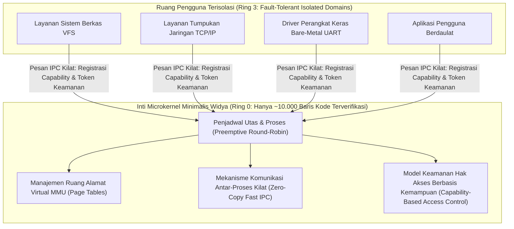

## Bab 40: Proyek Capstone Lanjut: Desain Microkernel & Runtime OS Berdaulat

### 40.1 Arsitektur Microkernel Berdaulat

Puncak tertinggi dari rekayasa perangkat lunak sistem adalah perancangan sistem operasi. Model sistem operasi konvensional monolitik (seperti Linux tradisional atau Windows NT) menempatkan seluruh subsistem—driver grafis, tumpukan jaringan, sistem berkas, dan pengelola memori—di dalam satu ruang alamat istimewa kernel (*Ring 0 / Supervisor Mode*). Satu kesalahan cacat memori pada satu driver printer dapat menumbangkan seluruh sistem operasi (*Kernel Panic / Blue Screen of Death*).

Proyek Capstone pamungkas dari buku ini adalah membangun **Prototipe Microkernel & Runtime Sistem Operasi Berdaulat (Widya-Microkernel OS)** yang menerapkan arsitektur ketahanan tingkat militer berbasis **Kernel Minimalis Terisolasi (Microkernel Architecture)** setara seL4 dan QNX.



Aksioma arsitektur Widya-Microkernel:
1. **Prinsip Hak Akses Minimum di Ring 0**: Hanya tiga tugas mutlak yang dijalankan di Ring 0: Penjadwalan proses (*Scheduling*), Pengelolaan memori virtual (*Paging*), dan Komunikasi Antar-Proses (*Fast IPC*).
2. **Isolasi Driver di Ruang Pengguna (Ring 3)**: Seluruh driver perangkat keras dan sistem berkas berjalan sebagai proses pengguna biasa. Jika driver jaringan mengalami crash, microkernel secara instan me-restart driver tersebut dalam hitungan mikrodetik tanpa mengganggu kestabilan sistem inti (*Self-Healing OS*).
3. **Keamanan Berbasis Kapabilitas (*Capability-Based Security*)**: Suatu proses tidak dapat mengakses objek memori atau layanan lain tanpa memegang token kapabilitas (*Capability Token*) yang diverifikasi secara kriptografis oleh microkernel.

### 40.2 Implementasi Kode Program Utuh

Berikut implementasi kode program utuh dari Prototipe Microkernel, Penjadwal Proses Kooperatif, dan Mekanisme Fast IPC pada Widya-Lang:

```widya
// ============================================================================
// PROYEK CAPSTONE LANJUT: PROTOTIPE MICROKERNEL & RUNTIME OS BERDAULAT
// Komponen: Capability-Based IPC + Process Control Block (PCB) + Scheduler
// ============================================================================

modul arsitektur_microkernel {
    pilihan StatusProses {
        Siap,
        Berjalan,
        MenungguPesan,
        Terminasi
    }

    // Struktur Blok Kontrol Proses (Process Control Block / PCB)
    struktur BlokKontrolProses {
        pid: Angka,
        nama_proses: Teks,
        status: StatusProses,
        prioritas: Angka,
        kuota_waktu: Angka,
        kapabilitas_token: Larik<Teks> // Daftar token kapabilitas yang sah
    }

    // Struktur Pesan IPC (Inter-Process Communication) Kilat
    struktur PesanIPC {
        pengirim_pid: Angka,
        penerima_pid: Angka,
        perintah_id: Angka,
        muatan_data: Teks
    }

    // Struktur Inti Microkernel
    struktur MicrokernelWidya {
        tabel_proses: Kamus<Angka, BlokKontrolProses>,
        antrean_ipc: Larik<PesanIPC>,
        pid_aktif: Angka,
        penghitung_siklus: AtomikAngka,

        fungsi inisialisasi() -> MicrokernelWidya {
            cetak("==================================================================");
            cetak("  MEMULAI WIDYA-MICROKERNEL SOVEREIGN OPERATING SYSTEM RUNTIME    ");
            cetak("  Arsitektur: Capability-Based Fast IPC + Fault-Tolerant Domains   ");
            cetak("==================================================================");
            cetak("[KERNEL BOOT] Menginisialisasi tabel deskriptor proses Ring 0...");
            cetak("[KERNEL BOOT] Mengaktifkan proteksi isolasi memori MMU...");

            kembalikan MicrokernelWidya {
                tabel_proses: Kamus::baru(),
                antrean_ipc: [],
                pid_aktif: 0,
                penghitung_siklus: AtomikAngka::baru(0)
            };
        }

        // Mendaftarkan proses baru ke dalam sistem
        fungsi daftarkan_proses(mut diri, nama: Teks, prioritas: Angka, cap: Larik<Teks>) -> Angka {
            misal pid_baru = diri.tabel_proses.panjang() + 1;
            misal pcb = BlokKontrolProses {
                pid: pid_baru,
                nama_proses: nama,
                status: StatusProses::Siap,
                prioritas: prioritas,
                kuota_waktu: 10,
                kapabilitas_token: cap
            };
            diri.tabel_proses.sisip(pid_baru, pcb);
            cetak("[KERNEL DAFTAR] Proses Baru: PID", pid_baru, "->", nama, "| Prioritas:", prioritas);
            kembalikan pid_baru;
        }

        // Komunikasi Antar-Proses (Fast IPC) dengan Validasi Kapabilitas
        fungsi kirim_pesan_ipc(mut diri, pengirim: Angka, penerima: Angka, cmd: Angka, data: Teks) -> Hasil<Boolean, Teks> {
            jika tidak diri.tabel_proses.mengandung(penerima) {
                kembalikan Hasil::Gagal("PID Penerima tidak eksis!");
            }

            misal pcb_pengirim = diri.tabel_proses.ambil(pengirim);
            
            // Validasi kapabilitas: Harus memiliki izin "IPC_KIRIM"
            misal mut punya_izin = salah;
            untuk c in pcb_pengirim.kapabilitas_token {
                jika c == "IPC_KIRIM" atau c == "ROOT_CAP" {
                    punya_izin = benar;
                }
            }

            jika tidak punya_izin {
                kembalikan Hasil::Gagal("Pelanggaran Keamanan: Proses tidak memiliki kapabilitas IPC_KIRIM!");
            }

            misal msg = PesanIPC {
                pengirim_pid: pengirim,
                penerima_pid: penerima,
                perintah_id: cmd,
                muatan_data: data
            };

            diri.antrean_ipc.tambah(msg);
            cetak("  [FAST IPC] Pesan dialirkan dari PID", pengirim, "ke PID", penerima, "| Payload:", data);
            kembalikan Hasil::Sukses(benar);
        }

        // Penjadwal Proses (Round-Robin Scheduler)
        fungsi jadwalkan_siklus(mut diri) {
            diri.penghitung_siklus.tambah(1);
            cetak("\n[PENJADWAL ROUND-ROBIN] Mengeksekusi Siklus Clock Sistem #", diri.penghitung_siklus.muat());

            untuk pid dalam 1..(diri.tabel_proses.panjang() + 1) {
                misal mut pcb = diri.tabel_proses.ambil(pid);
                cetak("  -> Memberikan jatah waktu eksekusi CPU ke PID", pid, "(", pcb.nama_proses, ")");
                pcb.status = StatusProses::Berjalan;
                diri.tabel_proses.sisip(pid, pcb);
            }
        }
    }
}

modul utama {
    fungsi utama() {
        misal mut kernel = arsitektur_microkernel::MicrokernelWidya::inisialisasi();

        // 1. Mendaftarkan domain layanan sistem di ruang pengguna (Ring 3)
        misal pid_driver = kernel.daftarkan_proses("Driver_UART_Hardware", 1, ["IPC_KIRIM", "MMIO_ACCESS"]);
        misal pid_vfs = kernel.daftarkan_proses("Layanan_Berkas_VFS", 2, ["IPC_KIRIM", "DISK_ACCESS"]);
        misal pid_aplikasi = kernel.daftarkan_proses("Aplikasi_Sandi_Negara", 3, ["IPC_KIRIM"]);

        // 2. Mengalirkan komunikasi antar-layanan via Fast IPC
        cetak("\n--- KOMUNIKASI FAST IPC ANTAR-DOMAIN TERISOLASI ---");
        misal status_ipc = kernel.kirim_pesan_ipc(
            pid_aplikasi,
            pid_vfs,
            0x01,
            "SIMPAN_DOKUMEN_RAHASIA_KEDAULATAN"
        );
        cocokkan status_ipc {
            Hasil::Sukses(_) => cetak("[IPC SUKSES] Pesan berhasil diverifikasi dan disalurkan."),
            Hasil::Gagal(e) => cetak("[IPC GAGAL]", e)
        }

        // 3. Menjalankan siklus penjadwalan proses
        kernel.jadwalkan_siklus();

        cetak("\n==================================================================");
        cetak("  SELAMAT! ANDA TELAH MENUNTASKAN SELURUH KURIKULUM LEVEL LANJUT  ");
        cetak("  KEDAULATAN TEKNOLOGI INFORMASI NUSANTARA SIAP DITEGAKKAN.       ");
        cetak("==================================================================");
    }
}
```

### 40.3 Rangkuman Desain & Analisis Rekayasa Sistem

Visi arsitektur microkernel berdaulat:

| Dimensi Arsitektur | Kernel Monolitik (Linux Tradisional) | Microkernel Berdaulat (Widya-OS) |
| :--- | :--- | :--- |
| **Ukuran Basis Kode Ring 0** | Jutaan baris kode (Rentan celah eksploitasi) | Minimalis: ~10.000 baris kode terverifikasi formal |
| **Lokasi Driver Perangkat Keras** | Di dalam kernel (Crash driver = Crash OS) | Terisolasi di Ring 3 (Crash driver = Auto-restart) |
| **Mekanisme Hak Akses** | Model pengguna root yang serba bisa | Keamanan berbasis Kapabilitas (*Capabilities*) |
| **Ketahanan Sistem (Fault-Tolerance)** | Sedang (Perlu reboot jika modul rusak) | Tertinggi di dunia (Self-Healing Architecture) |
| **Kesesuaian Penggunaan** | Server umum, desktop PC konsumen | Satelit pertahanan, alutsista militer, reaktor nuklir |

### 40.4 Latihan Mandiri & Evaluasi Pemahaman Sistem

1. Jelaskan bagaimana prinsip *Capability-Based Access Control* pada microkernel mengeliminasi konsep pengguna super (*root user*) yang sering menjadi sasaran empuk serangan peretas!
2. Mengapa isolasi driver perangkat keras di ruang pengguna (*User Space Ring 3*) menjamin keandalan sistem operasi berdaulat kebal terhadap *Kernel Panic* saat driver mengalami kerusakan biner?
3. Rancang sebuah mekanisme *Watchdog Supervisor Process* pada Widya-OS yang secara otomatis mendeteksi kematian proses driver dan meluncurkan kembali instansiasi barunya tanpa jeda layanan!

### 40.5 Latihan Soal Pilihan Ganda (10 Soal)

1. Model arsitektur sistem operasi di mana hanya komponen paling mendasar (penjadwal, manajemen memori, dan IPC) yang berjalan di Ring 0 dinamakan...
   A. Kernel Monolitik
   B. Microkernel Architecture
   C. Kernel Hibrida Monolitik
   D. DOS Real-Mode

2. Tiga tugas paling fundamental yang tetap wajib dieksekusi di dalam ruang istimewa microkernel (Ring 0) adalah...
   A. Web Server, Basis Data, dan Antivirus
   B. Penjadwalan Proses, Pengelolaan Ruang Alamat Virtual, dan Komunikasi Antar-Proses (IPC)
   C. Format Hard Disk, Download File, dan Cetak Printer
   D. Memformat Dokumen, Rendering Font, dan Audio Player

3. Mekanisme keamanan di mana hak akses ke suatu sumber daya sistem dinyatakan melalui kepemilikan token yang tidak dapat dipalsukan dinamakan...
   A. Access Control List Statis
   B. Keamanan Berbasis Kapabilitas (Capability-Based Security)
   C. Password File Bersama
   D. IP Whitelisting

4. Di manakah driver perangkat keras (seperti driver kartu jaringan, USB, dan GPU) dieksekusi pada arsitektur microkernel murni?
   A. Di dalam kernel Ring 0 bersama kode inti
   B. Di dalam ruang pengguna terisolasi (User Space Ring 3) sebagai proses biasa
   C. Di dalam chip monitor
   D. Di server cloud eksternal

5. Keuntungan utama dari penempatan driver perangkat keras di ruang pengguna (Ring 3) adalah...
   A. Jika driver mengalami crash atau kesalahan memori, kernel tidak akan panic dan driver dapat di-restart secara mandiri (*Self-Healing*)
   B. Komputer tidak membutuhkan pasokan listrik
   C. Kecepatan kipas angin bertambah kencang
   D. Memori RAM otomatis berlipat ganda

6. Struktur data sistem operasi yang bertugas menyimpan status eksekusi, nilai register, dan hak akses dari suatu proses dinamakan...
   A. File Allocation Table
   B. Process Control Block (PCB)
   C. Superblock
   D. Master Boot Record

7. Mekanisme komunikasi yang memungkinkan proses-proses independen saling bertukar data secara aman dan berkecepatan tinggi pada microkernel dinamakan...
   A. Fast Inter-Process Communication (Fast IPC)
   B. Global File Sharing
   C. USB Data Cable
   D. Infrared Transmission

8. Algoritma penjadwalan proses paling populer di mana setiap proses mendapatkan jatah waktu eksekusi (*time slice*) secara bergantian dinamakan...
   A. Round-Robin Scheduling
   B. First Come First Served
   C. Shortest Job First
   D. Priority Inversion

9. Standar microkernel berkecepatan tinggi terverifikasi formal matematis yang menjadi inspirasi perancangan sistem operasi militer dunia adalah...
   A. seL4
   B. Windows 95
   C. MS-DOS
   D. FreeDOS

10. Keberhasilan Anda menuntaskan seluruh 40 Bab Kurikulum Tingkat Lanjut Widya-Lang menandakan bahwa...
    A. Anda telah menguasai rekayasa perangkat lunak sistem berdaulat tingkat dunia—dari aljabar tipe, arsitektur memori tanpa GC, direct syscall, kriptografi pasca-kuantum PQC, hingga perancangan microkernel mandiri
    B. Anda tidak perlu lagi menyalakan komputer
    C. Anda berhak mencetak ijazah sendiri di rumah
    D. Seluruh perangkat keras komputer Anda otomatis diperbarui
